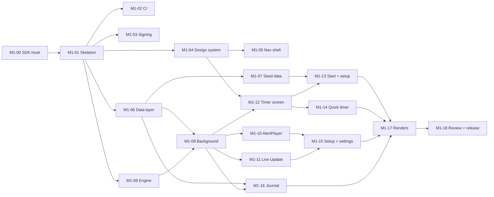

# M1 — Timer first: implementation plan

> Status: **Ready, waiting for the PO's go** · Last updated: 2026-10-21
> Release target: `v0.1.0` · PR into `main` · Tiers per [12 · Subagent Distribution Plan](../specs/12-agent-plan.md)

## 1. Goal

An installable APK on the PO's Galaxy in which the **complete steep timer**
works reliably: multi-step recipes, Pause, pre-alert tick, ringer-mode
alerts, Live Update / Now Bar, exact alarms, recovery and reboot. It also
includes:
- the design system and the navigation shell;
- the PO's two seed teas and two vessels;
- *Nochmal brühen*;
- the quick timer;
- reliability setup;
- a minimal auto-logged journal.

**Done** = CI green + signed APK on GitHub Release `v0.1.0` + the M1 on-device
checklist ([09 §4](../specs/09-release-plan.md#4-acceptance-checklists-on-the-pos-galaxy))
passes + design review of the rendered screenshots passes.

## 2. Scope

| In scope | Requirements |
|---|---|
| Timer engine, background execution, notifications, Live Update, alerts | TMR-01…03, 05…23, 30, 31, 41; NOT-01…03; 04 (all) |
| Brew setup, kettle hint, one-tap brew again | BRW-01…03, BRW-10, BRW-11 |
| Seed teas and vessels | 08 §2.5a; WARE-06 |
| First-start setup (welcome, reliability) | ONB-01, ONB-02, ONB-04 |
| Timer & alert settings, reliability status, test alert | SET-09…11, 14, 17, 24, 25, 31 |
| Minimal journal list (auto-logged sessions, read-only) | JRN-01, JRN-08 (basic) |
| Active brew bar, design system, navigation shell | GEN-01…12, 03 §2–3 |

| Out of scope | Milestone |
|---|---|
| Catalog, refresh, parser | M2 |
| Collection editing, recipe editor UI, teaware CRUD UI, stock UI | M3 |
| Notes, ratings, taste, statistics | M4 |
| Backup/export, remaining settings | M5 |

Recipe changes in M1 happen only through *Im Rezept speichern* on the setup
screen (BRW-02). Seed data covers the PO's teas.

## 3. Tasks

Tier: T1 = Sonnet/low, T2 = Opus/medium, T3 = Opus/high, T4 = Opus/xhigh.

| ID | Task | Tier | Depends on | Acceptance |
|---|---|---|---|---|
| **M1-00** | **Session-start hook for cloud sessions:** install Android cmdline-tools, `platform-tools`, `platforms;android-36`, `build-tools`; accept licences; set `ANDROID_HOME`; idempotent and fast on re-runs. | T2 | — | `./gradlew assembleDebug` works in a fresh session. |
| **M1-01** | **Gradle skeleton:**<ul><li>settings, version catalog, `build-logic` convention plugins;</li><li>modules `app`, `core:{model,common,domain,timer-engine,timer,database,datastore,designsystem,ui,network,testing}`, `feature:{onboarding,home,brew,journal,collection,stats,settings}` (stubs where out of scope);</li><li>`com.umamit.app`, min 35 / target 36, debug/release build types.</li></ul> | T2 | M1-00 | Empty app builds and launches in the emulator; module dependency rules enforced. |
| **M1-02** | **Quality tooling + CI:** Spotless/ktlint, Detekt, Lint config (no baseline), Roborazzi, `ci.yml` (format, detekt, lint, unit tests, screenshot verify, assemble, merged-manifest permission check). | T3 | M1-01 | CI green on a PR; a deliberately bad commit fails. |
| **M1-03** | **Signing + release workflow:** signing per [06 §6.1](../specs/06-architecture.md#61-signing-process-d-035): Claude generates the keystore and backup file, sends them to the PO, writes the fingerprint check; `release.yml` on tag `v*` builds a signed APK and creates a GitHub Release. The PO stores the backup and adds 2 secrets (`UMAMIT_KEYSTORE_B64`, `UMAMIT_KEYSTORE_PASSWORD`). | T3 | M1-01 | A test tag produces a release with a signed APK that installs over the previous one. |
| **M1-04** | **Design system:**<ul><li>colour tokens (Washi, Steeping), Cormorant Garamond (OFL, from `raw.githubusercontent.com/google/fonts`, subset);</li><li>type scale, shapes;</li><li>components `PrimaryActionCard`, `PillButton`, `TimerRing` (with pre-alert tick), `KettleHint`, `SectionHeader`, `TeaListItem`, `StatTriplet`, `ReliabilityBanner`, `ActiveBrewBar`, `EmptyState`;</li><li>placeholder illustrations.</li></ul> | T2 | M1-01 | Previews and screenshot tests for each component in light/dark at 1.0 and 2.0 font scale. |
| **M1-05** | **Navigation shell:** 4 tabs (Start, Journal, Sammlung, Statistik) with placeholders, settings route, predictive back, edge-to-edge. | T1 | M1-04 | Tabs keep their back stacks; screenshot tests. |
| **M1-06** | **Data layer v1:**<ul><li>Room entities/DAOs for `tea`, `brew_profile`, `brew_step`, `vessel`, `brew_session`, `session_step`, `inventory_event`, `photo`, `active_brew` (05 §3);</li><li>schema export;</li><li>DataStore settings subset;</li><li>repositories and fakes.</li></ul> | T2 (`active_brew` part: T3) | M1-01 | DAO tests (Robolectric); schema JSON committed. |
| **M1-07** | **Seed data:**<ul><li>2 teas, recipes and 2 vessels from 08 §2.5a;</li><li>stock events of 100 g with prices;</li><li>first-start photo download via the minimal `core:network` client (host allow-list), placeholder fallback.</li></ul> | T2 | M1-06 | Fresh install shows both teas with correct recipes, vessels and stock. No shop texts in the repo. |
| **M1-08** | **`BrewTimerEngine`** (pure Kotlin):<ul><li>all states and events of 04 §3, pre-alert rules (§5), quick timer (§10), `idleDemote`, `midnightTimeout`, recorded step data (§5.1);</li><li>exhaustive unit tests with virtual clocks.</li></ul> | T3, design review at T4 | M1-01 | All transitions in 04 §3.2 covered; ≥ 90 % line coverage. |
| **M1-09** | **Background integration:**<ul><li>`BrewSessionController`;</li><li>`BrewTimerService` (`specialUse` FGS), exact alarms (`USE_EXACT_ALARM`) for pre-alert and deadline, wake lock;</li><li>receivers, boot recovery, persistence and recovery per 04 §6–7.</li></ul> | **T4** | M1-06, M1-08 | Robolectric tests for alarm scheduling and recovery; process-death test on the emulator (`am kill`). |
| **M1-10** | **`AlertPlayer` + sounds:**<ul><li>ringer-mode matrix (04 §9), pre-alert tick, alert length, audio focus;</li><li>5 alert tones + tick from **CC0 recordings** (D-034), cut, loudness-normalised, converted to OGG; source URL and licence recorded in `docs/design/assets/source/CREDITS.md` and shown in About. First check which CC0 libraries are reachable from the cloud environment.</li></ul> | T3 | M1-09 | Ringer normal/vibrate/silent behave per table; *Alarm testen* plays all tones. |
| **M1-11** | **Notifications & Live Update:**<ul><li>channels (04 §8.1), content and actions per phase (§8.2);</li><li>promoted ongoing notification with `ProgressStyle` segments and pre-alert point (§8.3), with a fallback;</li><li>verify the API names against SDK 36.</li></ul> | T3 | M1-09 | Notification tests; Live Update visible on the emulator with API 36. |
| **M1-12** | **Timer screen (SCR-05):** all states, ⋮ items per state, *Brühen anpassen*, kettle hint, step dots, keep screen on, dimming (TMR-17), TalkBack announcements, active brew bar. | T2 | M1-04, M1-09 | Compose UI tests per state; screenshots match the mockup layout. |
| **M1-13** | **Start + setup:**<ul><li>Home (SCR-02) with *Aufguss starten*, *Nochmal brühen* (BRW-11, direct to READY), *Zuletzt gebrüht*;</li><li>tea picker (SCR-03);</li><li>setup (SCR-04) with recipe chips, vessel picker and scaling, *Im Rezept speichern*.</li></ul> | T2 | M1-07, M1-12 | 2-tap brew-again works; scaling to 250/400 ml matches 08 §2.5a. |
| **M1-14** | **Quick timer (SCR-07).** | T2 | M1-12 | Chips and custom duration; alert and Live Update work; not logged. |
| **M1-15** | **Setup + settings:** Einrichtung (SCR-01 welcome + reliability checklist: notifications, battery exemption / Samsung hints, Live notifications); reliability banner (TMR-31); timer & alert settings incl. *Vorwarnung*, dimming, *Alarm testen*, reliability status card. | T2 | M1-10, M1-11 | All checks show the correct status; deep links open the right system pages. |
| **M1-16** | **Minimal journal:** list of auto-logged sessions with the mockup row format (time of day, „55 °C · 1:00 · 3 Aufgüsse"), the „Gespeichert" sheet without the notes editor, stock deduction. | T2 | M1-06, M1-09 | A finished session appears immediately; stock is reduced. |
| **M1-17** | **Design review renders:** Roborazzi screenshots of all M1 screens and states (light/dark), committed under `docs/design/review/M1/`. | T1 | M1-12…16 | Images present, with placeholders only. |
| **M1-18** | **Milestone review + release:** review the full diff against the specs (T4), fix the findings, update the specs if needed, update `PROJECT_STATE.md`, tag `v0.1.0`, open the PR with the template and checklist. | **T4** | all | PR open; release APK available. |

## 4. Order and parallelism

The waves can run in parallel in separate worktrees:
1. M1-00 → M1-01
2. M1-02, M1-03, M1-04, M1-06, M1-08
3. M1-05, M1-07, M1-09
4. M1-10, M1-11, M1-12, M1-16
5. M1-13, M1-14, M1-15
6. M1-17 → M1-18

## 5. PO actions during M1

| When | Action |
|---|---|
| After M1-03 | Save the two signing files Claude sends (`umamit-release.p12`, `umamit-signing.txt`) safely; add the 2 secrets `UMAMIT_KEYSTORE_B64` and `UMAMIT_KEYSTORE_PASSWORD` in GitHub (Settings › Secrets and variables › Actions). ~2 minutes. |
| Any time | Upload images A1–A5 to `docs/design/assets/source/` (optional for M1; placeholders otherwise). |
| At the M1 PR | Install the APK, run the on-device checklist, listen to the sounds (Q-15), review the screenshots, comment in the PR, merge. |

## 6. Risks specific to M1

| Risk | Mitigation |
|---|---|
| Live Update API differs from the spec | M1-11 verifies against SDK 36 first; fallback to a normal ongoing notification. |
| Samsung kills the service despite the exemptions | Exact alarms start the FGS (04 §6.2); the PO verifies on the device; the diagnostic log helps. |
| Emulator cannot reproduce One UI behaviour | Device checklist by the PO is part of done. |
| Sound licensing | Use CC0 sources or synthesise the tones in code and render them to OGG. |
