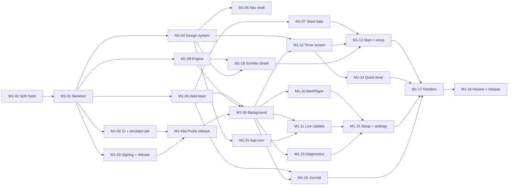

# M1 — Timer first: implementation plan

> Status: **Ready, waiting for the PO's go** · Last updated: 2026-10-21
> Release target: `v0.1.0` (probe `v0.0.1-probe`, candidates `v0.1.0-rc.N`) · PR into `main` · Tiers per [12 · Subagent Distribution Plan](../specs/12-agent-plan.md)

## 1. Goal

An installable APK on the PO's Galaxy in which the **complete steep timer**
works reliably: multi-step recipes, Pause, pre-alert tick, ringer-mode
alerts with a full-screen alert over the lock screen, Live Update (Now Bar
best effort), exact alarms, recovery and reboot. It also includes:
- the design system and the navigation shell;
- the PO's two seed teas and two vessels;
- *Nochmal brühen*;
- the quick timer;
- the session-only Schritte-Sheet (SCR-31);
- reliability setup;
- a minimal auto-logged journal;
- the diagnostics log.

Before the full timer is built, a **probe release** `v0.0.1-probe` checks the
risky platform behaviour on the PO's Galaxy (M1-03a).

**Done** = CI green + signed release candidate `v0.1.0-rc.N` tested by the PO
(final `v0.1.0` built from `main` after the merge) + the M1 on-device
checklist ([09 §4](../specs/09-release-plan.md#4-acceptance-checklists-on-the-pos-galaxy))
passes + design review of the rendered screenshots passes.

## 2. Scope

This section is the **single source of M1 scope**; [09 §2](../specs/09-release-plan.md#2-milestones)
refers here.

| In scope | Requirements |
|---|---|
| Timer engine, background execution, recovery, notifications, Live Update, full-screen alert, alerts | TMR-01…03, 05…23, 30, 31, 41; NOT-01…03; 04 (all, except the `Could` direct-boot path in §7.3) |
| Session step editing | SCR-31 Schritte-Sheet (TMR-10, TMR-11) |
| Brew setup, kettle hint, one-tap brew again | BRW-01…03, BRW-10, BRW-11 |
| Seed teas (incl. one-time photo download) and vessels | 08 §2.5a; ONB-06; WARE-06 |
| First-start setup (welcome, reliability, seed photos) | ONB-01, ONB-02, ONB-04, ONB-06 |
| Timer & alert settings, reliability status, test alert | SET-09…11, 14, 17, 24, 25, 31 |
| Minimal journal (auto-logged sessions, read-only) | JRN-01, JRN-08 (basic); TMR-12 incl. the „Gespeichert" sheet without the notes editor |
| Cross-cutting | GEN-01…04, 06, 07, 09, 12 |
| Active brew bar, design system, navigation shell | 03 §2–3 |
| Diagnostics log | 06 §5.6 (timer part); SCR-27 *Diagnose* |
| App icon | Adaptive + monochrome launcher icon, monochrome status-bar icon |
| Releases | `v0.0.1-probe`, `v0.1.0-rc.N`, `v0.1.0` ([06 §6](../specs/06-architecture.md#6-build--distribution)) |

| Out of scope | Milestone |
|---|---|
| Catalog, refresh, parser, guides | M2 |
| Collection editing, recipe editor UI, teaware CRUD UI, stock UI | M3 |
| Notes, ratings, taste, statistics; notes editor in the „Gespeichert" sheet | M4 |
| Manual export, remaining settings | M5 |
| In-app restore (BAK-02), direct-boot alert path | post-1.0 |

Recipe changes in M1 happen only through *Im Rezept speichern* on the setup
screen (BRW-02) or in the Schritte-Sheet (SCR-31). Seed data covers the PO's
teas.

## 3. Tasks

Tier: T1 = Sonnet/low, T2 = Opus/medium, T3 = Opus/high, T4 = Opus/xhigh.

| ID | Task | Tier | Depends on | Acceptance |
|---|---|---|---|---|
| **M1-00** | **Session-start hook for cloud sessions:** install Android cmdline-tools, `platform-tools`, `platforms;android-36`, `build-tools`; accept licences; set `ANDROID_HOME`; idempotent and fast on re-runs. | T2 | — | `./gradlew assembleDebug` works in a fresh session. |
| **M1-01** | **Gradle skeleton:**<ul><li>settings, version catalog with **all** libraries of 06 §4, `build-logic` convention plugins;</li><li>**all** module stubs of 06 §3 before any parallel work: `app`, `core:{model,common,domain,timer-engine,timer,catalog-parser,network,database,datastore,content,data,backup,designsystem,ui,testing}`, `feature:{onboarding,home,brew,collection,catalog,journal,stats,teaware,settings}` (empty stubs where out of scope);</li><li>`com.umamit.app`, min 35 / target 36, debug/release build types; version in `gradle.properties`.</li></ul> | T2 | M1-00 | Empty app builds; module dependency rules enforced; app launch verified by the smoke test in the CI emulator job (M1-02). |
| **M1-02** | **Quality tooling + CI:** Spotless/ktlint, Detekt, Lint config (no baseline), Roborazzi, `ci.yml` (format, detekt, lint, unit tests, screenshot verify, `assembleDebug`, `assembleRelease` with a throwaway CI signing config, merged-manifest permission check) and the **CI emulator job** (`reactivecircus/android-emulator-runner`, API 35 and 36) for instrumented tests. The cloud container has no KVM, so emulator tests only run in CI. | T3 | M1-01 | CI green on a PR; a deliberately bad commit fails; the emulator job runs a smoke test on both API levels. |
| **M1-03** | **Signing + release workflow:** signing per [06 §6.1](../specs/06-architecture.md#61-signing-process-d-035): Claude generates the keystore and backup file and **delivers both to the PO as session file attachments** (never committed, never a workflow artifact); fingerprint check. `release.yml` with `workflow_dispatch` (inputs `ref`, `version`; `contents: write`) builds a signed APK and **creates the tag and the GitHub Release** (pre-release for `-rc.N` / `-probe`). Claude triggers it via the GitHub Actions API/tool. versionCode per 06 §6. The PO stores the backup and adds 2 secrets (`UMAMIT_KEYSTORE_B64`, `UMAMIT_KEYSTORE_PASSWORD`). | T3 | M1-01 | A dispatched run creates tag + release with a signed APK whose fingerprint matches. |
| **M1-03a** | **Probe release `v0.0.1-probe`:** a minimal throwaway screen in the app that, on one tap, runs a 1-min test step with: exact alarm (`USE_EXACT_ALARM`), `specialUse` FGS, promoted Live Update with chronometer chip and `ProgressStyle`, full-screen alert over the lock screen (`USE_FULL_SCREEN_INTENT`), one synthesised draft tone (ffmpeg; refined in M1-10) per ringer mode; plus a status list of the permission checks with deep links. Released via `release.yml`. | T3 | M1-02, M1-03 | The PO runs the probe checklist (09 §4) on the Galaxy; findings recorded in `PROJECT_STATE.md` and fed into 04 §8 before M1-09/M1-11 are finished. |
| **M1-04** | **Design system:**<ul><li>full M3 light and dark colour schemes generated from seed `#4A5643` (material-color-utilities / Theme Builder) with the 03 §3.1 values as overrides; extended tokens (warm accent `#D9A35F`, liquor and type colours) via a `CompositionLocal`;</li><li>Cormorant Garamond (OFL, from `raw.githubusercontent.com/google/fonts`), Light/Regular/Medium, subset keeping `lnum` + `tnum`;</li><li>type scale, shapes;</li><li>components `PrimaryActionCard`, `PillButton`, `TimerRing` (with pre-alert tick), `KettleHint`, `SectionHeader`, `TeaListItem`, `StatTriplet`, `ReliabilityBanner`, `ActiveBrewBar`, `EmptyState`;</li><li>placeholder illustrations.</li></ul> | T2 | M1-01 | Previews and screenshot tests for each component in light/dark at 1.0 and 2.0 font scale; timer-digit jitter screenshot test (03 §3.2). |
| **M1-05** | **Navigation shell:** 4 tabs (Start, Journal, Sammlung, Statistik) with placeholders, settings route, predictive back, edge-to-edge. | T1 | M1-04 | Tabs keep their back stacks; screenshot tests. |
| **M1-06** | **Data layer v1:**<ul><li>Room entities/DAOs for `tea`, `brew_profile`, `brew_step`, `vessel`, `brew_session` (incl. `planned_step_count`), `session_step` (lifecycle 05 §3.7), `inventory_event`, `photo`, `active_brew` (05 §3);</li><li>schema export;</li><li>DataStore settings subset;</li><li>`data_extraction_rules.xml` per 05 §8 (Android backup is active from the first install);</li><li>repositories and fakes.</li></ul> | T2 (`active_brew` and backup rules: T3) | M1-01 | DAO tests (Robolectric); schema JSON committed. |
| **M1-07** | **Seed data:**<ul><li>2 teas, recipes and 2 vessels from 08 §2.5a;</li><li>stock events of 100 g with prices;</li><li>one-time seed photo download during the first-start setup (ONB-06) via the minimal `core:network` client with the host allow-list (single connection); progress, skippable, placeholder fallback.</li></ul> | T2 | M1-06 | Fresh install shows both teas with correct recipes, vessels and stock; photos after setup when online, placeholder offline. No shop texts or photos in the repo. |
| **M1-08** | **`BrewTimerEngine`** (pure Kotlin):<ul><li>all states and events of 04 §3 incl. `editSteps` with pre-alert override, pre-alert rules (§5), quick timer (§10), `idleDemote`, `midnightTimeout` (first local midnight ≥ 6 h after the last interaction), recorded step data (§5.1);</li><li>exhaustive unit tests with virtual clocks.</li></ul> | T3, design review at T4 | M1-01 | All transitions in 04 §3.2 covered; ≥ 90 % line coverage. |
| **M1-09** | **Background integration:**<ul><li>`BrewSessionController`;</li><li>`BrewTimerService` (`specialUse` FGS), exact alarms (`USE_EXACT_ALARM`) for pre-alert and deadline, wake lock;</li><li>receivers (`BOOT_COMPLETED`, `MY_PACKAGE_REPLACED`), recovery per 04 §6–7 with immediate FGS restart attempts (catching `ForegroundServiceStartNotAllowedException`), midnight check on recovery;</li><li>clear `active_brew` after a device restore (05 §8).</li></ul> | **T4** | M1-06, M1-08, M1-03a | Robolectric tests for alarm scheduling and recovery; process-death test (`am kill`) in the CI emulator job. |
| **M1-10** | **`AlertPlayer` + sounds:**<ul><li>ringer-mode matrix (04 §9), pre-alert tick, alert length, audio focus;</li><li>5 alert tones + tick **synthesised with ffmpeg** (D-036, 04 §9.2): committed generator script, loudness-normalised OGG; `CREDITS.md` entry „synthesised, own work"; the PO may later replace tones with CC0 recordings.</li></ul> | T3 | M1-09 | Ringer normal/vibrate/silent behave per table; *Alarm testen* plays all tones. |
| **M1-11** | **Notifications, Live Update and full-screen alert:**<ul><li>channels (04 §8.1), content and actions per phase (§8.2);</li><li>full-screen intent on `steep_finished`, SCR-05 over the lock screen (§8.2);</li><li>promoted ongoing notification per §8.3: chronometer-driven chip in RUNNING, `ProgressStyle` segments (minimum length, ≤ 30) updated on transitions and every 15 s, pre-alert point, delete intent respected, fallback;</li><li>API names as verified by the probe (M1-03a).</li></ul> | T3 | M1-09, M1-21 | Notification tests; in the CI emulator job (API 36) the Live Update is promoted (`dumpsys notification` shows `FLAG_PROMOTED_ONGOING`) and the full-screen intent launches SCR-05. |
| **M1-12** | **Timer screen (SCR-05):** all states, ⋮ items per state, *Brühen anpassen*, kettle hint, step dots, keep screen on, show over lock screen while alerting, dimming (TMR-17), TalkBack announcements, active brew bar. | T2 | M1-04, M1-09 | Compose UI tests per state; screenshots match the mockup layout. |
| **M1-13** | **Start + setup:**<ul><li>Home (SCR-02) with *Aufguss starten*, *Schnelltimer*, *Nochmal brühen* (BRW-11, direct to READY), *Zuletzt gebrüht* (`TeaListItem` rows), *Favoriten*;</li><li>tea picker (SCR-03);</li><li>setup (SCR-04) with recipe chips, vessel picker and scaling, *Bearb.* → Schritte-Sheet, *Im Rezept speichern*.</li></ul> | T2 | M1-07, M1-12, M1-19 | 2-tap brew-again works; scaling to 250/400 ml matches 08 §2.5a. |
| **M1-14** | **Quick timer (SCR-07).** | T2 | M1-12 | Chips and custom duration; alert and Live Update work; not logged. |
| **M1-15** | **Setup + settings:** Einrichtung (SCR-01 welcome + reliability checklist: notifications, battery exemption / Samsung hints incl. automatic restart, Live notifications, full-screen alert; seed photo progress from M1-07); reliability banner (TMR-31); timer & alert settings incl. *Vorwarnung*, dimming, *Alarm testen*, reliability status card (SET-24); *Über › Diagnose* (from M1-20). | T2 | M1-10, M1-11, M1-20 | All checks show the correct status; deep links open the right system pages. |
| **M1-16** | **Minimal journal:** list of auto-logged sessions with the mockup row format (time of day, „55 °C · 1:00 · 3 Aufgüsse", „2 von 3 Aufgüssen" from `planned_step_count`), the „Gespeichert" sheet without the notes editor, stock deduction. | T2 | M1-06, M1-09 | A finished session appears immediately; stock is reduced. |
| **M1-17** | **Design review renders:** Roborazzi screenshots of all M1 screens and states (light/dark), incl. the Schritte-Sheet, committed under `docs/design/review/M1/`. | T1 | M1-12…16, M1-19 | Images present, with placeholders only. |
| **M1-18** | **Milestone review + release:** review the full diff against the specs (T4), fix the findings, update the specs if needed, update `PROJECT_STATE.md`, open the PR with the template and checklist, dispatch `release.yml` for `v0.1.0-rc.N` from the PR branch (repeat after fixes); after the PO's approval, Claude merges and dispatches the final `v0.1.0` from `main`. | **T4** | all | PR open; rc pre-release available; final release after merge. |
| **M1-19** | **Schritte-Sheet (SCR-31):** session-only editing of duration and temperature per step, add/remove steps, pre-alert selector (Wie Einstellung / Aus / 5–30 s), *Im Rezept speichern*; used by SCR-04 *Bearb.*, *Weiterer Aufguss* (TMR-10) and ⋮ *Schritte bearbeiten* (TMR-11); sends `editSteps`. | T2 | M1-08, M1-04 | Compose UI tests; edited steps are used by the timer; done/running steps are read-only. |
| **M1-20** | **Diagnostics log (06 §5.6):** rolling log of timer events with scheduled vs actual fire times (pre-alert, deadline), FGS start/stop and refusals, ringer mode, boot / package-replaced, permission states; screen *Einstellungen › Über › Diagnose* with *Kopieren*. | T3 | M1-09 | Unit tests for the log; entries appear for a test session. |
| **M1-21** | **App icon:** adaptive launcher icon with monochrome layer (themed icons) and a monochrome status-bar small icon (needed by the Live Update chip), from A1 or a placeholder leaf vector. | T1 | M1-04 | Icons render in screenshot tests; lint clean. |

## 4. Order and parallelism

The waves can run in parallel in separate worktrees (M1-01 creates every
module first, so parallel tasks never edit the module graph):
1. M1-00 → M1-01
2. M1-02, M1-03, M1-04, M1-06, M1-08
3. M1-03a (probe; the PO tests it), M1-05, M1-07, M1-19, M1-21
4. M1-09 (after the probe results)
5. M1-10, M1-11, M1-12, M1-16, M1-20
6. M1-13, M1-14, M1-15
7. M1-17 → M1-18

## 5. PO actions during M1

| When | Action |
|---|---|
| After M1-03 | Save the two signing files Claude delivers in the session (`umamit-release.p12`, `umamit-signing.txt`) safely; add the 2 secrets `UMAMIT_KEYSTORE_B64` and `UMAMIT_KEYSTORE_PASSWORD` in GitHub (Settings › Secrets and variables › Actions). ~2 minutes. Fallback without attachments: run the two commands in [06 §6.1](../specs/06-architecture.md#61-signing-process-d-035). |
| After M1-03a | Install `v0.0.1-probe`, run the probe checklist (09 §4), report the results (incl. whether the Now Bar shows it). |
| Any time | Upload images A1–A5 to `docs/design/assets/source/` (optional for M1; placeholders otherwise). Optionally upload CC0 recordings to replace synthesised tones. |
| At the M1 PR | Install the latest `v0.1.0-rc.N`, run the on-device checklist, listen to the sounds (Q-15), review the screenshots, comment in the PR, and give your approval (Claude merges). |

## 6. Risks specific to M1

| Risk | Mitigation |
|---|---|
| Live Update / full-screen API differs from the spec or One UI behaves differently | Probe release first (M1-03a); M1-11 verifies against SDK 36; fallback to a normal ongoing notification / heads-up; Now Bar best effort. |
| Samsung kills the service despite the exemptions | Exact alarms start the FGS (04 §6.2); recovery restarts it (04 §6.3); the PO verifies on the device; the diagnostics log (M1-20) shows what happened. |
| Neither the cloud container (no KVM) nor the CI emulator reproduces One UI | CI emulator job for Android behaviour; probe release and device checklist by the PO are part of done. |
| Synthesised tones sound artificial | The PO listens in the probe and at *Alarm testen*; any tone can be replaced by a CC0 recording. |
