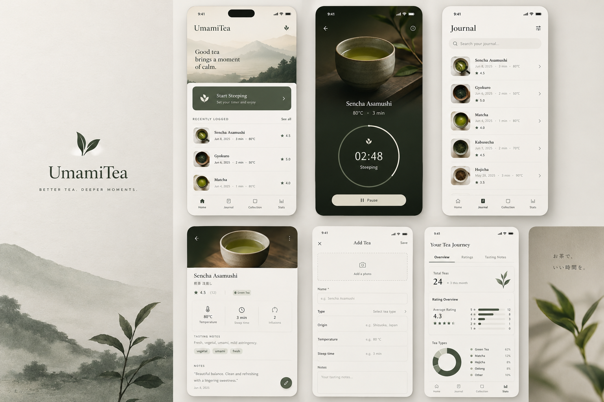
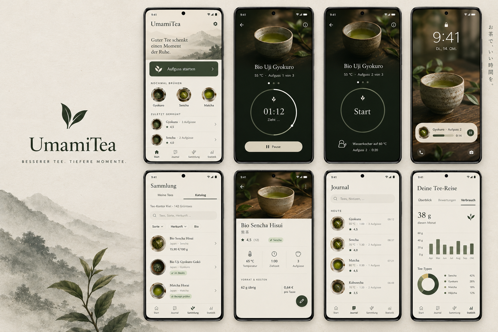

# 03 · UX & UI Specification

> Status: **Draft v0.2** · Last updated: 2026-10-21

Information architecture, navigation, visual design system and screens.
Functional rules: [02](02-functional-requirements.md). The UI language is
**German**; copy examples below are the intended German strings.

## 1. Design reference — brand mockup

The PO's brand mockup defines the **look and feel**. Its screens are
*illustrative*, not a feature list. It is stored at
[`docs/design/brand-mockup.png`](../design/brand-mockup.png).



| Element | In the mockup | Adopted as |
|---|---|---|
| Mood | Calm, quiet, premium, Japanese tea house; generous whitespace | Principle "Calm over clever" |
| Background | Warm off-white "washi paper" | `background`/`surface` tokens (§3.1) |
| Primary colour | Deep matcha/olive green (*Start Steeping* card, FAB) | `primary` |
| Dark surface | Deep forest green-black (timer) | Timer always uses the dark "Steeping" scheme |
| Display type | Elegant serif for titles and tea names | Serif display font (§3.2) |
| Labels | Small, letter-spaced uppercase labels („ZULETZT GEBRÜHT") | `labelOverline` |
| Imagery | Ink-wash mountains, tea leaves, moody tea photography | Illustrations + Tee-Kontor product photos |
| Logo | Two-leaf tea sprig | App icon & splash |
| Japanese | Secondary names (煎茶 浅蒸し), tagline お茶で、いい時間を。 | GEN-11, welcome |
| Timer | Thin ring, light centred digits, caption, cream pill *Pause* | SCR-05 |
| Lists | Round photo thumbnails, serif title, meta line, „★ 4,5" | Journal & Home |
| Tea detail | Hero photo, serif name, subtitle, rating with count, type chip, Temperature · Steep time · Infusions row | SCR-09 / SCR-21 |
| Stats | "Your Tea Journey" with tabs, big numerals, rating bars, tea-type donut | SCR-18 |
| Bottom nav | **Home · Journal · Collection · Stats** with thin line icons | §2.2 (German labels) |

### 1.1 Mockups v2 (aligned with spec v0.2)

Generated from [`docs/design/mockup-prompt.md`](../design/mockup-prompt.md) and
added by the PO on 2026-10-21. They are the **current visual reference** (they still show the former name
„UmamiTea"; the wordmark is now „UmamiT", D-033);
`brand-mockup.png` remains the original mood reference.

| File | Content |
|---|---|
| [`mockup-v2-board.png`](../design/mockup-v2-board.png) | Board with 8 screens: Start, timer running, timer READY, lock screen with Now Bar, Sammlung › Katalog, tea detail, Journal, Statistik › Verbrauch |
| [`mockup-v2-start.png`](../design/mockup-v2-start.png) | Start screen in detail |



**Review notes:** where the mockups and the spec differ, these rules apply.

| Screen | Observation | Resolution |
|---|---|---|
| All | German labels, nav Start · Journal · Sammlung · Statistik, Samsung frame, palette and typography match the spec | Adopted as reference |
| Start (board) | Section label misspelt „ZULETZT GERÜHRT" | Spec wins: „ZULETZT GEBRÜHT" (the single Start mockup is correct) |
| Start (both) | Greeting text „Guter Tee schenkt …" under the header | Spec wins: no greeting text, header illustration only (D-035) |
| Start (both) | No *Schnelltimer* entry and no FAVORITEN section | Spec wins: both are present (SCR-02) |
| Start (both) | ZULETZT GEBRÜHT rows in a free-form layout | Spec wins: rows use the `TeaListItem` format (§3.8) |
| Start (single) | The *Matcha* thumbnail shows a brown liquor (looks like hōjicha) | Image glitch; real thumbnails are tea photos |
| Timer running | Top-right shows an ⓘ icon | Spec wins: ⋮ overflow menu (SCR-05) |
| Timer running | Ring with a small marker near the end | Adopted: marker = pre-alert point on the ring |
| Timer READY | Step dots highlight step 1 while the label says „Aufguss 2 von 3" | Spec wins: dots show completed steps and the current step |
| Timer READY | Big „Start" inside the empty ring; kettle icon with „Wasserkocher auf 60 °C" and „Aufguss 2 · 0:20" below | Adopted as designed |
| Lock screen | Now Bar pill: thumbnail, „Gyokuro · Aufguss 2", progress bar, „0:14", pause button | Adopted as the Live Update target look |
| Katalog | Segmented „Meine Tees / Katalog", source line, search, chips Sorte / Herkunft / Bio, rows with origin · type, price per 100 g, chips „im Besitz" / „Rezept prüfen" | Adopted (count in the header is the real number, ≈ 270) |
| Tea detail | No *Brühen* button visible, only the pencil FAB | Spec wins: sticky primary *Brühen* button plus the pencil FAB |
| Tea detail | Stat row Temperatur · Ziehzeit · Aufgüsse; VORRAT & KOSTEN „62 g übrig · 0,64 € pro Tasse" | Adopted |
| Journal | Within a day group, rows show the time of day on the right („09:12") and a meta line „55 °C · 1:00 · 3 Aufgüsse" plus rating | **Adopted** — replaces the earlier meta line format (JRN-08 updated) |
| Statistik | Verbrauch tab with „38 g diesen Monat", monthly bar chart, Tee-Typen donut | Adopted; the donut may appear on Überblick and Verbrauch |

## 2. Information architecture & navigation

### 2.1 Site map

```
App
├── Einrichtung (SCR-01) — first start only
├── Start / Home (SCR-02)
│   ├── Aufguss starten → Teeauswahl (SCR-03) → Brühen (SCR-04) → Timer (SCR-05) → Gespeichert-Sheet (SCR-06)
│   │   └── Schritte-Sheet (SCR-31) from SCR-04 *Bearb.* and the timer
│   ├── Nochmal brühen (recent teas) → Timer READY (SCR-05, BRW-11)
│   ├── Schnelltimer (SCR-07)
│   └── Einstellungen (SCR-25) — top-bar action
├── Journal (SCR-15)
│   └── Sitzung (SCR-16) → Sitzung bearbeiten / Notizen (SCR-17) → Beschreibungen (SCR-30)
├── Sammlung (Collection) — segmented: [ Meine Tees | Katalog ]
│   ├── Meine Tees (SCR-08)
│   │   ├── Tee (SCR-09) → Bearbeiten (SCR-10), Rezept (SCR-12), Vorrat (SCR-29), Fotos (SCR-28)
│   │   └── Tee ohne Katalog anlegen → Sorte wählen (SCR-11) → SCR-10
│   └── Katalog (SCR-19)
│       ├── Katalog-Tee (SCR-21) → In Sammlung aufnehmen (SCR-23)
│       ├── Ratgeber (Tee-Info guides) → Artikel (SCR-20)
│       └── Katalog aktualisieren (SCR-22)
├── Statistik (SCR-18)
└── Einstellungen (SCR-25)
    ├── Teegeschirr (SCR-13) → SCR-14
    ├── Daten & Sicherung (SCR-26)
    └── Über (SCR-27)
```

### 2.2 Primary navigation

Bottom navigation bar (navigation rail on wide screens):

| # | Label | Icon (line) | Destination |
|---|---|---|---|
| 1 | **Start** | house | SCR-02 |
| 2 | **Journal** | notebook | SCR-15 |
| 3 | **Sammlung** | tea canister | SCR-08 / SCR-19 |
| 4 | **Statistik** | bar chart | SCR-18 |

- **Sammlung** opens on the last used segment (*Meine Tees* by default).
- Re-selecting a tab scrolls to top; a second re-select pops to its root (D-048);
  each tab keeps its back stack.
- Settings via the gear on Start and the ⋮ menu of the other tabs.
- The active brew bar (GEN-06) sits above the navigation bar; the timer is
  full-screen without either.

### 2.3 Back behaviour

Predictive back; back from the timer keeps the session running; editors with
unsaved changes trigger GEN-08.

### 2.4 Internal deep links

| Source | Target |
|---|---|
| Timer notification / Live Update / alert | SCR-05 |
| „Sitzung gespeichert" notification | SCR-16 |
| Catalog refresh result notification | SCR-19 |
| Reminder notification | SCR-08 (filtered) or SCR-26 |
| Reliability banner *Beheben* | System settings page (notifications, battery, Live Updates `ACTION_APP_NOTIFICATION_PROMOTION_SETTINGS`, full-screen alerts `ACTION_MANAGE_APP_USE_FULL_SCREEN_INTENT`) |

### 2.5 Layout

Phone-first (Galaxy, portrait and landscape). On wider windows (landscape,
split screen, DeX) the app uses a navigation rail and list-detail panes for
Sammlung and Journal; no orientation lock.

## 3. Visual design system

### 3.1 Colour tokens

First-pass values approximated from the mockup, to be finalized with the PO.

**How the theme is built (D-036):**
- Full Material 3 **light and dark colour schemes** (every M3 role) are
  generated from the seed colour `#4A5643` with material-color-utilities /
  Material Theme Builder. The values in the tables below are applied as
  **overrides** on top; roles not listed come from the generated scheme.
- The timer always uses the dark ("Steeping") scheme.
- **Extended tokens** that M3 has no role for are provided through a
  `CompositionLocal` (`UmamiExtendedColors`): warm accent `#D9A35F`
  (prominent overtime), the liquor colours and the type colours below.

**Light ("Washi")**

| Token | Hex | Usage |
|---|---|---|
| `primary` | `#4A5643` | Primary buttons, *Aufguss starten* card, FAB, selected nav |
| `onPrimary` | `#F6F3EC` | |
| `primaryContainer` | `#DDE2D2` | Selected chips |
| `onPrimaryContainer` | `#1F271B` | |
| `secondary` | `#8A7B5E` | Hōjicha-brown accents |
| `secondaryContainer` | `#ECE5D6` | Cream pills, tags |
| `tertiary` | `#6F8A5A` | Umami meter, charts |
| `background` | `#F3F0E9` | Washi background |
| `surface` | `#F7F5F0` | Cards, sheets |
| `surfaceContainerLow` | `#EFEBE3` | Inputs, search bar |
| `surfaceContainerHigh` | `#E7E2D8` | Chips |
| `onSurface` | `#2B2D27` | Primary text (ink) |
| `onSurfaceVariant` | `#6B6A62` | Secondary text (≈ 4.8:1 on background; the mockup's lighter grey fails AA) |
| `outline` | `#D9D4C8` | Hairlines |
| `error` | `#9E3B2F` | Errors (rare) |

**Dark ("Steeping")** — dark theme and the timer screen in both themes.

| Token | Hex | Usage |
|---|---|---|
| `background` | `#1C231D` | Forest green-black |
| `surface` | `#232B24` | Cards |
| `surfaceContainerHigh` | `#2E372F` | Chips, inputs |
| `primary` | `#B9C8A6` | Ring progress |
| `onPrimary` | `#1F271B` | |
| `secondaryContainer` | `#E5DFCF` | Cream *Pause* pill |
| `onSecondaryContainer` | `#2B2D27` | |
| `onSurface` | `#ECE8DE` | Text |
| `onSurfaceVariant` | `#A9A99D` | Secondary text |
| `outline` | `#4A544A` | Ring track |

**Type colours** (chips, chart series; always with a label): Gyokuro
`#5F7F45`, Kabusecha `#6C8A4F`, Sencha `#7C9A5B`, Fukamushi `#8AA463`,
Shincha `#9DB86E`, Matcha `#5F8C3E`, Kukicha/Karigane `#A6B07A`, Hōjicha
`#8C6A48`, Genmaicha `#B59A62`, China/Korea green `#8FA77A`, aromatisiert
`#9A7A9A`, other `#8C8C80`. Liquor colours for the timer fill animation:
green `#C9D58F`, gyokuro `#D7DF9F`, hōjicha `#B07A45`.

**Alert surface** (extended tokens `alert`, the same in both schemes; M1-04,
D-046): washi `#F3F0E9`, matcha `#6B9845`, content (ring, digits, caption)
`#1F271B`. The content stays readable through the whole pulse: 13.5:1 on
washi, 4.55:1 on matcha (AA for body text). The surface itself swings 2.97:1
in luminance (washi ↔ matcha), so the pulse is strong without changing hue.
The darker type colour Matcha `#5F8C3E` was not used: ink on it is only 3.9:1.

Dynamic colour is off by default (SET-06).

### 3.2 Typography

| Role | Font | Size / line height |
|---|---|---|
| Timer digits | Cormorant Garamond **Light** with `lnum` + `tnum` font features (lining, tabular figures) | 72–96 sp |
| Headline („Journal") | Serif display | 28 / 36 sp |
| Title (tea names) | Serif display | 20–22 / 28 sp |
| Body | System sans | 14–16 / 20–24 sp |
| Label | System sans | 12–14 sp |
| Overline | System sans, uppercase, +0.12 em tracking | 11 / 16 sp |

- Serif: bundled OFL font **Cormorant Garamond** (D-027), Light + Regular +
  Medium, Latin subset incl. German umlauts/ß. Subsetting keeps the `lnum`
  and `tnum` OpenType features for the timer digits. *Done in M1-04 (#29):*
  static instances at wght 300/400/500 of the Google Fonts variable font,
  subset to Basic Latin, Latin-1, Latin Extended-A (macrons), ẞ, general
  punctuation and €, with the features `lnum`, `tnum`, `onum`, `case`, `liga`,
  `calt`, `ccmp`, `locl`, `kern`; `lnum`/`tnum` survived, so the fallback is
  not needed. The default figures are proportional old-style, so every serif
  style sets `lnum` and the timer digits set `lnum, tnum`.
- A screenshot test renders the timer digits for all values 0–9 in every
  position and fails on width changes (digit jitter). Fallback if the
  features do not work: system sans with tabular figures, Light weight.
- Japanese text via the system CJK fallback font.
- Uppercase overlines use German `ẞ`-safe uppercasing (`ZULETZT GEBRÜHT`).

### 3.3 Shape, spacing, elevation

Spacing 4/8/12/16/24/32/48 dp; side margin 20 dp; cards 16 dp radius;
primary card 12 dp; pills fully rounded; circular thumbnails in lists; flat
design with hairlines instead of shadows.

### 3.4 Iconography

Material Symbols Outlined, weight 300; custom line icons for kyusu, houhin,
shiboridashi, gaiwan, chawan, chasen, cold-brew bottle, kettle, thermometer,
leaf amount, infusions, umami.

### 3.5 Imagery

- Ink-wash landscape illustrations (Home header, welcome, empty states),
  light and dark variants. Origin/licence to be settled with the PO (Q-04).
- Tea photos: Tee-Kontor product photos (downloaded by the catalog refresh,
  personal use) and the PO's own photos; fallback = type-coloured leaf
  illustration.

### 3.6 Motion & haptics

Guardrails (D-041); curves, durations, the fill direction and the pulse
rhythm are worked out in the waves 2–3 spec (M1 plan §3.2) and judged by the
PO in motion recordings. The resulting values are in [Motion tokens](#motion-tokens)
below.

- **Character:** calm and ritual-like. Material 3 motion system with soft
  ease-out, hardly any overshoot, slightly slower than the Material
  defaults. Motion explains state; it is never decoration for its own sake.
- **Functional motion:** ring progress (per frame in short steps), sheet
  and state transitions, the active brew bar.
- **Two signature moments:**
  1. **Liquor fill:** while a step runs, the inside of the ring fills in the
     tea's liquor colour (§3.1: green, gyokuro, hōjicha).
  2. **Pre-alert glow:** the pre-alert marker on the ring glows gently, in
     sync with the pre-alert tick.
- **Long steps** (≥ `LONG_STEP_THRESHOLD`, 10 min): ring and liquor fill
  update in coarse steps (about every 10 s) with a short glide instead of
  per frame, to save battery.
- **Alerting** deliberately breaks the calm style. A strong, slow pulse of
  the whole surface (washi → matcha green) at about a 1–2 s rhythm, with high
  contrast and **no flashing**. It must be unmistakable from across the
  room, including in silent mode, where the alert is visual only (04 §9.1).
- **Reduce motion:** follows only the system setting „Animationen
  entfernen" (no in-app switch). The pre-alert glow is off; the liquor
  fill still shows the level but updates without gliding; functional motion
  becomes instant or very short; the alert becomes a **static**
  high-contrast matcha surface without pulse.
- No motion may delay, hide or soften an alert (CLAUDE.md rule 8).

#### Motion tokens

Starting values from spec #27, shaped with `/emil-design-eng` and
`/apple-design` (M1-04, #29). The PO tunes them from the motion recordings;
code and this table change together. In code they are `MotionTokens` and the
Compose specs of `UmamiMotion` (`core:designsystem`, read with
`UmamiTheme.motion`).

**Easings**

| Token | Curve | Why |
|---|---|---|
| `CalmEaseOut` | `cubic-bezier(0.2, 0.8, 0.2, 1)` | Soft ease-out: it moves at once (the app answers immediately), then settles in a long, quiet tail. Softer than Emil's strong UI curve, because UmamiT is calm, not snappy. Never ease-in for UI: it feels late. |
| `CalmEaseInOut` | `cubic-bezier(0.45, 0, 0.2, 1)` | For things already on screen that move from one value to another (ring glide): a gentle start, a long deceleration. |
| `SineInOut` | `cubic-bezier(0.37, 0, 0.63, 1)` | The alert pulse breathes instead of blinking. |

**Durations and springs**

| Token | Compose spec | Use | Why |
|---|---|---|---|
| `press` | `tween(120, CalmEaseOut)`, scale 0.97 | Press feedback on pills and cards (not list rows, which keep only the ripple) | Felt at touch-down, so the press reads as heard; a subtle scale, nothing pops. |
| `pressRelease` | `spring(dampingRatio = 1, stiffness = 1500)` | Back to scale 1 after a press | Asymmetric: the user presses, the system answers faster. A spring keeps its velocity when a quick tap retargets it mid-press. |
| `exit` | `tween(200, CalmEaseOut)` | Elements leaving | Exits are faster than entries: the user decided, the system answers. |
| `standard` | `tween(300, CalmEaseOut)` | State and content transitions (never into ALERTING) | A little slower than Material's 200–250 ms: ritual, not hurried. Still short enough to never block the next tap. |
| `emphasized` | `tween(450, CalmEaseOut)` | Step changes, a whole surface changing state (never into ALERTING) | Bigger change, more time to follow it. |
| `fade` | `tween(300, CalmEaseOut)`; reduce motion: `tween(100, linear)` | Opacity and colour (never into ALERTING) | Fades help comprehension, so they stay under reduce motion, very short. |
| `tabSwitch` | out `tween(90, CalmEaseOut)`, in `tween(210, delay 90, CalmEaseOut)` (fade-through); reduce motion: `fade` (100 ms, no delay) | Switching between the four tabs | Tab switches happen tens of times a day, so they are short, and the old screen is gone before the new one arrives: no double exposure of two top bars. |
| `sheet` | `spring(dampingRatio = 1, stiffness = 320)` (response ≈ 0.35 s) | Schritte-Sheet and other sheets | Critically damped: no overshoot. A spring starts from the current value and keeps velocity, so a sheet grabbed mid-motion follows the finger. |
| `activeBrewBar` | `spring(dampingRatio = 1, stiffness = 250)` (response ≈ 0.4 s) | Active brew bar arriving and leaving | Same physics as sheets, a touch slower: it is ambient, not asked for. |
| short-step ring | none, per frame | Ring and liquor fill while a step under 10 min runs | Progress follows the remaining time exactly; any easing would lie about it. |
| `longStepGlide` | `tween(600, CalmEaseInOut)` every `10 000` ms | Ring and liquor fill of long steps (≥ 10 min) | One redraw burst every 10 s saves battery; the 600 ms glide keeps the jump from looking like a glitch. |
| `preAlertGlow` | `keyframes(800 ms)`: 0 → 1 at 200 ms (`CalmEaseOut`), → 0 at 800 ms (`SineInOut`) | Pre-alert marker on the ring | One swell exactly as long as the 0.8 s tick (D-045), peaking early like the strike of the bowl and decaying with its sound, so eye and ear get one event. |
| `alertEnter` | `snap()`, also without reduce motion | Entering ALERTING | The alert is the biggest state change and must never be delayed or softened by a transition (rule 8). |
| `alertPulse` | `infiniteRepeatable(tween(750, SineInOut), Reverse, initialStartOffset = 750 ms FastForward)`, animated 0 (washi) → 1 (matcha): frame 1 is full matcha, then matcha → washi → matcha, one cycle per 1.5 s | Alert surface | Slow and strong: visible across the room even in silent mode. It starts at its strongest phase, the same matcha as the static reduce-motion surface, so the onset is never soft. 0.67 cycles/s is far below the 3 flashes/s limit (WCAG 2.3.1), and a sine has no hard edges, so it never flashes. |

**Rules**

- **Fill direction:** the liquor fill always rises from the bottom of the
  ring, like tea poured into a cup.
- **No bounce:** every spring is critically damped (`dampingRatio = 1`).
  UmamiT has no flicked or thrown elements that would earn an overshoot.
- **Interruptible:** state changes use `animate*AsState` / `Animatable`, which
  continue from the current value when retargeted; nothing restarts from zero,
  except the one-shot pre-alert glow, which restarts with each tick.
- **Alerts first:** an alert's start is never delayed by a transition
  (`alertEnter`); the pulse begins on the first frame of ALERTING at full
  matcha.
- **Unscaled alert and glow:** Compose multiplies every duration by the system
  animator duration scale. The alert pulse and the pre-alert glow run with a
  fixed scale of 1 (`UnscaledMotion`, as an `Animatable` inside
  `withContext(UnscaledMotion)`), so a developer scale cannot slow the alert or
  pull the glow away from the 0.8 s tick.
- **Alert contrast, not flashing:** the pulse runs washi `#F3F0E9` ↔ matcha
  `#6B9845` (§3.1 „Alert surface"), 2.97:1 in luminance, one cycle per 1.5 s:
  0.67 flashes/s, far below WCAG 2.3.1's 3 per second, with sine edges. The
  content stays ≥ 4.5:1 on both ends and is never faded or moved. Inside the
  alert the ring shows no liquor, so nothing softens the pulse.
- **How the components use the tokens** (M1-04, #33): `TimerRing` takes
  the progress as a lambda read only while drawing, so short steps redraw per
  frame without recomposing. Long steps glide (`longStepGlide`; the caller
  updates the progress every `longStepUpdateIntervalMillis`), but the update to
  1 is drawn at once, so no glide runs into the alert. The pre-alert marker
  swells once with `preAlertGlow` for each new tick identity the caller passes
  (`preAlertGlowTick`). A glow is never cut short, and a ring that comes back
  (rotation, navigation) never replays a tick it already showed.
  `AlertSurface` runs `alertPulse` and restarts it at full matcha whenever the
  app returns to the foreground during ALERTING. `ActiveBrewBar` grows from its
  bottom edge (`expandVertically`/`shrinkVertically` with the `activeBrewBar`
  spring, clipped, plus `fade`/`exit`), so the content above glides instead of
  jumping 72 dp. The liquor tints the ring at
  32 % opacity, so the digits and caption (`onSurface`) stay ≥ 4.5:1 on it;
  timer digits keep their size at any font scale (80 sp is already large text)
  and shrink to 56 sp for h:mm:ss; the ring caption grows up to 1.5× (24 sp,
  two lines) so it stays inside the ring, and TalkBack reads it in full.
- **Recordings:** `scripts/motion/record-gifs.sh` renders the GIFs in
  `docs/design/review/M1/motion/` (record-only, never in CI).

**Reduce motion** (`LocalReduceMotion`): `true` when the system animator
duration scale is 0 („Animationen entfernen"). Other scales are developer
options: they do not switch reduce motion on; the alert pulse and the glow
ignore them, and all other motion follows them. `UmamiTheme` reads it from the system and follows
changes while the app runs; tests force it with `UmamiTheme(reduceMotion = …)`.
Under reduce motion every spatial spec above becomes `snap()`, fades shrink to
100 ms, `alertEnter` stays `snap()`, press feedback has no scale (the ripple remains), `preAlertGlow` and
`alertPulse` are `null` (glow off; the alert is a static high-contrast matcha
surface), and the long-step ring still updates every 10 s, without the glide.

**TalkBack:** motion never carries information on its own. Every animated
state has a text or semantics equivalent (remaining time, „Gleich fertig …",
„Jetzt abgießen!").

Haptics: tick on start/pause, pre-alert tick, alert pattern, confirm on
*Abgegossen*.

### 3.7 Voice & tone (German)

Ruhig, warm, knapp; informal **„du"**; sentence case; Japanese terms in
romanisation with macrons (Kōridashi) where standard. Examples:
- Welcome: „Aus Liebe zum Tee"
- Empty journal: „Deine erste Tasse wartet."
- Alert: „Jetzt abgießen!"
- Pre-alert caption: „Gleich fertig …"

### 3.8 Core components

| Component | Description |
|---|---|
| `TeaListItem` | 48 dp round thumbnail, serif title, meta line („8. Juni · 3 Min · 80 °C"), trailing „★ 4,5", hairline divider |
| `PrimaryActionCard` | Dark-green card, leaf icon, title + subtitle, chevron |
| `StatTriplet` | Temperatur · Ziehzeit · Aufgüsse with line icons |
| `SectionHeader` | Overline + optional „Alle anzeigen" |
| `TimerRing` | 3 dp ring, round cap, leaf glyph, digits + caption; pre-alert segment marked as a short tick on the ring |
| `PillButton` | Cream on dark / green on light |
| `KettleHint` | Kettle icon + „Wasserkocher auf 60 °C" |
| `RatingStars`, `TasteSlider`, `TasteRadar`, `DescriptorChip`, `UmamiMeter` | As named |
| `StockChip`, `FreshnessChip`, `CheckRecipeBadge` | „38 g übrig", „Bald genießen", „Rezept prüfen" |
| `CatalogFlagChips` | „Bio", „aromatisiert", „im Besitz", „nicht mehr im Sortiment" |
| `ActiveBrewBar` | 56 dp mini ring, tea name, step, remaining time |
| `ReliabilityBanner` | Quiet warning bar with *Beheben* |
| `StepsSheet` | Session-only step editor (SCR-31) |
| `EmptyState` | Illustration, serif title, body, button |

## 4. Screens

### SCR-01 Einrichtung (first start)

1. *Willkommen* — full-bleed ink-wash, logo, „UmamiT", welcome text
   **„Aus Liebe zum Tee"** (serif), お茶で、いい時間を。, *Los geht's*.
2. *Damit der Timer zuverlässig klingelt* — checklist rows with status ✓/!:
   Benachrichtigungen erlauben · Akku: Uneingeschränkt · Live-Benachrichtigungen ·
   Vollbild-Alarm (ONB-02). Each row has an action button; *Weiter* always
   available. Below: hint on Samsung's automatic restart
   (*Automatische Optimierung › Automatisch neu starten*) with a link to the
   setting.
   Meanwhile the two seed photos download once in the background with a
   small progress line „Teefotos werden geladen …" and *Überspringen*
   (ONB-06).
3. *Katalog laden* — „Alle Grüntees von Tee-Kontor Kiel offline verfügbar
   machen" · *Katalog jetzt laden* (progress inline) / *Später*.

### SCR-02 Start (Home)

```
┌──────────────────────────────┐
│ UmamiT                 ⚙   │
│  [ink-wash mountains ……… ]   │  header illustration only, no text
│ ┌──────────────────────────┐ │
│ │ 🍃 Aufguss starten     › │ │  → SCR-03
│ │    Tee wählen und los    │ │
│ └──────────────────────────┘ │
│ ⏱ Schnelltimer               │
│ NOCHMAL BRÜHEN               │  3 last brewed teas, tap → timer READY (BRW-11)
│ (○ Gyokuro) (○ Sencha) (○ …) │
│ ZULETZT GEBRÜHT  Alle anzeigen│  last 3 sessions
│ (○) Sencha Asamushi    ★ 4,5 │
│     8. Juni · 3 Min · 80 °C  │
│ FAVORITEN                    │
└──────────────────────────────┘
│ Start · Journal · Sammlung · Statistik │
```

- Reliability banner (TMR-31) at top when needed.
- Active session replaces the card with *Aufguss fortsetzen* + live countdown.
- At most one nudge card (knapper Vorrat, Backup, Katalog nie geladen).
- Empty state: „Deine Sammlung ist leer" · *Katalog öffnen* · *Schnelltimer*.

### SCR-03 Teeauswahl (bottom sheet)

Search; sections *Zuletzt*, *Favoriten*, *Alle* (non-archived owned teas);
footer *Aus dem Katalog* (→ SCR-19) and *Ohne Tee (Schnelltimer)*.

### SCR-04 Brühen (setup)

```
┌──────────────────────────────┐
│ ←  Brühen                     │
│ Bio Uji Gyokuro Gokō          │ serif
│ 玉露 · ★ 4,6 · 38 g übrig      │
│ [Kyusu ✓] [Kaltaufguss]     ✎ │ recipe chips
│ Gefäß    Houhin 120 ml      ▾ │
│ Wasser   100 ml       [−][+]  │
│ Blätter  4,0 g        [−][+]  │ 🔒 4,0 g / 100 ml
│ 🫖 Wasserkocher auf 55 °C      │ KettleHint
│ AUFGÜSSE                Bearb.│
│ 1  Aufguss  1:30   55 °C      │
│ 2  Aufguss  0:30   60 °C      │
│ 3  Aufguss  0:20   60 °C      │  Bearb. → Schritte-Sheet (SCR-31)
│ Vorwarnung  10 s (Standard)   │
│ [ Im Rezept speichern ]       │ only when changed
│ [      Brühen starten      ]  │
└──────────────────────────────┘
```

„Rezept prüfen" badge with reason above the steps if flagged. *Bearb.* and
the *Vorwarnung* row open the Schritte-Sheet (SCR-31).

### SCR-05 Timer

Always dark ("Steeping"), edge-to-edge, keeps the screen on. At the end of a
step it is brought up by the full-screen intent (TMR-06) and shown **over the
lock screen** (`setShowWhenLocked(true)`, `setTurnScreenOn(true)`); unlocking
is only needed to leave the timer.

```
┌──────────────────────────────┐
│ ←                         ⋮  │
│   [tea photo, fades out]     │
│      Bio Uji Gyokuro Gokō    │
│      55 °C · Aufguss 1 von 3 │
│        ●  ○  ○               │ step dots (rinse = small square)
│        ╭────────╮            │
│       │   🍃    │            │ tick mark on ring = pre-alert point
│       │  01:12  │            │
│       │ Zieht … │            │
│        ╰────────╯            │
│      [  ❙❙  Pause  ]         │ cream pill (only control)
└──────────────────────────────┘
```

| State | Ring | Caption | Primary control |
|---|---|---|---|
| READY | empty | KettleHint „Wasserkocher auf 60 °C" + „Aufguss 2 · 0:20" | **Start** (ring tappable too) |
| RUNNING | progress | „Zieht …" → „Gleich fertig …" after pre-alert | **Pause** |
| PAUSED | frozen, dimmed | „Pausiert" | **Weiter** |
| ALERTING | full, slow pulse | „Jetzt abgießen!" + overtime „+0:07"; from 15 s overtime: large „+2:30 überzogen" in warm accent `#D9A35F` | **Abgegossen** (*Weggegossen* for rinse) |
| FINISHED | full | „Alle Aufgüsse fertig" | **Sitzung beenden**, secondary *Weiterer Aufguss* |

Overflow ⋮ items by state:

| Item | READY | RUNNING | PAUSED | ALERTING | FINISHED |
|---|---|---|---|---|---|
| Brühen anpassen (only before the first step started) | ✓ | – | – | – | – |
| Aufguss jetzt beenden | – | ✓ | ✓ | – | – |
| Schritt überspringen | ✓ | – | – | – | – |
| Schritte bearbeiten (→ SCR-31) | ✓ | ✓ | ✓ | ✓ | ✓ |
| Weiterer Aufguss | ✓ | ✓ | ✓ | ✓ | ✓ (also as button) |
| Sitzung beenden | ✓ | ✓ | ✓ | ✓ | ✓ (also as button) |
| Sitzung verwerfen | ✓ | ✓ | ✓ | ✓ | ✓ |
| Timer-Einstellungen | ✓ | ✓ | ✓ | ✓ | ✓ |
TalkBack announcements: state changes, pre-alert, 10 s remaining, alert.

### SCR-06 „Gespeichert" sheet

Small bottom sheet after *Sitzung beenden*, auto-dismisses after 10 s:
„Gespeichert im Journal · 3 Aufgüsse · 2:20" with *Notizen hinzufügen* and (if
PRF-07 applies) *Zeiten ins Rezept übernehmen*.

### SCR-07 Schnelltimer

Dark like SCR-05; chips 0:30 … 5:00; tap time for a duration picker; *Start*;
while running *Pause*/*Weiter*; on alert *Fertig*; overflow *Abbrechen*
([04 §10](04-brew-timer.md#10-quick-timer)).

### SCR-08 Sammlung › Meine Tees

Segmented control [ **Meine Tees** | Katalog ] at the top; search
„Deine Tees durchsuchen …"; filter chips; sort; rows per TEA-08; FAB *Tee
hinzufügen* (→ choice: *Aus dem Katalog* / *Ohne Katalog*).
Empty: „Noch keine Tees · Im Katalog stöbern".

### SCR-09 Tee (my tea detail)

As in the mockup's tea detail: collapsing hero photo, serif name, subtitle,
„★ 4,5 (12)", type chip, umami meter, `StatTriplet`, sticky *Brühen*, pencil
FAB. Sections: REZEPTE, VORRAT & KOSTEN („38 g übrig · 0,42 € pro Tasse"),
FRISCHE, GESCHMACK (radar, top descriptors), LETZTE SITZUNGEN, NOTIZEN,
DETAILS. Overflow: Favorit, Aus Katalog zurücksetzen, Im Shop öffnen,
Archivieren, Löschen.

### SCR-10 Tee bearbeiten

Full-screen dialog (✕ · „Tee bearbeiten" · *Speichern*), photo drop zone,
sections per TEA-02.

### SCR-11 Sorte wählen (manual add)

List of built-in styles by group with search; *Andere / unbekannt*.

### SCR-12 Rezept bearbeiten

Fields per PRF-03/04 incl. *Vorwarnung* selector; step list with drag
handles; *Aufgüsse erzeugen* sheet; *Als Standard*.

### SCR-13 / SCR-14 Teegeschirr

List (type icon, name, volume) and editor.

### SCR-15 Journal

Serif „Journal", search „Tees, Notizen, …", filter icon; day-grouped rows
(header „HEUTE", „GESTERN", dates) with round photo, serif tea name, meta line
„55 °C · 1:00 · 3 Aufgüsse", rating, and the time of day on the right
(„09:12"); in-progress session pinned. Empty: „Deine erste Tasse wartet."

### SCR-16 Sitzung (detail)

Hero, tea (link), date/time, method, vessel, leaf/water/ratio, step table
(geplant / tatsächlich / °C), rating, radar, descriptors, notes, photos.
Actions: *Notizen hinzufügen*/*Bearbeiten*, *Nochmal brühen*, *Löschen*.

### SCR-17 Sitzung bearbeiten / Notizen

Rating, taste sliders with live radar, descriptors (→ SCR-30), notes, photos,
and (edit mode) date/time, leaf, water, step times.

### SCR-18 Statistik

Serif „Deine Tee-Reise"; tabs **Überblick · Bewertungen · Verbrauch**; range
selector. Überblick: teas total („24 · +3 diesen Monat"), sessions this
week/month, streak, sessions per week, tea-type donut. Bewertungen: average,
distribution bars, top teas, taste radar. Verbrauch: grams per month, money
spent per month, cost per session, running-out list.

### SCR-19 Sammlung › Katalog

Segmented control [ Meine Tees | **Katalog** ]; header „Tee-Kontor Kiel ·
274 Grüntees · aktualisiert am 21. Okt."; *Ratgeber* row (→ guides list);
search; filter chips (Sorte, Herkunft, Bio, aromatisiert, im Besitz,
Rezept prüfen); sort; rows with photo, name, subtitle, type, origin,
„15,90 €/100 g", flag chips. Overflow: *Katalog aktualisieren*.
Empty (never loaded): „Der Katalog ist noch leer" · *Katalog laden*.

### SCR-20 Ratgeber-Artikel

Hero image (if any), serif title, source line „Tee-Kontor Kiel · Tee-Info",
rich text, links to catalog teas resolved locally, *Im Browser öffnen*.

### SCR-21 Katalog-Tee

Photo, name, subtitle, type, origin/cultivar/harvest/shading/steaming, Bio /
aromatisiert / Coldbrew geeignet, the shop's taste scales (Umami,
Bitterstoffe, … as leaf rows 0–5), aroma and taste notes, description, ZUBEREITUNG (shop table and text, verbatim),
ABGELEITETES REZEPT (steps + flag reason), PACKUNGEN (sizes and prices), primary
*In Sammlung aufnehmen* or *Nachkauf erfassen*, secondary *Im Shop öffnen*.

### SCR-22 Katalog aktualisieren (sheet)

Progress (Seiten, Produkte, Fotos), *Abbrechen*; result summary (CAT-07 AC3);
error state with *Details kopieren* for the developer.

### SCR-23 In Sammlung aufnehmen (sheet)

Package option radio list („50 g · 8,95 €", „100 g · 17,90 €", „250 g ·
≈ 43,41 € · 3 % gespart", custom); estimated prices are marked „≈" and
replaced by the exact price when fetched; Kaufdatum; *Aufnehmen*.

### SCR-25 Einstellungen

Sections per SET-30; *Timer-Zuverlässigkeit* card at the top with status rows
(Benachrichtigungen, Live-Benachrichtigungen, Vollbild-Alarm, Akku, exakte
Alarme) and *Beheben* buttons; *Alarm testen*.

### SCR-26 Daten & Sicherung

Device-backup explanation, *Sicherung erstellen* (BAK-01), (Could) CSV
export, *Alle Daten löschen*. No in-app restore in 1.x (BAK-02 `Won't`,
D-036).

### SCR-27 Über

Logo, version, Tee-Kontor source note („Katalogdaten und Fotos © Tee-Kontor
Kiel, nur für den privaten Gebrauch"), licences, *Einrichtung erneut zeigen*,
*Diagnose* (local timer/catalog log, *Kopieren*; from M1;
[06 §5.6](06-architecture.md#56-error-handling--logging)).

### SCR-28 Fotos, SCR-29 Vorrat, SCR-30 Beschreibungen

Photo pager (zoom, cover, delete); stock sheet (remaining, *Nachkauf
erfassen*, *Bestand korrigieren*, history); descriptor picker (search,
groups, custom).

### SCR-31 Schritte-Sheet (session steps)

Bottom sheet that edits the steps of **this session only** (D-036). Opened
from SCR-04 *Bearb.* / *Vorwarnung*, from the timer overflow ⋮ *Schritte
bearbeiten* (TMR-11) and after *Weiterer Aufguss* (TMR-10, the new step is
editable before *Start*).

```
┌──────────────────────────────┐
│ Schritte für diese Sitzung    │
│ ✓ 1 Aufguss  1:30   55 °C     │ done steps read-only
│   2 Aufguss  [0:30] [60 °C] ✕ │ steppers: 5 s (<10 min) / 1 min, 5 °C
│   3 Aufguss  [0:20] [60 °C] ✕ │
│ + Aufguss hinzufügen          │
│ Vorwarnung  Wie Einstellung ▾ │ Wie Einstellung / Aus / 5–30 s
│ [ Im Rezept speichern ]       │ only for a session with a recipe
│ [          Fertig          ]  │
└──────────────────────────────┘
```

- Per step: duration (5 s steps below 10 min, 1 min steps above, PRF-04),
  temperature (5 °C steps), delete; *Aufguss hinzufügen* appends a step
  (TMR-10 defaults). Started and completed steps are read-only; the running
  step is not editable.
- Pre-alert selector overrides the effective pre-alert for this session.
- *Im Rezept speichern* writes the steps and pre-alert into the recipe used
  (with a confirmation snackbar). Notes per step arrive in M4.
- Changes apply via the `editSteps` event (04 §3.2).

## 5. Dialogs & messages (German)

| Situation | Copy |
|---|---|
| Unsaved changes | „Änderungen verwerfen?" · Weiter bearbeiten / Verwerfen |
| Delete tea | „*Gyokuro* löschen? Deine 12 Journal-Einträge bleiben erhalten." · Stattdessen archivieren / Löschen |
| Another session | „Erst die *Sencha*-Sitzung beenden?" · Beenden & neu starten / Abbrechen |
| Discard session | „Sitzung verwerfen? Nichts wird gespeichert." · Verwerfen / Weiter brühen |
| Reset from catalog | „Rezepte und Beschreibung aus dem Katalog übernehmen? Deine Änderungen gehen verloren." |
| Catalog error | „Die Shop-Seite hat sich geändert – ein App-Update ist nötig. Dein bisheriger Katalog bleibt erhalten." |

## 6. Accessibility

Touch targets ≥ 48 dp (timer pill ≥ 72 dp high); contrast ≥ 4.5:1 for body
text in all schemes; content descriptions in German; chart table
alternatives; correct semantics for rating, sliders, ring; 200 % font scale
without loss of essential content.
