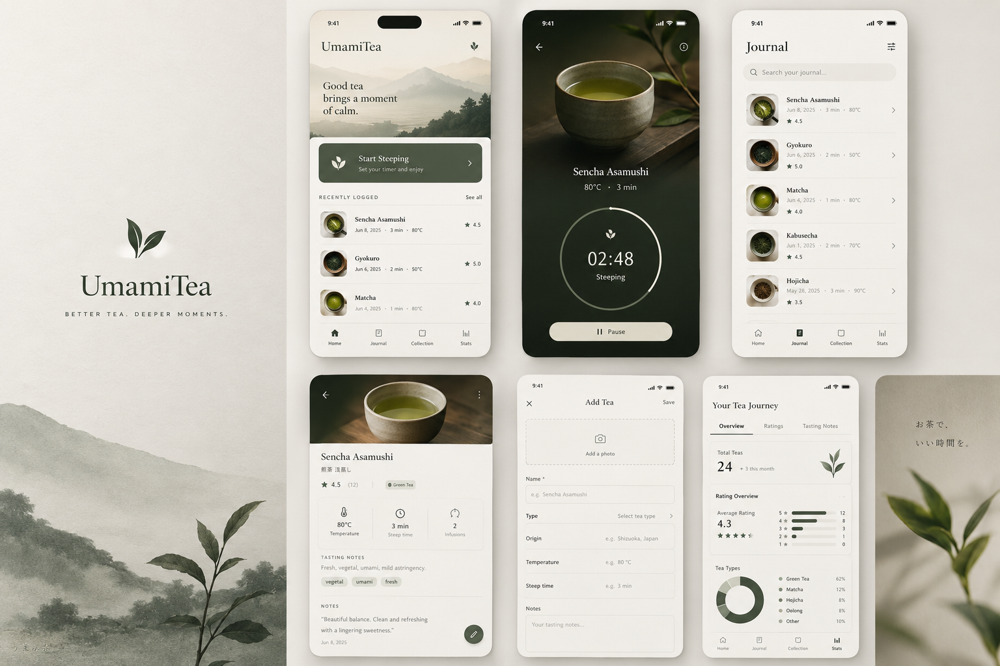
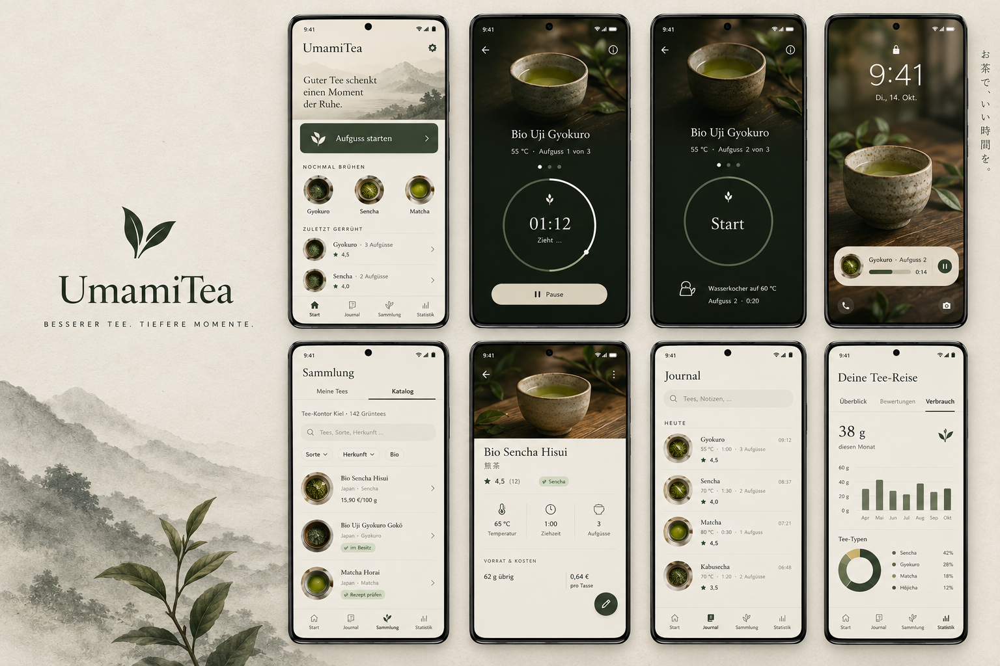

# 03 · UX & UI Specification

> Status: **Draft v0.2** · Last updated: 2026-11-12 (v0.6.1, D-114: SCR-05 taste per infusion, SCR-07 chips, SCR-09 and SCR-16 ⋮, SCR-16 GESCHMACK per infusion and folding, SCR-19 no kind and „N Tees", SCR-25 *Darstellung*, SCR-28 photo viewer; 2026-11-11: v0.6.0, the journal: SCR-06 stars and actions, SCR-08 and SCR-09 ratings, GESCHMACK and LETZTE SITZUNGEN, SCR-15 search and filters, SCR-16 in-place tasting inputs and hero, SCR-17 session editor, SCR-30 descriptor sheet, D-112; 2026-10-31: v0.4.0: *Meine Tees*, tea detail, tea and recipe editors, *Sorte wählen*, teaware, *Archivieren* everywhere, setup ⋮ *Tee ansehen* and *Neues Gefäß …*, BRW-08, tappable journal entries and the read-only session page with *So nochmal brühen*, *Bestand abziehen*, D-100; v0.3.0: the switch „Bei „Nicht stören" klingeln", D-099; 2026-10-30: v0.3.0: two timers in the bar and the timer screens, setup ⋮ *Im Katalog ansehen*, stock on READY, foldable *Sorte* groups, *Lautstärke*, the daily reminder's settings, „Alarmlautstärke ist aus", two SCR-07 polish items, D-098; v0.2.2: leaf and water on READY, catalog notifications open the refresh sheet, picker groups, low-stock card, quick timer *Vorwarnung* and 8:00, *Merken*, D-097; 2026-10-29: *Link einfügen* and the share target as built, #98; the timer's band gives way on a short screen, D-096; 2026-10-28: *Link einfügen* and share target, „nicht vorrätig" teas, D-094; 2026-10-26: v0.2.1: timer top bar,
> per-step pre-alert, *Vorwarnton*, stock correction, removing a tea from the
> picker, Kräutertee chip, D-093)

Information architecture, navigation, visual design system and screens.
Functional rules: [02](02-functional-requirements.md). The UI language is
**German**; copy examples below are the intended German strings.

## 1. Design reference — brand mockup

The PO's brand mockup defines the **look and feel**. Its screens are
*illustrative*, not a feature list. It is stored at
[`docs/design/brand-mockup.png`](../design/brand-mockup.png).



| Element | In the mockup | Adopted as |
|---|---|---|
| Mood | Calm, quiet, premium, Japanese tea house; generous whitespace | Principle "Calm over clever" |
| Background | Warm off-white "washi paper" | `background`/`surface` tokens (§3.1) |
| Primary colour | Deep matcha/olive green (*Start Steeping* card, FAB) | `primary` |
| Dark surface | Deep forest green-black (timer) | Timer always uses the dark "Steeping" scheme |
| Display type | Elegant serif for titles and tea names | Display font Alegreya Sans (§3.2, D-110) |
| Labels | Small, letter-spaced uppercase labels („ZULETZT GEBRÜHT") | `labelOverline` |
| Imagery | Ink-wash mountains, tea leaves, moody tea photography | Illustrations + Tee-Kontor product photos |
| Logo | Two-leaf tea sprig | App icon & splash |
| Japanese | Secondary names (煎茶 浅蒸し), tagline お茶で、いい時間を。 | GEN-11, welcome |
| Timer | Thin ring, light centred digits, caption, cream pill *Pause* | SCR-05 |
| Lists | Round photo thumbnails, serif title, meta line, „★ 4,5" | Journal & Home |
| Tea detail | Hero photo, serif name, subtitle, rating with count, type chip, Temperature · Steep time · Infusions row | SCR-09 / SCR-21 |
| Stats | "Your Tea Journey" with tabs, big numerals, rating bars, tea-type donut | SCR-18 |
| Bottom nav | **Home · Journal · Collection · Stats** with thin line icons | §2.2 (German labels) |

### 1.1 Mockups v2 (aligned with spec v0.2)

Generated from [`docs/design/mockup-prompt.md`](../design/mockup-prompt.md) and
added by the PO on 2026-10-21. They are the **current visual reference** (they still show the former name
„UmamiTea"; the wordmark is now „UmamiT", D-033);
`brand-mockup.png` remains the original mood reference.

| File | Content |
|---|---|
| [`mockup-v2-board.png`](../design/mockup-v2-board.png) | Board with 8 screens: Start, timer running, timer READY, lock screen with Now Bar, Sammlung › Katalog, tea detail, Journal, Statistik › Verbrauch |
| [`mockup-v2-start.png`](../design/mockup-v2-start.png) | Start screen in detail |



**Review notes:** where the mockups and the spec differ, these rules apply.

| Screen | Observation | Resolution |
|---|---|---|
| All | German labels, nav Start · Journal · Sammlung · Statistik, Samsung frame, palette and typography match the spec | Adopted as reference |
| Start (board) | Section label misspelt „ZULETZT GERÜHRT" | Spec wins: „ZULETZT GEBRÜHT" (the single Start mockup is correct) |
| Start (both) | Greeting text „Guter Tee schenkt …" under the header | Spec wins: no greeting text, header illustration only (D-035) |
| Start (both) | NOCHMAL BRÜHEN tiles above ZULETZT GEBRÜHT | Spec wins from v0.5.1 (D-110): one section ZULETZT GEBRÜHT, whose rows brew again |
| All | Serif titles and timer digits | Spec wins from v0.5.1 (D-110): the humanist sans Alegreya Sans (§3.2) |
| Start (both) | No *Schnelltimer* entry and no FAVORITEN section | Spec wins: both are present (SCR-02) |
| Start (both) | ZULETZT GEBRÜHT rows show „★ 4,5" | Spec wins (D-112): no rating on Start; ratings show in the Journal, in *Meine Tees* and on the tea detail |
| Start (both) | ZULETZT GEBRÜHT rows in a free-form layout | Spec wins: rows use the `TeaListItem` format (§3.8) |
| Start (single) | The *Matcha* thumbnail shows a brown liquor (looks like hōjicha) | Image glitch; real thumbnails are tea photos |
| Timer running | Top-right shows an ⓘ icon | Spec wins: ⋮ overflow menu (SCR-05) |
| Timer running | Ring with a small marker near the end | Adopted: marker = pre-alert point on the ring |
| Timer READY | Step dots highlight step 1 while the label says „Aufguss 2 von 3" | Spec wins: dots show completed steps and the current step |
| Timer READY | Big „Start" inside the empty ring; kettle icon with „Wasserkocher auf 60 °C" and „Aufguss 2 · 0:20" below | Adapted (D-058): the ring keeps the digits with „Bereit", *Start* is the cream pill below (the ring is tappable too); the kettle hint and „Aufguss 2 · 0:20" are adopted |
| Lock screen | Now Bar pill: thumbnail, „Gyokuro · Aufguss 2", progress bar, „0:14", pause button | Adopted as the Live Update target look |
| Katalog | Segmented „Meine Tees / Katalog", source line, search, chips Sorte / Herkunft / Bio, rows with origin · type, price per 100 g, chips „im Besitz" / „Rezept prüfen" | Adopted (count in the header is the real number, ≈ 270) |
| Tea detail | No *Brühen* button visible, only the pencil FAB | Spec wins: sticky primary *Brühen* button plus the pencil FAB |
| Tea detail | Stat row Temperatur · Ziehzeit · Aufgüsse; VORRAT & KOSTEN „62 g übrig · 0,64 € pro Tasse" | Adopted |
| Journal | Within a day group, rows show the time of day on the right („09:12") and a meta line „55 °C · 1:00 · 3 Aufgüsse" plus rating | **Adopted** — replaces the earlier meta line format (JRN-08 updated) |
| Statistik | Verbrauch tab with „38 g diesen Monat", monthly bar chart, Tee-Typen donut | Adopted; the donut may appear on Überblick and Verbrauch |

## 2. Information architecture & navigation

### 2.1 Site map

```
App
├── Einrichtung (SCR-01) — first start only
├── Start / Home (SCR-02)
│   ├── Aufguss starten → Teeauswahl (SCR-03) → Brühen (SCR-04) → Timer (SCR-05) → Gespeichert-Sheet (SCR-06)
│   │   ├── Schritte-Sheet (SCR-31) from SCR-04 *Bearb.* and the timer
│   │   └── from SCR-04 (v0.4.0): ⋮ Tee ansehen → Tee (SCR-09); Gefäß › Neues Gefäß … → SCR-14
│   ├── Zuletzt gebrüht (six recent teas; a tap is *Nochmal brühen*) → Timer READY (SCR-05, BRW-11, D-110)
│   ├── Schnelltimer (SCR-07)
│   └── Einstellungen (SCR-25) — top-bar action
├── Journal (SCR-15)
│   └── Sitzung (SCR-16) → So nochmal brühen → Brühen (SCR-04); Tee (SCR-09)
│       ├── rating, notes, taste, photos in place; Beschreibungen (SCR-30, sheet) — v0.6.0
│       └── ⋮ Bearbeiten → Sitzung bearbeiten (SCR-17) — v0.6.0
├── Sammlung (Collection) — segmented: [ Meine Tees | Katalog ]
│   ├── Meine Tees (SCR-08)
│   │   ├── Tee (SCR-09) → Brühen (SCR-04), Bearbeiten (SCR-10), Rezept (SCR-12); Vorrat (SCR-29), Fotos (SCR-28) — v0.4.1
│   │   └── ⋮ Tee aus dem Katalog hinzufügen (SCR-19) | Tee ohne Katalog hinzufügen → Sorte wählen (SCR-11) → SCR-10
│   └── Katalog (SCR-19)
│       ├── Katalog-Tee (SCR-21) → In Sammlung aufnehmen (SCR-23)
│       ├── Ratgeber (Tee-Info guides) → Artikel (SCR-20)
│       ├── Link einfügen (sheet, v0.2.1) → Katalog-Tee (SCR-21)
│       └── Katalog aktualisieren (SCR-22)
├── Statistik (SCR-18)
└── Einstellungen (SCR-25)
    ├── Teegeschirr (SCR-13) → SCR-14
    ├── Daten & Sicherung (SCR-26)
    └── Über (SCR-27)
```

### 2.2 Primary navigation

Bottom navigation bar (navigation rail on wide screens):

| # | Label | Icon (line) | Destination |
|---|---|---|---|
| 1 | **Start** | house | SCR-02 |
| 2 | **Journal** | notebook | SCR-15 |
| 3 | **Sammlung** | tea canister | SCR-08 / SCR-19 |
| 4 | **Statistik** | bar chart | SCR-18 |

- **Sammlung** opens on the last used segment (*Meine Tees* by default).
- Re-selecting a tab scrolls to top; a second re-select pops to its root (D-049);
  each tab keeps its back stack.
- Settings via the gear on Start and the ⋮ menu of the other tabs.
- **Settings closes on a tab switch** (D-104): when the tab being left has
  Settings in its back stack, the stack is popped to below the Settings entry,
  so Settings and everything opened from it (*Teegeschirr*, a vessel, *Über*,
  *Diagnose*) go. Coming back, the tab shows the screen it showed before
  Settings was opened. A vessel editor open above Settings is dropped without
  the discard question, as a process death would. Other pushed screens (a tea
  detail, a session page) keep their place across a switch; re-selecting a tab
  is unchanged (D-049). *Timer-Einstellungen* above the timer is not in a tab
  and is not affected.
- The active brew bar (GEN-06) sits above the navigation bar; the timer is
  full-screen without either.

### 2.3 Back behaviour

Predictive back; back from the timer keeps the session running; editors with
unsaved changes trigger GEN-08 (the Schritte-Sheet too, SCR-31, D-055).

### 2.4 Internal deep links

| Source | Target |
|---|---|
| Timer notification / Live Update / alert | SCR-05; from v0.3.0 (D-098) the screen of the notification's timer: SCR-05 for the brew, SCR-07 for the quick timer |
| „Sitzung gespeichert" notification | SCR-16 |
| Catalog refresh progress and result notifications | Sammlung › Katalog with SCR-22 open: the progress while the refresh runs, its summary after it (v0.2.2, D-097; until v0.2.1 the app where it was, D-079). Before the setup is finished: the app where it was |
| Reminder notification | SCR-08 (filtered) or SCR-26 |
| Daily low-stock reminder (v0.3.0, INV-11, D-098) | Start (SCR-02) at its root; during an alert the tap waits until it ends (as the catalog tap, D-097); before the setup is finished it is discarded |
| Reliability banner *Beheben* | System settings page (notifications, battery, Live Updates `ACTION_APP_NOTIFICATION_PROMOTION_SETTINGS`, full-screen alerts `ACTION_MANAGE_APP_USE_FULL_SCREEN_INTENT`; from v0.3.0 alarm volume `ACTION_SOUND_SETTINGS`, D-098) |

### 2.5 Layout

Phone-first (Galaxy, portrait and landscape). On wider windows (landscape,
split screen, DeX) the app uses a navigation rail and list-detail panes for
Sammlung and Journal; no orientation lock.

**Keyboard** ([D-102](10-open-questions-and-decisions.md#d-102)): the window
never pans (`adjustResize`); the keyboard is an inset. The shell's content
consumes the height the keyboard covers below it (navigation bar, brew bar),
so a screen pads only for the part of the keyboard above its own bottom
edge, and the editors pad for it once (their `Scaffold`'s `safeDrawing`
bottom inset; no extra `imePadding()`). A focused field scrolls into view
above the keyboard; nothing of the screen stays hidden behind it.

## 3. Visual design system

### 3.1 Colour tokens

First-pass values approximated from the mockup, to be finalized with the PO.

**How the theme is built (D-036):**
- Full Material 3 **light and dark colour schemes** (every M3 role) are
  generated from the seed colour `#4A5643` with material-color-utilities /
  Material Theme Builder. The values in the tables below are applied as
  **overrides** on top; roles not listed come from the generated scheme.
- The timer always uses the dark ("Steeping") scheme.
- **Extended tokens** that M3 has no role for are provided through a
  `CompositionLocal` (`UmamiExtendedColors`): warm accent `#D9A35F`
  (prominent overtime, as a non-text mark only: as text it is 1.97:1 on
  washi and 1.51:1 on matcha, D-055), the liquor colours and the type colours
  below.

**Light ("Washi")**

| Token | Hex | Usage |
|---|---|---|
| `primary` | `#4A5643` | Primary buttons, *Aufguss starten* card, FAB, selected nav |
| `onPrimary` | `#F6F3EC` | |
| `primaryContainer` | `#DDE2D2` | Selected chips |
| `onPrimaryContainer` | `#1F271B` | |
| `secondary` | `#8A7B5E` | Hōjicha-brown accents |
| `secondaryContainer` | `#ECE5D6` | Cream pills, tags |
| `tertiary` | `#6F8A5A` | Umami meter, charts |
| `background` | `#F3F0E9` | Washi background |
| `surface` | `#F7F5F0` | Cards, sheets |
| `surfaceContainerLow` | `#EFEBE3` | Inputs, search bar |
| `surfaceContainerHigh` | `#E7E2D8` | Chips |
| `onSurface` | `#2B2D27` | Primary text (ink) |
| `onSurfaceVariant` | `#6B6A62` | Secondary text (≈ 4.8:1 on background; the mockup's lighter grey fails AA) |
| `outline` | `#D9D4C8` | Hairlines |
| `error` | `#9E3B2F` | Errors (rare) |

**Dark ("Steeping")** — dark theme and the timer screen in both themes.

| Token | Hex | Usage |
|---|---|---|
| `background` | `#1C231D` | Forest green-black |
| `surface` | `#232B24` | Cards |
| `surfaceContainerHigh` | `#2E372F` | Chips, inputs |
| `primary` | `#B9C8A6` | Ring progress |
| `onPrimary` | `#1F271B` | |
| `secondaryContainer` | `#E5DFCF` | Cream *Pause* pill |
| `onSecondaryContainer` | `#2B2D27` | |
| `onSurface` | `#ECE8DE` | Text |
| `onSurfaceVariant` | `#A9A99D` | Secondary text |
| `outline` | `#4A544A` | Ring track |

**Type colours** (chips, chart series; always with a label): Gyokuro
`#5F7F45`, Kabusecha `#6C8A4F`, Sencha `#7C9A5B`, Fukamushi `#8AA463`,
Shincha `#9DB86E`, Matcha `#5F8C3E`, Kukicha/Karigane `#A6B07A`, Hōjicha
`#8C6A48`, Genmaicha `#B59A62`, China/Korea green `#8FA77A`, aromatisiert
`#9A7A9A`, other `#8C8C80`. Liquor colours for the timer fill animation:
green `#C9D58F`, gyokuro `#D7DF9F`, hōjicha `#B07A45`.

**Alert surface** (extended tokens `alert`, the same in both schemes; M1-04,
D-046): washi `#F3F0E9`, matcha `#6B9845`, content (ring, digits, caption,
overtime) `#1F271B`. The content stays readable through the whole pulse: 13.5:1 on
washi, 4.55:1 on matcha (AA for body text). The only control, the
*Abgegossen* pill, is ink with washi text there (13.5:1 for its label; the pill
itself is 13.5:1 against washi and 4.55:1 against matcha). The surface applies
these itself (`LocalOnAlertSurface`), so `TimerRing` and `PillButton` with
default parameters are alert-safe; a test computes every element's contrast in
both pulse phases (D-055). The warm accent is never text on the alert surface. The surface itself swings 2.97:1
in luminance (washi ↔ matcha), so the pulse is strong without changing hue.
The darker type colour Matcha `#5F8C3E` was not used: ink on it is only 3.9:1.

Dynamic colour is off by default (SET-06).

### 3.2 Typography

| Role | Font | Size / line height |
|---|---|---|
| Timer digits | Alegreya Sans **Light** with `lnum` + `tnum` font features (lining, tabular figures) | 72–96 sp |
| Headline („Journal") | Display sans (Alegreya Sans) | 28 / 36 sp |
| Title (tea names) | Display sans (Alegreya Sans) | 20–22 / 28 sp |
| Body | System sans | 14–16 / 20–24 sp |
| Label | System sans | 12–14 sp |
| Overline | System sans, uppercase, +0.12 em tracking | 11 / 16 sp |

- **Display font from v0.5.1 (D-110): Alegreya Sans**, a humanist sans with
  a calligraphic stroke, in place of the serif Cormorant Garamond: the PO's
  feedback was that a serif reads badly on the phone's small display. Bundled
  OFL font, the static Light + Regular + Medium, with the same Latin subset
  as below. Its bundled features are `case`, `liga`, `lnum`, `locl`, `onum`,
  `pnum`, `tnum` and `kern` (upstream has no `calt`; `ccmp` is not kept). Its default figures are proportional old-style too, so
  the styles keep `lnum` and the timer digits `lnum, tnum`. The sizes and
  roles are unchanged; wherever this document says „serif" for a title, the
  display sans is meant.
- Until v0.5.0, serif: bundled OFL font **Cormorant Garamond** (D-027), Light + Regular +
  Medium, Latin subset incl. German umlauts/ß. Subsetting keeps the `lnum`
  and `tnum` OpenType features for the timer digits. *Done in M1-04 (#29):*
  static instances at wght 300/400/500 of the Google Fonts variable font,
  subset to Basic Latin, Latin-1, Latin Extended-A (macrons), ẞ, general
  punctuation and €, with the features `lnum`, `tnum`, `onum`, `case`, `liga`,
  `calt`, `ccmp`, `locl`, `kern`; `lnum`/`tnum` survived, so the fallback is
  not needed. The default figures are proportional old-style, so every serif
  style sets `lnum` and the timer digits set `lnum, tnum`.
- A screenshot test renders the timer digits for all values 0–9 in every
  position and fails on width changes (digit jitter). Fallback if the
  features do not work: system sans with tabular figures, Light weight.
- Japanese text via the system CJK fallback font.
- Uppercase overlines use German `ẞ`-safe uppercasing (`ZULETZT GEBRÜHT`).

### 3.3 Shape, spacing, elevation

Spacing 4/8/12/16/24/32/48 dp; side margin 20 dp; cards 16 dp radius;
primary card 12 dp; pills fully rounded; circular thumbnails in lists; flat
design with hairlines instead of shadows.

### 3.4 Iconography

Material Symbols Outlined, weight 300; custom line icons for kyusu, houhin,
shiboridashi, gaiwan, chawan, chasen, cold-brew bottle, kettle, thermometer,
leaf amount, infusions, umami.

### 3.5 Imagery

- Ink-wash landscape illustrations (Home header, welcome, empty states),
  light and dark variants. Origin/licence to be settled with the PO (Q-04).
- Tea photos: Tee-Kontor product photos (downloaded by the catalog refresh,
  personal use) and the PO's own photos; fallback = type-coloured leaf
  illustration.

### 3.6 Motion & haptics

Guardrails (D-041); curves, durations, the fill direction and the pulse
rhythm are worked out in the waves 2–3 spec (M1 plan §3.2) and judged by the
PO in motion recordings. The resulting values are in [Motion tokens](#motion-tokens)
below.

- **Character:** calm and ritual-like. Material 3 motion system with soft
  ease-out, hardly any overshoot, slightly slower than the Material
  defaults. Motion explains state; it is never decoration for its own sake.
- **Functional motion:** ring progress (per frame in short steps), sheet
  and state transitions, the active brew bar.
- **Two signature moments:**
  1. **Liquor fill:** while a step runs, the inside of the ring fills in the
     tea's liquor colour (§3.1: green, gyokuro, hōjicha).
  2. **Pre-alert glow:** the pre-alert marker on the ring glows gently, in
     sync with the pre-alert tick.
- **Long steps** (≥ `LONG_STEP_THRESHOLD`, 10 min; from v0.3.0 cold or ice
  brew, or ≥ 60 min, D-098): ring and liquor fill update in coarse steps
  (about every 10 s) with a short glide instead of per frame, to save
  battery.
- **Alerting** deliberately breaks the calm style. A strong, slow pulse of
  the whole surface (washi → matcha green) at about a 1–2 s rhythm, with high
  contrast and **no flashing**. It must be unmistakable from across the
  room, including in silent mode, where the alert is visual only (04 §9.1).
- **Reduce motion:** follows only the system setting „Animationen
  entfernen" (no in-app switch). The pre-alert glow is off; the liquor
  fill still shows the level but updates without gliding; functional motion
  becomes instant (at animator scale 0 Compose ends every animation on its
  first frame, D-055); the alert becomes a **static**
  high-contrast matcha surface without pulse.
- No motion may delay, hide or soften an alert (CLAUDE.md rule 8).

#### Motion tokens

Starting values from spec #27, shaped with `/emil-design-eng` and
`/apple-design` (M1-04, #29). The PO tunes them from the motion recordings;
code and this table change together. In code they are `MotionTokens` and the
Compose specs of `UmamiMotion` (`core:designsystem`, read with
`UmamiTheme.motion`).

**Easings**

| Token | Curve | Why |
|---|---|---|
| `CalmEaseOut` | `cubic-bezier(0.2, 0.8, 0.2, 1)` | Soft ease-out: it moves at once (the app answers immediately), then settles in a long, quiet tail. Softer than Emil's strong UI curve, because UmamiT is calm, not snappy. Never ease-in for UI: it feels late. |
| `CalmEaseInOut` | `cubic-bezier(0.45, 0, 0.2, 1)` | For things already on screen that move from one value to another (ring glide): a gentle start, a long deceleration. |
| `SineInOut` | `cubic-bezier(0.37, 0, 0.63, 1)` | The alert pulse breathes instead of blinking. |

**Durations and springs**

| Token | Compose spec | Use | Why |
|---|---|---|---|
| `press` | `tween(120, CalmEaseOut)`, scale 0.97 | Press feedback on pills and cards (not list rows, which keep only the ripple) | Felt at touch-down, so the press reads as heard; a subtle scale, nothing pops. |
| `pressRelease` | `spring(dampingRatio = 1, stiffness = 1500)` | Back to scale 1 after a press | Asymmetric: the user presses, the system answers faster. A spring keeps its velocity when a quick tap retargets it mid-press. |
| `exit` | `tween(200, CalmEaseOut)` | Elements leaving | Exits are faster than entries: the user decided, the system answers. |
| `standard` | `tween(300, CalmEaseOut)` | State and content transitions (never into ALERTING) | A little slower than Material's 200–250 ms: ritual, not hurried. Still short enough to never block the next tap. |
| `emphasized` | `tween(450, CalmEaseOut)` | **Reserved, unused in M1.** Meant for a whole surface changing state (never into ALERTING). The one step change users see in M1 leaves the alert, and that stays a snap, so no M1 screen uses it | Bigger change, more time to follow it. |
| `fade` | `tween(300, CalmEaseOut)`; reduce motion: `tween(100, linear)` (on the device instant, see „Reduce motion" below) | Opacity and colour (never into ALERTING) | Fades help comprehension, so the token keeps a short one for the in-app reduce-motion path. |
| `exitFade` | `exit` (200 ms); reduce motion: `fade` (100 ms) | Fade of a leaving element: popped routes, the active brew bar | Same as `exit`, but never a snap where only opacity changes. |
| `tabSwitch` | out `tween(90, CalmEaseOut)`, in `tween(210, delay 90, CalmEaseOut)` (fade-through); reduce motion: `fade` (100 ms, no delay) | Switching between the four tabs | Tab switches happen tens of times a day, so they are short, and the old screen is gone before the new one arrives: no double exposure of two top bars. |
| `sheet` | `spring(dampingRatio = 1, stiffness = 320)` (response ≈ 0.35 s) | Own sheets (not the Schritte-Sheet, which uses Material 3's modal sheet and its motion, D-051) | Critically damped: no overshoot. A spring starts from the current value and keeps velocity, so a sheet grabbed mid-motion follows the finger. |
| `activeBrewBar` | `spring(dampingRatio = 1, stiffness = 250)` (response ≈ 0.4 s) | Active brew bar arriving and leaving | Same physics as sheets, a touch slower: it is ambient, not asked for. |
| short-step ring | none, per frame | Ring and liquor fill while a short step runs (under 10 min; from v0.3.0 every hot step under 60 min, D-098) | Progress follows the remaining time exactly; any easing would lie about it. |
| `longStepGlide` | `tween(600, CalmEaseInOut)` every `10 000` ms | Ring and liquor fill of long steps (≥ 10 min; from v0.3.0 cold or ice brew, or ≥ 60 min, D-098) | One redraw burst every 10 s saves battery; the 600 ms glide keeps the jump from looking like a glitch. |
| `preAlertGlow` | `keyframes(800 ms)`: 0 → 1 at 200 ms (`CalmEaseOut`), → 0 at 800 ms (`SineInOut`) | Pre-alert marker on the ring | One swell exactly as long as the 0.8 s tick (D-045), peaking early like the strike of the bowl and decaying with its sound, so eye and ear get one event. |
| `alertEnter` | `snap()`, also without reduce motion | Entering ALERTING | The alert is the biggest state change and must never be delayed or softened by a transition (rule 8). |
| `alertPulse` | `infiniteRepeatable(tween(750, SineInOut), Reverse, initialStartOffset = 750 ms FastForward)`, animated 0 (washi) → 1 (matcha): frame 1 is full matcha, then matcha → washi → matcha, one cycle per 1.5 s | Alert surface | Slow and strong: visible across the room even in silent mode. It starts at its strongest phase, the same matcha as the static reduce-motion surface, so the onset is never soft. 0.67 cycles/s is far below the 3 flashes/s limit (WCAG 2.3.1), and a sine has no hard edges, so it never flashes. |

**Rules**

- **Fill direction:** the liquor fill always rises from the bottom of the
  ring, like tea poured into a cup.
- **No bounce:** every spring is critically damped (`dampingRatio = 1`).
  UmamiT has no flicked or thrown elements that would earn an overshoot.
- **Interruptible:** state changes use `animate*AsState` / `Animatable`, which
  continue from the current value when retargeted; nothing restarts from zero,
  except the one-shot pre-alert glow, which restarts with each tick.
- **Alerts first:** an alert's start is never delayed by a transition
  (`alertEnter`); the pulse begins on the first frame of ALERTING at full
  matcha.
- **Overlays give way:** every menu, dialog, sheet and picker remembers the
  alert it was opened in; another alert removes it in its first frame, without
  an exit animation, and it stays closed after the alert (one shared gate,
  `AlertGate` in `core:ui`; D-058, D-100 build notes F1).
- **Unscaled alert and glow:** Compose multiplies every duration by the system
  animator duration scale. The alert pulse and the pre-alert glow run with a
  fixed scale of 1 (`UnscaledMotion`, as an `Animatable` inside
  `withContext(UnscaledMotion)`), so a developer scale cannot slow the alert or
  pull the glow away from the 0.8 s tick.
- **Alert contrast, not flashing:** the pulse runs washi `#F3F0E9` ↔ matcha
  `#6B9845` (§3.1 „Alert surface"), 2.97:1 in luminance, one cycle per 1.5 s:
  0.67 flashes/s, far below WCAG 2.3.1's 3 per second, with sine edges. The
  content stays ≥ 4.5:1 on both ends and is never faded or moved. Inside the
  alert the ring shows no liquor, so nothing softens the pulse.
- **How the components use the tokens** (M1-04, #33): `TimerRing` takes
  the progress as a lambda read only while drawing, so short steps redraw per
  frame without recomposing. Long steps glide (`longStepGlide`; the caller
  updates the progress every `longStepUpdateIntervalMillis`), but the update to
  1 is drawn at once, so no glide runs into the alert. Only forward progress
  glides: a level that goes down (the next long step after *Abgegossen* starts
  at 0) is drawn at once, so the liquor never sinks. The pre-alert marker
  swells once with `preAlertGlow` for each new tick identity the caller passes
  (`preAlertGlowTick`). A glow is never cut short, and a ring that comes back
  (rotation, navigation) never replays a tick it already showed.
  `AlertSurface` runs `alertPulse` and restarts it at full matcha whenever the
  app returns to the foreground during ALERTING; it makes the ring and the pill
  on it alert-safe (§3.1). `ActiveBrewBar` grows from its
  bottom edge (`expandVertically`/`shrinkVertically` with the `activeBrewBar`
  spring, clipped, plus `fade`/`exitFade`), so the content above glides instead of
  jumping 72 dp; its mini ring follows the long-step mode like `TimerRing`, and
  in ALERTING the bar snaps to static matcha (§3.8). Ring and mini ring build
  their strokes, the glow's gradient and the marker's place once per size
  (`drawWithCache`) and draw the liquor as an arc closed by its chord, so a
  per-frame redraw allocates nothing. The liquor tints the ring at
  32 % opacity, so the digits and caption (`onSurface`) stay ≥ 4.5:1 on it;
  timer digits keep their size at any font scale (80 sp is already large text)
  and shrink to 56 sp for h:mm:ss; the ring caption grows up to 1.5× (24 sp,
  two lines) so it stays inside the ring, and TalkBack reads it in full.
- **Recordings:** `scripts/motion/record-gifs.sh` renders the GIFs in
  `docs/design/review/M1/motion/` (record-only, never in CI).

**Reduce motion** (`LocalReduceMotion`): `true` when the system animator
duration scale is 0 („Animationen entfernen"). Other scales are developer
options: they do not switch reduce motion on; the alert pulse and the glow
ignore them, and all other motion follows them. `UmamiTheme` reads it from the system and follows
changes while the app runs; tests force it with `UmamiTheme(reduceMotion = …)`.
Under reduce motion every spatial spec above becomes `snap()`, fades shrink to
100 ms, `alertEnter` stays `snap()`, press feedback has no scale (the ripple remains), `preAlertGlow` and
`alertPulse` are `null` (glow off; the alert is a static high-contrast matcha
surface), and the long-step ring still updates every 10 s, without the glide.
**On the device** reduce motion means animator scale 0, and Compose then ends
every scaled animation on its first frame: every transition, fades included, is
instant. The 100 ms fades exist only on the in-app path (`reduceMotion = true`
at scale 1, which tests force). What depends on the flag on the device is the
alert and glow rules: no glow, a static alert surface (D-055).

**TalkBack:** motion never carries information on its own. Every animated
state has a text or semantics equivalent (remaining time, „Gleich fertig …",
„Jetzt abgießen!").

Haptics: tick on start/pause, pre-alert tick, alert pattern, confirm on
*Abgegossen*; a light tick (`SegmentFrequentTick`) per repeat of a held − / +
in the Schritte-Sheet (SCR-31, #141).

### 3.7 Voice & tone (German)

Ruhig, warm, knapp; informal **„du"**; sentence case; Japanese terms in
romanisation with macrons (Kōridashi) where standard. Examples:
- Welcome: „Aus Liebe zum Tee"
- Empty journal: „Deine erste Tasse wartet."
- Alert: „Jetzt abgießen!"
- Pre-alert caption: „Gleich fertig …"

### 3.8 Core components

| Component | Description |
|---|---|
| `TeaListItem` | 48 dp round thumbnail, serif title, meta line („8. Juni · 3 Min. · 80 °C"), trailing „★ 4,5", hairline divider |
| `PrimaryActionCard` | Dark-green card, leaf icon, title + subtitle, chevron |
| `StatTriplet` | Three figures with line icons (Temperatur · Ziehzeit · Aufgüsse); on SCR-09 from v0.4.0 the tea's sessions, last brew and stock (D-100) |
| `SectionHeader` | Overline + optional „Alle anzeigen" |
| `TimerRing` | 3 dp ring, round cap, leaf glyph, digits + caption; pre-alert segment marked as a short tick on the ring |
| `PillButton` | Cream on dark / green on light; ink with washi text on the alert surface |
| `KettleHint` | Kettle icon + „Wasserkocher auf 60 °C" |
| `RatingStars`, `TasteSlider`, `TasteRadar`, `DescriptorChip`, `UmamiMeter` | As named. From v0.6.0 (D-112): `RatingStars` is the one rating input (sheet and session page): five stars, 48 dp targets, a tap sets whole stars, a second tap on the same star takes half off, a third clears; a half star draws half filled; a light tick per change; TalkBack „Bewertung, 3,5 von 5 Sternen" / „Bewertung, keine", adjustable in half steps, action „Bewertung entfernen". Read-only it is the text „★ 4,5". `TasteSlider`: 0–5 in whole steps, „–" while unset. **The slim slider** (from v0.6.0, [D-113](10-open-questions-and-decisions.md#d-113); `TasteSlider` and the settings' *Lautstärke*, one look in `core:designsystem`): a pin handle of 3 × 20 dp, corners 1.5 dp, `primary` (4 × 24 dp while pressed or dragged); a 2 dp line with round caps, `primary` up to the handle and `outlineVariant` beyond it, with a 4 dp gap on each side of the handle; stop dots of 3 dp in `onSurfaceVariant` on the part beyond the handle only; the touch target stays 48 dp high. An unset `TasteSlider` shows a short mark of 1.5 × 10 dp in `onSurfaceVariant` at the left end and no `primary` line, so it differs from a set 0. `TasteRadar`: six axes (Umami, Süße, Bitterkeit, Adstringenz, Körper, Aroma), drawn from three set axes on, unset axes at the centre; TalkBack reads the values as a list |
| `StockChip`, `FreshnessChip`, `CheckRecipeBadge` | „38 g übrig", „Bald genießen", „Rezept prüfen". `FreshnessChip` (v0.4.1, `core:designsystem`): *Frisch* on `primaryContainer`, *Bald genießen* on `secondaryContainer` (as *Knapp*), *Über dem Höhepunkt* on `surfaceContainerHigh`; a compact size in SCR-03 |
| `CatalogFlagChips` | „Bio", „aromatisiert", „im Besitz", „nicht mehr im Sortiment" |
| `ActiveBrewBar` | 56 dp mini ring, tea name, step („Aufguss 2/4", `onSurface`: `onSurfaceVariant` is only 4.21:1 on the bar), remaining time. **ALERTING:** static matcha `#6B9845` with ink content (4.55:1), „Jetzt abgießen!" in place of the step, the overtime counting up („+0:07"), the mini ring full in ink without liquor; it snaps in (`alertEnter`), also when the bar first appears already alerting (a recreated activity: no growth, no fade, D-069), and never pulses (the full alert is SCR-05); a tap opens the timer (D-055). **Two timers (v0.3.0, D-098):** with a brew and a quick timer active the bar holds two halves side by side, brew first, each with its 40 dp mini ring, name („Schnelltimer" for the quick timer), step and countdown; each half is its own tap target (≥ 48 dp) and opens its timer; an alerting half takes the ALERTING style alone; a held quick alert shows „fertig" without the alert style until it rings. **Two brews (v0.5.0, D-108):** two brew sessions take the halves the same way, in the slot order (`BREW`, `BREW_2`), each with its step; a held brew shows „wartet" (TalkBack: „*Kamille*, Aufguss 1 von 2 fertig, wartet auf den anderen Aufguss") |
| `ReliabilityBanner` | Quiet warning bar with *Beheben* |
| `StepsSheet` | Session-only step editor (SCR-31) |
| `EmptyState` | Illustration, serif title, body, button |
| `DiscardChangesDialog` | „Änderungen verwerfen?" · *Weiter bearbeiten* / *Verwerfen* (GEN-08) |

## 4. Screens

### SCR-01 Einrichtung (first start)

1. *Willkommen* — full-bleed ink-wash, logo, „UmamiT", welcome text
   **„Aus Liebe zum Tee"** (serif), お茶で、いい時間を。, *Los geht's*.
2. *Damit der Timer zuverlässig klingelt* — checklist rows with status ✓/!:
   Benachrichtigungen erlauben · Akku: Uneingeschränkt · Live-Benachrichtigungen ·
   Vollbild-Alarm (ONB-02). Each row has an action button; *Weiter* always
   available. Below: hint on Samsung's automatic restart
   (*Automatische Optimierung › Automatisch neu starten*) with a link to the
   setting.
   Meanwhile the two seed photos download once in the background with a
   small progress line „Teefotos werden geladen …" and *Überspringen*
   (ONB-06), below *Weiter*.
   The setup is the start destination until completed; details:
   [D-066](10-open-questions-and-decisions.md#d-066).
3. *Katalog laden* — „Alle Tees von Tee-Kontor Kiel offline verfügbar machen,
   von Grüntee bis Chai. Das erste Laden dauert etwa eine halbe Stunde; die App
   kannst du währenddessen schon nutzen." (v0.5.0, #206: the whole range and
   NFR-PERF-11's ≈ 25–30 min; until then „Grün- und Kräutertees … etwa eine
   Viertelstunde") · *Katalog jetzt laden* (progress inline) / *Später*. After
   *Katalog jetzt laden*, *Weiter* finishes the setup while the load goes on
   in its service with its notification (ONB-03, D-079). *Katalog jetzt
   laden* ends a seed photo download still running first, so two jobs never
   run against the shop at once; the refresh gives the seed teas their
   photos instead (CAT-15, D-090).

### SCR-02 Start (Home)

```
┌──────────────────────────────┐
│ UmamiT                 ⚙   │
│  [ink-wash tea branch …… ]   │  header illustration only, no text
│ ┌──────────────────────────┐ │
│ │ 🍃 Aufguss starten     › │ │  → SCR-03
│ │    Tee wählen und los    │ │
│ └──────────────────────────┘ │
│ ⏱ Schnelltimer               │
│ ZULETZT GEBRÜHT  Alle anzeigen│  6 last brewed teas, tap → timer READY (BRW-11)
│ (○) Sencha Asamushi        › │
│     8. Juni · 3 Min. · 80 °C │
│ FAVORITEN                    │
└──────────────────────────────┘
│ Start · Journal · Sammlung · Statistik │
```

- **One list of recent teas (v0.5.1, D-110).** *Zuletzt gebrüht* shows the
  six most recently brewed distinct teas of the collection as `TeaListItem`
  rows with a chevron: the tea's name and photo, and its last session's
  „8. Juni · 3 Min. · 80 °C". A tap on a row is *Nochmal brühen* (BRW-11;
  TalkBack names the action so); *Alle anzeigen* opens the journal. Until
  v0.5.0 Start had two sections for this: three round tiles *Nochmal
  brühen* and the last three sessions under *Zuletzt gebrüht*, whose rows
  did nothing. Below, „*Nochmal brühen*" means the tap on such a row.
- **Start holds still on the way to the timer (v0.5.1, D-111).** From an
  accepted *Nochmal brühen* until the timer covers Start, Start keeps its
  layout from before the tap: the *Aufguss fortsetzen* card does not appear,
  *Aufguss starten* stays, and the active brew bar does not grow in under the
  timer's fade (§3.6). The hold is presentation only: an alert, the question
  „Welchen Timer beenden?" and a refused start show at once. Back on Start,
  the card and the bar are there.
- Reliability banner (TMR-31) at top when needed.
- Active session replaces the card with *Aufguss fortsetzen* + live countdown.
  Only a brew session does (v0.3.0, D-098): a quick timer alone leaves
  *Aufguss starten* (the bar shows it); with both timers the card shows the
  brew, never switching to the quick timer, and its tap opens the brew.
  With two brew sessions (v0.5.0, D-108) the card shows the first in the
  slot order and opens that one; the bar shows both.
- **Aufguss starten beside one timer (v0.5.0, D-108).** *Aufguss starten*
  shows while fewer than two timers are active: alone, below the card of one
  active brew (v0.3.0 hid it while a brew was active), or with a quick timer
  alone. With two active timers (two brews, or a brew and a quick timer) it
  is hidden; *Nochmal brühen* and the setup's *Start* then ask „Welchen Timer
  beenden?" (below).
- **Two timers (v0.3.0, D-098).** While a brew runs, *Schnelltimer* still
  opens SCR-07 and starts a quick timer alongside it, without a question;
  while a quick timer runs, *Aufguss starten* and *Nochmal brühen* start a
  brew alongside it. With a quick timer already active, *Start* on SCR-07
  asks „Schnelltimer beenden und neu starten?" (*Beenden & neu starten* /
  *Abbrechen*; §5). The active brew bar above the navigation bar shows both
  timers (§3.8).
- **Two brews (v0.5.0, D-108).** *Nochmal brühen* of another tea starts the
  second brew beside the first, without a question, and opens it; of a tea
  with an active session it opens that session. While two timers are
  active it asks „Welchen Timer beenden?": the title, „Es laufen schon zwei
  Timer. Der gewählte endet, dann startet der neue.", one full-width
  outlined button per active timer in the slot order (the tea's name or
  *Schnelltimer*; TalkBack „*Hisui* beenden") and *Abbrechen*. The setup
  (SCR-04) and SCR-07's *Start* ask the same. Never over an alert (rule 8).
- **Alarm volume (v0.3.0, D-098).** The reliability banner also shows
  „Alarmlautstärke ist aus" with *Beheben* (the system's sound settings)
  when the phone's alarm volume is 0 (TMR-31).
- At most one nudge card (knapper Vorrat, Backup, Katalog nie geladen).
  From v0.2.2 the low-stock card (INV-10, D-097): „*Tanabata* wird knapp ·
  14 g übrig" (or „*Tanabata* ist leer") in the body style, a small leaf
  in the tea's style colour, text buttons *Nachbestellen* (only when INV-09
  offers the link) and *Ausblenden*; no accent fill, no badge: a reminder,
  not an alarm. It takes the slot before the other nudges.
- Empty state: „Deine Sammlung ist leer" · *Katalog öffnen* · *Schnelltimer*.
- Details (lists, row format, live countdown): [D-062](10-open-questions-and-decisions.md#d-062).

### SCR-03 Teeauswahl (bottom sheet)

Search (GEN-10); sections *Zuletzt*, *Favoriten*, *Alle* (non-archived owned teas);
footer *Aus dem Katalog* (→ SCR-19 → SCR-21 → SCR-23 *In Sammlung aufnehmen*,
then back to SCR-04 with the new tea selected; D-073) and *Ohne Tee
(Schnelltimer)*. Material 3's modal sheet like SCR-31; never over an alert ([D-062](10-open-questions-and-decisions.md#d-062)).
The catalog flow runs in the Sammlung tab (Sammlung › Katalog at its root);
an add or a repurchase saved there opens SCR-04 of that tea above Start. Back
from the catalog list, or a tap on Start, returns to the picker; another tab
ends the flow; nothing is written before the save. An alert wins: the add
sheet and the picker give way and no setup opens during it ([D-088](10-open-questions-and-decisions.md#d-088)).

**Archiving a tea (v0.2.1, TEA-04, [D-093](10-open-questions-and-decisions.md#d-093); wording from v0.4.0, [D-100](10-open-questions-and-decisions.md#d-100)).**
A long press on a tea row opens a small menu with *Archivieren* (until v0.3.0
„Aus Sammlung entfernen"; with a haptic tick). Choosing it archives the tea
at once (no dialog), the row leaves the picker and a snackbar reads
„*Tanabata* archiviert" · *Rückgängig* (restores it in place). The tea leaves the picker's *Zuletzt* and
*Favoriten* and Start's *Zuletzt gebrüht* and *Favoriten* too; the journal keeps its entries
with name and photo. For the tea of the active brew session the item is
greyed out with „Erst die Sitzung beenden" (PO, D-093). TalkBack offers the
same action as a custom action on the row.

**Freshness (v0.4.1, INV-06, [D-104](10-open-questions-and-decisions.md#d-104)).**
Each tea row with a label shows a small `FreshnessChip` below its Sorte („Frisch",
„Bald genießen", „Über dem Höhepunkt"); none for an unopened or an empty tea.
TalkBack reads it with the row. Start's cards stay unchanged.

**Tea groups (v0.2.2, [D-097](10-open-questions-and-decisions.md#d-097)).**
*Alle* is split by the tea's kind, each group under a small section header
(„Grüntees", „Kräutertees"; from v0.4.0, for teas added without the
catalog, by the tea's Kategorie in the order „Grüntees", „Weiße Tees", „Oolongs",
„Schwarztees", „Pu-Erh", „Kräutertees", „Andere" (yellow tea counts as „Andere"), D-100), A–Z
within a group, groups in that order. Search results are grouped the same
way. *Zuletzt* and *Favoriten* stay ungrouped above. With teas of only one
kind the list has no group headers, as before.

### SCR-04 Brühen (setup)

```
┌──────────────────────────────┐
│ ←  Brühen                     │
│ Bio Uji Gyokuro Gokō          │ serif
│ 玉露 · ★ 4,6 · 38 g übrig      │
│ [Kyusu ✓] [Kaltaufguss]     ✎ │ recipe chips
│ Gefäß    Houhin 120 ml      ▾ │
│ Wasser   100 ml       [−][+]  │
│ Blätter  4,0 g        [−][+]  │ 🔒 4,0 g / 100 ml
│ 🫖 Wasserkocher auf 55 °C      │ KettleHint
│ AUFGÜSSE                Bearb.│
│ 1  Aufguss  1:30   55 °C      │
│ 2  Aufguss  0:30   60 °C      │
│ 3  Aufguss  0:20   60 °C      │  Bearb. → Schritte-Sheet (SCR-31)
│ Vorwarnung  10 · 5 · 5 s      │  per step (TMR-23)
│ [ Im Rezept speichern ]       │ only when changed
│ [      Brühen starten      ]  │
└──────────────────────────────┘
```

„Rezept prüfen" badge with reason above the steps if flagged (the same note as
SCR-21's, D-088). *Bearb.* and
the *Vorwarnung* row open the Schritte-Sheet (SCR-31). Steppers: leaf ± 0,1 g, water to the next 5 ml;
the ratio lock is a switch with the live ratio; at ≤ 10 °C the kettle hint reads „Kaltes Wasser" /
„Eiswürfel" ([D-062](10-open-questions-and-decisions.md#d-062)).

v0.2.1 ([D-093](10-open-questions-and-decisions.md#d-093)):
- The *Vorwarnung* row lists each step's effective pre-alert in order („10 ·
  5 · 5 s", „–" for none; all equal: „10 s").
- „38 g übrig" is a button (BRW-02, INV-03): it opens a small Material 3
  sheet „Wie viel ist noch da?" where the new total is entered (stepper
  ± 0,1 g, a number field, „g"; 0 allowed = leer) and *Speichern*; saving
  stores the difference as an `ADJUSTMENT` event and
  updates the header. While a session of this tea runs (or the setup is its
  *Brühen anpassen*), a line under the field says „Die laufende Sitzung zieht
  beim Beenden noch 5,0 g ab." (its leaf; deducted at *Sitzung beenden* as
  always, D-096). Like every sheet, it never covers an alert.
- A *Knapp* tea (INV-05, from v0.2.2 ≤ 15 g) reads „14 g übrig · knapp" (D-097),
  *Leer* reads „Leer"; the button stays the same.

v0.3.0 ([D-098](10-open-questions-and-decisions.md#d-098)):
- **⋮ › Im Katalog ansehen.** The top bar gets a ⋮ (48 dp target) with one
  item, *Im Katalog ansehen*, only when the tea has a `catalog_key` whose
  catalog tea exists (discontinued counts); otherwise there is no ⋮. It
  opens the tea's SCR-21 above the setup; back returns to the setup with
  recipe, vessel, leaf, water and steps unchanged. Like every menu it never
  covers an alert: an alert removes it in its first frame (rule 8).
- **Long hot steps.** A hot step of 10–59 min shows its Vorwarnung like any
  other („Auto · 10 s"); „–" / „· keine" stays for cold and ice brew and
  steps of 60 min and more (TMR-18).
- **Step durations, fast (#141).** The setup's step list stays a read-only
  summary; durations are edited in its Schritte-Sheet (*Bearb.*), which
  now has the tap on the time („Dauer wählen") and the held − / + of SCR-31.

v0.4.0 ([D-100](10-open-questions-and-decisions.md#d-100)):
- **⋮ › Tee ansehen.** The ⋮ is shown for every tea of the collection. Its
  first item, *Tee ansehen*, opens the tea's detail (SCR-09) above the
  setup; *Im Katalog ansehen* follows for teas with a catalog entry. Back
  returns to the setup with every value unchanged.
- ***Gefäß* list.** Favourites first, archived vessels hidden, and at its
  end *Neues Gefäß …*, which opens the vessel editor (SCR-14) above the
  setup. *Speichern* returns with the new vessel selected and the water and
  leaf scaled as for any vessel (WARE-03); ✕ returns with nothing changed.
- **Archived vessel.** A recipe whose vessel was archived shows it as
  „Kyusu (archiviert)" with water and leaf as stored; another vessel can be
  chosen, the archived one is not in the list (WARE-02).
- **Stock warning (BRW-08).** When the stock is known, above 0 g and below
  this brew's leaf, the stock line reads „Nur noch 3 g übrig" (or „Nur noch
  3 g übrig · knapp") and follows leaf changes; it is still the button to
  the stock sheet and never blocks *Brühen starten*. *Leer* stays „Leer".
- **From *So nochmal brühen*** (SCR-16, BRW-06) the setup opens with the
  session's tea, vessel, leaf, water and steps at their set times. Without
  the session's recipe the recipe chips show *Ohne Rezept* selected, and *Im
  Rezept speichern* saves a new recipe.
- ***Im Rezept speichern*** clears „Rezept prüfen" (TEA-17).
- **Step kinds** read *Aufguss*, *Spülen*, *Aufschlagen* here and in the
  Schritte-Sheet (until v0.3.0 „Spülaufguss").

### SCR-05 Timer

Always dark ("Steeping"), edge-to-edge, keeps the screen on. At the end of a
step it is brought up by the full-screen intent (TMR-06) and shown **over the
lock screen** (`setShowWhenLocked(true)`, `setTurnScreenOn(true)`); unlocking
is only needed to leave the timer.

The status-bar icons and the gesture handle follow the surface, not the phone's
theme: light on the dark Steeping surface (also SCR-07), dark on the washi/matcha
alert; the app theme's own on every other screen. The root sets them from the
route on top, never the screens themselves
([D-069](10-open-questions-and-decisions.md#d-069)).

**Ink-wash band and tea seal (v0.2.1, [D-095](10-open-questions-and-decisions.md#d-095)).**
The top is our own ink-wash picture A13 (`docs/design/assets.md`; a bamboo
spray since 2026-11-03, D-095), full width,
about 220 dp, centre-cropped and fading into the Steeping background. A brew
shows the tea photo as a **seal**: an 88 dp washi disc (`#F3F0E9`) with a thin
ring, centred, half over the band's lower edge. The photo fills its inner
circle and is drawn with a multiply blend, so a white background becomes the
disc's cream. Without a photo, or until it is read, the disc shows the
type-coloured leaf (the tea's style colour, 03 §3.1). The thin ring is
1 dp of ink at 30 % inside the disc's edge; the photo's circle is 76 dp.
The band starts at the top of the screen, behind the status bar, so the
seal's centre sits on its lower edge whatever the status bar's height. The
quick timer shows the band without a seal; its content starts at the band's
lower edge, before *Start* as while it runs (SCR-07). On the
alert surface both are hidden and their space stays. (Until v0.2.0 the tea
photo itself filled the top, with A4 as fallback.) On a short screen or at a
large font a brew's band gives way: it gets shorter, down to the status bar
and ← ⋮, until the primary control (*Start*, *Pause*, *Weiter*,
*Abgegossen*) and the bottom margin lie on the screen without scrolling,
e.g. at 384 × 832 dp with font scale 2.0 and a two-line tea name. The seal
stays on its lower edge. The band's height follows only the screen, the
font and the content above the control, so nothing moves when the alert
starts; what still does not fit, and the banner below the control, scroll
(rule 8, [D-096](10-open-questions-and-decisions.md#d-096)). The quick
timer's band follows its screen before *Start*: from v0.3.0 the running
quick timer reserves that screen's content (the chips and the *Vorwarnung*
row), so its band, ring and pill stand where they stood before *Start*
(SCR-07 polish 2, [D-098](10-open-questions-and-decisions.md#d-098)).

**Top-bar icons (v0.2.1, [D-093](10-open-questions-and-decisions.md#d-093)).**
Tea photos often have a white background, so ← and ⋮ each sit on a filled
circle (40 dp, the Steeping surface at 60 % opacity; the 48 dp touch target
is unchanged) with the light icon on it. The icon keeps at least 3:1
against its circle over any photo, also a pure white one. The circles stay
when the band has faded out; on the alert surface they use its own
container colour instead.

```
┌──────────────────────────────┐
│ (←) ~ ink-wash band A13 ~ (⋮)│
│  ~~~~~~~~~~ ╭────╮ ~~~~~~~~  │ fades out
│            │ 🍃 │            │ seal: tea photo on washi disc
│             ╰────╯           │
│      Bio Uji Gyokuro Gokō    │
│      55 °C · Aufguss 1 von 3 │
│        ●  ○  ○               │ step dots (rinse = small square)
│        ╭────────╮            │
│       │   🍃    │            │ tick mark on ring = pre-alert point
│       │  01:12  │            │
│       │ Zieht … │            │
│        ╰────────╯            │
│      [  ❙❙  Pause  ]         │ cream pill (only control)
└──────────────────────────────┘
```

| State | Ring | Caption | Primary control |
|---|---|---|---|
| READY | empty | KettleHint „Wasserkocher auf 60 °C" (≤ 10 °C: „Kaltes Wasser" / „Eiswürfel", BRW-10) + „4,0 g Tee · 250 ml Wasser" (v0.2.2, BRW-11, D-097; only what the session has) + from v0.3.0 the stock below it, „38 g übrig" / „14 g übrig · knapp" / „Leer" (BRW-11, D-098; only for a tea in the collection) + „Aufguss 2 · 0:20" | **Start** (ring tappable too) |
| RUNNING | progress | „Zieht …" → „Gleich fertig …" after pre-alert | **Pause** |
| PAUSED | frozen, dimmed | „Pausiert" | **Weiter** |
| ALERTING | full, slow pulse | „Jetzt abgießen!" + overtime „+0:07"; from 15 s overtime: large „+2:30 überzogen" in the alert content ink, marked with a small warm-accent `#D9A35F` dot (never warm-accent text, D-055) | **Abgegossen** (*Weggegossen* for rinse) |
| FINISHED | full | „Alle Aufgüsse fertig" | **Sitzung beenden**, secondary *Weiterer Aufguss* |

Overflow ⋮ items by state:

| Item | READY | RUNNING | PAUSED | ALERTING | FINISHED |
|---|---|---|---|---|---|
| Brühen anpassen (only before the first step started) | ✓ | – | – | – | – |
| Aufguss jetzt beenden | – | ✓ | ✓ | – | – |
| Schritt überspringen | ✓ | – | – | – | – |
| Schritte bearbeiten (→ SCR-31) | ✓ | ✓ | ✓ | – | ✓ |
| Weiterer Aufguss | ✓ | ✓ | ✓ | – | ✓ (also as button) |
| Sitzung beenden | ✓ | ✓ | ✓ | ✓ | ✓ (also as button) |
| Sitzung verwerfen | ✓ | ✓ | ✓ | ✓ | ✓ |
| Timer-Einstellungen | ✓ | ✓ | ✓ | ✓ | ✓ |
*Schritte bearbeiten* and *Weiterer Aufguss* are not offered in ALERTING: both
open the Schritte-Sheet, which never covers the alert (D-051, rule 8). They are
back after *Abgegossen* (D-055).

TalkBack announcements: state changes, pre-alert, 10 s remaining, alert.

**Two timers (v0.3.0, [D-098](10-open-questions-and-decisions.md#d-098)).**
- **Row for the quick timer.** While a quick timer is active, a slim row
  sits below the band (above the tea name): „⏱ Schnelltimer 2:14" in the
  body style, its countdown ticking, and a small text button *Pause* /
  *Weiter* for the quick timer only. A tap on the row opens SCR-07; back
  returns to this screen. Paused: „⏱ Schnelltimer · Pausiert 2:14".
- **Row for the other brew (v0.5.0, D-108).** With two brew sessions each
  brew's screen shows the other in the same row: „🍃 Hisui · Aufguss 2 ·
  0:48" („· bereit", „· Pausiert 0:48", „· fertig"; a held alert „· wartet")
  with *Pause*/*Weiter* for that brew only; a tap opens it, back returns.
  TalkBack reads the row as one element with tea, step and time. The space,
  alert and motion rules below hold for it as for the quick timer's row.
- **Space.** The row's height is reserved in every phase of a brew while a
  quick timer is active, so the pill never moves when the row comes or goes
  within a phase; when the quick timer starts or ends, the band gives way
  by the row's height (D-096). On a short screen at a large font the band
  gives way first; *Start* stays on the screen. Where even the band at the
  top bar is not enough (384 × 832 dp, font 2.0, a two-line name), the seal
  yields its place to the row (D-098 build notes, #136).
- **Alerts (rule 8).** On the brew's alert surface the row is hidden and its
  space kept; a held quick alert shows nothing here. After *Abgegossen* a
  held quick alert rings at once and its alert surface (SCR-07) comes to the
  front with its overtime („+12:00"); *Fertig* there returns to this screen.
  A quick alert that rings while this screen is shown brings SCR-07's alert
  surface to the front the same way; a brew deadline during it brings this
  screen's alert back at once.
- **Stock line (BRW-11).** The READY stock line uses the caption style below
  the amount line; it counts as content above the control (D-096, D-097),
  so the pill never moves at *Start*.
- **⋮.** The brew's ⋮ has no quick-timer items; *Sitzung beenden* and
  *Sitzung verwerfen* never touch the quick timer.
- **Motion.** None new: the row's countdown ticks, the button has the usual
  press feedback.

**Taste per infusion (v0.6.1, [D-114](10-open-questions-and-decisions.md#d-114)).** While a brew session runs, the
timer screen offers the taste of the infusion ended last (JRN-03, JRN-05):

```
│        [   Abgegossen   ]     │  primary control
│  ◉ Geschmack · 1. Aufguss     │  after the first Abgegossen; „ ✓" with values
```

- **The button.** A quiet text button with the taste icon below the step
  strip, „Geschmack · 1. Aufguss" (the infusion ended last, *Spülen* never
  counts), „… ✓" once that infusion has a value or a note. It shows in
  READY, RUNNING and PAUSED from the first *Abgegossen* (or *Aufguss jetzt
  beenden*) on, never before. From then its space is reserved; on the
  alert surface it is hidden and the space kept, so nothing moves when the
  alert starts (rule 8, D-096). The band gives way for it like for the
  other content above the control (D-096); below the control it scrolls
  with the banner where it does not fit. Each of two brews' screens offers
  its own session's infusion; the quick timer has none.
- **The sheet.** A Material 3 modal sheet on the Steeping surface: title
  „Geschmack · 1. Aufguss" with *Fertig* pinned at its end (as D-110's
  sheets), six `SlimSlider`s (§3.8; Umami, Süße, Bitterkeit, Adstringenz,
  Körper, Aroma; unset „–"), the field „Notiz zum Aufguss …" (≤ 200, a
  counter from 180), *Zurücksetzen* (the six values) at the end. No radar.
  A slider's release saves; the note saves 1 s after the last key and when
  the sheet closes. The keyboard does not open by itself.
- **Rule 8.** The pre-alert leaves the sheet open; an alert of any slot
  closes it (and the keyboard) in its first frame, a write already started
  completes, nothing entered is lost. The sheet never delays, covers or
  silences an alert, and the timer's controls work as soon as it closes.
- **TalkBack:** the button reads „Geschmack zum 1. Aufguss eintragen"
  („…, eingetragen" with values); the sheet's sliders read as on the
  session page.
- **Motion:** the sheet uses Material's sheet motion; the button fades in
  with the `fade` token at the first *Abgegossen* (at once with reduce
  motion).

### SCR-06 „Gespeichert" sheet

Small bottom sheet after *Sitzung beenden*, auto-dismisses after 10 s:
„Gespeichert im Journal · 3 Aufgüsse · 2:20" with *Notizen hinzufügen* and (if
PRF-07 applies) *Zeiten ins Rezept übernehmen*.

No scrim: it rises over the bottom of the tab content with the `sheet`
spring, on `surface`. A swipe down or TalkBack's *Schließen* dismisses it; a
finger on it holds it, also a resting one. Its 10 s run from *Sitzung
beenden*, also while the shell is covered, so it never returns stale. It is
never shown while an alert plays, and an alert removes it in
the same frame (rule 8). M1 shows only the text; v0.6.0 adds the stars and
*Notizen hinzufügen* (D-112), *Zeiten ins Rezept übernehmen* comes with #228. From M2, a session of a tea flagged „Rezept prüfen" adds
*Rezept passt*, which clears the flag of that tea only and then reads
„„Rezept prüfen“ ist entfernt.“ (CAT-05, D-073, D-088).

From v0.4.1, after the session whose completion set its tea's opening date
(INV-06), the sheet adds the line „Packung als geöffnet markiert" with
*Rückgängig* at its end, above *Rezept passt*; at a large font the text
wraps beside the action. *Rückgängig* writes back the date before (none or a
date) and the line then reads „Öffnungsdatum ist zurückgesetzt." A session
that didn't change the date shows no line. Like *Rezept passt*, it leaves
with the sheet when an alert starts, and a write already started is never
cancelled (rule 8, D-104). A failed read of the change shows no line; a
failed write of either action is logged and changes nothing else (D-090).
Each action line and the line that replaces it share a 40 dp minimum
height, so the sheet keeps its height when the action is tapped.

v0.6.0 ([D-112](10-open-questions-and-decisions.md#d-112)): the sheet gets
its rating and its two actions. Everything on it is optional; ignoring it
is the way to skip.

```
┌──────────────────────────────┐
│ Gespeichert im Journal       │
│ 3 Aufgüsse · 2:20            │
│  ☆   ☆   ☆   ☆   ☆          │  one tap rates (JRN-02)
│ Notizen hinzufügen         › │  → SCR-16
│ Zeiten ins Rezept übernehmen │  only when PRF-07 applies
│ Packung als geöffnet … Rückg.│  as before, when they apply
│ Rezept passt                 │
└──────────────────────────────┘
```

- **Stars** (`RatingStars`, §3.8): a tap rates the session at once; the
  second and third tap work as on the session page. Each star tap restarts
  the sheet's 10 s, so a half step has time. No text asks for a rating.
- ***Notizen hinzufügen*** closes the sheet and opens the session's page
  (SCR-16) above the current tab, without the keyboard.
- ***Zeiten ins Rezept übernehmen*** shows only when PRF-07 applies; tapped,
  its line reads „Rezept aktualisiert.". Missed, it waits on the session
  page.
- The order is fixed as drawn; lines that do not apply take no space.
- A rating or recipe write already started is never cancelled when an alert
  removes the sheet (rule 8); a failed write is logged and changes nothing
  else (D-090).

### SCR-07 Schnelltimer

Dark like SCR-05, with the ink-wash band but no seal (D-095), also before *Start*, where ← sits on the same 40 dp circle as on the timer; chips 0:30 … 5:00 and, from v0.2.2, 8:00 (wrapping onto a second row when needed); from v0.6.1 ([D-114](10-open-questions-and-decisions.md#d-114)) 1:00 · 2:00 · 3:00 · 5:00 · 8:00 · 10:00 · 15:00, opening at 1:00, with polish 2 and the band rule re-checked at font 2.0; tap time for a duration picker; *Start*;
while running *Pause*/*Weiter*; on alert *Fertig*; overflow *Abbrechen*
([04 §10](04-brew-timer.md#10-quick-timer)).

Before *Start* it is its own screen: the ring with the chosen duration (1:00
at first; caption „Zum Ändern antippen"), the chips and *Start*. A tap on the
ring opens „Dauer wählen" (hours, minutes, seconds with − / +; 5 s – 24 h in
PRF-04's increments). Once it runs, the timer screen shows it with the title
„Schnelltimer" and no step label or kettle hint; its overflow holds
*Abbrechen* (not on the alert) and *Timer-Einstellungen*. A session already
active asks first (TMR-21); from v0.3.0 it starts alongside a brew without a
question, and only an active quick timer asks „Schnelltimer beenden und neu
starten?" (D-098). Never over an alert: the screen gives way to the
timer, the picker and the question close (rule 8,
[D-065](10-open-questions-and-decisions.md#d-065)).

**Vorwarnung (v0.2.2, [D-097](10-open-questions-and-decisions.md#d-097)).**
Below the chips a *Vorwarnung* row with the selector of SCR-31
(„Auto · 10 s", *Aus*, 5–30 s, „· zu kurz" when the duration is too short),
remembered for the next quick timer. The ring before *Start* shows the
pre-alert mark for the chosen duration and lead; while it runs the mark
and the Vorwarnton work as on a brew step (TMR-22 AC1). With the row, on a
short screen at a large font the band before *Start* gives way as a brew's
does, so *Start* lies on the screen (e.g. 411 × 800 dp, font 2.0); where
everything fits it keeps its height and nothing moves at *Start* (rule 8).

**v0.3.0 ([D-098](10-open-questions-and-decisions.md#d-098)).**
- **Row for the brew.** While a brew session is active, the running quick
  timer shows the same kind of row as SCR-05 for the brew: „🍃 Tanabata ·
  Aufguss 2 · 0:48" (READY: „· bereit", FINISHED: „· fertig"), with
  *Pause*/*Weiter* for a running or paused step. A tap opens SCR-05; back
  returns. Hidden on the alert surface, space kept (rule 8).
- **Held alert.** A quick timer that ends while the brew alerts waits
  silently; its alert surface shows after the brew's *Abgegossen*, with
  the overtime from its own deadline („+12:00").
- **Two brews (v0.5.0, D-108).** While two brew sessions are active, *Start*
  asks „Welchen Timer beenden?" with both brews and *Abbrechen* (SCR-02);
  the chosen session ends as by *Sitzung beenden*, then the quick timer
  runs.
- **Polish 1: calm *Vorwarnung* row.** The row is anchored at its label:
  „Vorwarnung" keeps its x position for every choice (*Automatisch*, *Aus*,
  20 s, „· zu kurz"), and the selector grows to its right (#133).
- **Polish 2: the ring stays at *Start*.** The screen before *Start*
  reserves the running screen's band and control height, as the brew
  timer's reserved controls do, so on a short screen at a large font
  (384 × 832 dp, font 2.0) the ring's centre and the pill's top are the same
  before and after *Start*. On every screen the running quick timer's
  *Pause*, *Weiter* and *Fertig* now stand where *Start* stood (lower than in
  v0.2.2, by the chips and the row); the ring stays where it was. No new
  animation.

### SCR-08 Sammlung › Meine Tees

Segmented control [ **Meine Tees** | Katalog ] at the top, opening on the
segment used last (`collectionSegment`); search „Deine Tees durchsuchen …";
filter chips; sort; rows per TEA-08; adding a tea in Sammlung's ⋮ menu:
*Tee aus dem Katalog hinzufügen* / *Tee ohne Katalog hinzufügen* (a FAB
*Tee hinzufügen* until v0.4.0-rc.1, [D-102](10-open-questions-and-decisions.md#d-102)).
Empty: „Noch keine Tees · Im Katalog stöbern".

v0.4.0 ([D-100](10-open-questions-and-decisions.md#d-100)) replaces the M1
placeholder („Deine Sammlung folgt bald …", D-069):
- **Rows** (`TeaListItem`): cover, serif name, secondary name, Sorte, the
  stock chip („38 g", *Knapp*, *Leer*), a favourite star and
  `CheckRecipeBadge`. No rating (M4); the freshness chip from v0.4.1 (see
  below). A tap opens SCR-09.
- **Search** (TEA-09) over name, secondary name, vendor, region, cultivar and
  notes, ignoring case and accents.
- **Filter chips** (TEA-10): *Favoriten*, *Kategorie*, *Sorte*, *Vorrat*
  (*Knapp* / *Leer*), *Aromatisiert*, *Archiviert*. *Kategorie* and *Sorte*
  offer only values present in the collection. *Archiviert* shows only
  archived teas, each with *Wiederherstellen*.
- **Sort** (TEA-11): *Zuletzt gebrüht* (default), *Name*, *Zuletzt
  hinzugefügt*, *Vorrat*, *Bewertung* (v0.6.0: highest average first, unrated
  after rated); remembered (`collectionSort`); empty teas last.
- **Adding (⋮, D-102):** *Tee aus dem Katalog hinzufügen* switches to the
  *Katalog* segment (SCR-19), where a tea is added as before (SCR-23); *Tee
  ohne Katalog hinzufügen* opens SCR-11. Both show only while *Meine Tees*
  is the segment; nothing floats over the rows.
- **Empty states:** no teas → asset A7, „Noch keine Tees · Im Katalog
  stöbern"; a search or filter without results → asset A10, „Kein Tee passt
  zu deiner Suche.".
- **Snackbars:** „*Tanabata* archiviert" · *Rückgängig* after *Archivieren*
  on SCR-09, over the screen below the closed detail, wherever that is (the
  list, the session page, the screen under the setup).
- TalkBack labels on rows, chips and stars. Smooth with 500 teas
  (NFR-PERF-03).
- **As built (#153, Claude):** the chips row starts with the sort chip
  („Zuletzt gebrüht ▾", read „Sortierung: …"); *Kategorie*, *Sorte* and
  *Vorrat* open a menu of values to tick (the chip then names the one ticked,
  or „Sorte (2)"); *Kategorie* and *Sorte* show only while the collection has
  more than one value (or one is ticked). The stock chip reads „38 g übrig",
  „Knapp, 8 g übrig" or „Leer" to TalkBack. With only archived teas, A7 shows
  below the search and chips, so *Archiviert* stays reachable. A10 offers
  *Filter zurücksetzen* (search and chips off; the sort stays). The segment is
  remembered on every change, also when the app turns to *Katalog* itself.
- **Freshness (v0.4.1, INV-06, D-104):** the row's `FreshnessChip` follows the
  stock chip („Frisch", „Bald genießen", „Über dem Höhepunkt"); none for an
  unopened or an empty tea. TalkBack reads it with the row as „Frische: Bald
  genießen".
- **Rating (v0.6.0, TEA-08, TEA-11, D-112):** a tea with rated sessions
  shows their average as „★ 4,5" at the row's end (`TeaListItem`'s trailing
  slot); TalkBack reads „Bewertung 4,5 von 5". The sort chip offers
  *Bewertung* (highest first; unrated teas after the rated ones, empty teas
  last).

### SCR-09 Tee (my tea detail)

As in the mockup's tea detail: collapsing hero photo, serif name, subtitle,
„★ 4,5 (12)", type chip, umami meter, `StatTriplet`, sticky *Brühen*, pencil
FAB. Sections: REZEPTE, VORRAT & KOSTEN („38 g übrig · 0,42 € pro Tasse"),
FRISCHE, GESCHMACK (radar, top descriptors), LETZTE SITZUNGEN, NOTIZEN,
DETAILS. VORRAT & KOSTEN ends with „Beim Tee-Kontor nachbestellen" for catalog
teas (INV-09): a filled button when the stock is *Knapp* or *Leer*, otherwise
a text link with an external-link icon; it opens the shop page of the size
bought last. Overflow: Favorit, Aus Katalog zurücksetzen, Archivieren,
Löschen.

v0.4.0 ([D-100](10-open-questions-and-decisions.md#d-100)):
- **Top:** hero photo, names, Sorte chip, umami meter, and a `StatTriplet`
  of the tea's sessions, last brew and stock. No rating (M4).
- **Sticky *Brühen*:** the setup (SCR-04) with the default recipe.
- **REZEPTE:** each recipe with its key values (vessel, leaf, water,
  temperature, steps), the default marked; a tap opens the setup with that
  recipe, its pencil the recipe editor (SCR-12). *Rezept hinzufügen* below
  them, up to 10.
- **VORRAT:** „38 g übrig" with *knapp* / *leer*; *Bestand korrigieren* (the
  setup's sheet „Wie viel ist noch da?"); *Beim Tee-Kontor nachbestellen* as
  above (INV-09). Costs came with v0.4.1 (below).
- **VORRAT (v0.4.1, D-104, #181):** *Nachkauf erfassen* (+ icon) beside
  *Bestand korrigieren*, both outlined, side by side where they fit, else one
  below the other; then the reorder link, then the history (SCR-29, #185).
  *Nachkauf erfassen* opens a sheet „Nachkauf erfassen": *Menge* (g, empty), *Preis* (€, optional, „Leer
  lassen, wenn du ihn nicht kennst") and *Kaufdatum* („8. Nov. 2026", today by
  default; the date picker offers no later day). A malformed amount says so at
  its field („Gib die Menge in g an, z. B. 50.", „Gib den Preis in Euro an,
  z. B. 12,40."), a day after today (the clock moved back) „Das Datum liegt in
  der Zukunft."; *Erfassen* stays off until the input is valid, then records
  the purchase (INV-03) and closes the sheet. *Abbrechen*, back or a drag
  close it without saving; an alert removes it in its first frame (rule 8).
  The stock updates at once; an archived tea is restored from the archive
  with the purchase (INV-03, D-093 Q6). A catalog tea keeps *Beim Tee-Kontor
  nachbestellen* and its SCR-21 *Nachkauf erfassen* with the shop's sizes.
- **Cost (v0.4.1, INV-08, D-104, #182):** in VORRAT, between „38 g übrig"
  and the buttons, up to three smaller lines in the secondary text colour:
  „12,40 € / 100 g", „ca. 0,24 € pro Tasse (Rezept)" (with a default
  recipe) and, from the first priced session, „Ø 0,27 € pro Tasse aus 5
  Sitzungen" (TalkBack: „Durchschnittlich 0,27 € pro Tasse aus 5
  Sitzungen"). A tea without a recorded price shows none of them. They
  update at once after a purchase, a correction or a history delete. The
  section keeps its title „Vorrat".
- **Stock warning (v0.5.0, INV-05, INV-09, INV-10, INV-11, D-108, #197):** in
  VORRAT after the reorder link, above a hairline and before the history:
  - *Warnung*, one row with a switch (on by default) and „Startkarte und
    Erinnerung, wenn der Vorrat knapp wird"; the row is the switch, and
    TalkBack reads it with its state. The switch moves at the tap, before
    the stored value comes back (v0.5.0 motion review N3). Off: no Start card, no reminder line,
    and the reorder link stays a text link; the *Knapp* / *Leer* label stays.
  - *Knapp ab*, a field in whole grams with the suffix „g" and the line
    „Leer lassen für die Vorgabe aus den Einstellungen (15 g)" (SET-16's
    value). The field always shows the value in effect (v0.5.1, D-110):
    the tea's own, or without one SET-16's („15") in the quieter
    on-surface-variant colour; tapped, that gives way to the empty field
    with the greyed „15". TalkBack announces the shown global value with
    the state „Vorgabe", so it tells the default from an own value. The input is saved when it is done (*Fertig* on the keyboard,
    the field losing focus or the detail closing; v0.5.0 review), not per
    keystroke, and only a valid one (empty, or 1–500); the label, card,
    reminder, setup marker and reorder highlight then follow it. Anything
    else says „Gib 1 bis 500 g an oder lass das Feld leer." at the field and
    keeps the stored value, also a „600" that passed a valid „60". Shown with
    the warning off too.
  - The reorder link and the highlighted button take the same height
    (8 + 48 dp), so *Warnung* and *Knapp ab* never move when a tap or an
    input there switches between them (motion review S1).
  - Neither is in the tea editor (SCR-10); the detail is their one place.
- **BESCHREIBUNG** (seed and catalog descriptions, D-090), **NOTIZEN** and
  **DETAILS** (origin, cultivar, harvest, vendor …), each only with content.
  FRISCHE follows with v0.4.1; GESCHMACK and LETZTE SITZUNGEN with M4.
- **Rating, GESCHMACK, LETZTE SITZUNGEN (v0.6.0, TEA-13, D-112):**
  - **Header:** „★ 4,5 (12)" under the names: the average of the tea's
    rated sessions and their count; hidden without a rating. TalkBack:
    „Bewertung 4,5 von 5, aus 12 Sitzungen".
  - **GESCHMACK** (after FRISCHE; only with data): the tea's average
    `TasteRadar` (per axis over the sessions that set it; from three axes
    on) and below it up to five `DescriptorChip`s of its most frequent
    descriptors with their counts („Nori · 4"), read-only.
  - **LETZTE SITZUNGEN** (after GESCHMACK; only with finished sessions):
    the last three as rows „8. Juni · 55 °C · 1:00 · 3 Aufgüsse" with
    „★ 4,5" when rated; a tap opens the session page (SCR-16) in the same
    stack. With more than three, the header's *Alle anzeigen* opens the
    Journal tab filtered to this tea (SCR-15). Above the setup (⋮ *Tee
    ansehen*) the rows open nothing and *Alle anzeigen* is hidden, as the
    stock history's brew rows.
- **FRISCHE (v0.4.1, INV-06, D-104):** after VORRAT, only with a label: the
  `FreshnessChip` and „Geöffnet am 21. Okt. 2026", or „Mindestens haltbar bis
  1. Nov. 2026" once that date has passed (the label then stems from it).
  TalkBack reads both as one item.
- **Pencil FAB:** the tea editor (SCR-10).
- **Hero (v0.4.1):** the photo pager with *+ Foto* (SCR-28).
- **⋮:** *Favorit* (checked when it is one), *Archivieren*, *Löschen*. For the
  tea of the active brew session both are greyed out with „Erst die Sitzung
  beenden". *Löschen* asks with §5's dialog (*Stattdessen archivieren* /
  *Löschen*). Either closes the detail.
- **Archived tea:** *Brühen* is greyed out with „Tee ist archiviert"; ⋮ offers
  *Wiederherstellen* in place of *Archivieren*.
- **⋮ *Aus Katalog zurücksetzen* (v0.4.1, PRF-06, CAT-13, D-104, #184):**
  after *Favorit*, only while the catalog holds the tea; not greyed out
  during a brew (rule 8). It asks „Aus Katalog zurücksetzen?" — „Beschreibung
  und Katalog-Rezepte werden durch die aktuellen aus dem Katalog ersetzt.
  Deine eigenen Rezepte, Vorrat, Fotos, Notizen, Favorit und Journal bleiben,
  wie sie sind." — plus, over the limit of 10, „2 Katalog-Rezepte passen
  nicht mehr dazu (höchstens 10 Rezepte) und werden weggelassen." ·
  *Abbrechen* / *Zurücksetzen*. The detail updates at once; a failed write
  says „Der Tee konnte nicht zurückgesetzt werden." An alert removes the
  question in its first frame (rule 8).
- **Entries:** *Meine Tees*, the setup's ⋮ *Tee ansehen* and the session
  page's tea link. It updates at once after an edit, a brew or a correction.
  Its pencils open the tea and recipe editors in each entry, also above the
  setup; back from an editor returns to the detail.
- **No stock events:** the `StatTriplet` shows „–", VORRAT „Kein Bestand
  erfasst" with *Bestand korrigieren* and a plain reorder link; no stock is
  invented. DETAILS shows the country by its German name.
- **Dates (v0.4.1, #179):** DETAILS also lists *Haltbar bis* („21. Okt.
  2026") when set. *Geöffnet am* shows only in FRISCHE (INV-06), not twice
  (PO decision, v0.4.1 fix round).

v0.6.1 ([D-114](10-open-questions-and-decisions.md#d-114)):
- **⋮** starts with *Im Katalog ansehen* for a tea whose `catalog_key` has
  a catalog tea (discontinued counts), as in SCR-04; it opens the tea's
  SCR-21 above the detail, back returns. Then *Favorit*, *Aus Katalog
  zurücksetzen*, *Archivieren*, *Löschen* as before.
- **Hero:** a tap opens the photo viewer (SCR-28) on the photo shown.
- **GESCHMACK:** the radar averages every infusion of every session per
  axis (JRN-03).

### SCR-10 Tee bearbeiten

Full-screen dialog (✕ · „Tee bearbeiten" · *Speichern*), photo drop zone,
sections per TEA-02.

v0.4.0 (D-100): no photo drop zone (v0.4.1). Sections *Allgemein* (name,
secondary name, Sorte, umami level, flavoured), *Herkunft* (country, region,
cultivar, harvest year and flush, shading days, processing), *Kauf* (vendor,
„Tee-Kontor Kiel" by default for catalog teas; when a tea is added also
purchase date, package in g and price) and *Notizen*. A Sorte change keeps
the recipes (TEA-03). Errors show at the field (an empty name, a harvest
year in the future) and *Speichern* refuses them; ✕ with changes asks
„Änderungen verwerfen?" (GEN-08). Saving during a brew of the tea changes
nothing in the running session.
- **As built (#155, Claude):** like the vessel editor (SCR-14): errors show
  only after the first *Speichern*, then follow the typing. The Sorte is a
  menu of every built-in style by Kategorie; choosing one also sets the umami
  level to the Sorte's, and on *Speichern* the tea takes the Sorte's name
  (`tea_type`) and Kategorie (the form only for a new tea; the recipes stay).
  *Land* offers the usual tea countries by their German name. *Kaufdatum* is
  today by default and never later (as SCR-23); a price needs a package
  („Zum Preis gehört eine Packung."). The editor sits in the Sammlung stack;
  after an add, the new tea's detail replaces it, *Sorte wählen* included.
- **Frische (v0.4.1, #179):** a section after *Kauf* with *Geöffnet am*
  (empty: „Nicht gesetzt", hint „Leer: noch ungeöffnet.") and *Haltbar bis*.
  Each is a date button that opens Material's date picker, with *Entfernen*
  beside it once set. The picker offers no day after today for *Geöffnet am*;
  *Haltbar bis* has no limit. An opening date after today (e.g. a restored
  draft) shows „Das Öffnungsdatum liegt in der Zukunft." and *Speichern*
  refuses it.

### SCR-11 Sorte wählen (manual add)

List of built-in styles by group with search; *Andere / unbekannt*.

v0.4.0 (D-100): every built-in style by its Sorte name, grouped by Kategorie
(Grüntee, Weißer Tee, Oolong, Schwarzer Tee, Pu-Erh, Kräutertee) and
searchable, with *Andere / unbekannt* at the end (08 §3). A tap opens SCR-10
for a new tea with the style's Sorte, Kategorie, umami level and default
recipe.
- **As built (#155, Claude):** the search matches the Sorte name and its
  Kategorie (GEN-10). *Andere / unbekannt* stores no style (05 §3.1) and the
  Kategorie *Andere*.
- **v0.5.0 (#206):** the Kategorien *Rotbusch* and *Früchtetee* follow
  *Kräutertee*, each with its one row; *Chai* (Kategorie *Andere* when chosen
  here) sits above *Andere / unbekannt* in the last, unheaded group.

### SCR-12 Rezept bearbeiten

Fields per PRF-03/04 incl. *Vorwarnung* selector; step list with drag
handles; *Als Standard*.

v0.4.0 (D-100):
- **Fields:** name, method, vessel (sets the water and scales the leaf,
  WARE-03; favourites first, archived hidden, „(archiviert)" for the
  recipe's own archived vessel), leaf, water, base temperature, the recipe's
  *Vorwarnung*, notes; the ratio („1,6 g / 100 ml") updates live.
- **Steps:** a drag handle each (TalkBack: move up / down actions); kind
  *Aufguss* / *Spülen* / *Aufschlagen*; duration with the Schritte-Sheet's
  „Dauer wählen" and hold-to-repeat ± (5 s – 24 h); temperature in 5 °C
  steps; note. At least one step that is not *Spülen*. Add and delete steps.
- **Recipe actions:** *Als Standard*; delete (not for the last recipe nor
  the active brew session's; deleting the default makes the next one
  default).
- **Save:** *Speichern* clears „Rezept prüfen" (TEA-17); ✕ with changes asks
  GEN-08's question. A running brew keeps its steps.
- No *Aufgüsse erzeugen* (series generator, PRF-05 not planned).
- **As built (#156, Claude):** a full-screen dialog like SCR-10 and SCR-14
  (✕ · „Rezept bearbeiten" / „Neues Rezept" · *Speichern* · ⋮), sections
  *Rezept*, *Schritte*, *Notizen*; errors show only after the first
  *Speichern*, then follow the typing.
  - *Rezept*: name (hint „z. B. Kyusu oder Kaltaufguss"), *Methode* (Kyusu,
    Gongfu, Westlich, Matcha Usucha, Matcha Koicha, Kaltaufguss, Eisaufguss,
    Eigene), *Gefäß* (*Kein Gefäß* first; it keeps leaf and water), leaf and
    water typed („0,1 bis 100 g", „10 bis 3000 ml, in 5-ml-Schritten"), the
    line „Verhältnis 2,0 g / 100 ml" below them, the base temperature as a
    − / + stepper („10 °C · kalt" at 10 °C and below), *Vorwarnung* (*Wie in
    Einstellungen · 10 s*, *Aus*, 5–30 s) and the switch *Als Standard*,
    stored with *Speichern*; on the default recipe it stays on.
  - Each step: the drag handle (TalkBack: „Verschieben, Schritt 2" with *Nach
    oben* / *Nach unten verschieben*), „1 · Aufguss" opening the kind menu, ✕,
    the duration and temperature steppers, its *Vorwarnung* selector as in
    the Schritte-Sheet („Auto · 10 s" with the lead the timer will give) and
    a note (≤ 120 characters). The only step that brews can't become
    *Spülen* and can't be deleted. *Aufguss hinzufügen* appends the timer's
    *Weiterer Aufguss* (TMR-10), up to 30 steps.
  - ⋮ *Rezept löschen* asks „Rezept löschen?"; for the tea's last recipe it
    is greyed out with „Ein Tee braucht mindestens ein Rezept.", for the
    recipe of the active brew session with „Erst die Sitzung beenden" (E15,
    D-101).
  - The editor sits in the Sammlung stack above the detail; *Speichern* and
    *Löschen* return to it.

### SCR-13 / SCR-14 Teegeschirr

List (type icon, name, volume) and editor.

v0.4.0 (D-100):
- **SCR-13**, from *Einstellungen › Teegeschirr*: favourites first, then
  A–Z; archived vessels follow under „ARCHIVIERT" with *Wiederherstellen*. A
  FAB adds a vessel.
- **SCR-14**, full-screen dialog like SCR-10: name, type, volume, usable
  volume, material, notes, favourite. ⋮ *Archivieren* (not for the vessel of
  the active brew session: „Erst die Sitzung beenden"); there is no delete.
  Opened from the setup's *Neues Gefäß …* it returns there with the new
  vessel selected.

v0.4.1 (D-104, #187, WARE-01):
- **SCR-14** starts with the vessel's one photo: a 180 dp rounded picture, or
  the type icon on a tint without one (TalkBack: „Noch kein Foto"), with
  *Foto hinzufügen* (*Foto ersetzen* with a photo) and *Foto entfernen*. A
  pick is shown at once and stored with *Speichern*; ✕ or back after a pick
  asks „Änderungen verwerfen?".
- **SCR-13** shows the photo as a 40 dp rounded square in place of the type
  icon (TalkBack: „Foto von *[name]*"); the icon sits in a slot of the same
  width so the names line up. The setup's vessel list is unchanged.

### SCR-15 Journal

Serif „Journal", search „Tees, Notizen, …", filter icon; day-grouped rows
(header „HEUTE", „GESTERN", dates) with round photo, serif tea name, meta line
„55 °C · 1:00 · 3 Aufgüsse", rating, and the time of day on the right
(„09:12"); in-progress session pinned. Empty: „Deine erste Tasse wartet."

M1 (minimal, D-061): read-only, without search, filter and rating. The
in-progress session sits under „LÄUFT GERADE" and opens the timer. An early
finish reads „2 von 3 Aufgüssen". A session belongs to the local day of its
start in its own time zone (E13); older days read „MONTAG, 12. OKTOBER".

v0.4.0 (D-100): a tap on a past entry opens its session page (SCR-16); the
in-progress session still opens the timer. A deleted tea's entry shows its
name and the type leaf in place of the photo.

v0.6.0 ([D-112](10-open-questions-and-decisions.md#d-112)):
- **Rows:** „★ 4,5" under the meta line when the session is rated. No dot
  or other mark for sessions without notes. The photo stays the tea's
  cover.
- **Search** (JRN-09): a field „Tees, Notizen …" under the title, over tea
  name, notes and descriptor labels, ignoring case and accents; it filters
  as you type and keeps the day groups.
- **Filter:** the icon beside the search opens the sheet *Filter*, with the
  title row and *Fertig* pinned as in SCR-19 (D-110):
  - *Tee*: the teas that have sessions, by name; one at a time. A deleted
    tea is offered by its recorded name.
  - *Bewertung*: *ab 3 ★* · *ab 4 ★* · *ab 4,5 ★*; one at a time.
  - *Mit Notizen*: only sessions with note text.
  - *Zurücksetzen* at the end.
  Active filters show as chips under the search, each with ✕; the filter
  icon carries a dot while one is active.
- **„LÄUFT GERADE"** is hidden while a search or filter is active.
- **No match:** asset A10, „Keine Sitzung passt zu deiner Suche." ·
  *Filter zurücksetzen* (clears search and filters).
- **Empty journal:** asset A6, „Deine erste Tasse wartet." (an
  `EmptyState`; until v0.6.0 text only).
- **From the tea detail:** LETZTE SITZUNGEN's *Alle anzeigen* opens the
  tab with *Tee* set to that tea.
- Search and filters are dropped when the app restarts; they survive a tab
  switch and the way to a session page and back.
- TalkBack: a row adds „Bewertung 4,5 von 5"; the result count is announced
  after a search („12 Sitzungen").

### SCR-16 Sitzung (detail)

Hero, tea (link), date/time, method, vessel, leaf/water/ratio, step table
(geplant / tatsächlich / °C), rating, radar, descriptors, notes, photos.
Actions: *Notizen hinzufügen*/*Bearbeiten*, *So nochmal brühen*, *Löschen*.

v0.4.0 (D-100):
- **Content:** the tea (a tap opens SCR-09), date and time, method, vessel,
  leaf / water / ratio, and the step table (*geplant* / *tatsächlich* / °C,
  with each step's kind; a step never started reads „nicht gebrüht", Q-19). Rating, radar, descriptors, notes, photos and the
  actions *Notizen hinzufügen* / *Bearbeiten* follow in M4.
- ***Löschen*** (v0.4.0-rc.2, [D-102](10-open-questions-and-decisions.md#d-102)):
  ⋮ *Löschen* asks „Sitzung löschen?" · „Der Eintrag verschwindet aus dem
  Journal. Abgezogener Vorrat kommt zurück." · *Abbrechen* / *Löschen*;
  confirmed, the page closes and the session is gone with its stock
  deduction. The menu and the question give way to an alert (rule 8). The
  running session has no page (its entry opens the timer), so there is
  nothing to delete there.
- ***So nochmal brühen*** (BRW-06) opens the setup (SCR-04) with the session
  as brewed: tea, vessel, leaf, water and every planned step at its set
  time, never the measured time.
- **Tea archived:** *So nochmal brühen* is greyed out with „Tee ist
  archiviert", with *Wiederherstellen* next to it; restoring enables it.
- **Tea deleted:** the tea's name without a link, and no *So nochmal
  brühen*.

v0.6.0 ([D-112](10-open-questions-and-decisions.md#d-112)): the page is
where a session's tasting inputs live. Every one is optional, entered in
place and saved at once; there is no *Speichern*, no required field and no
hint that something is missing.

```
┌──────────────────────────────┐
│ ←  [ hero 4:3 ]     + Foto ⋮ │  session photos, else the tea's cover
│ Gyokuro Hoshino            › │
│ 8. Juni 2026 · 09:12         │
│ Kyusu · 5 g · 60 ml · 1:12   │
│ BEWERTUNG                    │
│  ★   ★   ★   ★   ☆          │
│ NOTIZEN                      │
│ ┌ Notizen …                ┐ │
│ SCHRITTE                     │
│  1 Aufguss  1:00  0:48 55 °C │
│  Zeiten ins Rezept übernehmen│  only when PRF-07 applies
│ GESCHMACK                    │
│  Geschmack hinzufügen      › │
│ BESCHREIBUNGEN               │
│  (Nori) (cremig) (+ Beschr.) │
├──────────────────────────────┤
│ [    So nochmal brühen     ] │
└──────────────────────────────┘
```

- **Hero** (JRN-07, TEA-05): 4:3, like the tea detail's (SCR-28). With
  session photos it swipes over them in the order added, with dots from two
  on; without, it shows the tea's cover, and without that the type leaf (a
  deleted tea: the leaf). ***+ Foto*** opens the photo picker (one image);
  at 6 it is greyed with „Höchstens 6 Fotos". The hero's ⋮ („Foto-Optionen",
  only with session photos) offers *Löschen* for the photo shown: „Foto
  löschen?" · „Das Foto wird aus der App entfernt." · *Abbrechen* /
  *Löschen*. Errors and TalkBack as SCR-28 („Fotos der Sitzung", „Foto 1
  von 3"). ← and the page's own ⋮ (*Bearbeiten*, *Löschen*) sit over the
  hero on the tea detail's translucent surfaces; a loaded page has no title
  (PO, D-112 Q20).
- **BEWERTUNG:** `RatingStars` (§3.8, JRN-02), empty until tapped.
- **NOTIZEN:** a multi-line field with the placeholder „Notizen …", growing
  with its text (≤ 5000 characters, a counter from 4500 on). It saves 1 s
  after the last key and when the field or the page is left; nothing is lost
  on back, on a tab switch or when an alert takes the screen.
- **SCHRITTE:** the step table as before. Below it, while PRF-07 applies,
  the text button *Zeiten ins Rezept übernehmen*; tapped, the line reads
  „Rezept aktualisiert." and is gone the next time the page opens.
- **GESCHMACK** (JRN-03): without values one row „Geschmack hinzufügen"
  with a chevron. Open (and always when values exist): the `TasteRadar`
  once three axes are set, then six `TasteSlider`s (Umami, Süße,
  Bitterkeit, Adstringenz, Körper, Aroma) and *Zurücksetzen*. Each release
  of a slider saves. When the third axis is set, the radar eases in above
  the sliders with the fold's tokens (§3.6: `sheet` for the height, `fade`)
  instead of pushing them down in one frame; a fold that opens with three
  axes shows it at once.
- **BESCHREIBUNGEN** (JRN-04): the chosen `DescriptorChip`s in the
  vocabulary's order and a chip *+ Beschreibung* that opens SCR-30. A tap
  on a chosen chip opens the sheet too (chips are not removed by a stray
  tap).
- **Order of the inputs:** the two quick ones (stars, notes) sit above the
  step table; the two longer ones below it.
- **⋮:** *Bearbeiten* (→ SCR-17) above *Löschen*.
- **Tea archived or deleted:** every input still works; only *So nochmal
  brühen* follows the v0.4.0 rules above.
- **Rule 8:** an alert closes the open menu, question or descriptor sheet
  in its first frame; a write already started completes.
- **Motion:** the hero, the stars and the folding of GESCHMACK follow §3.6
  (`sheet` spring for the fold); judged in the milestone's motion review.
  With reduce motion nothing slides: the fold opens and closes with the
  `fade` token's 100 ms fade only (on the device, animator scale 0 ends it
  at once; D-113).

v0.6.1 ([D-114](10-open-questions-and-decisions.md#d-114)):

```
│ GESCHMACK                    │
│ (Alle) (1. Aufguss•) (2.) (3.)│  1. selected on open
│   [ radar ]  or „Umami 4 · Süße 3"
│   „Weich, nach Nori …"       │  the infusion's note, one line
│   Anpassen               ⌄   │  folded; unfolds sliders, note, Zurücksetzen
```

- **GESCHMACK per infusion.** Without any value: the quiet row „Geschmack
  hinzufügen" as in v0.6.0; a tap shows the chips with the 1st infusion
  selected and unfolded. With values: a chip row (`FilterChip`s, scrolling
  sideways) *Alle* · „1. Aufguss" · „2." · … (ended steps that are not
  *Spülen*, numbered as the step table; a chip with a value or note has a
  small dot), the 1st infusion selected whenever the page opens.
- **Folded** (whenever the page opens): the selected infusion's radar once
  three axes are set, else one line „Umami 4 · Süße 3" („Noch nichts
  eingetragen" without values); its note in one line; and the row
  *Anpassen* with a chevron. **Unfolded:** the radar, the six
  `SlimSlider`s, the field „Notiz zum Aufguss …" (≤ 200, counter from 180)
  and *Zurücksetzen* (the infusion's six values). The fold state stays when
  the chip changes.
- ***Alle*** shows only the radar averaged per axis over the session's
  infusions (or the summary line); no *Anpassen*.
- **⋮:** *Tee ansehen* (not for a deleted tea), *Im Katalog ansehen* (when
  the tea's `catalog_key` has a catalog tea), a divider, *Bearbeiten*,
  *Löschen*. Both open above the page; back returns. The tea name's link
  stays.
- **Hero:** a tap opens the photo viewer (SCR-28) on the photo shown (the
  session's photos, or the tea's when it shows the cover).
- **Motion:** the fold uses the `sheet` spring for the height and the
  `fade` token, the chevron turns with it; a chip change cross-fades the
  radar and values (`fade`). With reduce motion the 100 ms fade only.
- **TalkBack:** the chips read „1. Aufguss, ausgewählt, Geschmack
  eingetragen"; *Anpassen* reads „Geschmack anpassen, eingeklappt".

### SCR-17 Sitzung bearbeiten

Until D-112 this was one editor for notes and recorded data. From v0.6.0
the tasting inputs live on SCR-16; SCR-17 is the editor for a finished
session's **recorded data** (JRN-11), opened by SCR-16's ⋮ *Bearbeiten*.

- **Top bar:** ✕, „Sitzung bearbeiten", *Speichern* (enabled once
  something changed and every field is valid).
- **Fields:**
  - *Datum* and *Uhrzeit* of the start (the system date and time pickers);
    a time in the future is refused with „Die Sitzung kann nicht in der
    Zukunft liegen.".
  - *Gefäß*: the vessels that are not archived, the session's own vessel
    even if it is, and *Kein Gefäß*.
  - *Blattmenge* (g, one decimal) and *Wasser* (ml), with the setup's
    limits and formats (SCR-04).
  - **SCHRITTE:** each brewed step as a row „1 · Aufguss" with *Zeit*
    (m:ss, the recorded time) and *°C* (5 °C steps, the Schritte-Sheet's
    range). Steps never started („nicht gebrüht") and skipped ones show
    greyed, without fields. A *Zeit* that is not m:ss (or h:mm:ss) shows
    „Als m:ss, z. B. 1:35." at the field; a well-formed one outside
    1 s – 24 h (0:00, or over 24 h) shows „Zwischen 0:01 und 24:00:00."
    (both Claude's copy under D-112, open to the PO in the review).
- **Not here:** the tea, the recipe, the method, adding or removing steps.
- ***Speichern*** writes everything in one transaction (05 §3.6), closes the
  editor and shows the page with the new values; a failed write keeps the
  editor open with „Die Änderungen konnten nicht gespeichert werden.".
- **Leaving with changes:** `DiscardChangesDialog`.
- A line under *Blattmenge* says what a change does, only while it differs:
  „Dein Vorrat wird um 2 g angepasst." (no line for a session without a
  stock deduction or without its tea).
- **Rule 8:** an alert takes the screen; the editor is still there
  afterwards with its unsaved values, as the other editors.

### SCR-18 Statistik

Serif „Deine Tee-Reise"; tabs **Überblick · Bewertungen · Verbrauch**; range
selector. Überblick: teas total („24 · +3 diesen Monat"), sessions this
week/month, streak, sessions per week, tea-type donut. Bewertungen: average,
distribution bars, top teas, taste radar. Verbrauch: grams per month, money
spent per month, cost per session, running-out list.
**M1 placeholder** (until v0.7.0, D-112; v0.6.1 until D-114): „Deine Statistik folgt bald · Sie kommt mit
einem späteren Update. Deine Aufgüsse stehen schon im Journal.", true before
and after the first brew (D-069).

### SCR-19 Sammlung › Katalog

Segmented control [ Meine Tees | **Katalog** ]; header „Tee-Kontor Kiel ·
274 Grüntees · aktualisiert am 21. Okt." (every tea of the range, whatever
the filters); *Ratgeber* row (→ guides list); search field („Name,
Kultivar, Region …"); a row of filter chips; rows with photo, name, secondary
name (one line, cut off when longer), *Sorte* (when the list isn't grouped by
it), origin, „15,90 €/100 g" and badges („Neu", „im Besitz", Bio,
aromatisiert, „Rezept prüfen"; CAT-10, D-090). The filters are CAT-10's (D-076, D-083):
- **Chips** for the frequent ones: *Filter* (opens the filter sheet; shows
  how many filters differ from the default view, „Filter (2)"), „Pur",
  „Vorrätig", „Bio", „Neu", „Im Besitz", and from v0.2.1 „Kräutertee"
  (D-093): off by default; on, the list shows only the Kräutertees,
  grouped by *Sorte* like the green teas; tapping it again returns to the
  green teas. In the Kräutertee view „Pur" does not apply (hidden); the
  other chips still apply, and it counts in „Filter (n)".
  The header then reads „… · 38 Kräutertees · …".
  From v0.4.0 ([D-103](10-open-questions-and-decisions.md#d-103)) a chip
  *Grüntee* stands right before *Kräutertee*: selected in the default
  view, so the green range is named (before, it showed only as „Pur"); a
  tap on it returns from the Kräutertees, a tap while selected changes
  nothing. It does not count in „Filter (n)".
- **Filter sheet** (Material 3 modal sheet; never over an alert) for the
  rest: *Sortierung* (Sorte · Name · Preis pro 100 g), *Sorte* and
  *Herkunft* (several each, from the catalog's own values), *Aroma* (Alle ·
  Pur · Aromatisiert), *Umami* (Egal · ab mittel · ab hoch · sehr hoch, from
  the shop's umami scale), the chips' switches again; *Zurücksetzen* returns
  to the default view and keeps the search. From v0.5.1 (D-110) the title
  row stays in place above the scrolling groups with *Fertig* at its end,
  so the sheet closes from any scroll position without scrolling to the
  end of the long list; *Zurücksetzen* stays at the end of the list. In the Kräutertee view (v0.2.1,
  D-093 Q19) *Aroma* and *Umami* are left out (*Sortierung*, *Sorte*,
  *Herkunft* and the switches Vorrätig, Bio, Neu, Im Besitz stay), and
  *Zurücksetzen* as well as „Filter zurücksetzen" reset the filters but stay
  in the Kräutertee view (#91).
  From v0.5.0 (D-108 point 8, #204) the sheet adds, after *Umami* and in
  every kind's view: *Geschmack* (multi-select chips of the shop's taste
  notes in the view, most frequent first; a tea must name every one
  chosen) and one row per shop taste scale in the view but Umami, titled by
  the scale („Süße", „Bitterstoffe" …) with *Egal · ab 1 · ab 2 · ab 3 ·
  ab 4 · ab 5*. Both count in „Filter (n)" (the notes once, each scale with
  a minimum once) and are cleared by *Zurücksetzen*. TalkBack reads each
  chip's state (ausgewählt / nicht ausgewählt), a scale chip with its scale
  („Süße ab 3").
- **Kräutertee hint (v0.2.1, D-093 Q20):** until the first successful refresh
  after the update (the last one ran a parser from before the Kräutertees),
  the Kräutertee view shows „Kräutertees kommen mit dem nächsten Abruf
  (≈ 16 min, einmalig)" with *Jetzt laden*, which starts the refresh and
  opens its sheet (*Fortschritt anzeigen* while one runs; from v0.5.0 the
  list's „Der Katalog wird aktualisiert …" row is then left out in that
  view, so the hint never moves under the finger that tapped *Jetzt laden*;
  motion review N2). When the view is
  empty it takes the no-match notice's place; the header still reads
  „… · 0 Kräutertees · …". From v0.5.0 (D-108, #203) each pending kind's
  view shows its own hint the same way: „Schwarztees kommen mit dem nächsten
  Abruf (≈ 30 min, einmalig)", and the Kräutertee hint says ≈ 30 min too.
- **Schwarztee (v0.5.0, D-108, #203):** the chip *Schwarztee* sits between
  *Grüntee* and *Kräutertee*; its view is grouped by *Sorte* with folding,
  the header reads „… · 186 Schwarztees · …", and „Pur" and Umami apply to
  the green view only, as in the Kräutertee view.
- **Weißer Tee, Oolong, Pu-Erh (v0.5.0, #205):** their chips follow
  *Schwarztee* (*Grüntee · Schwarztee · Weißer Tee · Oolong · Pu-Erh ·
  Kräutertee*, the row scrolls sideways); each view is grouped by *Sorte*
  with folding, its header reads „… · 2 Weiße Tees / 3 Oolongs / 12 Pu-Erhs
  · …", and each shows its own pending hint until the first refresh with
  parser v9. The empty catalog's body names them too: „Lade alle Grün-,
  Schwarz-, Weiß- und Kräutertees, Oolongs und Pu-Erhs von Tee-Kontor Kiel,
  um offline darin zu stöbern."
- **Rotbusch, Früchtetee, Chai (v0.5.0, #206):** their chips close the row,
  *Grüntee · Schwarztee · Weißer Tee · Oolong · Pu-Erh · Kräutertee ·
  Rotbusch · Früchtetee · Chai* (D-108 point 5); each view is grouped by
  *Sorte* with folding, its header reads „… · 3 Rotbuschtees / 2 Früchtetees
  / 9 Chais · …", and each shows its own pending hint until the first refresh
  with parser v10. Whenever the kind changes (a tap, *Alle zeigen*, back from
  *Gemerkt*), the row scrolls just enough to show the selected chip with the
  side margin, with the `standard` token (§3.6; at once under reduced
  motion, and at the row's first show); only the row scrolls. A row that
  scrolls back into the list keeps where the user left it (motion review
  S2, S3). When the kind changes while the chip row is out of view (*Alle
  zeigen* at the list's end), the list jumps back to the row at once (N1). The empty catalog's body: „Lade alle Tees von Tee-Kontor Kiel,
  von Grüntee bis Chai, um offline darin zu stöbern." A link's „nicht im
  Katalog" reads „Dieser Artikel gehört nicht zum Katalog (nur Tees, ohne
  Sets und Zubehör)."
- **Merken (v0.2.2, CAT-18, [D-097](10-open-questions-and-decisions.md#d-097)):**
  each row of a tea not in the collection ends with a bookmark toggle
  (48 dp target, outlined / filled, TalkBack „Merken" / „Gemerkt"; a short
  haptic tick). The chip „Gemerkt" sits after *Filter*: on, the list shows
  every marked tea, green and herbal, sold out or discontinued, grouped as
  the default view; the other chips are hidden and only the search applies;
  the header reads „… · 4 gemerkt · …". Empty: „Noch nichts gemerkt ·
  Tippe bei einem Tee auf das Lesezeichen.".
- **Default view** (D-073): grouped by *Sorte* under a section header per
  *Sorte* (teas without one last, „Ohne Sorte"), available teas only, „Pur"
  on, so flavoured teas are one tap away. Sorted by name or price the list
  is flat and each row names its *Sorte*.
- **Foldable groups (v0.3.0, CAT-10, [D-098](10-open-questions-and-decisions.md#d-098)):**
  in the grouped default and Kräutertee views each *Sorte* header is a
  toggle: „Bancha · 12" with a chevron (down = open, right = folded; the
  count is the group's teas under the current filters). A tap folds or
  unfolds the group; the state is remembered across app starts, separately
  for the green and the Kräutertee view. A non-empty search shows every hit
  unfolded; clearing it restores the folding. *Gemerkt* and the flat sort
  orders have no folding. TalkBack reads „Bancha, 12 Tees, eingeklappt"
  („ausgeklappt") with the click action „Ausklappen" / „Einklappen". No
  fold animation: the chevron turns and the content snaps (the list is
  browsed often).
- Search hits the filters hide are counted below the list („2 weitere
  Treffer sind durch die Filter ausgeblendet." · *Alle zeigen*); with no
  match at all: „Kein Tee passt zu deiner Suche und den Filtern." · *Filter
  zurücksetzen*.

„Rezept prüfen" is a badge of the row, not a filter (CAT-10). Overflow:
*Katalog aktualisieren*, and from v0.2.1 *Link einfügen* (CAT-17, D-094);
from v0.3.0 *Alle einklappen* and *Alle ausklappen* (only in a grouped view,
D-098).

**Link einfügen (sheet, v0.2.1, CAT-17, D-094).** Title „Tee per Link
hinzufügen", a paste field („Link zur Tee-Seite bei Tee-Kontor Kiel") filled
from the clipboard when it holds a link, and *Tee laden*. While it loads, a
progress indicator and „Tee wird geladen …". A green or herbal tea opens its
SCR-21; a tea already in the catalog whose page can't refresh it without a
stop (offline, no tea page, unreadable) opens its SCR-21 as it was, with the
message as a toast (CAT-17 AC6, D-096); otherwise the sheet stays open with
the message under the field:
„Das ist kein Tee-Link von Tee-Kontor Kiel." (link not accepted, no
request), „Dieser Tee gehört nicht zum Katalog (nur Grün- und
Kräutertees)." (nothing stored), „Gerade läuft ein Abruf – versuch es
danach." (a refresh runs), or the shop messages of §5 (offline, blocked,
not reachable). **Share target:** a link shared from the browser's *Teilen*
sheet to UmamiT goes the same way without the field: it opens SCR-21 for the
tea, or a small sheet with the same messages. The sheet never covers an
alert (rule 8).
As built (#98):
- **Clipboard:** the field is filled only when the clipboard holds a tea link
  the app accepts, and then with that link alone; any other clipboard text is
  never shown. Only the clipboard's text is read.
- **Field:** one line; its label is cut off with „…" when it doesn't fit (font
  scale 2.0). Editing the link clears the message. *Tee laden* acts only on a
  non-empty field and not while a link loads.
- **Messages** (§5): besides the four above, „Unter diesem Link gibt es im Shop
  keinen Tee." (404/410, a redirect, which is never followed, another 4xx, or a
  page that shows no product or another one) and „Diese Shop-Seite kann die App
  nicht lesen." (robots.txt disallows it, it is over the body limit, it has no
  breadcrumb). Nothing is stored for any message. Each message is in the error
  colour and read out by TalkBack when it appears.
- **Shared link:** the small sheet shows the progress, then the message and
  *Schließen*. Sharing again replaces a link still loading. A share is taken by
  Sammlung › Katalog (the list, not a screen left open there); while the timer
  or another full-screen screen is shown, the share waits until the user comes
  back to the tabs, so it never covers the timer.
- **Alerts:** the sheet leaves with the alert's first frame, without animation;
  its fetch goes on, and the sheet comes back after the alert with its link and
  message. A tea loaded meanwhile opens its SCR-21 once the catalog is on screen
  again (never over the timer). *Link einfügen* closes a refresh sheet it would
  cover; the refresh goes on. Closing the link's sheet cancels a link still loading.
Empty (never loaded): illustration A8, „Der Katalog ist noch leer" ·
*Katalog laden*. This is the entry point on a phone whose first-start setup
is already done (ONB-03 shows only on fresh installs).

v0.6.1 ([D-114](10-open-questions-and-decisions.md#d-114)):
- **Header:** „Tee-Kontor Kiel · 312 Tees · aktualisiert am 21. Okt." in
  every view, N the view's count (all teas, or the kind's); never a kind's
  name. The kind views' „274 Grüntees", „38 Kräutertees" … go.
- **No kind selected** is the default view: every tea, grouped by kind in
  the chip order, each kind group foldable (header „Grüntee · 274" with a
  chevron); with *Sortierung* *Sorte* the *Sorte* headings show inside each
  kind group without folding. A tap on a kind chip narrows to it; a tap on
  the selected chip clears it (no chip selected). One chip at a time.
  *Pur* and the umami filter apply in the Grüntee view only, so the
  all-teas view shows flavoured teas as well. A pending kind shows its
  hint as its group's body. *Zurücksetzen*, „Filter zurücksetzen" and
  *Alle zeigen* clear the kind; the chip row scrolls to its start.
- **Texts (point 9):** the empty catalog, the refresh sheet's and the
  notification's summary („312 Tees · 12 neu …") and the Ratgeber intro
  („Tee-Wissen von Tee-Kontor Kiel – auch ohne Verbindung lesbar.") speak
  of teas, not green teas.

### SCR-20 Ratgeber-Artikel

Hero image (if any, 16:9 under the status bar with the back button over it,
as SCR-21), serif title, source line „Tee-Kontor Kiel · Tee-Info · 12. März
2024" (the date when the shop gives one), rich text (headings in the serif,
lists, images at their own aspect ratio), links to catalog teas and other
guides opened in the app, every other link in the browser, *Im Browser
öffnen*. A link to a guide the catalog no longer holds opens its shop page.

**Ratgeber list** (from SCR-19's *Ratgeber* row, shown only while guides
exist: „Ratgeber · 12 Guides von Tee-Kontor Kiel, offline lesbar"): header
A11 (edge to edge, 2.4:1, its paper the theme's background), „Grüntee-Wissen von
Tee-Kontor Kiel – auch ohne Verbindung lesbar.", the guides by title with
the hero as round thumbnail and the date (else „Tee-Kontor Kiel ·
Tee-Info"). Empty: the empty state (its illustration A8 instead of the header),
„Noch keine Ratgeber." (D-087). A8 is also the illustration of the catalog
module's other empty states (a tea or a guide that is gone).

### SCR-21 Katalog-Tee

Photo, name, subtitle, type, origin/cultivar/harvest/shading/steaming, Bio /
aromatisiert / Coldbrew geeignet, the shop's taste scales (Umami,
Bitterstoffe, … as leaf rows 0–5), aroma and taste notes, description, ZUBEREITUNG (shop table and text, verbatim),
ABGELEITETES REZEPT (steps + flag reason), PACKUNGEN (sizes and prices), primary
*In Sammlung aufnehmen* or, for a tea in the collection, *Nachkauf erfassen*
(SCR-23, D-085), secondary *Im Shop öffnen*
(the size bought last when the tea is in the collection, else the product
page; CAT-11, D-072). Layout (D-078): the photo full width (4:3) under the
status bar with the back button over it; name, secondary name, tags, price
per 100 g and the actions; then the sections *Steckbrief*, *Geschmack*,
*Beschreibung*, *Zubereitung*, each only when the shop fills it. *Abgeleitete
Rezepte* follows *Zubereitung* (D-082): `CheckRecipeBadge` and the reason when
flagged, then each recipe, the default first („Kyusu · Standard", „4,0 g ·
200 ml · 65 °C" or „kalt", steps „1:00 · 0:15 bei 70 °C", „Aufschlagen 0:20")
with the source of a non-default recipe not from the shop's table. Then
*Packungen*: one row per size, smallest first, with the shop's price
(„12,40 €"), an estimate („≈ 30,07 € · 3 % gespart") or „Preis beim
Hinzufügen" for a smaller size, „nicht vorrätig" for a size known to be out
of stock, and a note explaining „≈" when an estimate is shown (D-081). A tea
no longer in the range, kept for a collection tea (CAT-07 AC4), carries the
tag „Nicht mehr im Sortiment" first and has no *Im Shop öffnen* (D-086).
A tea whose sizes are all unavailable (sold out, kept by CAT-16 or fetched
from a link by CAT-17, D-094) shows „nicht vorrätig" for the page's own
size, the only one whose stock the page tells (D-096), and can still be added (*In Sammlung aufnehmen* / *Nachkauf erfassen*).
From v0.2.2 a tea not in the collection has *Merken* (bookmark icon button
next to *Im Shop öffnen*; „Gemerkt" when marked) (CAT-18, D-097); adding it
removes the mark. A marked tea no longer in the range is kept and tagged
„Nicht mehr im Sortiment" like an owned one.

### SCR-22 Katalog aktualisieren (sheet)

Progress (Seiten, Produkte, Fotos, Ratgeber), *Abbrechen*; result summary (CAT-07 AC3)
as one line: „276 Tees · 12 neu · 5 geändert · 2 nicht mehr im
Sortiment · 3 Rezepte prüfen" (the count of all catalog teas, green and herbal, D-096), each part only when above 0, „274 Tees ·
keine Änderungen" for a later refresh without change, „274 Tees ·
31 Rezepte prüfen" for the first load; the result notification says the same
(D-086);
error state with *Details kopieren* for the developer. Closing the sheet never
stops a refresh, nor does locking the phone (its progress notification offers
*Abbrechen* too, D-079); while one runs, the empty catalog offers *Fortschritt
anzeigen*. From v0.2.2 a tap on the progress or the result notification
opens it over Sammlung › Katalog (D-097). Opened by *Katalog laden* and by *Katalog aktualisieren* in the ⋮
menu. The sheet never covers an alert: an alert removes it in the same
frame and it stays closed (rule 8, D-077).

### SCR-23 In Sammlung aufnehmen (sheet)

Package option radio list („50 g · 8,95 €", „100 g · 17,90 €", „250 g ·
≈ 43,41 € · 3 % gespart", „10 g · Preis beim Hinzufügen", *Andere Menge* with
an amount field); estimated prices are marked „≈" and replaced by the exact
price when fetched; the price field (editable, empty allowed) says where its
price comes from („Preis aus dem Shop", „Der genaue Preis wird im Shop
abgerufen …", „≈ geschätzt …", „Kein Preis bekannt …"); *Kaufdatum* („22. Okt.
2026", today by default, never later); *Aufnehmen*. For a tea already in the
collection the sheet is *Nachkauf erfassen* and opens on the size bought last.
Saving never waits for a price; the sheet never covers an alert (D-085).
While it saves, neither a swipe nor back closes it, so a failure always shows
its message; an alert still removes it at once, and a save that fails meanwhile
brings it back with its input and the message after the alert (D-090).

### SCR-25 Einstellungen

Sections per SET-30; *Timer-Zuverlässigkeit* card at the top with status rows
(Benachrichtigungen, Live-Benachrichtigungen, Vollbild-Alarm, Akku, exakte
Alarme) and *Beheben* buttons; *Alarm testen*. In M1: the card, *Timer &
Alarm* (Alarmton with *Anhören*, Vorwarnung, Vibration, Alarmdauer,
Bildschirm beim Brühen anlassen, Beim Ziehen abdunkeln, *Alarm testen*) and
*Über*; no dialog over an alert
([D-066](10-open-questions-and-decisions.md#d-066)). M2 adds *Katalog*
between them: „Letzter Abruf" with the date of the last successful refresh
(„21. Okt. 2026", „Noch nie"), *Jetzt aktualisieren* (SET-23, D-079) and the
switch *Fotos laden* (SET-22, „zusammen etwa 30 MB"; from v0.5.0 „zusammen etwa
80–100 MB", NFR-PERF-11, D-108). v0.2.1 adds
*Vorwarnton* with *Anhören* below *Vorwarnung* (SET-26, D-093). v0.2.2 adds
the section *Brühen & Vorrat* between *Timer & Alarm* and *Katalog* with
„Knapp ab" (SET-16, 0–500 g in 5 g steps, „15 g"; D-097).
v0.3.0 ([D-098](10-open-questions-and-decisions.md#d-098)):
- *Timer & Alarm* gets *Lautstärke* (SET-27) below *Vorwarnton*: a slider
  10–100 % in 10 % steps with the value („100 %"), and the hint „Wirkt auf
  die Alarmlautstärke des Handys". *Alarm testen* plays at it. From v0.6.0
  the slider has the slim look of §3.8 (D-113).
- The *Timer-Zuverlässigkeit* card gets the row „Alarmlautstärke" („Ist
  aus" with *Beheben*, which opens the system's sound settings; „OK"
  otherwise).
- *Brühen & Vorrat* gets the switch „Tägliche Vorrats-Erinnerung" (SET-28,
  on) with „Listet jeden Tag alle knappen und leeren Tees." and, while it is
  on, „Uhrzeit" with the time („18:00", SET-29), which opens Material 3's
  time picker (24 h). From v0.5.0 ([D-108](10-open-questions-and-decisions.md#d-108),
  #198) the switch is the row „Vorrats-Erinnerung" with its choice as the
  value („Täglich"); it opens a choice dialog with „Listet alle knappen und
  leeren Tees." and *Täglich · Alle 2 Tage · Alle 3 Tage · Wöchentlich ·
  Aus* (a pick is stored at once, *Fertig* closes). „Uhrzeit" shows while
  the choice is not *Aus*.
- *Timer & Alarm* gets the switch „Bei „Nicht stören" klingeln" (SET-32,
  on; [D-099](10-open-questions-and-decisions.md#d-099)) below *Alarmdauer*,
  with „Vorwarnung und Alarm klingen, wenn „Nicht stören" Alarme erlaubt".
  „Nicht stören" keeps a no-break space, so it never splits across lines.

v0.4.0 ([D-100](10-open-questions-and-decisions.md#d-100)):
- *Brühen & Vorrat* starts with the switch „Bestand abziehen" (SET-15, on)
  and „Zieht nach jeder Sitzung die Blätter vom Vorrat ab.", above „Knapp
  ab".
- The section *Teegeschirr* (SET-30) between *Katalog* and *Über*: one row
  „Teegeschirr" that opens SCR-13.

v0.6.1 ([D-114](10-open-questions-and-decisions.md#d-114)): a section *Darstellung* first, below the
*Timer-Zuverlässigkeit* card, with the row *Design* and its value
(„System"); it opens a choice dialog *System · Hell · Dunkel* (a pick
applies at once, *Fertig* closes), like *Vorrats-Erinnerung*. The app
switches without a restart and starts in the chosen theme with no flash of
the other. The timer, the quick timer and the alert surface stay as they
are (Steeping, washi/matcha); the status-bar icons follow D-069 on the
chosen theme.

### SCR-26 Daten & Sicherung

Device-backup explanation, *Sicherung erstellen* (BAK-01), (Could) CSV
export, *Alle Daten löschen*. No in-app restore in 1.x (BAK-02 `Won't`,
D-036).

### SCR-27 Über

Logo, version, Tee-Kontor source note („Katalogdaten und Fotos © Tee-Kontor
Kiel, nur für den privaten Gebrauch"), licences, *Einrichtung erneut zeigen*,
*Diagnose* (local timer/catalog log, *Kopieren*; from M1;
[06 §5.6](06-architecture.md#56-error-handling--logging)): entries newest
first, the time in monospace above each message; *Kopieren* in the top bar
copies a header (app and Android version, device) and every entry; an empty
log shows an empty state (D-060). In M1 the licences are a short text;
AboutLibraries follows with 1.0 (D-066).

### SCR-28 Fotos, SCR-29 Vorrat, SCR-30 Beschreibungen

Photo pager (zoom, cover, delete); stock sheet (remaining, *Nachkauf
erfassen*, *Bestand korrigieren*, history); descriptor picker (search,
groups, custom). SCR-28 and SCR-29 come with v0.4.1, SCR-30 with M4 (D-100).

SCR-30 in v0.6.0 (D-112): a bottom sheet over the session page, not a
screen.
- **Title row** „Beschreibungen" with the count („3 von 20") and *Fertig*,
  pinned above the scrolling content as in SCR-19's filter sheet (D-110).
- **Search** „Beschreibung suchen …" over the labels, ignoring case and
  accents; it narrows the groups.
- **Groups** in the order of 08 §4 (Meer … Fehlnoten), each an overline and
  a wrapping row of `DescriptorChip`s; a tap ticks or unticks and saves at
  once.
- **At 20** the unticked chips are greyed and the count reads „20 von 20 ·
  Höchstens 20 Beschreibungen".
- No custom descriptors (an idea kept for later).
- TalkBack: each chip is a toggle („Nori, ausgewählt"); the groups are
  headings.

SCR-28 in v0.4.1 (D-104, #183): the photos live in the detail's hero (SCR-09),
no screen of their own.
- **Pager:** the hero (4:3) swipes over the tea's photos, the cover first,
  then the others in their order; with more than one, dots on a translucent
  pill at its lower left, beside *+ Foto*. Without photos it shows the style's leaf as before.
- ***+ Foto*:** a rounded button over the hero's lower right corner, on the same
  translucent surface as ← and ⋮. It opens the Android photo picker (one
  image, no camera). The new photo shows at once; the first one becomes the
  cover. At 10 it is greyed out with a second line „Höchstens 10 Fotos".
- **Error:** an image that can't be read shows the toast „Das Foto konnte
  nicht gelesen werden." and nothing is added.
- **TalkBack:** the pager reads „Fotos von *Tee*", each photo „Foto 1 von 3,
  Titelbild" / „Foto 2 von 3".
- **Per photo (#186):** a ⋮ on the same translucent surface sits beside
  *+ Foto* while the tea has photos („Foto-Optionen" for TalkBack). It acts on
  the photo shown when it was opened: *Als Titelbild* (not on the cover) and
  *Löschen*. *Als Titelbild* moves the photo to the front with the cover-first
  order; the pager follows it by key, so the same photo stays in view, now
  „Foto 1 von 3, Titelbild", and the first dot fills. *Löschen* asks „Foto
  löschen?" — „Das Foto wird aus der App entfernt." (for the cover with others
  left: „… Das nächste Foto wird zum Titelbild.") · *Abbrechen* / *Löschen*;
  the pager then shows the neighbouring photo, or the leaf after the last one.
  The menu and the dialog close in the frame an alert starts (rule 8). A write
  that fails says „Das Foto konnte nicht geändert werden." and changes nothing.

SCR-29 in v0.4.1 (D-104, #185): VORRAT on the detail (SCR-09) is the stock
sheet; the history follows its buttons and the reorder link, no screen of
its own. Only with stock events.
- **Rows:** newest first, divided by hairlines: the kind („Kauf", „Bestand
  korrigiert", „Gebrüht") over the day („20. Okt. 2026"), the amount at the
  end („+100 g · 18,90 €", „−15 g", „−5 g"; a purchase's price only when
  recorded). The newest five show; *Alle 7 Einträge anzeigen* reveals the
  rest in place.
- **Löschen:** a trash icon on a purchase or correction row asks „Kauf
  löschen?" / „Korrektur löschen?" with „Vom 20. Okt. 2026. Dein Vorrat sinkt
  dadurch um 100 g." (or „steigt … um" for a lowering correction) ·
  *Abbrechen* / *Löschen*. The stock updates at once; the opening date stays.
  An alert removes the question in its first frame, for good (rule 8).
- **Brew rows:** no trash icon (a brew leaves only with its journal entry,
  D-102); a chevron, and a tap opens the session page (SCR-16) in the same
  stack. Above the setup (⋮ *Tee ansehen*) a brew row opens nothing.
- **TalkBack:** each row is one item read as a sentence: „Kauf am 20. Okt.
  2026: 100 g dazu für 18,90 €", „Bestand korrigiert am …: 15 g weniger",
  „Gebrüht am …: 5 g verbraucht"; a brew row's action „Sitzung ansehen"; the
  trash icon „Kauf vom 20. Okt. 2026 löschen".

**Photo viewer (v0.6.1, [D-114](10-open-questions-and-decisions.md#d-114)).** A tap on a hero with photos (SCR-09,
SCR-16) or on the vessel's photo (SCR-14) opens a full-screen route on
black: the whole photo fitted (never cropped), pinch and double-tap to zoom
(up to 4×, double-tap back to fit), a swipe to the neighbouring photo in
the hero's order (not while zoomed in), „2 / 5" at the top with ← on a
40 dp translucent circle; back closes it and the hero shows the photo last
viewed. No cover or delete actions here. The status-bar icons are light.
TalkBack: the hero's action „Foto vergrößern", the viewer „Foto 2 von 5".
Motion: it opens and closes with the `fade` token (no shared-element
zoom); with reduce motion at once. An alert takes the screen as
everywhere (rule 8).

### SCR-31 Schritte-Sheet (session steps)

Bottom sheet that edits the steps of **this session only** (D-036). Opened
from SCR-04 *Bearb.* / *Vorwarnung*, from the timer overflow ⋮ *Schritte
bearbeiten* (TMR-11) and after *Weiterer Aufguss* (TMR-10, the new step is
editable before *Start*). Never from ALERTING: both entries appear after
*Abgegossen* (D-055).

```
┌──────────────────────────────┐
│ Schritte für diese Sitzung    │
│ ✓ 1 Aufguss  1:30   55 °C     │ done steps read-only
│   2 Aufguss  [0:30] [60 °C] ✕ │ steppers: 5 s (<10 min) / 1 min, 5 °C
│     Vorwarnung  Auto · 10 s ▾ │ per step: Automatisch / Aus / 5–30 s
│   3 Aufguss  [0:20] [60 °C] ✕ │
│     Vorwarnung  Auto · 5 s  ▾ │
│ + Aufguss hinzufügen          │
│ [ Im Rezept speichern ]       │ only for a session with a recipe
│ [          Fertig          ]  │
└──────────────────────────────┘
```

- Per step: duration (5 s steps below 10 min, 1 min steps above, PRF-04),
  temperature (5 °C steps), delete; *Aufguss hinzufügen* appends a step
  (TMR-10 defaults). Started and completed steps are read-only; the running
  step is not editable.
- **Faster durations (v0.3.0, #141, [D-098](10-open-questions-and-decisions.md#d-098)).**
  A tap on a pending step's time opens „Dauer wählen", SCR-07's picker
  (hours, minutes, seconds with − / +; 5 s – 24 h in PRF-04's increments),
  with the step's value: *Übernehmen* sets it, *Abbrechen* leaves it. A held
  − / + (duration and temperature) repeats: the first repeat after 400 ms,
  then every 150 ms, from 1,5 s every 60 ms and from 2 s every 25 ms, one
  PRF-04 step (or 5 °C) per repeat with a light haptic tick, so 5:00 →
  10:00 takes about 3 s; a plain tap is one step, a release stops at once, and
  a bound ends the hold. TalkBack reads the time as a button („Ziehzeit,
  Schritt 2: 5 Minuten. Ändern"); − / + are single steps there. Like the
  sheet, the picker never covers an alert: it goes in the alert's first frame
  with the sheet, and its draft is never applied; a hold stops.
- **Pre-alert per step (v0.2.1, TMR-23, [D-093](10-open-questions-and-decisions.md#d-093)).**
  Each pending step, and the running one, has a *Vorwarnung* selector:
  *Automatisch* (shows its value, „Auto · 5 s", or „Auto · keine") / *Aus* /
  5–30 s in 5 s steps. An explicit value the step is too short for
  (d < N + 5 s) shows „zu kurz" and has no pre-alert. From v0.3.0 a hot
  step of 10–59 min has a selector like any short step („Auto · 10 s"); only
  long steps (cold or ice brew, ≥ 60 min) show „Auto · keine", from the
  engine's one long-step function (TMR-18, D-098). The running step's
  selector is its only editable field. The session-wide selector of v0.2.0
  is gone.
- A changed pre-alert applies to **this session** only, like every other
  step change; it goes into the recipe only via *Im Rezept speichern* (PO,
  D-093).
- *Im Rezept speichern* writes the steps with their pre-alerts into the
  recipe used (with a confirmation snackbar). Notes per step arrive in M4.
- Changes apply via the `editSteps` event (04 §3.2) on *Fertig*; closing the
  sheet any other way (swipe down, back, scrim, handle) applies nothing.
  Without unsaved edits it closes at once; with unsaved edits it stays and asks
  „Änderungen verwerfen?" (GEN-08): *Weiter bearbeiten* keeps editing,
  *Verwerfen* closes and drops the edits. Edits undone by hand count as none.
  The alert never asks (below, D-055).
- Built in `feature:brew` as the stateless `StepsSheet` plus the state holder
  `StepsSheetState` (#38): it emits the `editSteps` request and a
  save-to-recipe request and calls neither the engine nor the database, so
  SCR-04 and SCR-05 host it unchanged. It is Material 3's modal bottom sheet
  (own window for TalkBack focus, predictive back, drag and fling), always
  fully expanded, with Material's calm sheet motion instead of the `sheet`
  token (§3.6); under reduce motion it appears and leaves without the slide.
- **Alerts first (rule 8):** the sheet never covers the alert. On entering
  ALERTING the host passes `alerting = true` and `visible = false`; the sheet
  and an open „Änderungen verwerfen?" are removed at once, without animation
  and without asking, and unapplied edits are dropped.
  Details: [D-051](10-open-questions-and-decisions.md#d-051).

## 5. Dialogs & messages (German)

| Situation | Copy |
|---|---|
| Unsaved changes | „Änderungen verwerfen?" · Weiter bearbeiten / Verwerfen |
| Session photo limit (v0.6.0, JRN-07) | „Höchstens 6 Fotos" |
| Descriptor limit (v0.6.0, JRN-04) | „Höchstens 20 Beschreibungen" |
| Recipe offer accepted (v0.6.0, PRF-07) | „Rezept aktualisiert." |
| Session start in the future (v0.6.0, JRN-11) | „Die Sitzung kann nicht in der Zukunft liegen." |
| Session editor, step *Zeit* not m:ss (v0.6.0, SCR-17; Claude's copy, D-112) | „Als m:ss, z. B. 1:35." |
| Session editor, step *Zeit* outside 1 s – 24 h (v0.6.0, SCR-17; Claude's copy, D-112) | „Zwischen 0:01 und 24:00:00." |
| Journal search without a match (v0.6.0, JRN-09) | „Keine Sitzung passt zu deiner Suche." · Filter zurücksetzen |
| Delete tea (v0.4.0, TEA-04) | „*Gyokuro* löschen? Deine 12 Journal-Einträge bleiben erhalten." · Stattdessen archivieren / Löschen |
| Tea archived (v0.4.0, TEA-04; the picker too) | „*Tanabata* archiviert" · Rückgängig |
| Archive or delete the tea or vessel of the active brew (v0.4.0) | „Erst die Sitzung beenden" (the item greyed out) |
| Session of an archived tea (v0.4.0, BRW-06) | „Tee ist archiviert" · Wiederherstellen |
| Stock below the leaf (v0.4.0, BRW-08) | „Nur noch 3 g übrig" |
| Another session | „Erst die *Sencha*-Sitzung beenden?" · Beenden & neu starten / Abbrechen |
| Another quick timer (v0.3.0, D-098) | „Schnelltimer beenden und neu starten?" · Beenden & neu starten / Abbrechen |
| Daily reminder (v0.3.0, INV-11) | „3 Tees werden knapp" / „*Tanabata* wird knapp" / „*Hisui* ist leer"; lines „Tanabata · 14 g", „Hisui · leer" |
| Alarm volume 0 (v0.3.0, TMR-31) | „Alarmlautstärke ist aus" · Beheben |
| Discard session | „Sitzung verwerfen? Nichts wird gespeichert." · Verwerfen / Weiter brühen |
| Reset from catalog (v0.4.1) | „Rezepte und Beschreibung aus dem Katalog übernehmen? Deine Änderungen gehen verloren." |
| Catalog error | „Die Shop-Seite hat sich geändert – ein App-Update ist nötig. Dein bisheriger Katalog bleibt erhalten." |
| Catalog refresh blocked (08 §2.8) | „Der Shop hat den Abruf vorübergehend blockiert – bitte später erneut versuchen." · „Dein bisheriger Katalog bleibt erhalten." |
| Catalog refresh offline | „Keine Verbindung zum Shop – bitte später erneut versuchen." · „Dein bisheriger Katalog bleibt erhalten." |
| Catalog refresh, shop down (401/403/5xx) | „Der Shop ist gerade nicht erreichbar – bitte später erneut versuchen." · „Dein bisheriger Katalog bleibt erhalten." |
| Catalog refresh, storage full | „Der Katalog konnte nicht gespeichert werden – ist der Speicher voll?" · „Dein bisheriger Katalog bleibt erhalten." |
| Catalog refresh cancelled | „Laden abgebrochen" · „Dein bisheriger Katalog bleibt erhalten." |
| Tee per Link: not a shop tea link (CAT-17) | „Das ist kein Tee-Link von Tee-Kontor Kiel." |
| Tee per Link: not in the catalog's sections (CAT-17) | „Dieser Tee gehört nicht zum Katalog (nur Grün-, Schwarz-, Weiß- und Kräutertees, Oolongs und Pu-Erhs)." |
| Tee per Link: a refresh runs (CAT-17) | „Gerade läuft ein Abruf – versuch es danach." |
| Tee per Link: no tea at the link (404/410, a redirect, another 4xx, no or another product; CAT-17, #98) | „Unter diesem Link gibt es im Shop keinen Tee." |
| Tee per Link: the page can't be read (robots.txt, over the body limit, no breadcrumb; CAT-17, #98) | „Diese Shop-Seite kann die App nicht lesen." |
| Tee per Link: offline / blocked / shop down / storage full (CAT-17) | The first line of the matching catalog refresh row above (nothing is stored) |

## 6. Accessibility

Touch targets ≥ 48 dp (timer pill ≥ 72 dp high); contrast ≥ 4.5:1 for body
text in all schemes; content descriptions in German; chart table
alternatives; correct semantics for rating, sliders, ring; 200 % font scale
without loss of essential content. Navigation labels stay on one line and
shrink to fit their item instead of wrapping („Sammlung" at 200 %, D-075).
