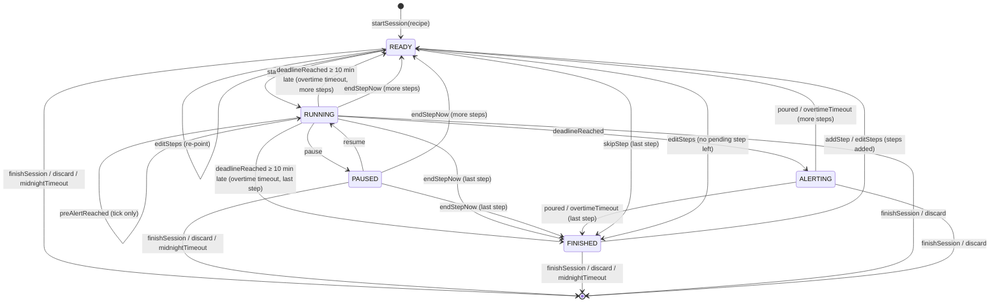
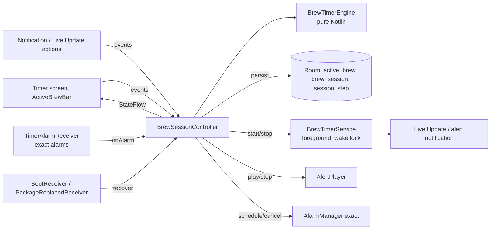

# 04 · Brew Timer Specification

> Status: **Draft v0.2** · Last updated: 2026-10-22 (engine rules, D-047; step edits, quick timer,
> recovery and snapshot, D-048; time rules and service contract, D-053;
> slice review: controller rules, alarm kinds, notification per state, D-054;
> controller inputs and ports, D-056; alarms, service and recovery in the
> first turn, D-057; accuracy workflow, D-067, 2026-10-23)
> v0.2: pre-alert tick, alert follows ringer mode, Pause as only running
> control, exact alarms always available (personal app, no store review),
> Live Update on Android 16, Samsung battery handling, one timer at a time.

The steep timer is the most important feature of UmamiT. This document
specifies its behaviour, state machine, background execution, persistence,
notifications and alerts. Functional requirements: TMR-xx and NOT-xx in
[02](02-functional-requirements.md).

**Target platform:** Samsung Galaxy, Android 16 / One UI 8 (minimum Android
15, API 35).

## 1. Terminology

| Term | Meaning |
|---|---|
| **Session** | One brewing of one tea (`BrewSession`), made of steps. |
| **Step** | One timed unit: RINSE, INFUSION or WHISK, with planned duration and optional temperature. |
| **Short / long step** | Planned duration < 10 min / ≥ 10 min (`LONG_STEP_THRESHOLD`). Cold and ice brews are always long steps. |
| **Deadline** | Monotonic time (`SystemClock.elapsedRealtime()`) at which the running step ends. |
| **Pre-alert** | Soft tick *N* seconds before the deadline (TMR-23). |
| **Overtime** | Time between deadline and the user tapping *Abgegossen*. |
| **Active time** | Time a step spent RUNNING or ALERTING (excludes PAUSED). |

## 2. Design principles

1. **Single source of truth:** a pure-Kotlin `BrewTimerEngine` state machine
   owned by an app-scoped `BrewSessionController`; UI, service, alarms and
   notifications only observe it or send events.
2. **Derived time:** remaining = `deadline − now` from the monotonic clock;
   never a decrementing counter.
3. **Persist every transition** before side effects.
4. **Idempotent events** (deadline from coroutine *and* alarm, *Abgegossen*
   from app *and* notification).
5. **Belt and braces:** in-process timing **and** exact alarms **and** a
   foreground service; any one of them is enough to alert.
6. **Testable with virtual time** (`MonotonicClock`, `WallClock` injected).

## 3. State machine



### 3.1 States

| State | Data | Meaning |
|---|---|---|
| `Idle` | — | No active session. |
| `Ready(i)` | step index, `readySince` | Waiting for the user to pour water and tap *Start*. Never auto-starts (TMR-08). |
| `Running(i)` | deadline (monotonic + wall), pre-alert time, `preAlertPlayed`, step start, paused total | Counting down. |
| `Paused(i)` | remaining ms, `pausedSince` (monotonic + wall), `preAlertPlayed`, step start, paused total | Frozen. |
| `Alerting(i)` | deadline (monotonic + wall), `alertPlayed`, step start, paused total | Step done; alert playing; waiting for *Abgegossen*. |
| `Finished` | `readySince` | All planned steps done; waiting for *Sitzung beenden* or *Weiterer Aufguss*. |

Every active state also carries the session: plan, pre-alert settings, zone,
last interaction, boot count, `demoted` and `longStepsOnly` (05 §3.12). Active
time is derived from the deadline, not stored (D-048).

### 3.2 Events and transitions

| Event | Allowed in | Effect |
|---|---|---|
| `startSession(teaId?, recipeSnapshot)` | Idle | Create IN_PROGRESS session + planned steps → `Ready(0)`. |
| `start` | Ready | `deadline = now + planned`; `preAlertAt = deadline − N` if applicable (TMR-23) → Running. Schedule exact alarms (§6.2). A short step ensures the FGS, a long step stops it (§6.1, D-053). |
| `pause` | Running | `remaining = deadline − now` → Paused; cancel alarms; release wake lock. A paused long step gets the FGS back. |
| `resume` | Paused | `deadline = now + remaining`; recompute `preAlertAt`: a played one is not repeated, an unplayed one is rescheduled from the new deadline, or skipped if `deadline − N ≤ now` (E6) → Running; reschedule alarms. FGS as for `start`. |
| `preAlertReached` | Running, when the pre-alert is due | Ensure the FGS (the tick plays in it, §9), then play tick once (idempotent: flag `preAlertPlayed`); caption „Gleich fertig …"; update Live Update. A due pre-alert is never ignored: too close to or past the deadline it sets `preAlertPlayed` without `PlayPreAlert`, so its due time is consumed and no tick sounds at or after the deadline (D-048). |
| `deadlineReached` | Running | → Alerting; ensure the FGS, then start the alert. At or after deadline + 10 min it applies `overtimeTimeout` instead, without an alert, as recovery does (D-053). Ignored in other states. |
| `endStepNow` | Running, Paused | Record actual = active elapsed; → next Ready or Finished. No alert. |
| `poured` | Alerting | Stop alert; record actual incl. overtime; → next Ready or Finished. |
| `overtimeTimeout` | Alerting, 10 min after deadline (`dueTimes.overtimeTimeoutAt`) | As `poured`, but actual = planned, overtime = 0 and `endedAt` = the deadline's wall time (assume poured on time); flag `overtimeAutoAck`. Not an interaction; silent. A quick timer ends. A `poured`, `endStepNow` or `finishSession` at or after deadline + 10 min records the same auto-ack (D-053). |
| `skipStep` | Ready | Mark skipped → next Ready or Finished. |
| `addStep` | any except Idle | *Weiterer Aufguss* (TMR-10): append `defaultAddedStep(plan)` — the last non-rinse step's kind and temperature, 1.5 × its duration rounded half up to 5 s below 10 min and to whole minutes from 10 min on, within 5 s – 24 h; if Finished → `Ready(new)`. A due pre-alert of the running step stays due (§5, D-054). |
| `editSteps(list, preAlertChoice)` | any except Idle | From the Schritte-Sheet (SCR-31): the whole plan plus *Wie Einstellung* / *Aus* / N s. Replaces only the pending steps and sets or clears the session's pre-alert override. Rejected unchanged if it changes, removes or reorders a started or ended step (`StartedStepChanged`) or leaves no non-rinse step (`NoBrewStepLeft`). Ready re-points to the first pending step, or goes to Finished; Finished with new steps goes to Ready. The running step's pre-alert follows the new N, but one that is already due stays due unless the edit leaves the step without a pre-alert (*Aus*, §5, D-054). Session-only unless *Im Rezept speichern*. |
| `finishSession` | any except Idle | A RUNNING/PAUSED step is completed as `endStepNow`, an ALERTING step as `poured`; then COMPLETED if ≥ 1 non-rinse step completed, else discard (UI confirms) → Idle; show SCR-06 sheet. |
| `discard` | any except Idle | Delete session and stock deduction → Idle. |
| `idleDemote` | Ready, Paused, Finished of a brew session, not yet demoted; 30 min after it became idle (`dueTimes.idleDemoteAt`) | Sets `demoted`, no other change: `StopForeground`, then the Live Update is posted again as a regular silent ongoing notification (with *Start*/*Weiter*/*Sitzung beenden*). Any user event clears `demoted` and ensures the FGS (notification action exemption; D-053). |
| `midnightTimeout` | Ready, Paused, Finished of a brew session, demoted or not; the first local midnight in the session's zone at least 6 h after it became idle (`dueTimes.midnightAt`; inexact alarm, also checked on recovery §7.2) | As `finishSession` without confirmation: if ≥ 1 non-rinse step completed (a paused step counts), COMPLETED with `auto_finished` (`CompleteSession(autoFinished = true)`, D-054) and the notification „Sitzung gespeichert" (`NotifySessionSaved`, no saved sheet); otherwise discarded silently. A paused step ends where its pause began; the open pause is not recorded. Not an interaction. |
| `recover` | any except Idle | Sent once on every process start with the persisted state (§7.2). Not an interaction. |

There are **no** ±10 s adjust events in v0.2 (TMR-04 dropped).

Engine rules (D-047):

- **Guards.** Time-based events carry no payload. They are accepted only
  when `dueTimes(state)` says they are due at `now`, so a stale alarm or an
  early coroutine wake-up is harmless. *Pause* works only before the
  deadline.
- **Not accepted.** An event a state does not allow returns the same state
  and no effects. The transition reports it as `Ignored`, or as
  `Rejected(reason)` when the UI should explain it: `startSession` while a
  timer is active is `ActiveTimerExists` (TMR-21).
- **`alertCompleted`** (Alerting; from the AlertPlayer after its cycle) sets
  `alertPlayed`.
- **Ending after the deadline.** `endStepNow` or `finishSession` in Running
  at or after the deadline, before `deadlineReached` was processed, counts as
  poured, with overtime.
- **Boot (D-048).** The clock reading carries the boot count, and the state
  records the boot its elapsed values belong to. `recover` rebases them from
  the wall values after a reboot; every other event from another boot is
  rejected as `BootChanged` until `recover` ran.
- **Plan shape (D-048).** Started or ended steps always form a prefix and
  pending steps the suffix. `addStep` and `editSteps` replace only the
  suffix, through the data effect `ReplacePendingSteps(fromIndex, steps)`.
- **Finish fallback.** A `finishSession` that falls back to discard records
  nothing; a started step counts as completed. The UI asks
  `finishWouldDiscard(state)` before it confirms.
- **Idle time (D-053).** A waiting state is idle since its last interaction
  or since it started waiting (`readySince`, `pausedSince`), whichever is
  later; idle demote and the midnight rule count from there, on the wall
  clock. So a step ended by the overtime timeout, which is not an
  interaction, starts a new idle period.
- **Time-based events** (`preAlertReached`, `deadlineReached`,
  `overtimeTimeout`, `idleDemote`, `midnightTimeout`, `quickTimerTimeout`) are
  not interactions. Every user event updates `last_interaction_wall_ms`.
- **A stale reading (D-054).** A clock reading older than the state breaks
  the controller rule of §4, but never a persisted state: `pause` keeps
  1 ms – planned remaining, and a pause that would be negative counts as 0 in
  `resume` and in the recorded paused time. So `restore` accepts every state
  the engine produces, and the session and its alert survive the next
  process start.
- **Beenden & neu starten (TMR-21, D-054).** No engine event of its own: the
  controller sends, in one event-lock turn, the event that ends the active
  timer, then the new start. A brew session ends with `finishSession` (the
  TMR-21 dialog is the confirmation, so a session without a completed
  non-rinse step is discarded without a second question); the controller
  shows no saved sheet for it and posts „Sitzung gespeichert"
  (notification 3) instead, i.e. it executes `ShowSavedSheet(id)` of this
  finish as `NotifySessionSaved(id)` (TMR-14). The session is not
  `auto_finished`: the user chose to end it. A quick timer ends with `cancel`
  (Ready, Running, Paused) or `poured` (Alerting). Then `startSession` or
  `startQuickTimer` meets Idle. The effects of both transitions run in order.

## 4. Components



- `BrewTimerEngine.reduce(state, event, now) → (state, effects, outcome)`.
  The effects are:
  - data: `CreateSession`, `ReplacePendingSteps`, `RecordStep`,
    `CompleteSession(sessionId, autoFinished)` (true only for the midnight
    timeout, D-054), `DiscardSession`;
  - `Persist`, `ScheduleAlarms`;
  - side effects: `PlayPreAlert`, `StartAlert`, `StopAlert`, `StartForeground`,
    `StopForeground`, `UpdateNotification`, `ShowSavedSheet`, `NotifySessionSaved`.
- **Effect order (D-047).** Every accepted transition lists, in this order:
  1. its data effects;
  2. exactly one `Persist` (steps 1 and 2 run in one Room transaction);
  3. exactly one `ScheduleAlarms(dueTimes(newState))`;
  4. its side effects.
- **Session rows.** The controller creates the session rows only for the
  `CreateSession` of an accepted start, so a refused start leaves no orphaned
  rows.
- **Controller rules (D-054).** These keep every engine guarantee true on
  the device:
  - The controller reads the clocks (`readClocks`) **after** it has taken the
    event lock, once per `reduce`; never when it creates or enqueues an event
    (a click handler, a notification action, an alarm's `onReceive`). Within
    a boot `elapsedMs` is then non-decreasing from event to event. The engine
    also survives a stale reading (§3.2 engine rules).
  - A failed Room transaction (data effects + `Persist`) is logged (06 §5.6)
    and then `Persist` alone is retried once; the side effects still run from
    the in-memory transition either way. `StartAlert`, `StopAlert` and
    `PlayPreAlert` are never skipped because of a storage error.
  - The data effects are total on predictable input, so they do not roll
    back the transaction: a `RecordStep` without its row changes nothing
    (`Persist` re-syncs the rows), an unreadable settings file counts as the
    defaults, and a session zone this device does not know counts as the
    device's zone (D-054).
- **Alarms.** `ScheduleAlarms` carries the full due set. The controller
  reconciles it per alarm type (§6.2): it schedules a type whose time is
  present and cancels one whose time is absent. There is no separate
  `CancelAlarms`. After every `reduce`, accepted or not, the controller
  re-arms its in-process wake-up from `dueTimes(state)`, but only from a
  state of the current boot (after `recover`). A time-based event that is due
  is never `Ignored`: it is applied or consumed, so the wake-up cannot spin
  (D-048). `dueEvents(state, now)` maps the due set to the events in apply
  order (deadline before pre-alert, then overtime; quick-timer cancel,
  midnight, then idle demote); the wake-up and the alarm receivers share it,
  and send each through `reduce`; an event an earlier one made obsolete is
  ignored.
- **Recovery.** The controller sends `recover` exactly once per process, as
  the first event, inside the same lock as the restore of `active_brew`: the
  first turn of the process restores it before its own input, whatever that
  input is (an alarm, a tap; D-057).
  `restore` throws only `IllegalArgumentException`; the controller then logs
  it (06 §5.6) and clears `active_brew` instead of running a wrong timer.
- **Alert.** `StartAlert` means "ensure the alert of the alerting step is
  playing": if it already plays for that step, nothing restarts. So a
  `deadlineReached` and a `recover` (or two `recover`s) that both ask for it
  give one alert (D-048).
- **Foreground service (D-053).** `StartForeground` means "ensure it runs";
  `StopForeground` stops it and removes notifications 1 and 2, also when they
  were posted without the service. Every active state runs with the service
  except a demoted session and a long running step. So:
  - `startSession`, `startQuickTimer`, and `start`/`resume` of a short step
    emit `StartForeground`; `start`/`resume` of a long step emit
    `StopForeground`;
  - `deadlineReached` emits `StartForeground` before `StartAlert`;
  - `idleDemote` and every transition to Idle emit `StopForeground`; a
    transition to Idle never emits `UpdateNotification`;
  - any other transition from a state without the service to one with it
    (a user event on a demoted session, pausing or ending a long step) adds
    `StartForeground`;
  - `recover` emits `StartForeground` only where the state needs it;
  - a `preAlertReached` that plays the tick emits `StartForeground` before
    `PlayPreAlert`, as the deadline does before the alert (D-054).
- **Which notification (D-044, D-054).** `StartForeground` and
  `UpdateNotification` use the notification of the **new** state (§8.2):
  - in Alerting, the alert (ID 2, `steep_finished`) is the foreground
    notification. `StartForeground` and `UpdateNotification` show ID 2 — with
    the full-screen intent only when `StartAlert` is in the same transition
    (D-057) — and cancel IDs 1 and 4 if they are posted. Neither is posted
    while alerting (`deadlineReached`, `addStep`/`editSteps` while alerting,
    `recover` of an alerting state);
  - in every other active state with the service, ID 1, the Live Update; while
    the session is demoted or a long step runs, the quiet notification ID 4
    without the service (a Live Update „Fertig um 14:30" for a long step, a
    regular ongoing notification for a demoted session; D-064). ID 4 is
    cancelled before every start of the service. ID 2 is cancelled when the
    alert ends.
  While the service runs, the notification changes only through it (D-057).
  The M1-09/M1-11 Robolectric tests assert that neither ID 1 nor ID 4 is
  posted after `deadlineReached`, after `addStep` while alerting, after
  `recover` of an alerting state and at a long step's deadline.
- `BrewSessionController` serialises events (single coroutine/Mutex),
  executes effects, exposes `StateFlow<TimerUiState>` (D-056):
  - **Inputs** are suspend functions: the starts, the user events with their
    source (app or notification), `onAlarm(kind)` and the alert player's
    `alertCompleted(alert)`.
  - **Effects reach ports:** alarms (the full due set), service, notifier,
    alert player, saved sheet, diagnostics, and the in-process wake-up. The
    Android adapters are thin.
  - **A turn that holds the lock runs to its end,** even when its caller is
    cancelled, so a transition is never half applied.
  - **A port that throws is logged,** and the next effect still runs.
  - **The screens see only state and user events:** SCR-05 and the active
    brew bar reach the controller through the `BrewTimer` seam of
    `feature:brew` (D-058); `TimerUiState.Active.preAlert` carries the
    session's own pre-alert option for the Schritte-Sheet.
- `BrewTimerService` shows the Live Update or the alert as its foreground
  notification and holds the wake lock; no timer logic. Its port sends it the
  notification of the state and the wake-lock time (§6.3, D-057). The
  `AlertPlayer` is a process singleton the controller drives (D-059); the
  service keeps the process in the foreground while it plays.
- UI renders remaining time per frame from the deadline while visible.

## 5. Time computation

- **Monotonic** `elapsedRealtime()` for all countdown arithmetic; **wall**
  clock for journal timestamps, notification chronometer and reboot recovery;
  `Settings.Global.BOOT_COUNT` stored to detect reboots.
- Remaining time is displayed rounded **up** to whole seconds; overtime rounded
  down („+0:07"); ≥ 1 h as `h:mm:ss`. Ready shows the planned duration;
  Finished shows 0. A running step past its deadline shows 0 until
  `deadlineReached` is processed.
- Delivery (D-047): the alert is **at-least-once**. Alerting holds
  `alertPlayed`, and recovery replays `StartAlert` while it is false. The
  pre-alert tick is **at-most-once**: `preAlertPlayed` is set in the
  transition that plays it.
- Pre-alert: `preAlertAt = deadline − N·1000` where N = session override
  (Schritte-Sheet) ?: recipe value ?: global setting (default **10 s**); none
  if N = 0, if planned < N + 5 s, for rinse steps < 15 s, or for long steps
  (≥ 10 min). `startSession` freezes recipe ?: global as the inherited value,
  so a later change of the recipe or the setting never changes an active
  session; *Wie Einstellung* clears the session override (D-048). `resume`
  and `editSteps` recompute an unplayed pre-alert of the running step from its
  deadline and the current N, and skip it when that time is not after now; a
  played one never comes back. An edit never consumes a pre-alert that is
  already due but whose `preAlertReached` is still queued: it stays due while
  the step still has a pre-alert, and `preAlertReached` decides by the 1-s
  rule (D-054). `preAlertLeadSeconds(state)` gives the current step's N, or
  none, for the ring and the progress point (§8.3). A due `preAlertReached` plays the tick while at
  least **1 s** is left before the deadline and only marks it played after
  that (D-053).

### 5.1 Recorded step data

| Field | Rule |
|---|---|
| `plannedSeconds` | Planned duration at step start. |
| `actualSeconds` | Active elapsed from *Start* to *Abgegossen* / *Aufguss jetzt beenden*, excluding pauses, rounded to 1 s. Includes overtime if acknowledged within 10 min; else `overtimeTimeout` rule. |
| `pausedSeconds` | Total paused time. |
| `overtimeSeconds` | Deadline → *Abgegossen* (0 if ended early or auto-acknowledged). |
| `startedAt`, `endedAt` | Wall clock. |
| `skipped`, `overtimeAutoAck` | Flags. |

Durations are rounded half up. The journal can therefore differ from the
display by 1 s: 2.5 s of overtime shows „+0:02" and is recorded as 3 s. Other
rules (D-047):

- A skipped step records 0 for actual, paused and overtime, and null for
  `startedAt` and `endedAt`. It keeps `plannedSeconds`.
- A Running step ended at or after the deadline counts as poured:
  overtime = now − deadline, and actual = planned + overtime.

## 6. Background execution

### 6.1 Strategy

| Situation | Mechanisms (all active together) |
|---|---|
| Short step RUNNING | Controller coroutine until pre-alert/deadline · exact alarms for pre-alert and deadline · foreground service with Live Update · partial wake lock |
| Long step RUNNING (≥ 10 min, or any step of a cold or ice brew) | Exact alarm for deadline only (no pre-alert tick) · Live Update „Fertig um 14:30" (`longStepEndWallMs`, the quiet notification ID 4, promotion requested; D-064) without foreground service · no wake lock. Pausing it brings the FGS back like any waiting state. |
| READY / PAUSED / FINISHED | Foreground service keeps the Live Update (no wake lock) for up to 30 min, then `idleDemote` stops it; midnight alarm (inexact) for `midnightTimeout`. After a process restart, recovery tries to restart the FGS immediately (§6.3); if Android refuses, a plain ongoing notification is shown until the next user interaction or exact alarm restarts the FGS (§7.2). |
| ALERTING | Foreground service keeps the process in the foreground while the `AlertPlayer` plays; wake lock for the longest alert + 30 s (2 min 30 s) from the start of the alert, released by the next state (D-057) |

### 6.2 Exact alarms

- The app declares **`USE_EXACT_ALARM`**, which is granted automatically.
  This is acceptable because the app is sideloaded and never goes through
  Play review (D-013). `SCHEDULE_EXACT_ALARM` is not needed.
- One alarm per `DueTimes` field, reconciled from `ScheduleAlarms` after
  every accepted transition (§4): scheduled when the field has a time,
  cancelled when it has none. Request codes are fixed per field, so
  rescheduling replaces the alarm (D-054):

  | `DueTimes` field | Alarm | Request code | Receiver sends |
  |---|---|---|---|
  | `preAlertAtElapsedMs` | exact, `setExactAndAllowWhileIdle(ELAPSED_REALTIME_WAKEUP)` | 101 | `preAlertReached` |
  | `deadlineElapsedMs` | exact, `setExactAndAllowWhileIdle(ELAPSED_REALTIME_WAKEUP)` | 102 | `deadlineReached` |
  | `overtimeTimeoutAtElapsedMs` | exact, `setExactAndAllowWhileIdle(ELAPSED_REALTIME_WAKEUP)` | 103 | `overtimeTimeout` |
  | `idleDemoteAtWallMs` | exact, `setExactAndAllowWhileIdle(RTC_WAKEUP)` | 104 | `idleDemote` |
  | `quickCancelAtWallMs` | exact, `setExactAndAllowWhileIdle(RTC_WAKEUP)` | 105 | `quickTimerTimeout` |
  | `midnightAtWallMs` | inexact, `set(RTC)` (no wake-up) | 106 | `midnightTimeout` |

  The elapsed fields use `ELAPSED_REALTIME` so a wall-clock change never
  moves them (E1); the overtime timeout is exact because it may start the
  FGS (`StartForeground` of the next Ready), and only exact-alarm delivery
  allows that from the background. The wall fields use `RTC` so they follow
  a wall-clock or zone change; idle demote and the quick-timer cancel stop
  the service, so a late one would keep it running; the midnight timeout
  may wait until the phone next wakes (recovery applies it too, §7.2), so it
  neither wakes the phone nor needs to be exact. Each receiver sends the event of its
  row; the event is accepted only when due (§3.2 guards), so a late, early
  or stale alarm is harmless. After a reboot the alarms are gone and
  `recover` schedules them again (§7.3).
- `TimerAlarmReceiver` hands every alarm to the controller's `onAlarm`
  (idempotent); it finds the controller through the app (D-057). If the
  process was killed (E3), the alarm starts a new one, whose controller first
  recovers the state (§7.2); the `StartForeground` of recovery or of the
  transition then starts `BrewTimerService` in the foreground (exact-alarm
  delivery is an allowed exemption for starting an FGS from the background),
  so the `AlertPlayer` can play.
- `AlarmManager.canScheduleExactAlarms()` is still checked; if false (should
  not happen), the reliability banner is shown (TMR-31).

### 6.3 Foreground service

- Type `specialUse` with the subtype string from §13 (no store review, but
  Android requires a type).
- Started from the user's *Start* tap (foreground), from notification
  actions, from the exact alarm (§6.2), and **attempted** during recovery
  (§7.2), on `BOOT_COMPLETED` (§7.3) and on `MY_PACKAGE_REPLACED` (§7.5).
  Background starts are allowed while the app is exempt from battery
  optimisation (ONB-02), and `specialUse` is not among the FGS types
  restricted after boot. Every start from the background catches
  `ForegroundServiceStartNotAllowedException`, logs it (06 §5.6) and falls
  back to the plain ongoing notification; the next exact alarm sends the
  refused start once more (D-057).
- Partial wake lock during short RUNNING steps and ALERTING, with timeout
  `remaining + alert length + 30 s`; the alert length is the longest one
  (Lang, 2 min). Waiting states release it.
- While the service runs in the foreground, the port sends its commands with
  `startService`, which a running foreground service allows from the
  background; the same notification ID only updates the notification, a new
  one (the alert) takes `startForeground`. If that is refused, the service
  leaves the foreground and posts the alert alone (§8.2). A stop never
  reaches the service before a pending start has called `startForeground`
  (D-057).

### 6.4 Samsung battery management

- First-start setup (ONB-02) requests `ACTION_REQUEST_IGNORE_BATTERY_OPTIMIZATIONS`
  (permission `REQUEST_IGNORE_BATTERY_OPTIMIZATIONS`, allowed for a sideloaded
  app) and guides the PO to One UI's *Akku › Uneingeschränkt* and to add
  UmamiT to *Nie schlafende Apps*.
- `PowerManager.isIgnoringBatteryOptimizations()` is checked at app start and
  before each session; if false → reliability banner.
- Verified on the PO's Galaxy (Android 16 / One UI 8) as part of acceptance.

## 7. Persistence & recovery

### 7.1 Persisted on every transition

`active_brew` row ([05 §3.12](05-data-model.md#312-activebrew)) and step
records, in one Room transaction. The engine maps every state to this row
plus the session's step rows and back without loss (`snapshot(state)`,
`restore(snapshot)`; D-048): a step's status is derived, not stored (rows with
recorded values are ended, the current step of Running, Paused or Alerting is
started, all others are pending). The quick timer has no step rows; its one
step is `quick_duration_seconds`.

If that transaction fails, the controller logs it, retries `Persist` alone
once and runs the side effects anyway (§4 controller rules, D-054). A
`Persist` that still fails leaves the previous row; the next transition's
`Persist` writes the current state again.

### 7.2 Recovery on process start

The controller restores the state and sends `recover` in the first turn of
the process, before that turn's own input (D-057), which the engine applies
purely (§12 unit tests with fake clocks and boot counts; D-048).
After a reboot it first moves every elapsed value to the new elapsed clock at
the same distance from now as its wall value, within physical bounds: every
instant of the old boot lies before elapsed 0, so a pause start and a passed
deadline are clamped to ≤ 0, and a running step keeps at most its planned
time. A state that is impossible on the same boot count (a deadline of an
alert or a pause start after now, more than the planned time left) is
treated as a reboot. The bounds catch a wall clock set back across the
reboot; a wall clock set forward cannot be told apart from a longer time off,
so the step counts as longer off and past 10 min is auto-acknowledged
(accepted limit, D-048). Every row that keeps the session emits
`UpdateNotification` and, unless the session is demoted or a long step is
running, `StartForeground` (an attempt, §6.3); the timeout rows are silent
(no `StartAlert`, no saved sheet). A waiting session applies the timeouts that
came while the process was dead in this order: quick-timer cancel, midnight,
idle demote (D-053).

| Persisted phase | Behaviour (same boot uses monotonic values; after reboot wall-clock values) |
|---|---|
| READY / PAUSED / FINISHED | Restore; try to restart the FGS now (§6.3), else re-post a plain ongoing notification and restart the FGS on the next interaction. |
| READY / PAUSED / FINISHED, past the midnight timeout (TMR-14) | `midnightTimeout` applied silently (with „Sitzung gespeichert" if logged), also after a reboot (wall clock). |
| READY / PAUSED / FINISHED, demoted or idle for 30 min | Restored without the FGS: a regular ongoing notification; a not yet demoted session is demoted now (`StopForeground`). |
| RUNNING long step, deadline in future | Restored without the FGS (§6.1); the deadline alarm restarts it for the alert. |
| RUNNING, deadline in future | Restore; reschedule alarms from `dueTimes`; try to restart the FGS (§6.3). An unplayed pre-alert stays due even if its time has passed, so a pre-alert alarm that restarted the process still reaches `preAlertReached`, whose rules decide whether a late tick plays. |
| RUNNING/ALERTING, deadline passed < 10 min ago | → ALERTING with overtime; `StartAlert` while `alertPlayed` is false (at-least-once). |
| RUNNING/ALERTING, deadline passed ≥ 10 min ago | `overtimeTimeout` applied silently: poured on time with `overtimeAutoAck`, ended at the deadline's wall time. A quick timer just ends. |
| Quick timer READY / PAUSED, 30 min after the last interaction | Ended silently (`StopForeground`), as by `quickTimerTimeout`. |

**Open for #46 (D-057 review):** a process killed during ALERTING whose
deadline alarm was already handled (the in-process wake-up came first) has
only the overtime alarm left; the alert is replayed only if something starts
the process before then (app start recovery, #46), otherwise the overtime
timeout acknowledges it silently. An exact „alert watchdog" alarm (e.g.
deadline + 30 s while `alertPlayed` is false) would close this; it needs an
engine due time and is decided with #46.

### 7.3 Reboot

`BootReceiver` (`BOOT_COMPLETED`, delivered after the first unlock) restores the state from wall-clock data,
reschedules the exact alarms (or applies §7.2 if the deadline already passed),
tries to restart the FGS (§6.3) and posts a notification „Dein
Gyokuro-Timer läuft weiter". If the FGS start was refused, the deadline
alarm starts it when it fires (§6.2).

Samsung's *Automatische Optimierung* may restart the phone at night; the
first-start setup shows a hint to disable *Automatisch neu starten* (ONB-02).

`Could`: a direct-boot alert path — `LOCKED_BOOT_COMPLETED` receiver
(`directBootAware`) plus the current deadline mirrored in device-protected
storage — would let the alert fire before the first unlock (E2).

### 7.4 Force stop

Alarms are cleared by the system; on next launch §7.2 applies and the UI says
„Der Timer wurde vom System angehalten."

### 7.5 App update

Installing an update kills the process and a running FGS (alarms survive).
`PackageReplacedReceiver` (`MY_PACKAGE_REPLACED`) runs §7.2 recovery right
away, including the FGS restart attempt.

## 8. Notifications

### 8.1 Channels

| Channel ID | Name | Importance | Sound / vibration | Purpose |
|---|---|---|---|---|
| `brew_timer` | Brühtimer | DEFAULT, silent (promotion only needs importance above MIN) | none | Live Update / ongoing (not while ALERTING, §8.2) |
| `steep_finished` | Aufguss fertig | HIGH | none (played by `AlertPlayer`) | Full-screen intent / heads-up „Jetzt abgießen!" |
| `sessions` | Sitzungen | LOW | none | Auto-finished session, reboot notice |
| `reminders` | Erinnerungen | LOW | none | Backup, stock reminders |
| `catalog` | Katalog | LOW | none | Refresh progress and result |

### 8.2 Notification content

| Phase | Title | Text | Actions |
|---|---|---|---|
| READY | Gyokuro · Aufguss 2 von 3 | Bereit · 0:20 · Wasserkocher auf 60 °C | *Start* |
| RUNNING | Gyokuro · Aufguss 2 von 3 | Zieht bei 60 °C (chronometer countdown) | *Pause* |
| RUNNING after pre-alert | Gyokuro · Aufguss 2 von 3 | Gleich fertig … | *Pause* |
| PAUSED | Gyokuro · Aufguss 2 von 3 | Pausiert · noch 0:12 | *Weiter* |
| ALERTING (separate notification on `steep_finished` with `setFullScreenIntent(SCR-05)`, `CATEGORY_ALARM`) | Jetzt abgießen! | Gyokuro · Aufguss 2 | *Abgegossen* |
| FINISHED | Gyokuro · Alle Aufgüsse fertig | Tippen zum Beenden | *Sitzung beenden* |
| Long step (notification 4) | Gyokuro · Aufguss 1 von 1 | Fertig um 14:30 | *Pause* |
| Demoted (notification 4, TMR-14) | as the phase | as the phase | *Start* / *Weiter*, *Sitzung beenden* |
| Quick timer | Schnelltimer | as the phase | as the phase, plus *Abbrechen*; *Fertig* while alerting |

Actions → non-exported receiver → controller (source NOTIFICATION).
Notification IDs: 1 Live Update/FGS, 2 alert, 3 sessions, 4 the quiet
notification without the service (a long running step, a demoted session;
D-064), 10+ reminders/catalog. Content intent → SCR-05 through the app's
launcher activity, named explicitly with `com.umamit.action.OPEN_TIMER`, which opens the timer route; the
same intent is the alert's full-screen intent (D-064). Actions: *Start*,
*Pause*/*Weiter*, *Abgegossen* (*Weggegossen* for a rinse, *Fertig* for the
quick timer), *Sitzung beenden* (FINISHED, demoted; not where it would
discard the session, TMR-12 AC1), *Abbrechen* (quick timer).
Going to Idle removes notifications 1, 2 and 4 through `StopForeground`, whether
or not the service runs; the midnight timeout's „Sitzung gespeichert" is
notification 3 (`NotifySessionSaved`, D-053).

**While ALERTING the alert (ID 2) is the app's only notification of
importance DEFAULT or higher (D-044):** it replaces the Live Update as the
foreground-service notification, and a Live Update posted without the
service (notification 1 after a refused start, notification 4) is cancelled
first; the Live Update returns with the next state. While the service runs,
every change of the timer notification goes through the service, never
`notify` next to it (D-057, D-064).
Reason: Android 16 force-groups two ungrouped notifications of an app in the
same importance section (`config_autoGroupAtCount` = 2) and marks them
`FLAG_SILENT`; System UI then suppresses the full-screen intent and the
heads-up (`docs/plans/M1-probe-api-notes.md`).

**Full-screen alert (D-036):** the alert notification (ID 2) carries a
full-screen intent to SCR-05 for short **and** long steps. With the screen
off or locked, the screen turns on and the timer activity is shown over the
lock screen (`setShowWhenLocked(true)`, `setTurnScreenOn(true)`); while the
phone is in use, it shows as a heads-up instead. This also happens in silent
mode (visual only). Requires `USE_FULL_SCREEN_INTENT`; the app checks
`NotificationManager.canUseFullScreenIntent()` and, if false, ONB-02 and the
reliability banner deep-link to `Settings.ACTION_MANAGE_APP_USE_FULL_SCREEN_INTENT`
(fallback: heads-up only).

### 8.3 Live Update

On Android 16 the `brew_timer` notification is requested as a **promoted
ongoing notification** (Live Update):

- `Notification.ProgressStyle` with one **segment per step** (length ∝
  planned duration with a minimum visible length so short steps stay
  visible; at most 30 steps, PRF-03; rinse segments in a muted colour) and a
  **point** at the pre-alert of the current step; progress = elapsed active
  time of the session's planned total. Progress is updated on every state
  transition and **every 15 s** while RUNNING (not per second), in order with
  the controller's commands (D-064).
- Ongoing, with content title, `NotificationCompat.Builder.setRequestPromotedOngoing(true)`
  (AndroidX core; the platform `Notification.Builder` of SDK 36 has no such
  method, it sets the extra `android.requestPromotedOngoing`, D-043) and a
  monochrome small icon (M1 app icon task). On Android 16 the request is
  **always** set, also while the user does not allow promotion, so the system
  promotes the posted notification as soon as the user allows it (D-044). The
  system promotes it only if it has promotable characteristics
  (`hasPromotableCharacteristics()`, whose rules differ between Android 16
  builds: colorized before QPR1, not colorized from QPR1) and the user allows
  it; the resulting flag is `FLAG_PROMOTED_ONGOING` (0x40000).
- **Status-bar chip:** in RUNNING it is driven by the chronometer countdown
  (`setUsesChronometer(true)`, `setChronometerCountDown(true)`,
  `setWhen(deadlineWall)`); no static short critical text with a time. In
  READY / PAUSED / FINISHED a short critical text is used (e.g. „60 °C",
  „Pause").
- Shown as a status-bar chip and on the lock screen. On One UI 8 it may also
  appear in the Samsung **Now Bar**; this is **best effort** (One UI may
  require the user to enable live notifications per app or a developer
  option) and is not a release blocker. With `v0.0.2-probe` the countdown did
  appear in the Now Bar on the PO's Galaxy (2026-10-22).
- **User dismissal is respected:** `setDeleteIntent` records the dismissal;
  the notification is not re-posted until the next state change (a new phase,
  step, the pre-alert or the demotion; D-064).
- A demoted session (TMR-14) is a regular ongoing notification without the
  promotion request; a long running step keeps it (TMR-18, „Fertig um
  14:30").
- If promotion is not allowed (`NotificationManager.canPostPromotedNotifications()`
  false), the system shows it as a normal ongoing notification (the request
  stays set) and the
  reliability banner deep-links to
  `Settings.ACTION_APP_NOTIFICATION_PROMOTION_SETTINGS` (D-043). The banner is based
  only on this check, not on Now Bar presence.
- API names follow the Android 16 SDK and are verified in the **probe
  release** (M1 plan) on the PO's Galaxy before the full timer is built.
  `v0.0.2-probe` passed all four probe items on 2026-10-22 (09 §4, D-040,
  #17).

## 9. Alerts

### 9.1 AlertPlayer — follows the ringer mode

| Ringer mode | Pre-alert tick | Alert |
|---|---|---|
| Normal (Ton) | Soft tick sound + short haptic | Alert tone + vibration pattern (if SET-11) |
| Vibrate | Short haptic | Vibration pattern |
| Silent (Stumm) | — | Visual only (full-screen alert turns the screen on, Live Update) |

- Audio uses `AudioAttributes.USAGE_NOTIFICATION_EVENT`, so volume follows the
  notification volume; Do Not Disturb is respected.
- Transient audio focus with ducking; vibrate only during calls.
- Alert length (SET-14): Kurz = once; **Normal = repeat up to 15 s**
  (default); Lang = until acknowledged, max 2 min.
- Vibration pattern `[0, 400, 200, 400, 200, 800]` ms with
  `VibrationAttributes.USAGE_NOTIFICATION` semantics.
- Details (#16): the alert repeats in cycles of the tone length, at least
  the vibration pattern plus 1 s (tone + vibration pattern together; Normal
  = 4 × 3.5 s for the Klangschale, 5 × 3 s for the other tones), and each
  cycle reads the ringer mode and call state again. A ringing or active
  call (incl. VoIP) counts as „in a call". If the audio focus is refused or
  lost, the rest of that alert has no sound. Do Not Disturb set to *total
  silence* or *alarms only* keeps the alert visual; in *priority only* mode
  the platform decides.
- Settings and reporting (#44, D-059): tone (SET-09), vibration (SET-11) and
  alert length (SET-14) are read at the start of every alert and tick; an
  unreadable settings file plays the defaults. When the alert has run its
  full length (also when it was visual only), the player reports
  `alertCompleted` for that alert once; an alert stopped or replaced first
  is not reported, and recovery replays an unreported alert (at least once,
  D-047). A pre-alert never cuts a playing alert.
- Test via SET-31 (*Alarm testen*): the tick, then 1.5 s later the alert,
  with the current settings, through the same player and matrix. It is
  ignored while a real alert or tick plays; a real one replaces a running
  test.

### 9.2 Sounds

Bundled OGG, mono, 48 kHz, ≤ 60 KB each, loudness-normalised: Klangschale
(default alert), Glocke, Holzblock, Glockenspiel, Sanft; plus a short, soft
**tick** for the pre-alert: a small singing-bowl „ting" of about 0.8 s, 8 LU
below the alert (D-045). The five alert tones are normalised to -16 LUFS
with a true-peak ceiling of -1.5 dBTP (D-045, D-059):

| Tone | Character | Length |
|---|---|---|
| Klangschale | bright singing bowl, 880 Hz, slow shimmer (D-045) | 3.5 s |
| Glocke | small bell struck twice, 660 Hz, minor-third bell partials | 3.0 s |
| Holzblock | two wood blocks, „tok-tok … tok-tok" | 1.2 s |
| Glockenspiel | rising arpeggio C6–E6–G6–C7 on steel bars | 2.2 s |
| Sanft | two soft, round tones rising a fourth (D5 → G5) | 3.0 s |

Sourcing (D-036): all tones are **synthesised** first with ffmpeg in the
cloud container (e.g. additive partials with exponential decay for the bowl,
bell and chime; filtered noise burst for the wood block), loudness-normalised
and encoded to OGG; the generator script is committed. The PO may later
replace any tone with an uploaded **CC0 recording**; its source URL and
licence are recorded in `docs/design/assets/source/CREDITS.md` and shown in
About.

## 10. Quick timer

Ephemeral session (no journal, no stock) using the same engine with one
INFUSION step and these differences:

| Event | Allowed in | Effect |
|---|---|---|
| `start` | Ready | as §3.2 |
| `pause` / `resume` | Running / Paused | as §3.2 |
| `deadlineReached` | Running | → Alerting |
| `poured` (button *Fertig*) | Alerting | → Idle |
| `cancel` (*Abbrechen*, overflow and notification) | Ready, Running, Paused | → Idle, nothing recorded |
| `quickTimerTimeout` | Ready, Paused; 30 min after the last interaction (`dueTimes.quickCancelAt`, wall clock) | → Idle, nothing recorded |
| `overtimeTimeout` | Alerting, 10 min after the deadline | → Idle, nothing recorded |
| `recover` | any | as §7.2; after 10 min of overtime → Idle |

The quick timer has no idle demote and no midnight timeout: its 30-min cancel
comes first (D-053).

`startQuickTimer(duration, globalPreAlert)` starts it in Ready; a duration
outside 5 s – 24 h or a pre-alert other than 0 or 5–30 s is rejected as
`InvalidQuickTimer`. It has no
`brew_session` row, so `CreateSession`, `RecordStep`, `ShowSavedSheet` and
the other data effects never occur. Starting a session or another quick
timer while one is active is rejected as `ActiveTimerExists` (TMR-21);
`editSteps` and the session events are ignored (D-048).

Uses the global pre-alert, the same alert and the Live Update
(„Schnelltimer"). Counts as the single active timer. No `endStepNow`,
`skipStep` or `addStep`; an unstarted or paused quick timer is cancelled after
30 min without interaction.

## 11. Edge cases

| # | Case | Expected behaviour |
|---|---|---|
| E1 | Clock or time zone changed during a step | No effect (monotonic). |
| E2 | Reboot during a step | §7.3: alarms rescheduled at boot. `BOOT_COMPLETED` arrives only after the first unlock (the database is credential-encrypted), so the alert fires on time only if the phone is unlocked before the deadline; otherwise it fires right after the first unlock, with overtime, if that is less than 10 min after the deadline. From 10 min on, recovery applies the overtime timeout silently (§7.2): no alert, the step is recorded as poured on time (e.g. a night restart during a cold brew, unlocked in the morning). Accepted for a personal app; a direct-boot path is `Could` (§7.3). |
| E3 | Process killed during a short step | Exact alarm fires → FGS started → alert plays. |
| E4 | App swiped from recents | Session continues. |
| E5 | *Abgegossen* tapped in app and notification at once | Second event ignored. |
| E6 | Pause during pre-alert window, then resume | Pre-alert not repeated if already played; an unplayed one is rescheduled from the new deadline, or skipped if `deadline − N ≤ now` after the resume (§5). |
| E7 | Planned step < N + 5 s | No pre-alert for that step. |
| E8 | Phone call during alert | Vibration only. |
| E9 | Notifications or Live Updates disabled mid-session | Alert still plays via service; banner shown. |
| E10 | Tea deleted while its session is active | Delete disabled („Erst die Sitzung beenden"). |
| E11 | Device restore (new phone or reset) | `active_brew` is cleared on the first start after the restore (05 §8); no session is resumed. |
| E12 | Catalog refresh during a session | Allowed; never affects the session (it uses a recipe snapshot). |
| E13 | Session spans midnight | Belongs to the local date of `startedAt`. |
| E14 | DND on | Sound/vibration suppressed per DND; visual alert remains. |

## 12. Testing

| Level | Tests |
|---|---|
| Unit | Every transition in §3.2; pre-alert computation and skip rules; idempotency; rounding; recorded data; recovery table with fake clocks and boot counts; idle/overtime timeouts; the midnight rule with both Europe/Berlin DST changes; stale clock readings. The seeded invariant test checks after every event: the foreground-service contract against an independent oracle (§4), the pre-alert tick at most once per step and only ≥ 1 s before the deadline, a due pre-alert kept by edits, the snapshot round trip, and that no due event is ignored (also after an ignored event). |
| Robolectric | Controller + Room; notification content per phase; alarm scheduling; ringer-mode matrix of `AlertPlayer`. |
| Instrumented (CI emulator job, API 35 and 36) | Process death during a step (SIGKILL from a test runner in its own process; `am kill` spares a process with a foreground service, D-057); alarm delivery; full-screen intent launch; promotion of the Live Update asserted via `dumpsys notification` (`FLAG_PROMOTED_ONGOING`). |
| On the PO's Galaxy (acceptance) | Probe release first (M1 plan); then alert & pre-alert with screen off for 2 and 6 min steps; app swiped away; `adb`-free checks of Live Update (Now Bar best effort); reboot during a long step; ringer normal/vibrate/silent; DND. |
| Accuracy | 50 × 60 s steps with the screen off on the CI emulator, in the manually dispatched workflow `accuracy.yml` that must pass before each release candidate (`AccuracyRunTest`, skipped in the regular emulator job; [09 §4a](09-release-plan.md#4a-accuracy-run-before-each-release-candidate), D-067); on the device the diagnostics log (06 §5.6) records scheduled vs actual fire times: p95 ≤ 250 ms, max ≤ 1 s for pre-alert and alert. |

## 13. Manifest declarations (timer-related)

```xml
<uses-permission android:name="android.permission.POST_NOTIFICATIONS" />
<uses-permission android:name="android.permission.POST_PROMOTED_NOTIFICATIONS" /> <!-- not in the SDK 36 stubs; from Android 16 QPR1 a normal|appop permission that promotion requires; must stay declared (D-044) -->
<uses-permission android:name="android.permission.FOREGROUND_SERVICE" />
<uses-permission android:name="android.permission.FOREGROUND_SERVICE_SPECIAL_USE" />
<uses-permission android:name="android.permission.WAKE_LOCK" />
<uses-permission android:name="android.permission.VIBRATE" />
<uses-permission android:name="android.permission.USE_EXACT_ALARM" />
<uses-permission android:name="android.permission.REQUEST_IGNORE_BATTERY_OPTIMIZATIONS" />
<uses-permission android:name="android.permission.RECEIVE_BOOT_COMPLETED" />
<uses-permission android:name="android.permission.USE_FULL_SCREEN_INTENT" />
<!-- Timer activity: setShowWhenLocked(true) is set from code only while the
     timer route is on top with an active session, and setTurnScreenOn(true)
     only while it alerts there (D-058); not in the manifest, so the rest of
     the app never appears over the lock screen. The notifications' content
     intent and the alert's full-screen intent name the app's launcher activity
     explicitly with the action com.umamit.action.OPEN_TIMER, without an intent
     filter; the activity opens the timer route and sets the flags before its
     first frame (D-064). -->

<service
    android:name=".timer.service.BrewTimerService"
    android:exported="false"
    android:foregroundServiceType="specialUse">
    <property
        android:name="android.app.PROPERTY_SPECIAL_USE_FGS_SUBTYPE"
        android:value="Tea steeping countdown timer started by the user" />
</service>
<receiver android:name=".timer.TimerActionReceiver" android:exported="false" />
<receiver android:name=".timer.alarm.TimerAlarmReceiver" android:exported="false" />
<receiver android:name=".timer.BootReceiver" android:exported="true">
    <intent-filter>
        <action android:name="android.intent.action.BOOT_COMPLETED" />
    </intent-filter>
</receiver>
<receiver android:name=".timer.PackageReplacedReceiver" android:exported="false">
    <intent-filter>
        <action android:name="android.intent.action.MY_PACKAGE_REPLACED" />
    </intent-filter>
</receiver>
```

Class names are indicative. Permission names for Live Updates are verified
against the Android 16 SDK at implementation.
