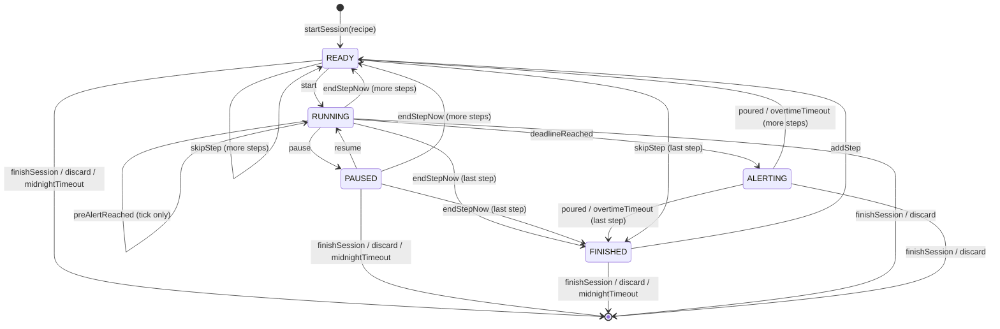
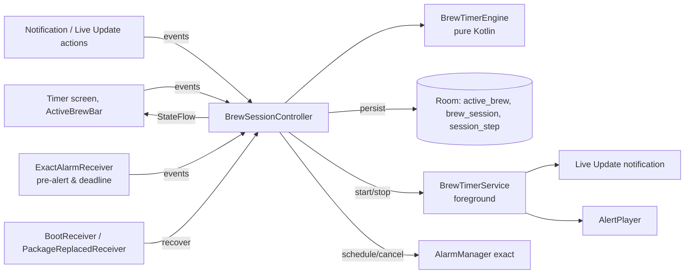

# 04 · Brew Timer Specification

> Status: **Draft v0.2** · Last updated: 2026-10-21
> v0.2: pre-alert tick, alert follows ringer mode, Pause as only running
> control, exact alarms always available (personal app, no store review),
> Live Update on Android 16, Samsung battery handling, one timer at a time.

The steep timer is the most important feature of UmamiT. This document
specifies its behaviour, state machine, background execution, persistence,
notifications and alerts. Functional requirements: TMR-xx and NOT-xx in
[02](02-functional-requirements.md).

**Target platform:** Samsung Galaxy, Android 16 / One UI 8 (minimum Android
15, API 35).

## 1. Terminology

| Term | Meaning |
|---|---|
| **Session** | One brewing of one tea (`BrewSession`), made of steps. |
| **Step** | One timed unit: RINSE, INFUSION or WHISK, with planned duration and optional temperature. |
| **Short / long step** | Planned duration < 10 min / ≥ 10 min (`LONG_STEP_THRESHOLD`). Cold and ice brews are always long steps. |
| **Deadline** | Monotonic time (`SystemClock.elapsedRealtime()`) at which the running step ends. |
| **Pre-alert** | Soft tick *N* seconds before the deadline (TMR-23). |
| **Overtime** | Time between deadline and the user tapping *Abgegossen*. |
| **Active time** | Time a step spent RUNNING or ALERTING (excludes PAUSED). |

## 2. Design principles

1. **Single source of truth:** a pure-Kotlin `BrewTimerEngine` state machine
   owned by an app-scoped `BrewSessionController`; UI, service, alarms and
   notifications only observe it or send events.
2. **Derived time:** remaining = `deadline − now` from the monotonic clock;
   never a decrementing counter.
3. **Persist every transition** before side effects.
4. **Idempotent events** (deadline from coroutine *and* alarm, *Abgegossen*
   from app *and* notification).
5. **Belt and braces:** in-process timing **and** exact alarms **and** a
   foreground service; any one of them is enough to alert.
6. **Testable with virtual time** (`MonotonicClock`, `WallClock` injected).

## 3. State machine



### 3.1 States

| State | Data | Meaning |
|---|---|---|
| `Idle` | — | No active session. |
| `Ready(i)` | step index, `readySince` | Waiting for the user to pour water and tap *Start*. Never auto-starts (TMR-08). |
| `Running(i)` | deadline (monotonic + wall), pre-alert time, active elapsed before | Counting down. |
| `Paused(i)` | remaining ms, active elapsed, `pausedSince` | Frozen. |
| `Alerting(i)` | deadline | Step done; alert playing; waiting for *Abgegossen*. |
| `Finished` | — | All planned steps done; waiting for *Sitzung beenden* or *Weiterer Aufguss*. |

### 3.2 Events and transitions

| Event | Allowed in | Effect |
|---|---|---|
| `startSession(teaId?, recipeSnapshot)` | Idle | Create IN_PROGRESS session + planned steps → `Ready(0)`. |
| `start` | Ready | `deadline = now + planned`; `preAlertAt = deadline − N` if applicable (TMR-23) → Running. Schedule exact alarms (§6.2). |
| `pause` | Running | `remaining = deadline − now` → Paused; cancel alarms; release wake lock. |
| `resume` | Paused | `deadline = now + remaining`; recompute `preAlertAt` (skip if already passed) → Running; reschedule alarms. |
| `preAlertReached` | Running | Play tick once (idempotent: flag `preAlertPlayed`); caption „Gleich fertig …"; update Live Update. |
| `deadlineReached` | Running | → Alerting; start alert. Ignored in other states. |
| `endStepNow` | Running, Paused | Record actual = active elapsed; → next Ready or Finished. No alert. |
| `poured` | Alerting | Stop alert; record actual incl. overtime; → next Ready or Finished. |
| `overtimeTimeout` | Alerting, 10 min after deadline | As `poured`, but actual = planned and overtime = 0 (assume poured on time); flag `overtimeAutoAck`. |
| `skipStep` | Ready | Mark skipped → next Ready or Finished. |
| `addStep(step)` | any except Idle | Append; if Finished → `Ready(new)`. |
| `editSteps(list, preAlertOverride?)` | any except Idle | From the Schritte-Sheet (SCR-31): replace steps not yet started and optionally the session's pre-alert. Session-only unless *Im Rezept speichern*. |
| `finishSession` | any except Idle | A RUNNING/PAUSED step is completed as `endStepNow`, an ALERTING step as `poured`; then COMPLETED if ≥ 1 non-rinse step completed, else discard (UI confirms) → Idle; show SCR-06 sheet. |
| `discard` | any except Idle | Delete session and stock deduction → Idle. |
| `idleDemote` | Ready, Paused, Finished; 30 min without interaction | No state change: stop the foreground service, demote the Live Update to a regular silent ongoing notification (with *Start*/*Weiter*/*Sitzung beenden*). Any interaction restarts the FGS (notification action exemption). |
| `midnightTimeout` | Ready, Paused, Finished; the first local midnight at least 6 h after the last interaction (`last_interaction_wall_ms`; inexact alarm, also checked on recovery §7.2) | If ≥ 1 non-rinse step completed: COMPLETED, notification „Sitzung gespeichert". Otherwise discarded silently. |

There are **no** ±10 s adjust events in v0.2 (TMR-04 dropped).

## 4. Components



- `BrewTimerEngine.reduce(state, event, now) → (state, effects)`; effects:
  `Persist`, `ScheduleAlarms`, `CancelAlarms`, `PlayPreAlert`, `StartAlert`,
  `StopAlert`, `StartForeground`, `StopForeground`, `UpdateNotification`,
  `RecordStep`, `CompleteSession`, `DiscardSession`, `ShowSavedSheet`.
- `BrewSessionController` serialises events (single coroutine/Mutex),
  executes effects, exposes `StateFlow<TimerUiState>`.
- `BrewTimerService` hosts the Live Update notification, the wake lock and the
  `AlertPlayer`; no timer logic.
- UI renders remaining time per frame from the deadline while visible.

## 5. Time computation

- **Monotonic** `elapsedRealtime()` for all countdown arithmetic; **wall**
  clock for journal timestamps, notification chronometer and reboot recovery;
  `Settings.Global.BOOT_COUNT` stored to detect reboots.
- Remaining time is displayed rounded **up** to whole seconds; overtime rounded
  down („+0:07"); ≥ 1 h as `h:mm:ss`.
- Pre-alert: `preAlertAt = deadline − N·1000` where N = recipe override ?:
  global setting (default **10 s**); none if N = 0, if planned < N + 5 s, for
  rinse steps < 15 s, or for long steps (≥ 10 min).

### 5.1 Recorded step data

| Field | Rule |
|---|---|
| `plannedSeconds` | Planned duration at step start. |
| `actualSeconds` | Active elapsed from *Start* to *Abgegossen* / *Aufguss jetzt beenden*, excluding pauses, rounded to 1 s. Includes overtime if acknowledged within 10 min; else `overtimeTimeout` rule. |
| `pausedSeconds` | Total paused time. |
| `overtimeSeconds` | Deadline → *Abgegossen* (0 if ended early or auto-acknowledged). |
| `startedAt`, `endedAt` | Wall clock. |
| `skipped`, `overtimeAutoAck` | Flags. |

## 6. Background execution

### 6.1 Strategy

| Situation | Mechanisms (all active together) |
|---|---|
| Short step RUNNING | Controller coroutine until pre-alert/deadline · exact alarms for pre-alert and deadline · foreground service with Live Update · partial wake lock |
| Long step RUNNING (≥ 10 min) | Exact alarm for deadline only (no pre-alert tick for cold brew) · Live Update notification without foreground service · no wake lock |
| READY / PAUSED / FINISHED | Foreground service keeps the Live Update (no wake lock) for up to 30 min, then `idleDemote` stops it; midnight alarm (inexact) for `midnightTimeout`. After a process restart, recovery tries to restart the FGS immediately (§6.3); if Android refuses, a plain ongoing notification is shown until the next user interaction or exact alarm restarts the FGS (§7.2). |
| ALERTING | Foreground service plays the alert; wake lock held until the alert ends |

### 6.2 Exact alarms

- The app declares **`USE_EXACT_ALARM`**, which is granted automatically.
  This is acceptable because the app is sideloaded and never goes through
  Play review (D-013). `SCHEDULE_EXACT_ALARM` is not needed.
- On `start`/`resume`: `setExactAndAllowWhileIdle(ELAPSED_REALTIME_WAKEUP, …)`
  for `preAlertAt` (short steps) and `deadline`; cancelled on pause, end,
  discard. Request codes are fixed per alarm type, so rescheduling replaces
  them.
- `ExactAlarmReceiver` forwards `preAlertReached` / `deadlineReached`
  (idempotent). If the service is not running (process was killed), it
  starts `BrewTimerService` in the foreground (exact-alarm delivery is an
  allowed exemption for starting an FGS from the background) so the
  `AlertPlayer` can play.
- `AlarmManager.canScheduleExactAlarms()` is still checked; if false (should
  not happen), the reliability banner is shown (TMR-31).

### 6.3 Foreground service

- Type `specialUse` with the subtype string from §13 (no store review, but
  Android requires a type).
- Started from the user's *Start* tap (foreground), from notification
  actions, from the exact alarm (§6.2), and **attempted** during recovery
  (§7.2), on `BOOT_COMPLETED` (§7.3) and on `MY_PACKAGE_REPLACED` (§7.5).
  Background starts are allowed while the app is exempt from battery
  optimisation (ONB-02), and `specialUse` is not among the FGS types
  restricted after boot. Every start from the background catches
  `ForegroundServiceStartNotAllowedException`, logs it (06 §5.6) and falls
  back to the plain ongoing notification.
- Partial wake lock during short RUNNING steps and ALERTING, with timeout
  `remaining + alert length + 30 s`.

### 6.4 Samsung battery management

- First-start setup (ONB-02) requests `ACTION_REQUEST_IGNORE_BATTERY_OPTIMIZATIONS`
  (permission `REQUEST_IGNORE_BATTERY_OPTIMIZATIONS`, allowed for a sideloaded
  app) and guides the PO to One UI's *Akku › Uneingeschränkt* and to add
  UmamiT to *Nie schlafende Apps*.
- `PowerManager.isIgnoringBatteryOptimizations()` is checked at app start and
  before each session; if false → reliability banner.
- Verified on the PO's Galaxy (Android 16 / One UI 8) as part of acceptance.

## 7. Persistence & recovery

### 7.1 Persisted on every transition

`active_brew` row ([05 §3.12](05-data-model.md#312-activebrew)) and step
records, in one Room transaction.

### 7.2 Recovery on process start

| Persisted phase | Behaviour (same boot uses monotonic values; after reboot wall-clock values) |
|---|---|
| READY / PAUSED / FINISHED | Restore; try to restart the FGS now (§6.3), else re-post a plain ongoing notification and restart the FGS on the next interaction. |
| READY / PAUSED / FINISHED, local date changed past the midnight threshold (TMR-14) | `midnightTimeout` applied silently (with „Sitzung gespeichert" if logged). |
| RUNNING, deadline in future | Restore; reschedule alarms (pre-alert only if still ahead); try to restart the FGS (§6.3). |
| RUNNING/ALERTING, deadline passed ≤ 10 min ago | → ALERTING with overtime; alert plays if not already played for this step. |
| RUNNING/ALERTING, deadline passed > 10 min ago | `overtimeTimeout` applied silently. |

### 7.3 Reboot

`BootReceiver` (`BOOT_COMPLETED`, delivered after the first unlock) restores the state from wall-clock data,
reschedules the exact alarms (or applies §7.2 if the deadline already passed),
tries to restart the FGS (§6.3) and posts a notification „Dein
Gyokuro-Timer läuft weiter". If the FGS start was refused, the deadline
alarm starts it when it fires (§6.2).

Samsung's *Automatische Optimierung* may restart the phone at night; the
first-start setup shows a hint to disable *Automatisch neu starten* (ONB-02).

`Could`: a direct-boot alert path — `LOCKED_BOOT_COMPLETED` receiver
(`directBootAware`) plus the current deadline mirrored in device-protected
storage — would let the alert fire before the first unlock (E2).

### 7.4 Force stop

Alarms are cleared by the system; on next launch §7.2 applies and the UI says
„Der Timer wurde vom System angehalten."

### 7.5 App update

Installing an update kills the process and a running FGS (alarms survive).
`PackageReplacedReceiver` (`MY_PACKAGE_REPLACED`) runs §7.2 recovery right
away, including the FGS restart attempt.

## 8. Notifications

### 8.1 Channels

| Channel ID | Name | Importance | Sound / vibration | Purpose |
|---|---|---|---|---|
| `brew_timer` | Brühtimer | DEFAULT, silent (promotion only needs importance above MIN) | none | Live Update / ongoing |
| `steep_finished` | Aufguss fertig | HIGH | none (played by `AlertPlayer`) | Full-screen intent / heads-up „Jetzt abgießen!" |
| `sessions` | Sitzungen | LOW | none | Auto-finished session, reboot notice |
| `reminders` | Erinnerungen | LOW | none | Backup, stock reminders |
| `catalog` | Katalog | LOW | none | Refresh progress and result |

### 8.2 Notification content

| Phase | Title | Text | Actions |
|---|---|---|---|
| READY | Gyokuro · Aufguss 2 von 3 | Bereit · 0:20 · Wasserkocher auf 60 °C | *Start* |
| RUNNING | Gyokuro · Aufguss 2 von 3 | Zieht bei 60 °C (chronometer countdown) | *Pause* |
| RUNNING after pre-alert | Gyokuro · Aufguss 2 von 3 | Gleich fertig … | *Pause* |
| PAUSED | Gyokuro · Aufguss 2 von 3 | Pausiert · noch 0:12 | *Weiter* |
| ALERTING (separate notification on `steep_finished` with `setFullScreenIntent(SCR-05)`, `CATEGORY_ALARM`) | Jetzt abgießen! | Gyokuro · Aufguss 2 | *Abgegossen* |
| FINISHED | Gyokuro · Alle Aufgüsse fertig | Tippen zum Beenden | *Sitzung beenden* |
| Long step | Gyokuro · Kaltaufguss | Fertig um 14:30 | *Pause* |

Content intent → SCR-05; actions → non-exported receiver → controller.
Notification IDs: 1 Live Update/FGS, 2 alert, 3 sessions, 10+ reminders/catalog.

**Full-screen alert (D-036):** the alert notification (ID 2) carries a
full-screen intent to SCR-05 for short **and** long steps. With the screen
off or locked, the screen turns on and the timer activity is shown over the
lock screen (`setShowWhenLocked(true)`, `setTurnScreenOn(true)`); while the
phone is in use, it shows as a heads-up instead. This also happens in silent
mode (visual only). Requires `USE_FULL_SCREEN_INTENT`; the app checks
`NotificationManager.canUseFullScreenIntent()` and, if false, ONB-02 and the
reliability banner deep-link to `Settings.ACTION_MANAGE_APP_USE_FULL_SCREEN_INTENT`
(fallback: heads-up only).

### 8.3 Live Update

On Android 16 the `brew_timer` notification is requested as a **promoted
ongoing notification** (Live Update):

- `Notification.ProgressStyle` with one **segment per step** (length ∝
  planned duration with a minimum visible length so short steps stay
  visible; at most 30 steps, PRF-03; rinse segments in a muted colour) and a
  **point** at the pre-alert of the current step; progress = elapsed active
  time of the session's planned total. Progress is updated on every state
  transition and **every 15 s** while RUNNING (not per second).
- Ongoing, with content title, `NotificationCompat.Builder.setRequestPromotedOngoing(true)`
  (AndroidX core; the platform `Notification.Builder` of SDK 36 has no such
  method, it sets the extra `android.requestPromotedOngoing`, D-043) and a
  monochrome small icon (M1 app icon task). The system promotes it only if it
  has promotable characteristics (`hasPromotableCharacteristics()`) and the
  user allows it; the resulting flag is `FLAG_PROMOTED_ONGOING` (0x40000).
- **Status-bar chip:** in RUNNING it is driven by the chronometer countdown
  (`setUsesChronometer(true)`, `setChronometerCountDown(true)`,
  `setWhen(deadlineWall)`); no static short critical text with a time. In
  READY / PAUSED / FINISHED a short critical text is used (e.g. „60 °C",
  „Pause").
- Shown as a status-bar chip and on the lock screen. On One UI 8 it may also
  appear in the Samsung **Now Bar**; this is **best effort** (One UI may
  require the user to enable live notifications per app or a developer
  option) and is not a release blocker.
- **User dismissal is respected:** `setDeleteIntent` records the dismissal;
  the notification is not re-posted until the next state change.
- If promotion is not allowed (`NotificationManager.canPostPromotedNotifications()`
  false), it falls back to a normal ongoing notification and the
  reliability banner deep-links to
  `Settings.ACTION_APP_NOTIFICATION_PROMOTION_SETTINGS` (D-043). The banner is based
  only on this check, not on Now Bar presence.
- API names follow the Android 16 SDK and are verified in the **probe
  release** `v0.0.1-probe` (M1 plan) on the PO's Galaxy before the full timer
  is built.

## 9. Alerts

### 9.1 AlertPlayer — follows the ringer mode

| Ringer mode | Pre-alert tick | Alert |
|---|---|---|
| Normal (Ton) | Soft tick sound + short haptic | Alert tone + vibration pattern (if SET-11) |
| Vibrate | Short haptic | Vibration pattern |
| Silent (Stumm) | — | Visual only (full-screen alert turns the screen on, Live Update) |

- Audio uses `AudioAttributes.USAGE_NOTIFICATION_EVENT`, so volume follows the
  notification volume; Do Not Disturb is respected.
- Transient audio focus with ducking; vibrate only during calls.
- Alert length (SET-14): Kurz = once; **Normal = repeat up to 15 s**
  (default); Lang = until acknowledged, max 2 min.
- Vibration pattern `[0, 400, 200, 400, 200, 800]` ms with
  `VibrationAttributes.USAGE_NOTIFICATION` semantics.
- Test via SET-31 (*Alarm testen*).

### 9.2 Sounds

Bundled OGG, mono, ≤ 60 KB each, loudness-normalised: Klangschale (default
alert), Glocke, Holzblock, Glockenspiel, Sanft; plus a very short soft
**tick** for the pre-alert.

Sourcing (D-036): all tones are **synthesised** first with ffmpeg in the
cloud container (e.g. additive partials with exponential decay for the bowl,
bell and chime; filtered noise burst for the wood block), loudness-normalised
and encoded to OGG; the generator script is committed. The PO may later
replace any tone with an uploaded **CC0 recording**; its source URL and
licence are recorded in `docs/design/assets/source/CREDITS.md` and shown in
About.

## 10. Quick timer

Ephemeral session (no journal, no stock) using the same engine with one
INFUSION step and these differences:

| Event | Allowed in | Effect |
|---|---|---|
| `start` | Ready | as §3.2 |
| `pause` / `resume` | Running / Paused | as §3.2 |
| `deadlineReached` | Running | → Alerting |
| `poured` (button *Fertig*) | Alerting | → Idle |
| `cancel` (*Abbrechen*, overflow and notification) | Ready, Running, Paused | → Idle, nothing recorded |

Uses the global pre-alert, the same alert and the Live Update
(„Schnelltimer"). Counts as the single active timer. No `endStepNow`,
`skipStep` or `addStep`; an unstarted or paused quick timer is cancelled after
30 min without interaction.

## 11. Edge cases

| # | Case | Expected behaviour |
|---|---|---|
| E1 | Clock or time zone changed during a step | No effect (monotonic). |
| E2 | Reboot during a step | §7.3: alarms rescheduled at boot. `BOOT_COMPLETED` arrives only after the first unlock (the database is credential-encrypted), so the alert fires on time only if the phone is unlocked before the deadline; otherwise it fires right after the first unlock, with overtime. Accepted for a personal app; a direct-boot path is `Could` (§7.3). |
| E3 | Process killed during a short step | Exact alarm fires → FGS started → alert plays. |
| E4 | App swiped from recents | Session continues. |
| E5 | *Abgegossen* tapped in app and notification at once | Second event ignored. |
| E6 | Pause during pre-alert window, then resume | Pre-alert not repeated if already played; otherwise rescheduled. |
| E7 | Planned step < N + 5 s | No pre-alert for that step. |
| E8 | Phone call during alert | Vibration only. |
| E9 | Notifications or Live Updates disabled mid-session | Alert still plays via service; banner shown. |
| E10 | Tea deleted while its session is active | Delete disabled („Erst die Sitzung beenden"). |
| E11 | Device restore (new phone or reset) | `active_brew` is cleared on the first start after the restore (05 §8); no session is resumed. |
| E12 | Catalog refresh during a session | Allowed; never affects the session (it uses a recipe snapshot). |
| E13 | Session spans midnight | Belongs to the local date of `startedAt`. |
| E14 | DND on | Sound/vibration suppressed per DND; visual alert remains. |

## 12. Testing

| Level | Tests |
|---|---|
| Unit | Every transition in §3.2; pre-alert computation and skip rules; idempotency; rounding; recorded data; recovery table with fake clocks and boot counts; idle/overtime timeouts. |
| Robolectric | Controller + Room; notification content per phase; alarm scheduling; ringer-mode matrix of `AlertPlayer`. |
| Instrumented (CI emulator job, API 35 and 36) | Process death (`am kill`) during a step; alarm delivery; full-screen intent launch; promotion of the Live Update asserted via `dumpsys notification` (`FLAG_PROMOTED_ONGOING`). |
| On the PO's Galaxy (acceptance) | Probe release first (M1 plan); then alert & pre-alert with screen off for 2 and 6 min steps; app swiped away; `adb`-free checks of Live Update (Now Bar best effort); reboot during a long step; ringer normal/vibrate/silent; DND. |
| Accuracy | 50 × 60 s steps screen off in the CI emulator job; on the device the diagnostics log (06 §5.6) records scheduled vs actual fire times: p95 ≤ 250 ms, max ≤ 1 s for pre-alert and alert. |

## 13. Manifest declarations (timer-related)

```xml
<uses-permission android:name="android.permission.POST_NOTIFICATIONS" />
<uses-permission android:name="android.permission.POST_PROMOTED_NOTIFICATIONS" /> <!-- not a public SDK 36 permission; harmless, kept for forward compatibility (D-043) -->
<uses-permission android:name="android.permission.FOREGROUND_SERVICE" />
<uses-permission android:name="android.permission.FOREGROUND_SERVICE_SPECIAL_USE" />
<uses-permission android:name="android.permission.WAKE_LOCK" />
<uses-permission android:name="android.permission.VIBRATE" />
<uses-permission android:name="android.permission.USE_EXACT_ALARM" />
<uses-permission android:name="android.permission.REQUEST_IGNORE_BATTERY_OPTIMIZATIONS" />
<uses-permission android:name="android.permission.RECEIVE_BOOT_COMPLETED" />
<uses-permission android:name="android.permission.USE_FULL_SCREEN_INTENT" />
<!-- Timer activity: setShowWhenLocked(true) / setTurnScreenOn(true) are set
     from code only while SCR-05 is shown for an alert (not in the manifest,
     so the rest of the app never appears over the lock screen). -->

<service
    android:name=".timer.BrewTimerService"
    android:exported="false"
    android:foregroundServiceType="specialUse">
    <property
        android:name="android.app.PROPERTY_SPECIAL_USE_FGS_SUBTYPE"
        android:value="Tea steeping countdown timer started by the user" />
</service>
<receiver android:name=".timer.TimerActionReceiver" android:exported="false" />
<receiver android:name=".timer.ExactAlarmReceiver" android:exported="false" />
<receiver android:name=".timer.BootReceiver" android:exported="true">
    <intent-filter>
        <action android:name="android.intent.action.BOOT_COMPLETED" />
    </intent-filter>
</receiver>
<receiver android:name=".timer.PackageReplacedReceiver" android:exported="false">
    <intent-filter>
        <action android:name="android.intent.action.MY_PACKAGE_REPLACED" />
    </intent-filter>
</receiver>
```

Class names are indicative. Permission names for Live Updates are verified
against the Android 16 SDK at implementation.
