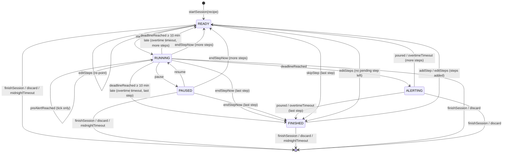
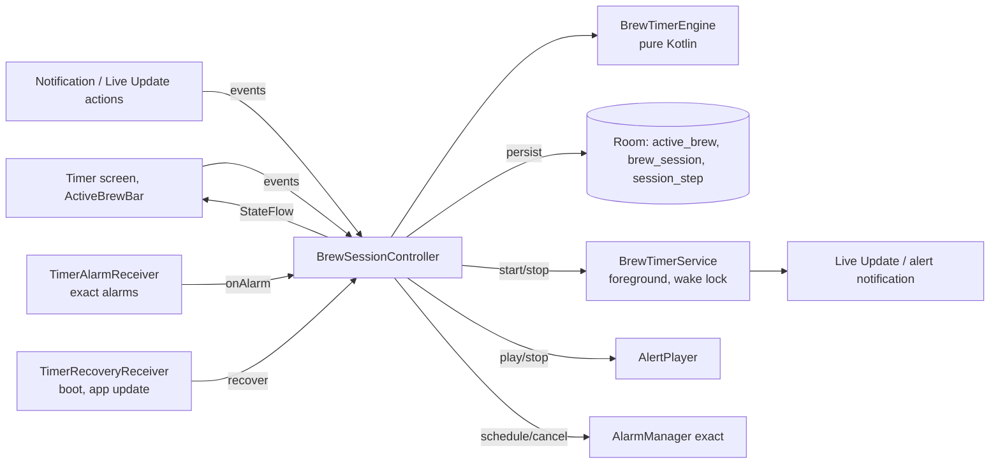

# 04 · Brew Timer Specification

> Status: **Draft v0.2** · Last updated: 2026-10-22 (engine rules, D-047; step edits, quick timer,
> recovery and snapshot, D-048; time rules and service contract, D-053;
> slice review: controller rules, alarm kinds, notification per state, D-054;
> controller inputs and ports, D-056; alarms, service and recovery in the
> first turn, D-057; recovery triggers, device restore, alert watchdog, D-063;
> accuracy workflow, D-067, 2026-10-23; deadline guard, accuracy up to the
> sound, D-068, 2026-10-23; sounds loaded ahead, the alert player's own
> thread, D-092, 2026-10-26; pre-alert per step and new pre-alert sounds
> for v0.2.1, quick timers alongside a brew planned for v0.3.0, D-093,
> 2026-10-26; loads ahead on a loader thread, a late pre-alert sound cut by
> the alert, D-096, 2026-10-29; the quick timer's own pre-alert choice and
> the fix of its silent pre-alert for v0.2.2, D-097, 2026-10-30; v0.3.0:
> two controller slots, alert arbitration with a held quick alert, the Live
> Update for the timer due next, long steps from 60 min, `USAGE_ALARM` with
> *Lautstärke* and the DND matrix, D-098, 2026-10-30)
> v0.2: pre-alert tick, alert follows ringer mode, Pause as only running
> control, exact alarms always available (personal app, no store review),
> Live Update on Android 16, Samsung battery handling, one timer at a time
> (until v0.2.2; from v0.3.0 one brew session and one quick timer at once,
> §3.3, §9.3, §10, D-093, D-098).

The steep timer is the most important feature of UmamiT. This document
specifies its behaviour, state machine, background execution, persistence,
notifications and alerts. Functional requirements: TMR-xx and NOT-xx in
[02](02-functional-requirements.md).

**Target platform:** Samsung Galaxy, Android 17 / One UI 9 since 2026-10-28,
before that Android 16 / One UI 8 (minimum Android 15, API 35; target SDK 36).

## 1. Terminology

| Term | Meaning |
|---|---|
| **Session** | One brewing of one tea (`BrewSession`), made of steps. |
| **Step** | One timed unit: RINSE, INFUSION or WHISK, with planned duration and optional temperature. |
| **Short / long step** | Planned duration < 10 min / ≥ 10 min (`LONG_STEP_THRESHOLD`). Cold and ice brews are always long steps. **From v0.3.0 (D-098, #122):** the threshold is **60 min (3600 s)**; a long step is every step of a cold or ice brew and any step ≥ 60 min, all others are short. One pure function in `core:timer-engine` (`isLongStep`) decides it; the setup and the Schritte-Sheet call it. The duration rounding of PRF-04 / TMR-10 (5 s below 10 min, whole minutes from 10 min) is a separate constant and stays. |
| **Slot** (v0.3.0) | One of the controller's two places for an active timer: `BREW` (a brew session) and `QUICK` (a quick timer), each with its own engine state (§3.3, D-098). |
| **Held alert** (v0.3.0) | A quick timer in ALERTING that may not sound yet because the brew slot alerts; it rings when the brew slot leaves ALERTING (§9.3). |
| **Deadline** | Monotonic time (`SystemClock.elapsedRealtime()`) at which the running step ends. |
| **Pre-alert** | Soft tick *N* seconds before the deadline (TMR-23). |
| **Overtime** | Time between deadline and the user tapping *Abgegossen*. |
| **Active time** | Time a step spent RUNNING or ALERTING (excludes PAUSED). |

## 2. Design principles

1. **Single source of truth:** a pure-Kotlin `BrewTimerEngine` state machine
   owned by an app-scoped `BrewSessionController`; UI, service, alarms and
   notifications only observe it or send events.
2. **Derived time:** remaining = `deadline − now` from the monotonic clock;
   never a decrementing counter.
3. **Persist every transition** before side effects.
4. **Idempotent events** (deadline from coroutine *and* alarm, *Abgegossen*
   from app *and* notification).
5. **Belt and braces:** in-process timing **and** exact alarms **and** a
   foreground service; any one of them is enough to alert.
6. **Testable with virtual time** (`MonotonicClock`, `WallClock` injected).

## 3. State machine



### 3.1 States

| State | Data | Meaning |
|---|---|---|
| `Idle` | — | No active session. |
| `Ready(i)` | step index, `readySince` | Waiting for the user to pour water and tap *Start*. Never auto-starts (TMR-08). |
| `Running(i)` | deadline (monotonic + wall), pre-alert time, `preAlertPlayed`, step start, paused total | Counting down. |
| `Paused(i)` | remaining ms, `pausedSince` (monotonic + wall), `preAlertPlayed`, step start, paused total | Frozen. |
| `Alerting(i)` | deadline (monotonic + wall), `alertPlayed`, step start, paused total | Step done; alert playing; waiting for *Abgegossen*. |
| `Finished` | `readySince` | All planned steps done; waiting for *Sitzung beenden* or *Weiterer Aufguss*. |

Every active state also carries the session: plan, pre-alert settings, zone,
last interaction, boot count, `demoted` and `longStepsOnly` (05 §3.12). Active
time is derived from the deadline, not stored (D-048).

### 3.2 Events and transitions

| Event | Allowed in | Effect |
|---|---|---|
| `startSession(teaId?, recipeSnapshot)` | Idle | Create IN_PROGRESS session + planned steps → `Ready(0)`. |
| `start` | Ready | `deadline = now + planned`; `preAlertAt = deadline − N` if applicable (TMR-23) → Running. Schedule exact alarms (§6.2). A short step ensures the FGS, a long step stops it (§6.1, D-053). |
| `pause` | Running | `remaining = deadline − now` → Paused; cancel alarms; release wake lock. A paused long step gets the FGS back. |
| `resume` | Paused | `deadline = now + remaining`; recompute `preAlertAt`: a played one is not repeated, an unplayed one is rescheduled from the new deadline, or skipped if `deadline − N ≤ now` (E6) → Running; reschedule alarms. FGS as for `start`. |
| `preAlertReached` | Running, when the pre-alert is due | Ensure the FGS (the tick plays in it, §9), then play tick once (idempotent: flag `preAlertPlayed`); caption „Gleich fertig …"; update Live Update. A due pre-alert is never ignored: too close to or past the deadline it sets `preAlertPlayed` without `PlayPreAlert`, so its due time is consumed and no tick sounds at or after the deadline (D-048). |
| `deadlineReached` | Running | → Alerting; ensure the FGS, then start the alert. At or after deadline + 10 min it applies `overtimeTimeout` instead, without an alert, as recovery does (D-053). Ignored in other states. |
| `endStepNow` | Running, Paused | Record actual = active elapsed; → next Ready or Finished. No alert. |
| `poured` | Alerting | Stop alert; record actual incl. overtime; → next Ready or Finished. |
| `overtimeTimeout` | Alerting, 10 min after deadline (`dueTimes.overtimeTimeoutAt`) | As `poured`, but actual = planned, overtime = 0 and `endedAt` = the deadline's wall time (assume poured on time); flag `overtimeAutoAck`. Not an interaction; silent. A quick timer ends. A `poured`, `endStepNow` or `finishSession` at or after deadline + 10 min records the same auto-ack (D-053). |
| `skipStep` | Ready | Mark skipped → next Ready or Finished. |
| `addStep` | any except Idle | *Weiterer Aufguss* (TMR-10): append `defaultAddedStep(plan)` — the last non-rinse step's kind and temperature, 1.5 × its duration rounded half up to 5 s below 10 min and to whole minutes from 10 min on, within 5 s – 24 h; if Finished → `Ready(new)`. A due pre-alert of the running step stays due (§5, D-054). |
| `editSteps(list, preAlertChoice)` | any except Idle | From the Schritte-Sheet (SCR-31): the whole plan plus *Wie Einstellung* / *Aus* / N s. Replaces only the pending steps and sets or clears the session's pre-alert override. Rejected unchanged if it changes, removes or reorders a started or ended step (`StartedStepChanged`) or leaves no non-rinse step (`NoBrewStepLeft`). Ready re-points to the first pending step, or goes to Finished; Finished with new steps goes to Ready. The running step's pre-alert follows the new N, but one that is already due stays due unless the edit leaves the step without a pre-alert (*Aus*, §5, D-054). Session-only unless *Im Rezept speichern*. **From v0.2.1 (D-093):** `editSteps(list)` — each step carries its own `PreAlertChoice` (*Automatisch* / *Aus* / N s) and the session-wide choice goes; the running step may change only its choice (else `StartedStepChanged`), and its pre-alert follows its new N by the same rules. Like every step change, the choices stay in the session; only *Im Rezept speichern* writes them to the recipe's steps (TMR-23, PO). An added step (`addStep`) starts as *Automatisch*. |
| `finishSession` | any except Idle | A RUNNING/PAUSED step is completed as `endStepNow`, an ALERTING step as `poured`; then COMPLETED if ≥ 1 non-rinse step completed, else discard (UI confirms) → Idle; show SCR-06 sheet. |
| `discard` | any except Idle | Delete session and stock deduction → Idle. |
| `idleDemote` | Ready, Paused, Finished of a brew session, not yet demoted; 30 min after it became idle (`dueTimes.idleDemoteAt`) | Sets `demoted`, no other change: `StopForeground`, then the Live Update is posted again as a regular silent ongoing notification (with *Start*/*Weiter*/*Sitzung beenden*). Any user event clears `demoted` and ensures the FGS (notification action exemption; D-053). |
| `midnightTimeout` | Ready, Paused, Finished of a brew session, demoted or not; the first local midnight in the session's zone at least 6 h after it became idle (`dueTimes.midnightAt`; inexact alarm, also checked on recovery §7.2) | As `finishSession` without confirmation: if ≥ 1 non-rinse step completed (a paused step counts), COMPLETED with `auto_finished` (`CompleteSession(autoFinished = true)`, D-054) and the notification „Sitzung gespeichert" (`NotifySessionSaved`, no saved sheet); otherwise discarded silently. A paused step ends where its pause began; the open pause is not recorded. Not an interaction. |
| `recover` | any except Idle | Sent once on every process start with the persisted state (§7.2). Not an interaction. |

There are **no** ±10 s adjust events in v0.2 (TMR-04 dropped).

Engine rules (D-047):

- **Guards.** Time-based events carry no payload. They are accepted only
  when `dueTimes(state)` says they are due at `now`, so a stale alarm or an
  early coroutine wake-up is harmless. *Pause* works only before the
  deadline.
- **Not accepted.** An event a state does not allow returns the same state
  and no effects. The transition reports it as `Ignored`, or as
  `Rejected(reason)` when the UI should explain it: `startSession` while a
  timer is active is `ActiveTimerExists` (TMR-21). From v0.3.0 each slot
  has its own engine state, so this means a second start in the same slot
  (§3.3).
- **`alertCompleted`** (Alerting; from the AlertPlayer after its cycle) sets
  `alertPlayed`.
- **Ending after the deadline.** `endStepNow` or `finishSession` in Running
  at or after the deadline, before `deadlineReached` was processed, counts as
  poured, with overtime.
- **Boot (D-048).** The clock reading carries the boot count, and the state
  records the boot its elapsed values belong to. `recover` rebases them from
  the wall values after a reboot; every other event from another boot is
  rejected as `BootChanged` until `recover` ran.
- **Plan shape (D-048).** Started or ended steps always form a prefix and
  pending steps the suffix. `addStep` and `editSteps` replace only the
  suffix, through the data effect `ReplacePendingSteps(fromIndex, steps)`.
- **Finish fallback.** A `finishSession` that falls back to discard records
  nothing; a started step counts as completed. The UI asks
  `finishWouldDiscard(state)` before it confirms.
- **Idle time (D-053).** A waiting state is idle since its last interaction
  or since it started waiting (`readySince`, `pausedSince`), whichever is
  later; idle demote and the midnight rule count from there, on the wall
  clock. So a step ended by the overtime timeout, which is not an
  interaction, starts a new idle period.
- **Time-based events** (`preAlertReached`, `deadlineReached`,
  `overtimeTimeout`, `idleDemote`, `midnightTimeout`, `quickTimerTimeout`) are
  not interactions. Every user event updates `last_interaction_wall_ms`.
- **A stale reading (D-054).** A clock reading older than the state breaks
  the controller rule of §4, but never a persisted state: `pause` keeps
  1 ms – planned remaining, and a pause that would be negative counts as 0 in
  `resume` and in the recorded paused time. So `restore` accepts every state
  the engine produces, and the session and its alert survive the next
  process start.
- **Beenden & neu starten (TMR-21, D-054).** No engine event of its own: the
  controller sends, in one event-lock turn, the event that ends the active
  timer, then the new start. A brew session ends with `finishSession` (the
  TMR-21 dialog is the confirmation, so a session without a completed
  non-rinse step is discarded without a second question); the controller
  shows no saved sheet for it and posts „Sitzung gespeichert"
  (notification 3) instead, i.e. it executes `ShowSavedSheet(id)` of this
  finish as `NotifySessionSaved(id)` (TMR-14). The session is not
  `auto_finished`: the user chose to end it. A quick timer ends with `cancel`
  (Ready, Running, Paused) or `poured` (Alerting). Then `startSession` or
  `startQuickTimer` meets Idle. The effects of both transitions run in order.
  From v0.3.0 it acts within one slot only: the brew slot's dialog ends only
  the brew session, „Schnelltimer beenden und neu starten?" only the quick
  timer (D-098).

### 3.3 Two slots (v0.3.0, D-098)

The engine stays a single-timer state machine. The controller holds two
**slots**, `BREW` and `QUICK`, each with its own engine state, `DueTimes`,
exact alarms (§6.2), watchdog, snapshot row (§7.1) and `alertPlayed`. Both
share the controller's event lock, the turn order and the alert player.
- **Admission.** `startSession` goes to the brew slot, `startQuickTimer` to
  the quick slot. A start is rejected as `ActiveTimerExists` only when its
  own slot is active; the other slot is never touched. So either timer
  starts while the other runs (TMR-21, TMR-22).
- **Events.** Every user event names its slot (the screen, the notification
  action, the bar); a time-based event comes from its slot's alarm or
  wake-up. One turn handles one event of one slot, then applies the
  arbitration of §9.3 across both.
- **Held alert in the engine.** ALERTING carries `ringingSince` (elapsed and
  wall; null = held). The controller sends `alertHold` (preemption, or a
  deadline while the brew alerts), `alertRingStart` (release) and, in place
  of `recover` while the brew alerts after its own recovery, `recoverHeld`
  (§7.2); none is an interaction, and the engine ignores the hold for a brew
  session. A quick alert that rings at its deadline rings since its deadline,
  as before v0.3.0 (#134 build notes in D-098). `dueTimes.overtimeTimeoutAt` of the quick slot is
  `ringingSince` + 10 min and has no value while held; the brew slot is
  never held and keeps deadline + 10 min. `deadlineReached` at or after
  deadline + 10 min applies `overtimeTimeout` only for a timer that could
  have rung; a quick timer reaching its deadline while the brew alerts is
  held instead, however late.
- **Independence.** *Sitzung beenden*, *Sitzung verwerfen*, *Pause*, every
  step action and the brew's idle and midnight rules act on the brew slot
  only; *Abbrechen*, *Pause* and the 30-min cancel of the quick timer on the
  quick slot only.

## 4. Components



- `BrewTimerEngine.reduce(state, event, now) → (state, effects, outcome)`.
  The effects are:
  - data: `CreateSession`, `ReplacePendingSteps`, `RecordStep`,
    `CompleteSession(sessionId, autoFinished)` (true only for the midnight
    timeout, D-054), `DiscardSession`;
  - `Persist`, `ScheduleAlarms`;
  - side effects: `PlayPreAlert`, `StartAlert`, `StopAlert`, `StartForeground`,
    `StopForeground`, `UpdateNotification`, `ShowSavedSheet`, `NotifySessionSaved`.
- **Effect order (D-047).** Every accepted transition lists, in this order:
  1. its data effects;
  2. exactly one `Persist` (steps 1 and 2 run in one Room transaction);
  3. exactly one `ScheduleAlarms(dueTimes(newState))`;
  4. its side effects.
- **Session rows.** The controller creates the session rows only for the
  `CreateSession` of an accepted start, so a refused start leaves no orphaned
  rows.
- **Controller rules (D-054).** These keep every engine guarantee true on
  the device:
  - The controller reads the clocks (`readClocks`) **after** it has taken the
    event lock, once per `reduce`; never when it creates or enqueues an event
    (a click handler, a notification action, an alarm's `onReceive`). Within
    a boot `elapsedMs` is then non-decreasing from event to event. The engine
    also survives a stale reading (§3.2 engine rules).
  - A failed Room transaction (data effects + `Persist`) is logged (06 §5.6)
    and then `Persist` alone is retried once; the side effects still run from
    the in-memory transition either way. `StartAlert`, `StopAlert` and
    `PlayPreAlert` are never skipped because of a storage error.
  - The data effects are total on predictable input, so they do not roll
    back the transaction: a `RecordStep` without its row changes nothing
    (`Persist` re-syncs the rows), an unreadable settings file counts as the
    defaults, and a session zone this device does not know counts as the
    device's zone (D-054).
- **Alarms.** `ScheduleAlarms` carries the full due set. The controller
  reconciles it per alarm type (§6.2): it schedules a type whose time is
  present and cancels one whose time is absent. There is no separate
  `CancelAlarms`. After every `reduce`, accepted or not, the controller
  re-arms its in-process wake-up from `dueTimes(state)`, but only from a
  state of the current boot (after `recover`). A time-based event that is due
  is never `Ignored`: it is applied or consumed, so the wake-up cannot spin
  (D-048). `dueEvents(state, now)` maps the due set to the events in apply
  order (deadline before pre-alert, then overtime; quick-timer cancel,
  midnight, then idle demote); the wake-up and the alarm receivers share it,
  and send each through `reduce`; an event an earlier one made obsolete is
  ignored.
- **Recovery.** The controller sends `recover` exactly once per process, as
  the first event, inside the same lock as the restore of `active_brew`: the
  first turn of the process restores it before its own input, whatever that
  input is (an alarm, a tap; D-057). The app's process start, `BOOT_COMPLETED`
  and `MY_PACKAGE_REPLACED` ask for that turn without an input of their own
  (`recover(trigger)`, D-063).
  `restore` throws only `IllegalArgumentException`; the controller then logs
  it (06 §5.6) and clears `active_brew` instead of running a wrong timer.
- ***Beenden & neu starten* (TMR-21).** One turn ends the active timer
  (*Sitzung beenden*; the quick timer *Abgegossen* or *Abbrechen*) and starts
  the new session; the finish's `ShowSavedSheet` is posted as
  `NotifySessionSaved` (D-054, D-063).
- **Alert.** `StartAlert` means "ensure the alert of the alerting step is
  playing": if it already plays for that step, nothing restarts. So a
  `deadlineReached` and a `recover` (or two `recover`s) that both ask for it
  give one alert (D-048).
- **Foreground service (D-053).** `StartForeground` means "ensure it runs";
  `StopForeground` stops it and removes notifications 1, 2 and 4, also when they
  were posted without the service. Every active state runs with the service
  except a demoted session and a long running step. So:
  - `startSession`, `startQuickTimer`, and `start`/`resume` of a short step
    emit `StartForeground`; `start`/`resume` of a long step emit
    `StopForeground`;
  - `deadlineReached` emits `StartForeground` before `StartAlert`;
  - `idleDemote` and every transition to Idle emit `StopForeground`; a
    transition to Idle never emits `UpdateNotification`;
  - any other transition from a state without the service to one with it
    (a user event on a demoted session, pausing or ending a long step) adds
    `StartForeground`;
  - `recover` emits `StartForeground` only where the state needs it;
  - a `preAlertReached` that plays the tick emits `StartForeground` before
    `PlayPreAlert`, as the deadline does before the alert (D-054).
- **Which notification (D-044, D-054).** `StartForeground` and
  `UpdateNotification` use the notification of the **new** state (§8.2):
  - in Alerting, the alert (ID 2, `steep_finished`) is the foreground
    notification. `StartForeground` and `UpdateNotification` show ID 2 — with
    the full-screen intent only when `StartAlert` is in the same transition
    (D-057) — and cancel IDs 1 and 4 if they are posted. Neither is posted
    while alerting (`deadlineReached`, `addStep`/`editSteps` while alerting,
    `recover` of an alerting state);
  - in every other active state with the service, ID 1, the Live Update; while
    the session is demoted or a long step runs, the quiet notification ID 4
    without the service (a Live Update „Fertig um 14:30" for a long step, a
    regular ongoing notification for a demoted session; D-064). ID 4 is
    cancelled before every start of the service. ID 2 is cancelled when the
    alert ends.
  While the service runs, the notification changes only through it (D-057).
  The M1-09/M1-11 Robolectric tests assert that neither ID 1 nor ID 4 is
  posted after `deadlineReached`, after `addStep` while alerting, after
  `recover` of an alerting state and at a long step's deadline.
- `BrewSessionController` serialises events (single coroutine/Mutex),
  executes effects, exposes `StateFlow<TimerUiState>` (D-056):
  - **Inputs** are suspend functions: the starts and *Beenden & neu
    starten*, the user events with their source (app or notification),
    `onAlarm(kind)`, `recover(trigger)` and the alert player's
    `alertCompleted(alert)`.
  - **Effects reach ports:** alarms (the full due set), service, notifier,
    alert player, saved sheet, diagnostics, and the in-process wake-up. The
    Android adapters are thin.
  - **A turn that holds the lock runs to its end,** even when its caller is
    cancelled, so a transition is never half applied.
  - **A port that throws is logged,** and the next effect still runs.
  - **The screens see only state and user events:** SCR-05 and the active
    brew bar reach the controller through the `BrewTimer` seam of
    `feature:brew` (D-058); `TimerUiState.Active.preAlert` carries the
    session's own pre-alert option for the Schritte-Sheet.
- `BrewTimerService` shows the Live Update or the alert as its foreground
  notification and holds the wake lock; no timer logic. Its port sends it the
  notification of the state and the wake-lock time (§6.3, D-057). The
  `AlertPlayer` is a process singleton the controller drives (D-059); the
  service keeps the process in the foreground while it plays. It runs on its
  own thread, and at the end of every turn, after the turn's own cues, the
  controller tells it whether a timer is active, so it keeps the sounds of
  the next tick and alert loaded (§9.1, D-092).
- UI renders remaining time per frame from the deadline while visible.

## 5. Time computation

- **Monotonic** `elapsedRealtime()` for all countdown arithmetic; **wall**
  clock for journal timestamps, notification chronometer and reboot recovery;
  `Settings.Global.BOOT_COUNT` stored to detect reboots.
- Remaining time is displayed rounded **up** to whole seconds; overtime rounded
  down („+0:07"); ≥ 1 h as `h:mm:ss`. Ready shows the planned duration;
  Finished shows 0. A running step past its deadline shows 0 until
  `deadlineReached` is processed.
- Delivery (D-047): the alert is **at-least-once**. Alerting holds
  `alertPlayed`, and recovery replays `StartAlert` while it is false. The
  pre-alert tick is **at-most-once**: `preAlertPlayed` is set in the
  transition that plays it.
- Pre-alert: `preAlertAt = deadline − N·1000` where N = session override
  (Schritte-Sheet) ?: recipe value ?: global setting (default **10 s**); none
  if N = 0, if planned < N + 5 s, for rinse steps < 15 s, or for long steps
  (≥ 10 min; from v0.3.0 cold or ice brew, or ≥ 60 min, §1, D-098). `startSession` freezes recipe ?: global as the inherited value,
  so a later change of the recipe or the setting never changes an active
  session; *Wie Einstellung* clears the session override (D-048).
  **From v0.2.1 (D-093), per step:** B = the inherited value (recipe ?:
  global, frozen at `startSession`); each step's `PreAlertChoice` gives N:
  an explicit value as set, *Aus* = 0, *Automatisch* =
  **min(B, 5 · ⌊planned_s / 15⌋)** (a third of the step rounded down to
  whole 5 s, never more than B). The skip rules above stay; since an
  automatic N ≤ planned/3, the „planned < N + 5 s" rule can only remove an
  explicit value, and every step under 15 s has no automatic pre-alert. The
  quick timer uses *Automatisch* with B = the global setting. `resume`
  and `editSteps` recompute an unplayed pre-alert of the running step from its
  deadline and the current N, and skip it when that time is not after now; a
  played one never comes back. An edit never consumes a pre-alert that is
  already due but whose `preAlertReached` is still queued: it stays due while
  the step still has a pre-alert, and `preAlertReached` decides by the 1-s
  rule (D-054). `preAlertLeadSeconds(state)` gives the current step's N, or
  none, for the ring and the progress point (§8.3). A due `preAlertReached` plays the tick while at
  least **1 s** is left before the deadline and only marks it played after
  that (D-053).
  **Two timers (v0.3.0, D-098).** A due pre-alert of one slot while the
  other slot's alert sound plays, or while its pre-alert sound still rings,
  waits until that sound ends and then follows the same 1-s rule: played if
  at least 1 s of its step is left, else marked played without a sound
  (§9.3). It never cuts an alert; an alert cuts it.

### 5.1 Recorded step data

| Field | Rule |
|---|---|
| `plannedSeconds` | Planned duration at step start. |
| `actualSeconds` | Active elapsed from *Start* to *Abgegossen* / *Aufguss jetzt beenden*, excluding pauses, rounded to 1 s. Includes overtime if acknowledged within 10 min; else `overtimeTimeout` rule. |
| `pausedSeconds` | Total paused time. |
| `overtimeSeconds` | Deadline → *Abgegossen* (0 if ended early or auto-acknowledged). |
| `startedAt`, `endedAt` | Wall clock. |
| `skipped`, `overtimeAutoAck` | Flags. |

Durations are rounded half up. The journal can therefore differ from the
display by 1 s: 2.5 s of overtime shows „+0:02" and is recorded as 3 s. Other
rules (D-047):

- A skipped step records 0 for actual, paused and overtime, and null for
  `startedAt` and `endedAt`. It keeps `plannedSeconds`.
- A Running step ended at or after the deadline counts as poured:
  overtime = now − deadline, and actual = planned + overtime.

## 6. Background execution

### 6.1 Strategy

| Situation | Mechanisms (all active together) |
|---|---|
| Short step RUNNING | Controller coroutine until pre-alert/deadline · exact alarms for pre-alert and deadline · foreground service with Live Update · partial wake lock |
| Long step RUNNING (≥ 10 min, or any step of a cold or ice brew; from v0.3.0 ≥ 60 min or cold/ice brew, D-098) | Exact alarm for deadline only (no pre-alert tick), with the deadline guard 90 s later (§6.2, D-068) · Live Update „Fertig um 14:30" (`longStepEndWallMs`, the quiet notification ID 4, promotion requested; D-064) without foreground service · no wake lock. Pausing it brings the FGS back like any waiting state. |
| READY / PAUSED / FINISHED | Foreground service keeps the Live Update (no wake lock) for up to 30 min, then `idleDemote` stops it; midnight alarm (inexact) for `midnightTimeout`. After a process restart, recovery tries to restart the FGS immediately (§6.3); if Android refuses, a plain ongoing notification is shown until the next user interaction or exact alarm restarts the FGS (§7.2). |
| ALERTING | Foreground service keeps the process in the foreground while the `AlertPlayer` plays; wake lock for the longest alert + 30 s (2 min 30 s) from the start of the alert, released by the next state (D-057) |

**Two slots (v0.3.0, D-098).** The table applies per slot. One foreground
service runs while either slot needs it; it stops only when neither does. The
partial wake lock is held while either slot runs a short step or alerts, with
the longer of the two timeouts. Idle demote and the midnight timeout belong
to the brew slot only: a demoted brew leaves the service running while the
quick slot needs it and shows as notification 5 (§8.2). A long running step
that ends next while the other slot needs the service is the service's Live
Update (notification 1, §8.2), still without a wake lock of its own. A hot step of
10–59 min is now a short step and keeps the service and the wake lock for its
length.

### 6.2 Exact alarms

- The app declares **`USE_EXACT_ALARM`**, which is granted automatically.
  This is acceptable because the app is sideloaded and never goes through
  Play review (D-013). `SCHEDULE_EXACT_ALARM` is not needed.
- One alarm per `DueTimes` field, reconciled from `ScheduleAlarms` after
  every accepted transition (§4): scheduled when the field has a time,
  cancelled when it has none. Request codes are fixed per field, so
  rescheduling replaces the alarm (D-054):

  | `DueTimes` field | Alarm | Request code | Receiver sends |
  |---|---|---|---|
  | `preAlertAtElapsedMs` | exact, `setExactAndAllowWhileIdle(ELAPSED_REALTIME_WAKEUP)` | 101 | `preAlertReached` |
  | `deadlineElapsedMs` | exact, `setExactAndAllowWhileIdle(ELAPSED_REALTIME_WAKEUP)` | 102 | `deadlineReached` |
  | `overtimeTimeoutAtElapsedMs` | exact, `setExactAndAllowWhileIdle(ELAPSED_REALTIME_WAKEUP)` | 103 | `overtimeTimeout` |
  | `idleDemoteAtWallMs` | exact, `setExactAndAllowWhileIdle(RTC_WAKEUP)` | 104 | `idleDemote` |
  | `quickCancelAtWallMs` | exact, `setExactAndAllowWhileIdle(RTC_WAKEUP)` | 105 | `quickTimerTimeout` |
  | `midnightAtWallMs` | inexact, `set(RTC)` (no wake-up) | 106 | `midnightTimeout` |
  | — (alert watchdog: deadline + 90 s while a step runs, every 30 s while the alert plays) | exact, `setExactAndAllowWhileIdle(ELAPSED_REALTIME_WAKEUP)` | 107 | nothing of its own |

  **Quick slot (v0.3.0, D-098).** The table is the brew slot's. The quick
  slot uses the same fields with request codes **201–207** (201 pre-alert,
  202 deadline, 203 overtime timeout, 205 quick cancel, 207 watchdog; 204
  and 206 are never set), so the slots never replace each other's alarms.
  Before v0.3.0 a quick timer used 101–107: after the update its first
  recovery restores it into the quick slot, and the reconcile cancels the
  brew slot's codes (no brew active) and schedules 201–207. An old alarm
  that fires first is handled as today: recovery runs before it, and the
  §3.2 guards make it harmless.

  The alert watchdog is no `DueTimes` field and `ScheduleAlarms` leaves it
  alone: the controller sets it at the end of every turn. While a step runs
  it is the **deadline guard**, 90 s after the deadline (D-068); the deadline
  turn replaces it by the alert's 30 s cadence (the first one 30 s after the
  alert started); when the alert ends, the step pauses or ends, it is
  cancelled. Its only job is to start a process after a kill, whose recovery
  replays the alert (§7.2, D-063, D-068). In a live process it finds nothing
  due, and `StartAlert` never restarts the playing alert, so an alert never
  plays twice.

  The elapsed fields use `ELAPSED_REALTIME` so a wall-clock change never
  moves them (E1); the overtime timeout is exact because it may start the
  FGS (`StartForeground` of the next Ready), and only exact-alarm delivery
  allows that from the background. The wall fields use `RTC` so they follow
  a wall-clock or zone change; idle demote and the quick-timer cancel stop
  the service, so a late one would keep it running; the midnight timeout
  may wait until the phone next wakes (recovery applies it too, §7.2), so it
  neither wakes the phone nor needs to be exact. Each receiver sends the event of its
  row; the event is accepted only when due (§3.2 guards), so a late, early
  or stale alarm is harmless. After a reboot the alarms are gone and
  `recover` schedules them again (§7.3).
- `TimerAlarmReceiver` hands every alarm to the controller's `onAlarm`
  (idempotent); it finds the controller through the app (D-057). If the
  process was killed (E3), the alarm starts a new one, whose controller first
  recovers the state (§7.2); the `StartForeground` of recovery or of the
  transition then starts `BrewTimerService` in the foreground (exact-alarm
  delivery is an allowed exemption for starting an FGS from the background),
  so the `AlertPlayer` can play.
- `AlarmManager.canScheduleExactAlarms()` is still checked; if false (should
  not happen), the reliability banner is shown (TMR-31).

### 6.3 Foreground service

- Type `specialUse` with the subtype string from §13 (no store review, but
  Android requires a type).
- Started from the user's *Start* tap (foreground), from notification
  actions, from the exact alarm (§6.2), and **attempted** during recovery
  (§7.2), on `BOOT_COMPLETED` (§7.3) and on `MY_PACKAGE_REPLACED` (§7.5).
  Background starts are allowed while the app is exempt from battery
  optimisation (ONB-02), and `specialUse` is not among the FGS types
  restricted after boot. Every start from the background catches
  `ForegroundServiceStartNotAllowedException`, logs it (06 §5.6) and falls
  back to the plain ongoing notification. The next turn that may start the
  service from the background (an exact alarm, a notification action, a tap)
  and sent it no command itself starts it again, with the notification of
  the state of that moment; a start refused again is logged (D-057, D-063).
- Partial wake lock during short RUNNING steps and ALERTING, with timeout
  `remaining + alert length + 30 s`; the alert length is the longest one
  (Lang, 2 min). Waiting states release it.
- While the service runs in the foreground, the port sends its commands with
  `startService`, which a running foreground service allows from the
  background; the same notification ID only updates the notification, a new
  one (the alert) takes `startForeground`. If that is refused, the service
  leaves the foreground and posts the alert alone (§8.2). A stop never
  reaches the service before a pending start has called `startForeground`
  (D-057).
- Android posts the notification of `startForeground` asynchronously, so a
  same-ID update the service posts within 1 s of a `startForeground` can be
  overtaken by the start's late post. And Android drops an update without a
  word while the app posts faster than 5 notifications per second (a moving
  average over all its posts), which two timers can reach: one tap updates
  notifications 5 and 1 at once. So the service posts a same-ID update that
  follows any post of the app (`startForeground`, an update, notification 5)
  within 1 s once more 0.5 s later (only-alert-once, only while that ID is
  still the foreground notification; a newer update replaces it). Same-ID
  updates never call `startForeground` again (D-071, D-098 #135).
- A process killed while it posts an update of its foreground notification
  can leave that notification behind, still flagged as a foreground
  notification but owned by no service; the app can never cancel it. So a
  foreground start of the service while it is not in the foreground first
  takes over the other timer notification (1 or 2) when it is posted with
  that flag: `startForeground` with a copy of it (only-alert-once, no
  full-screen intent), then `startForeground` with its own notification, a
  switch that makes Android remove the stale one before the new one appears
  (D-044). A failure of the takeover is logged and the normal start follows
  (D-084).

### 6.4 Samsung battery management

- First-start setup (ONB-02) requests `ACTION_REQUEST_IGNORE_BATTERY_OPTIMIZATIONS`
  (permission `REQUEST_IGNORE_BATTERY_OPTIMIZATIONS`, allowed for a sideloaded
  app) and guides the PO to One UI's *Akku › Uneingeschränkt* and to add
  UmamiT to *Nie schlafende Apps*.
- `PowerManager.isIgnoringBatteryOptimizations()` is checked at app start and
  before each session; if false → reliability banner.
- Verified on the PO's Galaxy as part of acceptance (Android 16 / One UI 8
  through v0.2.0; re-checked on Android 17 / One UI 9 on 2026-10-28).

## 7. Persistence & recovery

### 7.1 Persisted on every transition

`active_brew` row ([05 §3.12](05-data-model.md#312-activebrew)) and step
records, in one Room transaction. From v0.3.0 (umamit.db v4, D-098) one row
per slot (`slot` = `BREW` or `QUICK`); a transition writes only its slot's
row, and the held state is part of it (`alert_ringing_since_*`). The engine maps every state to this row
plus the session's step rows and back without loss (`snapshot(state)`,
`restore(snapshot)`; D-048): a step's status is derived, not stored (rows with
recorded values are ended, the current step of Running, Paused or Alerting is
started, all others are pending). The quick timer has no step rows; its one
step is `quick_duration_seconds`.

If that transaction fails, the controller logs it, retries `Persist` alone
once and runs the side effects anyway (§4 controller rules, D-054). A
`Persist` that still fails leaves the previous row; the next transition's
`Persist` writes the current state again.

### 7.2 Recovery on process start

The controller restores the state and sends `recover` in the first turn of
the process, before that turn's own input (D-057), which the engine applies
purely (§12 unit tests with fake clocks and boot counts; D-048).
After a reboot it first moves every elapsed value to the new elapsed clock at
the same distance from now as its wall value, within physical bounds: every
instant of the old boot lies before elapsed 0, so a pause start and a passed
deadline are clamped to ≤ 0, and a running step keeps at most its planned
time. A state that is impossible on the same boot count (a deadline of an
alert or a pause start after now, more than the planned time left) is
treated as a reboot. The bounds catch a wall clock set back across the
reboot; a wall clock set forward cannot be told apart from a longer time off,
so the step counts as longer off and past 10 min is auto-acknowledged
(accepted limit, D-048). Every row that keeps the session emits
`UpdateNotification` and, unless the session is demoted or a long step is
running, `StartForeground` (an attempt, §6.3); the timeout rows are silent
(no `StartAlert`, no saved sheet). A waiting session applies the timeouts that
came while the process was dead in this order: quick-timer cancel, midnight,
idle demote (D-053).

| Persisted phase | Behaviour (same boot uses monotonic values; after reboot wall-clock values) |
|---|---|
| READY / PAUSED / FINISHED | Restore; try to restart the FGS now (§6.3), else re-post a plain ongoing notification and restart the FGS on the next interaction. |
| READY / PAUSED / FINISHED, past the midnight timeout (TMR-14) | `midnightTimeout` applied silently (with „Sitzung gespeichert" if logged), also after a reboot (wall clock). |
| READY / PAUSED / FINISHED, demoted or idle for 30 min | Restored without the FGS: a regular ongoing notification; a not yet demoted session is demoted now (`StopForeground`). |
| RUNNING long step, deadline in future | Restored without the FGS (§6.1); the deadline alarm restarts it for the alert. |
| RUNNING, deadline in future | Restore; reschedule alarms from `dueTimes`; try to restart the FGS (§6.3). An unplayed pre-alert stays due even if its time has passed, so a pre-alert alarm that restarted the process still reaches `preAlertReached`, whose rules decide whether a late tick plays. |
| RUNNING/ALERTING, deadline passed < 10 min ago | → ALERTING with overtime; `StartAlert` while `alertPlayed` is false (at-least-once). |
| RUNNING/ALERTING, deadline passed ≥ 10 min ago | `overtimeTimeout` applied silently: poured on time with `overtimeAutoAck`, ended at the deadline's wall time. A quick timer just ends. |
| Quick timer READY / PAUSED, 30 min after the last interaction | Ended silently (`StopForeground`), as by `quickTimerTimeout`. |

**Triggers (D-063).** Any input of a new process recovers first (an alarm,
a tap, a notification action). The app's process start (`Application.onCreate`),
`BOOT_COMPLETED` (§7.3) and `MY_PACKAGE_REPLACED` (§7.5) ask for a recovery
turn of their own; in a process that already recovered they change nothing.

**A kill during ALERTING (D-063).** A process killed during ALERTING has only
the overtime alarm left, however its deadline was handled; its recovery
would acknowledge the step silently. So while the alert plays, the alert
watchdog alarm (§6.2) comes every 30 s: a new process it starts replays the
alert that had not run its cycle (at least once, D-047).

**A lost deadline alarm (D-068).** A long step runs without the service, so
its deadline alarm is its only wake-up. Android skips every broadcast to a
process while Auto Backup runs the app's full backup, then kills the
process: the alarm counts as delivered and nothing else comes, and the
recovery in the morning would acknowledge the step silently (night, idle
and charging are the conditions of both an overnight cold brew and the
backup). So while a step runs, the alert watchdog alarm is set 90 s after
the deadline as a deadline guard: a process it starts finds the deadline
passed less than 10 min ago and alerts, at most 90 s late. The same guard
covers a kill between the deadline turn and the first watchdog of its
alert, and any other lost deadline broadcast.

**Device restore (E11, D-063).** Restore detection clears `active_brew`
(05 §8). Recovery then ends every `IN_PROGRESS` session other than the active
one: saved with `auto_finished` when it has a completed infusion, else
discarded; nothing resumes. The session of a snapshot cleared as unreadable
is ended the same way.

**A stored timer that cannot be read (D-057, D-063).** Each turn tries three
times; a turn that fails comes again (its alarm and the in-process wake-up)
after 5 s during the first 30 s of failures, every 30 s up to 5 min, then
every 2 min. After 11 min the process stops retrying, so a database that
stays broken does not wake the phone forever. Only the retries stop: the
stored timer may well be valid (a cold brew hours from its deadline), so its
row, its alarms and its session stay. Its own alarms, a tap or the next
process start read again, each with its three tries. A snapshot that
`restore` refuses is different: it is cleared at once, with its alarms and
any notification the old process left (D-057, D-063).

**Two slots (v0.3.0, D-098).** The first turn restores both rows and runs
`recover` for the brew slot first, then for the quick slot. If the brew slot
is then ALERTING, the quick slot gets `recoverHeld`: a quick timer past its
deadline becomes held (no sound, no overtime timeout), however long ago its
deadline was, and a ringing one is held again; it rings when the
brew slot leaves ALERTING (§9.3). Otherwise the quick slot follows the table
above, with its overtime timeout counted from `ringingSince` when it had
already rung. A held alert survives process death, a reboot and an app
update; recovery never plays two sounds, and the brew alert is replayed
first.

### 7.3 Reboot

`TimerRecoveryReceiver` (`BOOT_COMPLETED`, delivered after the first unlock)
asks the controller to recover (D-063): it restores the state from
wall-clock data, reschedules the exact alarms (or applies §7.2 if the
deadline already passed), tries to restart the FGS (§6.3) and posts a
notification „Dein Timer läuft weiter" (the tea below it) through the notifier port,
except while alerting (the alert is the notice then). If the FGS start was
refused, the deadline alarm starts it when it fires (§6.2).

Samsung's *Automatische Optimierung* may restart the phone at night; the
first-start setup shows a hint to disable *Automatisch neu starten* (ONB-02).

`Could`: a direct-boot alert path — `LOCKED_BOOT_COMPLETED` receiver
(`directBootAware`) plus the current deadline mirrored in device-protected
storage — would let the alert fire before the first unlock (E2).

### 7.4 Force stop

Alarms are cleared by the system; on next launch §7.2 applies and the UI says
„Der Timer wurde vom System angehalten."

### 7.5 App update

Installing an update kills the process and a running FGS (alarms survive).
`TimerRecoveryReceiver` (`MY_PACKAGE_REPLACED`) runs §7.2 recovery right
away, including the FGS restart attempt (D-063). The update from v0.2.2 to
v0.3.0 also migrates umamit.db v3 → v4 (05 §9) and moves a running quick
timer's alarms to the quick slot's codes (§6.2, D-098). A hot step of 10–59
min that v0.2.2 ran as a long step (no pre-alert, no service) recovers as a
short step: the FGS restart attempt, the countdown Live Update, and its
pre-alert computed from its deadline and N as `resume` does, due while its
time is still ahead, else skipped without a late tick (§5, D-098).

## 8. Notifications

### 8.1 Channels

| Channel ID | Name | Importance | Sound / vibration | Purpose |
|---|---|---|---|---|
| `brew_timer` | Brühtimer | DEFAULT, silent (promotion only needs importance above MIN) | none | Live Update / ongoing (not while ALERTING, §8.2) |
| `steep_finished` | Aufguss fertig | HIGH | none (played by `AlertPlayer`) | Full-screen intent / heads-up „Jetzt abgießen!" |
| `sessions` | Sitzungen | LOW | none | Auto-finished session, reboot notice |
| `reminders` | Erinnerungen | LOW | none | Backup, stock reminders |
| `catalog` | Katalog | LOW | none | Refresh progress and result |
| `timer_other` | Weiterer Timer (v0.3.0, D-098) | LOW | none | The active timer that is not the Live Update (notification 5); never promoted |
| `stock` | Vorrat (v0.3.0, D-098) | LOW | none | The daily low-stock reminder (INV-11, notification 12) |

### 8.2 Notification content

| Phase | Title | Text | Actions |
|---|---|---|---|
| READY | Gyokuro · Aufguss 2 von 3 | Bereit · 0:20 · Wasserkocher auf 60 °C (≤ 10 °C: „Kaltes Wasser", an ice brew „Eiswürfel", as SCR-05; BRW-10, D-068) | *Start* |
| RUNNING | Gyokuro · Aufguss 2 von 3 | Zieht bei 60 °C (chronometer countdown) | *Pause* |
| RUNNING after pre-alert | Gyokuro · Aufguss 2 von 3 | Gleich fertig … | *Pause* |
| PAUSED | Gyokuro · Aufguss 2 von 3 | Pausiert · noch 0:12 | *Weiter* |
| ALERTING (separate notification on `steep_finished` with `setFullScreenIntent(SCR-05)`, `CATEGORY_ALARM`) | Jetzt abgießen! | Gyokuro · Aufguss 2 | *Abgegossen* |
| FINISHED | Gyokuro · Alle Aufgüsse fertig | Tippen zum Beenden | *Sitzung beenden* |
| Long step (notification 4) | Gyokuro · Aufguss 1 von 1 | Fertig um 14:30 | *Pause* |
| Demoted (notification 4, TMR-14) | as the phase | as the phase | *Start* / *Weiter*, *Sitzung beenden* |
| Quick timer | Schnelltimer | as the phase | as the phase, plus *Abbrechen*; *Fertig* while alerting |

Actions → non-exported receiver → controller (source NOTIFICATION).
Notification IDs: 1 Live Update/FGS, 2 alert, 3 sessions, 4 the quiet
notification without the service (a long running step, a demoted session;
D-064), 5 the other active timer (v0.3.0, D-098), 10 catalog progress and
11 catalog result (D-079), 12+ reminders (12 the daily low-stock reminder,
v0.3.0). IDs 1, 2, 4 and 5 belong to a role, not a slot: each carries its
slot in its actions and content intent. Content intent → SCR-05 through the app's
launcher activity, named explicitly with `com.umamit.action.OPEN_TIMER`, which opens the timer route; the
same intent is the alert's full-screen intent (D-064). Actions: *Start*,
*Pause*/*Weiter*, *Abgegossen* (*Weggegossen* for a rinse, *Fertig* for the
quick timer), *Sitzung beenden* (FINISHED, demoted; not where it would
discard the session, TMR-12 AC1), *Abbrechen* (quick timer).
Going to Idle removes notifications 1, 2 and 4 through `StopForeground`, whether
or not the service runs; the midnight timeout's „Sitzung gespeichert" is
notification 3 (`NotifySessionSaved`, D-053).

**While ALERTING the alert (ID 2) is the app's only notification of
importance DEFAULT or higher (D-044):** it replaces the Live Update as the
foreground-service notification, and a Live Update posted without the
service (notification 1 after a refused start, notification 4) is cancelled
first; the Live Update returns with the next state. While the service runs,
every change of the timer notification goes through the service, never
`notify` next to it (D-057, D-064).
Reason: Android 16 force-groups two ungrouped notifications of an app in the
same importance section (`config_autoGroupAtCount` = 2) and marks them
`FLAG_SILENT`; System UI then suppresses the full-screen intent and the
heads-up (`docs/plans/M1-android16-api-notes.md`).

**Full-screen alert (D-036):** the alert notification (ID 2) carries a
full-screen intent to SCR-05 for short **and** long steps. With the screen
off or locked, the screen turns on and the timer activity is shown over the
lock screen (`setShowWhenLocked(true)`, `setTurnScreenOn(true)`); while the
phone is in use, it shows as a heads-up instead. This also happens in silent
mode (visual only). Requires `USE_FULL_SCREEN_INTENT`; the app checks
`NotificationManager.canUseFullScreenIntent()` and, if false, ONB-02 and the
reliability banner deep-link to `Settings.ACTION_MANAGE_APP_USE_FULL_SCREEN_INTENT`
(fallback: heads-up only).

**Two timers (v0.3.0, D-098).** The timer that ends next owns notification 1
(or 4) as in the table above; the other active timer is notification 5 on
`timer_other`, with the same title and text per phase and its own actions
(*Start*, *Pause*/*Weiter*, *Abbrechen* for the quick timer, *Sitzung
beenden* where the table offers it). While a slot alerts, notification 2 is
that slot's alert and the other slot shows only as notification 5, so the
alert stays the app's only notification of importance DEFAULT or higher
(D-044). A held quick alert is notification 5 „Schnelltimer · Fertig, wartet
auf den Aufguss" with no full-screen intent; when it rings it becomes
notification 2 with its full-screen intent to SCR-07. When one timer ends,
notification 5 goes and the remaining timer is shown as with one timer.
While the service runs for either timer, the timer due next is its
notification 1, also a long running step that would be the quiet 4 alone; its
wake lock stays the short step's or the alert's only (§6.1). After a process
death, a notification 5 the killed process left is removed unless a timer is
shown there again (#135 build notes in D-098).

**A new alert is a new notification (v0.3.0, D-098).** System UI launches a
full-screen intent only for a notification it adds, never for an update of
one it shows. So an alert that starts while another alert is the service's
notification 2 (the brew's deadline during a ringing quick alert, a held quick
alert released when the brew session is ended or discarded during its alert)
is posted as a new notification 2: the service leaves the foreground with the
earlier alert removed and starts it again with the new one. An alert shown
again (an update, a re-sent start with only-alert-once) stays an update.

### 8.3 Live Update

On Android 16 the `brew_timer` notification is requested as a **promoted
ongoing notification** (Live Update):

- `Notification.ProgressStyle` with one **segment per step** (length ∝
  planned duration with a minimum visible length so short steps stay
  visible; at most 30 steps, PRF-03; rinse segments in a muted colour) and a
  **point** at the pre-alert of the current step; progress = elapsed active
  time of the session's planned total. Progress is updated on every state
  transition and **every 15 s** while RUNNING (not per second), in order with
  the controller's commands (D-064). A phase change is never left stale behind
  the foreground start's late post (§6.3, D-071).
- Ongoing, with content title, `NotificationCompat.Builder.setRequestPromotedOngoing(true)`
  (AndroidX core; the platform `Notification.Builder` of SDK 36 has no such
  method, it sets the extra `android.requestPromotedOngoing`, D-043) and a
  monochrome small icon (M1 app icon task). On Android 16 the request is
  **always** set, also while the user does not allow promotion, so the system
  promotes the posted notification as soon as the user allows it (D-044). The
  system promotes it only if it has promotable characteristics
  (`hasPromotableCharacteristics()`, whose rules differ between Android 16
  builds: colorized before QPR1, not colorized from QPR1) and the user allows
  it; the resulting flag is `FLAG_PROMOTED_ONGOING` (0x40000).
- **Status-bar chip:** in RUNNING it is driven by the chronometer countdown
  (`setUsesChronometer(true)`, `setChronometerCountDown(true)`,
  `setWhen(deadlineWall)`); no static short critical text with a time. In
  READY / PAUSED / FINISHED a short critical text is used (e.g. „60 °C",
  „Pause"; at most 10 °C „Kaltes Wasser" or „Eiswürfel", D-068).
- Shown as a status-bar chip and on the lock screen. On One UI 8 and 9 it may also
  appear in the Samsung **Now Bar**; this is **best effort** (One UI may
  require the user to enable live notifications per app or a developer
  option) and is not a release blocker. With `v0.0.2-probe` the countdown did
  appear in the Now Bar on the PO's Galaxy (2026-10-22).
- **User dismissal is respected:** `setDeleteIntent` records the dismissal;
  the notification is not re-posted until the next state change (a new phase,
  step, the pre-alert or the demotion; D-064).
- A demoted session (TMR-14) is a regular ongoing notification without the
  promotion request; a long running step keeps it (TMR-18, „Fertig um
  14:30").
- If promotion is not allowed (`NotificationManager.canPostPromotedNotifications()`
  false), the system shows it as a normal ongoing notification (the request
  stays set) and the
  reliability banner deep-links to
  `Settings.ACTION_APP_NOTIFICATION_PROMOTION_SETTINGS` (D-043). The banner is based
  only on this check, not on Now Bar presence.
- **The timer due next (v0.3.0, D-098, PO Q5).** With two active timers
  only one is the Live Update: a ringing alert first (the brew's); else a
  running slot beats a waiting one; of two running, the earlier deadline (the
  brew on a tie); of two waiting, the brew, unless it is demoted (TMR-14). The
  controller recomputes it after every transition of either slot and, when it
  changes, updates notifications 1 and 5 in that turn (the service keeps
  foreground ID 1; it never switches IDs for it). A user's dismissal (above)
  belongs to the slot it was shown for; a move of the Live Update always posts
  the new lead's notification 1, so it never keeps showing the timer that is
  now notification 5.
- API names follow the Android 16 SDK and are verified in the **probe
  release** (M1 plan) on the PO's Galaxy before the full timer is built.
  `v0.0.2-probe` passed all four probe items on 2026-10-22 (09 §4, D-040,
  #17).

## 9. Alerts

### 9.1 AlertPlayer — follows the ringer mode

| Ringer mode | Pre-alert tick | Alert |
|---|---|---|
| Normal (Ton) | Soft tick sound + short haptic | Alert tone + vibration pattern (if SET-11) |
| Vibrate | Short haptic | Vibration pattern |
| Silent (Stumm) | — | Visual only (full-screen alert turns the screen on, Live Update) |

**From v0.3.0 (D-098, #123 point 1; amends D-093 Q2):**
- Audio uses **`AudioAttributes.USAGE_ALARM`** (the alarm stream) and
  vibration `VibrationAttributes.USAGE_ALARM`, so both follow the phone's
  alarm volume, which One UI sets apart from the notification volume. The
  player's gain is *Lautstärke* / 100 (SET-27, `alertVolumePercent` 10–100,
  default 100), set as the player's volume on top of the stream and read with
  the other settings at the start of every cue; a change applies to the next
  cue. The app never changes the system volume.
- The alarm stream ignores the ringer mode, so the app keeps applying the
  table above itself on every cycle: silent and vibrate still silence the
  sound.
- Do Not Disturb:

  | DND mode | Pre-alert | Alert |
  |---|---|---|
  | Off | as the ringer mode | as the ringer mode |
  | „Nur Alarme" (alarms only) | as the ringer mode | as the ringer mode |
  | Priority („Prioritätsmodus", alarms allowed) | as the ringer mode | as the ringer mode |
  | „Absolute Ruhe" (total silence) | — | visual only |

  The app reads DND with `NotificationManager.getCurrentInterruptionFilter()`
  (`INTERRUPTION_FILTER_NONE` = total silence) next to the user's ringer mode
  (`getRingerMode()`). Under „alarms only" AOSP reports the ringer as silent
  whatever the user chose, so a silent report there is read as normal (both
  cues ring); priority mode uses the ringer mode as reported (D-098 build
  notes, #128). Each cue's *Diagnose* line names the ringer mode, the DND
  mode, the alarm volume and the gain, so the PO's phone shows how One UI
  reports them (09 §4).

- **Alarm volume 0:** `getStreamVolume(STREAM_ALARM) == 0` is a reliability
  check (TMR-31): „Alarmlautstärke ist aus" with *Beheben*
  (`ACTION_SOUND_SETTINGS`). The cue still runs (vibration, visual); it is
  logged.
- The rest of this section is unchanged; where it names
  `USAGE_NOTIFICATION_EVENT`, `VibrationAttributes.USAGE_NOTIFICATION` or the
  DND behaviour, v0.3.0 reads as above.

- Until v0.2.2: audio uses `AudioAttributes.USAGE_NOTIFICATION_EVENT`, so
  volume follows the notification volume; Do Not Disturb is respected.
- Transient audio focus with ducking; vibrate only during calls.
- Alert length (SET-14): Kurz = once; **Normal = repeat up to 15 s**
  (default); Lang = until acknowledged, max 2 min.
- Vibration pattern `[0, 400, 200, 400, 200, 800]` ms with
  `VibrationAttributes.USAGE_NOTIFICATION` semantics.
- Details (#16): the alert repeats in cycles of the tone length, at least
  the vibration pattern plus 1 s (tone + vibration pattern together; Normal
  = 4 × 3.5 s for the Klangschale, 5 × 3 s for the other tones), and each
  cycle reads the ringer mode and call state again. A ringing or active
  call (incl. VoIP) counts as „in a call". If the audio focus is refused or
  lost, the rest of that alert has no sound. Do Not Disturb set to *total
  silence* or *alarms only* keeps the alert visual; in *priority only* mode
  the platform decides.
- Settings and reporting (#44, D-059): tone (SET-09), vibration (SET-11) and
  alert length (SET-14) are read at the start of every alert and tick; an
  unreadable settings file plays the defaults. When the alert has run its
  full length (also when it was visual only), the player reports
  `alertCompleted` for that alert once; an alert stopped or replaced first
  is not reported, and recovery replays an unreported alert (at least once,
  D-047). A pre-alert never cuts a playing alert.
- Test via SET-31 (*Alarm testen*): the tick, then the alert 0.7 s after
  the tick's sound has ended (1.5 s after the start for the 0.8 s „Ting
  (leise)"; from v0.2.1 3.7–3.9 s for the Vorwarnton, so its fall-off is
  heard whole, #84), with the current settings, through the same player and
  matrix. It is ignored while a real alert or tick plays; a real one
  replaces a running test.
- **Loading and thread (D-092).** While a timer is active, the player keeps
  the tick and the current tone loaded, so a cue only starts its sound; a
  used sound is loaded again right after its cue, and idle releases them.
  Loading never waits for the settings file. A sound that is not loaded, or
  a loaded one that fails, is loaded on the spot, so a failure costs time,
  never the sound. The player runs on its own thread (`UmamiTAlert`), so a
  busy main thread never delays a cue. Each step's tick and alert logs where
  its start spent the time (06 §5.6). From v0.2.1 „the tick" is the chosen
  pre-alert sound (SET-26, §9.2, D-093), read and loaded like the tone, and
  logged with its file key. A tone or pre-alert sound changed in the
  settings while a timer is active is loaded at once (the old one released),
  not only at the controller's next turn, so the next cue still finds it
  loaded (#84). The loads ahead (and the release of unused players) run on a
  loader thread of their own (`UmamiTAlertLoad`), never on `UmamiTAlert`, so
  no load ever sits ahead of a cue: a pre-alert or alert that comes while a
  changed sound loads starts at once, and a cue whose own sound has not
  loaded yet loads it on the spot as above (D-096). The pre-alert releases
  its sound and focus only after the sound has rung out; an alert still cuts
  it at once.

### 9.2 Sounds

Bundled OGG, mono, 48 kHz, ≤ 60 KB each, loudness-normalised: Klangschale
(default alert), Glocke, Holzblock, Glockenspiel, Sanft; plus a short, soft
**tick** for the pre-alert: a small singing-bowl „ting" of about 0.8 s, 8 LU
below the alert (D-045). The five alert tones are normalised to -16 LUFS
with a true-peak ceiling of -1.5 dBTP (D-045, D-059):

| Tone | Character | Length |
|---|---|---|
| Klangschale | bright singing bowl, 880 Hz, slow shimmer (D-045) | 3.5 s |
| Glocke | small bell struck twice, 660 Hz, minor-third bell partials | 3.0 s |
| Holzblock | two wood blocks, „tok-tok … tok-tok" | 1.2 s |
| Glockenspiel | rising arpeggio C6–E6–G6–C7 on steel bars | 2.2 s |
| Sanft | two soft, round tones rising a fourth (D5 → G5) | 3.0 s |

Sourcing (D-036): all tones are **synthesised** first with ffmpeg in the
cloud container (e.g. additive partials with exponential decay for the bowl,
bell and chime; filtered noise burst for the wood block), loudness-normalised
and encoded to OGG; the generator script is committed. The PO may later
replace any tone with an uploaded **CC0 recording**; its source URL and
licence are recorded in `docs/design/assets/source/CREDITS.md` and shown in
About.

**Pre-alert sounds (v0.2.1, SET-26, D-093).** The PO found the tick too
quiet and too short. Claude synthesises four new pre-alert sounds with
`scripts/sounds/generate.sh`, mastered **much louder** and with a longer
fall-off (PO): normalised to **-18 LUFS** (Claude: 6 LU above the old tick,
2 LU below the alert; same -1.5 dBTP ceiling), each a single strike with an
exponential decay over **about 3 s** (PO; the old tick: 0.8 s), OGG ≤ 60 KB.
They keep `USAGE_NOTIFICATION_EVENT`, so they follow the notification
volume, and the ringer-mode matrix of §9.1 is unchanged (PO; from v0.3.0
they play with `USAGE_ALARM` and *Lautstärke*, §9.1, D-098):

| Sound | Character | Length |
|---|---|---|
| Zimbel | two small cymbals (tingsha), bright, slow beating | 3.2 s |
| Glöckchen | small high bell, 1320 Hz, soft strike | 3.0 s |
| Klangstab | one wind-chime bar, pure partials, long ring | 3.2 s |
| Tiefe Schale | lower singing bowl, 440 Hz, round | 3.2 s |

Today's tick stays selectable as „Ting (leise)". The PO picks the default
via *Alarm testen* on the first v0.2.1 release candidate (each sound can be
heard with *Anhören* in SET-26); until then the default is Zimbel. The
chosen sound is the pre-alert's sound everywhere the tick was: the matrix of
§9.1, *Alarm testen* and the loading ahead of D-092 (it replaces the tick
there). A pre-alert sound still never cuts a playing alert, but an alert
always cuts a pre-alert sound that still rings (§9.1). On time, a pre-alert
comes at least 5 s before the deadline (E7), so a sound of about 3 s has
rung out by then; a late one plays while at least 1 s is left (§5, D-053),
and the alert then cuts it at the deadline. A pre-alert sound still ringing
after *Pause*, *Aufguss jetzt beenden*, *Schritt überspringen*, *Sitzung
beenden* or *Sitzung verwerfen* rings out (at most about 3.5 s: the sound,
then the audio focus 250 ms later), since only an alert stops it.

Each pre-alert sound starts with its strike in the first milliseconds (no
leading silence) and is in phase at the strike, so it is loudest at its
start. `generate.sh` checks the five pre-alert files as encoded (also
`--verify`): -18 LUFS ± 0.5 LU (the tick -24), true peak at or below its
ceiling, length within 20 ms, mono 48 kHz Vorbis ≤ 60 KB, and at least
-30 dBFS within the first 5 ms (#84). The sounds are a list in the app
(`PreAlertSound`, stored keys of 05 §6): an own recording of the PO later is
one more entry, shorter than 5 s.

### 9.3 Two timers: alert arbitration (v0.3.0, D-098)

One alert player serves both slots; the controller decides which slot may
sound, at the end of every turn. Never two sounds at once (PO Q2, R2-Q2, S1).

| Situation | Result |
|---|---|
| Brew deadline, quick not alerting | Brew alerts as today. |
| Quick deadline, brew not alerting | Quick alerts as today (sound, notification 2, full-screen intent to SCR-07); `ringingSince` = now. |
| Both deadlines in the same turn (or within the brew alert) | Brew alerts; quick goes ALERTING **held** (`alertHold`): no sound, no notification 2, no full-screen intent, no overtime timeout. |
| Brew deadline while the quick alert rings | **Preemption**, same turn: the quick sound stops, the brew alert starts, the quick slot goes back to held. The quick alert is not reported completed. |
| Brew leaves ALERTING (*Abgegossen*, *Sitzung beenden*, *verwerfen*, its overtime timeout) with quick held | **Release**, same turn: `alertRingStart`; the quick alert rings with its overtime from its own deadline („+12:00"); its overtime timeout is 10 min from now; its full-screen intent brings SCR-07 to the front. |
| A pre-alert due while the other slot's alert sound plays or its pre-alert rings | Waits until that sound ends; played if ≥ 1 s of its step is left, else consumed (§5). |
| An alert due while the other slot's pre-alert rings | The alert cuts it at once (as within one slot). |

- **Waiting for a pre-alert's end:** the player does not report it, so the
  controller counts a pre-alert as ringing for the longest pre-alert sound
  plus the player's 250 ms release (3.45 s); a pre-alert waiting for an alert
  plays when the player reports the alert's end or the alert is stopped.
- **Overtime timeout of a quick alert:** 10 min after it last started
  ringing (S1). Every release restarts the alert length (SET-14) and the
  10 min, so a held alert always rings in full before it ends silently.
- **At least once:** `alertCompleted` is per slot; a held or preempted alert
  is never reported completed, so recovery replays it (D-047). The alert
  watchdog runs per slot; a held quick alert needs none (the brew slot's
  watchdog restarts the process, and recovery holds it again).
- **Visuals:** the brew's alert surface hides the quick row (SCR-05); the
  bar shows a held quick timer as „fertig" without the alert style (03 §3.8).

## 10. Quick timer

Ephemeral session (no journal, no stock) using the same engine with one
INFUSION step and these differences:

| Event | Allowed in | Effect |
|---|---|---|
| `start` | Ready | as §3.2 |
| `pause` / `resume` | Running / Paused | as §3.2 |
| `deadlineReached` | Running | → Alerting |
| `poured` (button *Fertig*) | Alerting | → Idle |
| `cancel` (*Abbrechen*, overflow and notification) | Ready, Running, Paused | → Idle, nothing recorded |
| `quickTimerTimeout` | Ready, Paused; 30 min after the last interaction (`dueTimes.quickCancelAt`, wall clock) | → Idle, nothing recorded |
| `overtimeTimeout` | Alerting, 10 min after the deadline | → Idle, nothing recorded |
| `recover` | any | as §7.2; after 10 min of overtime → Idle |

The quick timer has no idle demote and no midnight timeout: its 30-min cancel
comes first (D-053).

`startQuickTimer(duration, globalPreAlert, preAlertChoice)` starts it in
Ready (the choice from v0.2.2, D-097: null = *Automatisch*, 0 = *Aus*, or an
explicit 5–30 s); a duration outside 5 s – 24 h, or a global pre-alert or a
choice other than 0 or 5–30 s, is rejected as `InvalidQuickTimer`. It has no
`brew_session` row, so `CreateSession`, `RecordStep`, `ShowSavedSheet` and
the other data effects never occur. Starting a session or another quick
timer while one is active is rejected as `ActiveTimerExists` (TMR-21);
`editSteps` and the session events are ignored (D-048).

Uses the global pre-alert, the same alert and the Live Update
(„Schnelltimer"). Counts as the single active timer (until v0.2.2; from
v0.3.0 it lives in the quick slot, §3.3). No `endStepNow`,
`skipStep` or `addStep`; an unstarted or paused quick timer is cancelled after
30 min without interaction. From v0.2.1 its pre-alert follows the automatic
rule of §5 with B = the global setting (a 0:30 timer gets at most 10 s;
D-093). From v0.2.2 its one step carries the choice made on SCR-07
(*Automatisch* by default, the last choice remembered in the setting
`quickTimerPreAlert`), with the step rules of §5: an explicit value as set,
skipped when the duration is shorter than N + 5 s or a long step. The
choice is part of the snapshot (`active_brew.quick_pre_alert_seconds`,
05 §3.12), so recovery keeps it. The PO found the quick timer's pre-alert
silent and unmarked in v0.2.1 although the engine schedules it; v0.2.2
reproduces that on the real path (controller, alarms, screen, alert player)
and fixes it (D-097).

**Alongside a brew (v0.3.0, TMR-21, TMR-22, D-093, D-098).** A quick timer
starts alongside one brew session in its own slot (§3.3); it is rejected as
`ActiveTimerExists` only while another quick timer is active, which the UI
answers with „Schnelltimer beenden und neu starten?" (*Beenden & neu
starten* ends only the quick timer, §3.2). It is started only from Start's
*Schnelltimer* (SCR-07), never from the timer's ⋮ or a notification (PO Q4).
Its alarms use the quick slot's codes (§6.2), its row is `active_brew` slot
`QUICK` (§7.1), its notification follows §8.2 and §8.3, and its alert is
arbitrated with the brew's (§9.3). Its 30-min cancel and its silent end
after 10 min of ringing stay; it has no idle demote or midnight timeout.

## 11. Edge cases

| # | Case | Expected behaviour |
|---|---|---|
| E1 | Clock or time zone changed during a step | No effect (monotonic). |
| E2 | Reboot during a step | §7.3: alarms rescheduled at boot (the deadline guard too, D-068). `BOOT_COMPLETED` arrives only after the first unlock (the database is credential-encrypted), so the alert fires on time only if the phone is unlocked before the deadline; otherwise it fires right after the first unlock, with overtime, if that is less than 10 min after the deadline. From 10 min on, recovery applies the overtime timeout silently (§7.2): no alert, the step is recorded as poured on time (e.g. a night restart during a cold brew, unlocked in the morning). Accepted for a personal app; a direct-boot path is `Could` (§7.3). |
| E3 | Process killed during a step | Exact alarm fires → FGS started → alert plays. If the deadline broadcast is lost (an Auto Backup full backup skips it), the deadline guard 90 s later starts the process and recovery alerts (§7.2, D-068). |
| E4 | App swiped from recents | Session continues. |
| E5 | *Abgegossen* tapped in app and notification at once | Second event ignored. |
| E6 | Pause during pre-alert window, then resume | Pre-alert not repeated if already played; an unplayed one is rescheduled from the new deadline, or skipped if `deadline − N ≤ now` after the resume (§5). |
| E7 | Planned step < N + 5 s | No pre-alert for that step. From v0.2.1 only an explicit per-step value can meet this; the automatic N is at most a third of the step (§5, D-093). |
| E15 | *Aus Sammlung entfernen* on the tea of the active brew session (v0.2.1) | Not possible: the item is greyed out with „Erst die Sitzung beenden" (TEA-04, PO, D-093). |
| E8 | Phone call during alert | Vibration only. |
| E9 | Notifications or Live Updates disabled mid-session | Alert still plays via service; banner shown. |
| E10 | Tea deleted while its session is active | Delete disabled („Erst die Sitzung beenden"). |
| E11 | Device restore (new phone or reset) | `active_brew` is cleared on the first start after the restore (05 §8); no session is resumed. The first recovery ends every session left `IN_PROGRESS`: saved with `auto_finished` when it has a completed infusion, else discarded (§7.2, D-063). |
| E12 | Catalog refresh during a session | Allowed; never affects the session (it uses a recipe snapshot). |
| E13 | Session spans midnight | Belongs to the local date of `startedAt`. |
| E14 | DND on | Sound/vibration suppressed per DND; visual alert remains. From v0.3.0 (§9.1, D-098): „alarms only" and priority mode play as the ringer mode; total silence is visual only. |
| E16 | Brew and quick timer due at the same moment (v0.3.0) | Brew alerts; quick held; quick rings after *Abgegossen* with its overtime (§9.3). |
| E17 | Process killed with both timers active, one alert held (v0.3.0) | Both restored; the brew alert replays first; the held quick alert rings after *Abgegossen* (§7.2). |
| E18 | Phone's alarm volume at 0 (v0.3.0) | Cues run visual and with vibration only; banner „Alarmlautstärke ist aus" (§9.1). |

## 12. Testing

| Level | Tests |
|---|---|
| Unit | **v0.3.0 (D-098):** the long-step rule at 599/600/3599/3600 s for hot steps and any length for cold and ice brew; a 20-min hot step's automatic and explicit pre-alert scheduled and played, a 60-min one none; a running 15-min hot step stored by v0.2.2 as a long step recovered with its pre-alert while it is still ahead (#127); the held alert (overtime from the deadline, timeout from `ringingSince`, preemption and release) and its snapshot round trip; the seeded invariant test extended to two slots with arbitration (never two sounds, the brew never held, a held quick alert always rings before its silent end, every slot's due event handled). Every transition in §3.2; pre-alert computation and skip rules (from v0.2.1 per step: the automatic rule at the boundaries 14/15/19/20/30/45 s and B = 0, 5, 30 s, explicit values, the running step's choice changed, D-093; the quick timer's
choice *Automatisch*, *Aus* and explicit, through snapshot and recovery,
D-097); idempotency; rounding; recorded data; recovery table with fake clocks and boot counts; idle/overtime timeouts; the midnight rule with both Europe/Berlin DST changes; stale clock readings. The seeded invariant test checks after every event: the foreground-service contract against an independent oracle (§4), the pre-alert tick at most once per step and only ≥ 1 s before the deadline, a due pre-alert kept by edits, the snapshot round trip, and that no due event is ignored (also after an ignored event). |
| Robolectric | **v0.3.0 (D-098):** a brew with a running quick timer; both due within 1 s; the brew preempting a ringing quick alert; a quick alert held for 12 min, then ringing with „+12:00"; *Beenden & neu starten* only within a slot; process death with both active, incl. a held alert; a pre-alert during the other slot's alert; the slots' request codes never colliding and a v0.2.2 quick timer's old codes recovered; the Live Update following the next due slot (promotion switching after a pause and when one ends, notification 5 never promoted, no orphan after either ends or after a process death, a long step ending next shown by the service, a demoted brew giving way); a new alert while another alert is notification 2 (preemption, a quick alert released when the brew session ends during its alert) posted as a new notification, whose full-screen intent System UI launches (a shadow rule: only an added notification launches one); a 15-min hot step with service, countdown Live Update and Vorwarnung, also after a process death, beside a quick timer and after the update from v0.2.2 (#127); `USAGE_ALARM`, gain at 10/50/100 %, the ringer-mode and DND matrix, the alarm-volume-0 check. Controller + Room; notification content per phase; alarm scheduling (from v0.2.2 also a quick timer's pre-alert alarm, its mark in the UI state and the pre-alert sound played, D-097); ringer-mode matrix of `AlertPlayer`; the takeover of a stale foreground notification, with shadows that add AOSP's notification rules (D-084). |
| Instrumented (CI emulator job, API 35 and 36) | **v0.3.0 (D-098):** process death during a brew step with a quick timer running: both restored, both alert on time, the brew first when both are due (#137: a brew step and a quick timer due together, killed while both run and again during the brew's alert with the quick timer's held; the brew's alert on time and replayed, the quick timer's deadline handled on time and held without a full-screen intent, then ringing at once after *Abgegossen*; the log's alert sounds brew first, the quick timer's once and last); promotion of the Live Update for the next due slot. Process death during a step (SIGKILL from a test runner in its own process; `am kill` spares a process with a foreground service, D-057), with the alarm starting the new process and with the app reopened before the deadline (state restored, alert within 2 s of the deadline, D-063); alarm delivery. The runner's instrumentation lets Android allow every foreground start of the app's uid, so a refused start cannot show here: the refused-start paths (§6.3) rest on the Robolectric tests and the PO's device; full-screen intent launch; promotion of the Live Update asserted via `dumpsys notification` (`FLAG_PROMOTED_ONGOING`). A test that fails only now and then is repeated by the manually dispatched workflow `timer-stress.yml` (`scripts/stress-instrumented.sh`; for the kill during a step it can sweep the moment of the kill, D-084). |
| On the PO's Galaxy (acceptance) | Probe release first (M1 plan); then alert & pre-alert with screen off for 2 and 6 min steps; app swiped away; `adb`-free checks of Live Update (Now Bar best effort); reboot during a long step; ringer normal/vibrate/silent; DND. |
| Accuracy | 50 × 60 s steps with the screen off on the CI emulator, in the manually dispatched workflow `accuracy.yml` that must pass before each release candidate (`AccuracyRunTest`, skipped in the regular emulator job; [09 §4a](09-release-plan.md#4a-accuracy-run-before-each-release-candidate), D-067); on the device the diagnostics log (06 §5.6) records scheduled vs actual times: p95 ≤ 250 ms, max ≤ 1 s for pre-alert and alert, measured up to the moment the player started the sound (the „alert" entry), not the handling of the event (D-068). **From v0.3.0 (D-098):** a second variant `alongside` runs the same brew steps with a quick timer running alongside, restarted so it overlaps the steps, and measures both timers' pre-alerts and alerts against the same targets; every v0.3.0 rc and the final release need both variants (09 §4a). |

## 13. Manifest declarations (timer-related)

```xml
<uses-permission android:name="android.permission.POST_NOTIFICATIONS" />
<uses-permission android:name="android.permission.POST_PROMOTED_NOTIFICATIONS" /> <!-- not in the SDK 36 stubs; from Android 16 QPR1 a normal|appop permission that promotion requires; must stay declared (D-044) -->
<uses-permission android:name="android.permission.FOREGROUND_SERVICE" />
<uses-permission android:name="android.permission.FOREGROUND_SERVICE_SPECIAL_USE" />
<uses-permission android:name="android.permission.WAKE_LOCK" />
<uses-permission android:name="android.permission.VIBRATE" />
<uses-permission android:name="android.permission.USE_EXACT_ALARM" />
<uses-permission android:name="android.permission.REQUEST_IGNORE_BATTERY_OPTIMIZATIONS" />
<uses-permission android:name="android.permission.RECEIVE_BOOT_COMPLETED" />
<uses-permission android:name="android.permission.USE_FULL_SCREEN_INTENT" />
<!-- Timer activity: setShowWhenLocked(true) is set from code only while the
     timer route is on top with an active session, and setTurnScreenOn(true)
     only while it alerts there (D-058); not in the manifest, so the rest of
     the app never appears over the lock screen. The notifications' content
     intent and the alert's full-screen intent name the app's launcher activity
     explicitly with the action com.umamit.action.OPEN_TIMER, without an intent
     filter; the activity opens the timer route and sets the flags before its
     first frame (D-064). -->

<service
    android:name=".timer.service.BrewTimerService"
    android:exported="false"
    android:foregroundServiceType="specialUse">
    <property
        android:name="android.app.PROPERTY_SPECIAL_USE_FGS_SUBTYPE"
        android:value="Tea steeping countdown timer started by the user" />
</service>
<receiver android:name=".timer.TimerActionReceiver" android:exported="false" />
<receiver android:name=".timer.alarm.TimerAlarmReceiver" android:exported="false" />
<!-- Both broadcasts come from the system, which reaches a receiver that is
     not exported (D-063). -->
<receiver android:name=".timer.TimerRecoveryReceiver" android:exported="false">
    <intent-filter>
        <action android:name="android.intent.action.BOOT_COMPLETED" />
        <action android:name="android.intent.action.MY_PACKAGE_REPLACED" />
    </intent-filter>
</receiver>
```

Class names are indicative. Permission names for Live Updates are verified
against the Android 16 SDK at implementation.
