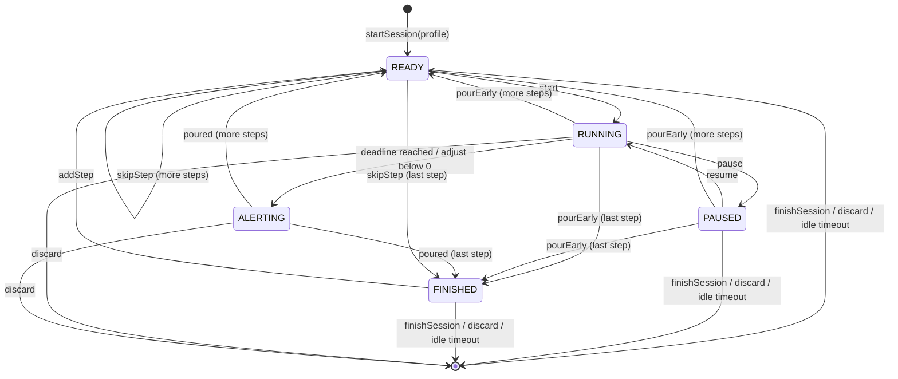
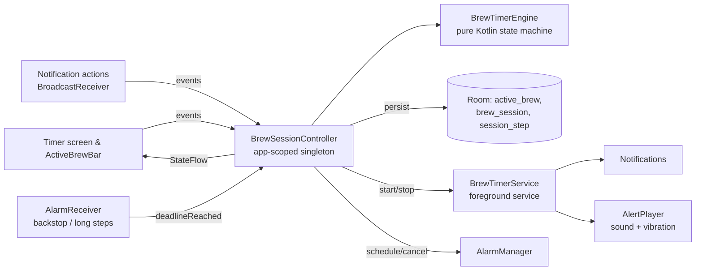

# 04 · Brew Timer Specification

> Status: **Draft v0.1** · Last updated: 2026-10-21

The steep timer is UmamiTea's most critical feature: a missed alert ruins a
cup of gyokuro. This document specifies its behaviour, state machine,
background execution, persistence, notifications and alerts in enough detail
to implement and test it. Functional requirements: TMR-xx and NOT-xx in
[02](02-functional-requirements.md).

## 1. Terminology

| Term | Meaning |
|---|---|
| **Session** | One brewing of one tea (`BrewSession`), consisting of steps. |
| **Step** | One timed unit: RINSE, INFUSION or WHISK, with planned duration and optional temperature. |
| **Short step** | Planned duration < 30 min (`LONG_STEP_THRESHOLD`). |
| **Long step** | Planned duration ≥ 30 min (cold brew, ice brew). |
| **Deadline** | The monotonic time (`SystemClock.elapsedRealtime()`) at which the running step ends. |
| **Overtime** | Time between the deadline and the user acknowledging (*Poured*). |
| **Active time** | Time a step spent RUNNING or ALERTING (excludes PAUSED). |

## 2. Design principles

1. **Single source of truth:** a pure-Kotlin `BrewTimerEngine` state machine,
   owned by an app-scoped `BrewSessionController`, is the only place timer state
   changes. UI, service and notifications *observe* it.
2. **Derived, not accumulated time:** remaining time is always computed as
   `deadline − now` from the monotonic clock; the app never decrements a
   counter every second. This prevents drift.
3. **Persist every transition** before side effects (notifications, sounds).
4. **Idempotent events:** a deadline fired twice (coroutine + alarm backstop),
   or a *Poured* tapped in the app and the notification simultaneously, has the
   same effect as once.
5. **Testable with virtual time:** the engine takes an injected
   `MonotonicClock` and `WallClock`.

## 3. State machine



### 3.1 States

| State | Data held | Meaning |
|---|---|---|
| `Idle` | — | No active session (no row in `active_brew`). |
| `Ready(stepIndex)` | session, step index, `readySince` | Waiting for the user to pour water and start the step. |
| `Running(stepIndex, deadline)` | deadline (monotonic + wall), `activeElapsedBeforeMs` | Counting down. |
| `Paused(stepIndex, remainingMs)` | remaining ms, active elapsed so far, `pausedSince` | Frozen. |
| `Alerting(stepIndex, deadline)` | deadline; overtime = now − deadline | Step finished; alert playing; waiting for *Poured*. |
| `Finished` | session | All planned steps done; waiting for *Finish & log* or *Add infusion*. |

### 3.2 Events and transitions

| Event | Allowed in | Effect |
|---|---|---|
| `startSession(teaId?, profileSnapshot)` | Idle | Create `BrewSession` (IN_PROGRESS) + planned steps → `Ready(0)` (or `Running(0)` if SET-12). |
| `start` | Ready | `deadline = now + plannedMs` → Running. Record step `startedAt` (wall). |
| `pause` | Running | `remaining = deadline − now` (clamped ≥ 0) → Paused. |
| `resume` | Paused | `deadline = now + remaining` → Running. |
| `adjust(deltaSec)` | Running, Paused | Running: `deadline += delta`; if `deadline ≤ now` → Alerting. Paused: `remaining += delta`, min 1 s. Accumulate `adjustedSeconds`. |
| `deadlineReached` | Running | → Alerting; start alert. Ignored in any other state (idempotency). |
| `pourEarly` | Running, Paused | Record actual = active elapsed; → next Ready or Finished. No alert. |
| `poured` | Alerting | Stop alert; record actual = active elapsed incl. overtime (capped, §5.3); → next Ready or Finished. |
| `skipStep` | Ready | Mark step `skipped`; → next Ready or Finished. |
| `addStep(step)` | any except Idle | Append step; if Finished → Ready(new index). |
| `editSteps(list)` | any except Idle | Replace steps with index > current (or ≥ current in Ready). |
| `finishSession` | Ready, Paused, Finished | If ≥ 1 non-rinse step completed → COMPLETED; else discard (after UI confirm). → Idle. |
| `discard` | any except Idle | Delete session and its inventory event → Idle. |
| `idleTimeout` | Ready, Paused, Finished (60 min without interaction) | As `finishSession` without confirmation; post "Session saved" notification. |
| `overtimeTimeout` | Alerting (10 min after deadline) | As `poured` with actual = planned + adjustments (assume poured on time); flag `overtimeAutoAcknowledged`. |

## 4. Architecture of the timer



- `BrewTimerEngine` — pure function `reduce(state, event, now) → (state, effects)`.
  Effects: `PersistState`, `ScheduleDeadline`, `CancelDeadline`, `StartAlert`,
  `StopAlert`, `StartForeground`, `StopForeground`, `UpdateNotification`,
  `RecordStep`, `CompleteSession`, `DiscardSession`.
- `BrewSessionController` — serialises events through a single coroutine
  `Mutex`/actor, executes effects, exposes `StateFlow<TimerUiState>`.
- `BrewTimerService` — foreground service; holds the wake lock, posts the
  ongoing notification, hosts the `AlertPlayer`. Contains no timer logic.
- UI computes the displayed remaining time each frame from `deadline` and
  `elapsedRealtime()` (`withFrameNanos` loop only while visible).

## 5. Time computation

### 5.1 Clocks

- **Monotonic:** `SystemClock.elapsedRealtime()` — includes deep sleep, not
  affected by the user changing the clock or time zone. Used for all countdown
  arithmetic.
- **Wall:** `System.currentTimeMillis()` — used only for timestamps in the
  journal, notification chronometer (`setWhen`), and reboot recovery.
- **Boot detection:** `Settings.Global.BOOT_COUNT` stored with each persisted
  state; if it differs on restore, monotonic values are invalid and wall-clock
  values are used.

### 5.2 Display rounding

- Remaining time is displayed rounded **up** to whole seconds
  (`ceil(remainingMs / 1000)`), so "0:01" shows until the true end and "0:00"
  appears exactly at alert time.
- Overtime is displayed rounded down ("+0:07").
- Durations ≥ 1 h display `h:mm:ss`.

### 5.3 Recorded step data

| Field | Rule |
|---|---|
| `plannedSeconds` | Planned duration at step start (adjustments not included). |
| `adjustedSeconds` | Net sum of ±10 s adjustments. |
| `actualSeconds` | Active elapsed time from *start* to *Poured* / *Pour now*, excluding paused time, rounded to nearest second. Overtime included, capped at 10 min. |
| `pausedSeconds` | Total time paused. |
| `overtimeSeconds` | Time between deadline and *Poured* (0 if poured early). |
| `startedAt` / `endedAt` | Wall-clock timestamps. |
| `skipped` | True if skipped. |

## 6. Background execution

### 6.1 Strategy summary

| Situation | Mechanism |
|---|---|
| App visible | Controller coroutine delays until deadline; UI renders. Service also running (started at session start). |
| Short step running, app in background / screen off | **Foreground service** (`specialUse`), **partial wake lock** with timeout, deadline coroutine; **exact alarm backstop** if permitted. |
| Long step running (≥ 30 min) | No wake lock; foreground service stopped; **AlarmManager** alarm (exact if permitted, else windowed 10 min); ongoing low-priority notification. |
| Ready / Paused / Finished | Foreground service keeps the ongoing notification (no wake lock). Idle timeout 60 min via coroutine + inexact alarm. |
| Alerting | Foreground service plays alert (sound/vibration) and shows the heads-up alert notification. |

### 6.2 Short steps: foreground service

- `BrewTimerService` is started with `startForegroundService()` from the
  `start`/`startSession` user action while the app is in the foreground (allowed
  on all API levels). It stays in the foreground until the session ends or
  enters a long step.
- **Type:** `foregroundServiceType="specialUse"` with
  `PROPERTY_SPECIAL_USE_FGS_SUBTYPE = "Tea steeping countdown timer started by the user; alerts the user when the infusion must be poured."`
  The Play Console foreground-service declaration must include a short video of
  the timer. See decision [D-004](10-open-questions-and-decisions.md#d-004).
  (`shortService` is not suitable: it times out after ~3 minutes, while western
  steeps take 3–5 minutes.)
- **Wake lock:** `PARTIAL_WAKE_LOCK` acquired when a short step enters RUNNING,
  with timeout `remaining + 30 s`; released on pause, pour, alert end, or
  session end. Never held in READY/PAUSED/FINISHED or for long steps. This keeps
  `delay()`-based deadlines accurate while the screen is off and keeps the app
  well clear of Android vitals' excessive-wake-lock thresholds (sessions are
  minutes, not hours).
- **Notification updates:** the ongoing notification uses the system
  chronometer in countdown mode (`setUsesChronometer(true)`,
  `setChronometerCountDown(true)`, `setWhen(deadlineWall)`), so it does not
  need per-second updates. It is updated only on state transitions.

### 6.3 Long steps (reminder mode)

- On entering RUNNING for a long step: stop foreground (keep a regular ongoing
  notification "Cold brew · ready at ~14:30"), release any wake lock, schedule
  an alarm:
  - if `AlarmManager.canScheduleExactAlarms()` →
    `setExactAndAllowWhileIdle(ELAPSED_REALTIME_WAKEUP, deadline)`;
  - else `setWindow(ELAPSED_REALTIME_WAKEUP, deadline, 10 min)` — the UI says
    "around 14:30" and explains on tap how to enable precise reminders (SET-21).
- The alarm's receiver posts the alert notification on the *Cold brew & long
  steeps* channel (sound from the channel, not from `AlertPlayer`) and sends
  `deadlineReached` to the controller.
- Pause/resume/adjust reschedule the alarm. After reboot, `BOOT_COMPLETED`
  (and `LOCKED_BOOT_COMPLETED` is **not** used) reschedules long-step alarms from
  wall-clock data.

### 6.4 Exact alarm backstop for short steps

`SCHEDULE_EXACT_ALARM` is declared (not `USE_EXACT_ALARM`). If granted (default
on Android 12–13; user-granted on 14+), each short-step deadline is *also*
scheduled with `setExactAndAllowWhileIdle`, in case the process is killed
while the service runs. The receiver posts the alert notification and, if the
app process is alive, forwards `deadlineReached` (idempotent). Alarms are
cancelled on pause/pour/discard.

### 6.5 Restrictions & policies to respect

| Platform rule | Handling |
|---|---|
| Android 13+ notification permission | Requested in onboarding; banner TMR-31 if missing. FGS still runs without it; the `AlertPlayer` sound/vibration still works because it is played by the service, not the notification. |
| Android 14+ FGS types | `specialUse` declared with `FOREGROUND_SERVICE_SPECIAL_USE` permission. |
| Background FGS start restrictions (Android 12+) | FGS is only started from user actions in the foreground or from notification actions (exempt). Never from alarms or boot. |
| Android 14+ exact alarms denied by default | Treated as optional (§6.3, §6.4). |
| Full-screen intents restricted (Android 14+) | Not used. Heads-up notification + sound instead. |
| Doze / App Standby | Short steps: wake lock + FGS. Long steps: `AllowWhileIdle` exact or windowed alarms. |
| Battery optimisation exemptions | The app **does not** ask to be excluded from battery optimisation. |
| OEM background killers | Settings › Timer shows a "Timer not ringing?" help page with general advice for aggressive OEM battery managers. |

## 7. Persistence & recovery

### 7.1 What is persisted

On every transition, inside one Room transaction:
- `active_brew` single row (see [05 §3.12](05-data-model.md#312-activebrew)):
  session id, step index, phase, deadline (monotonic and wall), remaining ms,
  active elapsed ms, paused-since, boot count, last-interaction time.
- Changes to `brew_session` / `session_step` (recorded actuals).

### 7.2 Recovery on process start

At `Application.onCreate` the controller loads `active_brew`:

| Persisted phase | Same boot | After reboot / clock unknown |
|---|---|---|
| READY / PAUSED / FINISHED | Restore as-is; re-post ongoing notification (start FGS only when the user next interacts, because background FGS start is restricted). | Same. |
| RUNNING, deadline in future | Restore RUNNING with the same deadline; schedule deadline. If app not in foreground, rely on the exact alarm backstop or show notification "Timer was interrupted — open to continue". | Recompute remaining from `deadlineWall − now`. |
| RUNNING, deadline passed ≤ 10 min ago | → ALERTING with overtime; play alert only if the app is in the foreground (otherwise the backstop alarm has already notified). | Same, using wall clock. |
| RUNNING, deadline passed > 10 min ago | → step auto-acknowledged (`overtimeTimeout`), state READY/FINISHED, no sound. | Same. |
| ALERTING | Same rules as "deadline passed". | Same. |

If the persisted data is inconsistent (e.g. session row missing), the active
state is cleared and the error is logged locally (debug builds only).

### 7.3 Force-stop

After the user force-stops the app, alarms are cleared by the system. On next
launch, recovery (§7.2) applies and the UI clearly shows "The timer was
stopped by the system."

## 8. Notifications

### 8.1 Channels

| Channel ID | Name (en) | Importance | Sound | Vibration | Purpose |
|---|---|---|---|---|---|
| `brew_timer` | Brew timer | LOW | none | none | Ongoing countdown / FGS notification |
| `steep_finished` | Steep finished | HIGH | none (played by app, §9) | none (app) | Heads-up "Pour now" for short steps |
| `long_steep` | Cold brew & long steeps | HIGH | channel default (bundled "Singing bowl") | on | Alert for long steps |
| `session_updates` | Session updates | LOW | none | none | Auto-finished session, interrupted timer |
| `reminders` | Reminders | DEFAULT | default | default | Backup, stock & freshness digests |

### 8.2 Notification content

| Phase | Notification | Title | Text | Actions |
|---|---|---|---|---|
| READY | `brew_timer` ongoing | Gyokuro · Infusion 2 of 4 | Ready · 0:20 at 55 °C | *Start* |
| RUNNING | `brew_timer` ongoing, chronometer countdown | Gyokuro · Infusion 2 of 4 | Steeping at 55 °C | *Pause*, *+10 s* |
| PAUSED | `brew_timer` ongoing | Gyokuro · Infusion 2 of 4 | Paused · 0:12 left | *Resume* |
| ALERTING | `steep_finished` (heads-up, category `ALARM`, public) | Pour now! | Gyokuro · Infusion 2 | *Poured* |
| FINISHED | `brew_timer` ongoing | Gyokuro · All infusions done | Tap to log your session | *Finish & log* |
| Long step | `brew_timer` (non-FGS ongoing) | Gyokuro · Cold brew | Ready around 14:30 | *Open* |
| Long step done | `long_steep` | Your cold brew is ready | Gyokuro · steeped 3 h | *Done* |

- Content intent → SCR-05. All actions go to an internal (non-exported)
  `BroadcastReceiver` that forwards to the controller.
- Notification ID constants: 1 = ongoing/FGS, 2 = alert, 3 = session updates,
  10+ = reminders.
- Lock-screen visibility: public.
- Live Updates (TMR-41, Could): on platforms that support promoted ongoing
  notifications with progress, the RUNNING notification uses the progress style
  with a segment per step.

## 9. Alerts

### 9.1 AlertPlayer

- Plays the chosen bundled tone (SET-09) with `AudioAttributes`:
  - SET-13 "Ring even in silent mode" → `USAGE_ALARM` (respects Do Not
    Disturb's alarm setting; audible when the ringer is silent).
  - SET-13 "Follow ringer mode" → `USAGE_NOTIFICATION_EVENT`; silent/vibrate
    ringer mode is respected.
- Requests transient audio focus (`AUDIOFOCUS_GAIN_TRANSIENT_MAY_DUCK`) so music
  ducks; abandons it when done.
- During a phone call (`AudioManager.mode` in call/communication) → vibrate only.
- Alert length (SET-14): Short = tone once (~3 s); Normal = repeat with 2 s gaps
  up to 15 s; Long = repeat until acknowledged, max 2 min. The heads-up
  notification remains until acknowledged or replaced.
- Vibration (SET-11): pattern `[0, 400, 200, 400, 200, 800]` ms, repeated with
  the tone; via `VibratorManager` (API 31+) / `Vibrator`. Uses
  `VibrationAttributes.USAGE_ALARM` where available.
- Pre-alert (SET-10, Could): a single soft tick at T−5 s, notification stream.
- Test alert in settings (SET-31) uses the same player.

### 9.2 Bundled tones

5 short, calm tones (OGG Vorbis, mono, 44.1 kHz, ≤ 60 KB each): *Singing bowl*
(default), *Bell*, *Wood block*, *Chime*, *Soft*. Loudness normalised to
−16 LUFS. Licences recorded in About.

## 10. Quick timer

- Uses the same engine with an ephemeral session (`sessionId = null`): one
  INFUSION step, no journal entry, no inventory.
- States: READY → RUNNING ⇄ PAUSED → ALERTING → (Done) → Idle.
- Shares the FGS, notifications (title "Quick timer"), and alert settings.
- Counts as the single active timer (GEN-03).

## 11. Edge cases

| # | Case | Expected behaviour |
|---|---|---|
| E1 | User changes device time / time zone during a step | No effect on countdown (monotonic). Journal timestamps use wall clock at the moment of recording. |
| E2 | Device reboots during a short step | On boot, nothing rings (FGS not restartable from boot). Next app open → recovery §7.2. If the exact backstop alarm existed it was cleared by reboot — note in "Timer not ringing?" help. |
| E3 | Device reboots during a long step | `BOOT_COMPLETED` receiver reschedules the alarm from wall-clock deadline. |
| E4 | Low memory kill during a short step | FGS processes are rarely killed; if killed, backstop exact alarm (if allowed) notifies; recovery on open. |
| E5 | User swipes app from recents | Session continues (FGS keeps running). |
| E6 | User taps *Poured* in notification and app simultaneously | Second event ignored (idempotent by state check). |
| E7 | +10 s tapped during ALERTING | Not available in ALERTING (buttons hidden). |
| E8 | −10 s with 4 s remaining | Deadline in the past → ALERTING immediately. |
| E9 | Phone call arrives during RUNNING | Countdown continues; alert vibrates only if call still active. |
| E10 | Headphones connected | Alert plays through the active output per Android routing for the chosen usage (alarm usage also plays on speaker). |
| E11 | Notification permission revoked mid-session | FGS continues; alert sound still plays; banner shown in app. |
| E12 | Tea deleted while its session is active | Delete disabled for the tea with an active session ("Finish the session first"). |
| E13 | Restore backup while a session is active | Restore disabled until the session is finished. |
| E14 | Multi-window / rotation on timer screen | State unaffected; layout adapts. |
| E15 | Battery saver on | No change for short steps; long-step windowed alarms may be deferred further — UI wording "around" covers this. |
| E16 | 24 h maximum step | Allowed; always long-step mode. |
| E17 | Session spans midnight | Session belongs to the local date of `startedAt` for grouping and streaks. |

## 12. Testing the timer

| Level | Tests |
|---|---|
| Unit (JVM) | Engine transitions for every row in §3.2; idempotency; rounding (§5.2); recorded data (§5.3); recovery table (§7.2) with fake clocks and boot counts; idle and overtime timeouts. |
| Integration (Robolectric) | Controller + Room persistence; notification content per phase; alarm scheduling choices with/without exact permission. |
| Instrumented | Service lifecycle; alert with screen off on real devices; process death (`adb shell am kill`) and recovery; reboot during long step. |
| Manual device matrix | See [07 §8](07-non-functional.md#8-compatibility--device-matrix); includes Samsung, Xiaomi, OnePlus/Oppo for OEM battery behaviour; Doze forced via `adb shell dumpsys deviceidle force-idle`. |
| Accuracy benchmark | Automated: 50 runs of a 60 s step with screen off; alert timestamp vs. deadline; pass if p95 ≤ 250 ms and max ≤ 1 s. |

## 13. Manifest declarations (timer-related)

```xml
<uses-permission android:name="android.permission.POST_NOTIFICATIONS" />
<uses-permission android:name="android.permission.FOREGROUND_SERVICE" />
<uses-permission android:name="android.permission.FOREGROUND_SERVICE_SPECIAL_USE" />
<uses-permission android:name="android.permission.WAKE_LOCK" />
<uses-permission android:name="android.permission.VIBRATE" />
<uses-permission android:name="android.permission.SCHEDULE_EXACT_ALARM" />
<uses-permission android:name="android.permission.RECEIVE_BOOT_COMPLETED" />

<service
    android:name=".timer.BrewTimerService"
    android:exported="false"
    android:foregroundServiceType="specialUse">
    <property
        android:name="android.app.PROPERTY_SPECIAL_USE_FGS_SUBTYPE"
        android:value="Tea steeping countdown timer started by the user" />
</service>

<receiver android:name=".timer.TimerActionReceiver" android:exported="false" />
<receiver android:name=".timer.DeadlineAlarmReceiver" android:exported="false" />
<receiver android:name=".timer.BootReceiver" android:exported="true">
    <intent-filter>
        <action android:name="android.intent.action.BOOT_COMPLETED" />
    </intent-filter>
</receiver>
```

(Class names are indicative; final packages per [06](06-architecture.md).)
