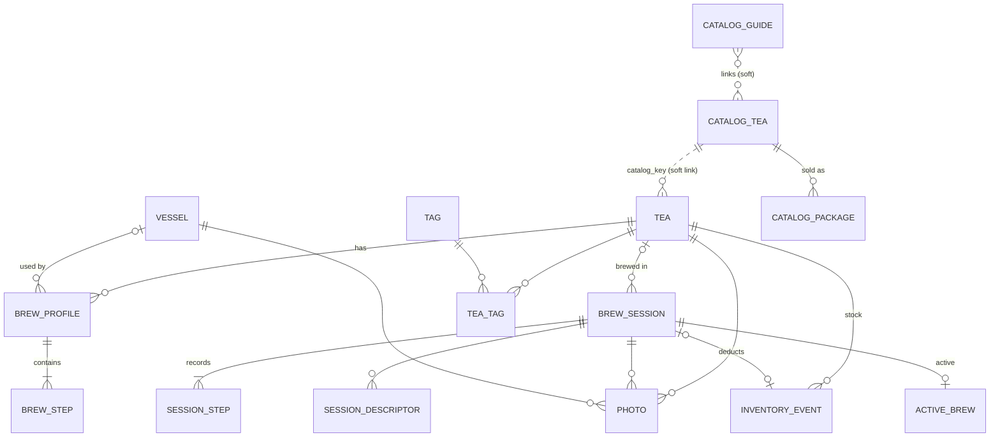

# 05 · Data Model & Backup Format

> Status: **Draft v0.2** · Last updated: 2026-10-22 (`active_brew` snapshot, D-048)
> v0.2: Tee-Kontor catalog tables, pre-alert per recipe, 5 °C temperature
> steps, metric only, costs, no sample data.

## 1. Principles

1. **Local only.** Room (SQLite) database, typed DataStore for settings, files
   in app-private storage.
2. **Metric storage:** °C, g, ml, seconds. Temperatures are stored as
   integers that are **multiples of 5** (GEN-12).
3. **Stable IDs:** UUID v4 strings for user data; the catalog uses the shop's
   base article number as its key (e.g. `TG0557`).
4. **Timestamps** epoch ms UTC; sessions also store the IANA zone ID.
5. **Snapshots for history:** sessions copy tea name, type, recipe and vessel
   values.
6. **Catalog is separate and replaceable.** Catalog tables live in a
   **separate Room database `catalog.db`** (excluded from device backup) and
   are rebuilt by each refresh; collection teas are independent copies with a *soft* link
   (`catalog_key`) — no foreign key — so catalog refreshes and device
   restores never cascade into personal data (CAT-13).
7. **Built-in styles** are a bundled asset referenced by key.

## 2. Entity-relationship diagram

## 3. Personal data tables

Booleans are `INTEGER` 0/1; all non-cross-ref tables have `created_at` and
`updated_at` (omitted below).

### 3.1 Tea

Table `tea`

| Column | Type | Req. | Notes |
|---|---|---|---|
| `id` | TEXT | ✓ | PK, UUID |
| `name` | TEXT | ✓ | 1–80 |
| `secondary_name` | TEXT | | ≤ 80 |
| `catalog_key` | TEXT | | Tee-Kontor base article number; soft link |
| `style_key` | TEXT | | Built-in style; null = other |
| `tea_type` | TEXT | | Display type, e.g. „Gyokuro" (from catalog *Sorte* or style) |
| `category` | TEXT | ✓ | `TeaCategory` |
| `form` | TEXT | ✓ | `TeaForm` |
| `umami_level` | TEXT | | `UmamiLevel`; null = style's |
| `is_flavored` | INTEGER | ✓ | aromatisiert |
| `is_organic` | INTEGER | ✓ | Bio |
| `ingredients` | TEXT | | ≤ 1000, flavoured teas (from catalog) |
| `origin_country` | TEXT | | ISO 3166-1 alpha-2 |
| `origin_region` | TEXT | | ≤ 80 |
| `cultivar` | TEXT | | ≤ 80 |
| `harvest_year` | INTEGER | | |
| `harvest_season` | TEXT | | `HarvestSeason` |
| `shading_days` | INTEGER | | 0–60 |
| `processing_notes` | TEXT | | ≤ 300 (e.g. „Chumushi") |
| `description` | TEXT | | ≤ 10000 (copied from catalog) |
| `vendor` | TEXT | | default „Tee-Kontor Kiel" for catalog teas |
| `product_url` | TEXT | | shop link |
| `opened_date` | TEXT | | ISO date |
| `best_before` | TEXT | | ISO date |
| `freshness_days` | INTEGER | | override |
| `low_stock_grams` | REAL | | override |
| `storage_note` | TEXT | | ≤ 120 |
| `notes` | TEXT | | ≤ 5000 |
| `recipe_check_reason` | TEXT | | `RecipeCheckReason`; null = no flag (CAT-05, TEA-17) |
| `is_favorite` | INTEGER | ✓ | |
| `is_archived` | INTEGER | ✓ | |
| `cover_photo_id` | TEXT | | FK → `photo` SET NULL |

Indices: `name NOCASE`, `catalog_key`, `style_key`, `is_archived`.
FTS4 `tea_fts`: name, secondary_name, vendor, origin_region, cultivar, notes.

### 3.2 BrewProfile (recipe)

Table `brew_profile`

| Column | Type | Req. | Notes |
|---|---|---|---|
| `id` | TEXT | ✓ | PK |
| `tea_id` | TEXT | ✓ | FK → `tea` CASCADE |
| `name` | TEXT | ✓ | 1–40 |
| `method` | TEXT | ✓ | `BrewMethod` |
| `leaf_grams` | REAL | ✓ | 0.1–100 |
| `water_ml` | INTEGER | ✓ | 10–3000 |
| `base_temp_c` | INTEGER | ✓ | 5–100, multiple of 5 |
| `vessel_id` | TEXT | | FK → `vessel` SET NULL |
| `pre_alert_seconds` | INTEGER | | null = global; 0 = off; 5–30 step 5 |
| `is_default` | INTEGER | ✓ | one per tea |
| `position` | INTEGER | ✓ | |
| `source` | TEXT | ✓ | `RecipeSource` |
| `notes` | TEXT | | ≤ 500 |

### 3.3 BrewStep

Table `brew_step`: `id` PK; `profile_id` FK CASCADE; `position` (unique per
profile); `kind` `StepKind`; `duration_seconds` 5–86400; `temp_c` INTEGER
nullable, multiple of 5; `note` ≤ 120.

### 3.4 Vessel

Table `vessel`: `id`, `name` 1–40, `type` `VesselType`, `capacity_ml`
10–3000, `usable_ml` (≤ capacity), `material` `VesselMaterial`, `notes`,
`is_favorite`, `is_archived`, `cover_photo_id`.

### 3.5 Tag & TeaTag (Could)

`tag` (`id`, `name` UNIQUE NOCASE 1–30); `tea_tag` (`tea_id`, `tag_id`) PK both.

### 3.6 BrewSession

Table `brew_session`

| Column | Type | Req. | Notes |
|---|---|---|---|
| `id` | TEXT | ✓ | PK |
| `status` | TEXT | ✓ | `SessionStatus` |
| `tea_id` | TEXT | | FK → `tea` SET NULL |
| `tea_name` | TEXT | ✓ | snapshot |
| `tea_secondary_name`, `tea_type`, `style_key`, `category` | TEXT | | snapshots |
| `profile_id` | TEXT | | FK → `brew_profile` SET NULL |
| `profile_name` | TEXT | | snapshot |
| `method` | TEXT | ✓ | |
| `vessel_id` | TEXT | | FK SET NULL |
| `vessel_name` | TEXT | | snapshot |
| `leaf_grams` | REAL | | |
| `water_ml` | INTEGER | | |
| `base_temp_c` | INTEGER | | |
| `pre_alert_seconds` | INTEGER | | effective value used |
| `planned_step_count` | INTEGER | ✓ | number of steps planned at finish (incl. never-started ones), for „2 von 3 Aufgüssen" (TMR-12) |
| `cost_cents` | INTEGER | | leaf × cost per gram at finish (INV-08) |
| `started_at` | INTEGER | ✓ | |
| `ended_at` | INTEGER | | |
| `zone_id` | TEXT | ✓ | |
| `rating` | REAL | | 0.5–5.0 step 0.5 |
| `taste_umami`, `taste_sweetness`, `taste_bitterness`, `taste_astringency`, `taste_body`, `taste_aroma` | INTEGER | | 0–5 each |
| `notes` | TEXT | | ≤ 5000 |
| `auto_finished` | INTEGER | ✓ | |
| `times_offered` | INTEGER | ✓ | PRF-07 prompt was applicable |
| `times_applied` | INTEGER | ✓ | user accepted *Zeiten ins Rezept übernehmen*; the offer is not shown again |

FTS4 `session_fts` (tea_name, notes); descriptor search via join.

### 3.7 SessionStep

Table `session_step`: `id`; `session_id` FK CASCADE; `position`; `kind`;
`planned_seconds`; `actual_seconds`; `paused_seconds`; `overtime_seconds`;
`temp_c`; `started_at`; `ended_at`; `skipped`; `overtime_auto_ack`
(see [04 §3.2](04-brew-timer.md#32-events-and-transitions)); `note` ≤ 300.

**Lifecycle:** all planned rows are created when the session starts
(`startSession`); `editSteps` / `addStep` insert, update or delete rows that
have not started. When the session finishes, rows that were never started
are **deleted**; `brew_session.planned_step_count` keeps the planned total so
the journal can show „2 von 3 Aufgüssen". Skipped steps (TMR-09) stay with
`skipped = 1`.

### 3.8 Descriptors

Built-in German vocabulary is bundled ([08 §4](08-content.md#4-tasting-descriptor-vocabulary)).
`custom_descriptor` (`id`, `label` UNIQUE NOCASE 1–30, `group`);
`session_descriptor` (`session_id` FK CASCADE, `descriptor_key`) — key is a
built-in key or `custom:<id>`.

### 3.9 Photo

Table `photo`: `id` (file `<id>.jpg` in `filesDir/photos/`; catalog copies are
re-encoded from WebP to JPEG when copied), exactly one of
`tea_id` / `session_id` / `vessel_id` (FK CASCADE), `position`, `width_px`,
`height_px`, `byte_size`, `origin` (`PhotoOrigin`).
When a tea is added from the catalog, the catalog photo is **copied** into
`photo` (origin `CATALOG_COPY`) so the tea stays independent.

### 3.10 InventoryEvent

Table `inventory_event`

| Column | Type | Req. | Notes |
|---|---|---|---|
| `id` | TEXT | ✓ | PK |
| `tea_id` | TEXT | ✓ | FK CASCADE |
| `session_id` | TEXT | | FK CASCADE, unique |
| `type` | TEXT | ✓ | `InventoryEventType` |
| `delta_grams` | REAL | ✓ | + added / − used |
| `price_cents` | INTEGER | | for INITIAL/PURCHASE |
| `currency` | TEXT | | default `EUR` |
| `package_label` | TEXT | | e.g. „100 g" |
| `occurred_at` | INTEGER | ✓ | |
| `note` | TEXT | | ≤ 200 |

Remaining stock = SUM(`delta_grams`). Cost per gram = Σ price / Σ grams of
INITIAL+PURCHASE events.

### 3.12 ActiveBrew

Single-row table `active_brew` (`id` = 1). Together with the session's
`session_step` rows it holds the timer engine's state without loss; the
plain model type is `ActiveBrewSnapshot` in `core:model`, and the engine maps
it with `snapshot(state)` / `restore(snapshot)`
([04 §7.1](04-brew-timer.md#71-persisted-on-every-transition), D-048). A
step's status is not stored: rows with recorded values are ended, the
current step of RUNNING/PAUSED/ALERTING is started, all others are pending.

| Column | Type | Notes |
|---|---|---|
| `session_id` | TEXT | FK CASCADE; null for quick timer |
| `is_quick_timer`, `quick_duration_seconds` | | the quick timer's one INFUSION step; it has no `session_step` rows |
| `step_index` | INTEGER | current step; the number of steps in FINISHED |
| `phase` | TEXT | `TimerPhase` |
| `deadline_elapsed_ms`, `deadline_wall_ms` | INTEGER | RUNNING/ALERTING |
| `pre_alert_elapsed_ms`, `pre_alert_played` | | RUNNING; `pre_alert_played` also PAUSED |
| `remaining_ms` | INTEGER | PAUSED |
| `paused_total_ms` | INTEGER | current step, before the current phase |
| `paused_since_elapsed_ms`, `paused_since_wall_ms` | INTEGER | PAUSED |
| `ready_since_wall_ms` | INTEGER | READY/FINISHED |
| `step_started_wall_ms` | INTEGER | RUNNING/PAUSED/ALERTING |
| `alert_played` | INTEGER | ALERTING; recovery replays the alert while 0 |
| `boot_count` | INTEGER | boot of the `…_elapsed_ms` values |
| `last_interaction_wall_ms` | INTEGER | `idleDemote` after 30 min; `midnightTimeout` at the first local midnight ≥ 6 h after it; quick-timer cancel after 30 min |
| `demoted` | INTEGER | FGS stopped, regular notification shown |
| `pre_alert_override_seconds` | INTEGER | the session's own pre-alert (Schritte-Sheet); null = *Wie Einstellung*, 0 = *Aus* |
| `pre_alert_inherited_seconds` | INTEGER | recipe ?: global pre-alert, frozen at the start (0 = off) |
| `zone_id` | TEXT | the session's time zone; needed for the quick timer, which has no `brew_session` row |

The earlier `active_elapsed_ms` is dropped: it is derived (RUNNING:
planned − (deadline − now); PAUSED: planned − remaining) and is not part of
the state (D-048).

## 4. Catalog tables (rebuilt by each refresh)

### 4.1 CatalogTea

Table `catalog_tea`

| Column | Type | Notes |
|---|---|---|
| `key` | TEXT PK | Base article number (variant suffixes like `-50`, `M` stripped) |
| `name`, `secondary_name` | TEXT | |
| `product_url` | TEXT | canonical product page |
| `shop_category` | TEXT | e.g. „Grüner Tee › Japan › Gyokuro" |
| `tea_type` | TEXT | *Sorte* as named by the shop |
| `style_key` | TEXT | mapped built-in style (CAT-06) |
| `origin_country`, `origin_region`, `cultivar`, `harvest`, `shading`, `steaming` | TEXT | as found |
| `is_organic`, `is_flavored`, `cold_brew_suitable` | INTEGER | badges / aroma / ingredients |
| `aroma`, `taste_notes`, `manufacturer`, `season`, `matcha_grade` | TEXT | properties table |
| `taste_scales_json` | TEXT | shop scales, e.g. `{"Umami":4,"Bitterstoffe":1}` |
| `breadcrumb` | TEXT | category path of the product page |
| `ingredients` | TEXT | flavoured teas |
| `description_html` | TEXT | sanitised HTML/Markdown of the description |
| `brew_table_raw` | TEXT | brewing grid as found (JSON: one object per row with `kind` = japan/westlich and the cell texts) |
| `brew_text_raw` | TEXT | brewing prose as found |
| `derived_recipes_json` | TEXT | list of recipes (same shape as `brew_profile` + steps) |
| `recipe_check_reason` | TEXT | `RecipeCheckReason` or null |
| `base_price_cents_per_100g` | INTEGER | |
| `available` | INTEGER | in stock at refresh |
| `discontinued` | INTEGER | not found in the latest refresh; only kept if a collection tea links to it (CAT-07 AC4) |
| `photo_file` | TEXT | `filesDir/catalog/<key>.webp` |
| `photo_url`, `photo_etag` | TEXT | change detection |
| `content_hash` | TEXT | to report „geändert" |
| `first_seen_at`, `last_seen_at` | INTEGER | |

FTS4 `catalog_fts` over name, secondary_name, description text, cultivar,
origin_region.

### 4.2 CatalogPackage

Table `catalog_package`: `catalog_key` FK CASCADE, `article_number`
(e.g. `TG0557-50`), `label` („50 g", „250 g · 3 % gespart"), `grams` REAL,
`price_cents`, `price_is_estimate` INTEGER, `savings_percent` INTEGER,
`variant_url`, `available`.

### 4.2a CatalogSkip

Table `catalog_skip`: `base_key` PK, `reason` (`NOT_GREEN`, `SET`,
`NO_TEA`), `checked_at` — base numbers from the sitemap that were classified
as out of scope, so later refreshes don't fetch them again (re-checked after
90 days).

### 4.3 CatalogGuide

Table `catalog_guide`: `slug` PK, `title`, `url`, `body_markdown`,
`hero_file`, `linked_catalog_keys` (JSON), `fetched_at`.

### 4.4 CatalogRefreshLog

Table `catalog_refresh_log`: `id`, `started_at`, `finished_at`, `status`
(`SUCCESS` / `FAILED` / `CANCELLED`), counts (new, changed, discontinued,
flagged, photos), `parser_version`, `error_summary`.

### 4.5 Refresh transaction

Parsing writes into staging tables; on success, one transaction replaces
`catalog_tea`, `catalog_package`, `catalog_guide` and marks discontinued keys
(kept from the previous catalog with `discontinued = 1`). On failure the
staging tables are dropped and the old catalog stays untouched (CAT-07 AC5).

## 5. Enumerations

| Enum | Values |
|---|---|
| `TeaCategory` | `GREEN`, `WHITE`, `YELLOW`, `OOLONG`, `BLACK`, `DARK`, `HERBAL`, `OTHER` |
| `TeaForm` | `LOOSE_LEAF`, `POWDER`, `TEA_BAG`, `COMPRESSED` |
| `UmamiLevel` | `NONE`, `LOW`, `MEDIUM`, `HIGH`, `VERY_HIGH` |
| `HarvestSeason` | `FIRST_FLUSH`, `SECOND_FLUSH`, `SUMMER`, `AUTUMN`, `WINTER`, `UNKNOWN` |
| `BrewMethod` | `KYUSU`, `GONGFU`, `WESTERN`, `MATCHA_USUCHA`, `MATCHA_KOICHA`, `COLD_BREW`, `ICE_BREW`, `CUSTOM` |
| `StepKind` | `RINSE`, `INFUSION`, `WHISK` |
| `VesselType` | `KYUSU`, `HOUHIN`, `SHIBORIDASHI`, `GAIWAN`, `CLAY_TEAPOT`, `WESTERN_TEAPOT`, `MUG_INFUSER`, `GLASS`, `CHAWAN`, `COLD_BREW_BOTTLE`, `OTHER` |
| `VesselMaterial` | `UNGLAZED_CLAY`, `GLAZED_CERAMIC`, `PORCELAIN`, `GLASS`, `CAST_IRON`, `STAINLESS_STEEL`, `OTHER` |
| `SessionStatus` | `IN_PROGRESS`, `COMPLETED`, `MANUAL` |
| `TimerPhase` | `READY`, `RUNNING`, `PAUSED`, `ALERTING`, `FINISHED` |
| `InventoryEventType` | `INITIAL`, `PURCHASE`, `BREW`, `ADJUSTMENT` |
| `PhotoOrigin` | `OWN`, `CATALOG_COPY` |
| `RecipeSource` | `CATALOG_TABLE`, `CATALOG_TEXT`, `STYLE_DEFAULT`, `USER` |
| `RecipeCheckReason` | `FROM_TEXT`, `FROM_STYLE_DEFAULT`, `TABLE_TEXT_CONFLICT`, `IMPLAUSIBLE_VALUE`, `UNMAPPED_STYLE` |
| `DescriptorGroup` | `MARINE`, `VEGETAL`, `SWEET`, `ROASTED_NUTTY`, `FLORAL`, `FRUITY`, `EARTHY_WOODY`, `SPICE_HERB`, `MOUTHFEEL`, `OFF_NOTE`, `OTHER` |

## 6. Settings (DataStore)

| Field | Type | Default | Req. |
|---|---|---|---|
| `schemaVersion` | Int | 1 | |
| `onboardingCompleted` | Boolean | false | ONB-04 |
| `theme` | SYSTEM/LIGHT/DARK | SYSTEM | SET-05 |
| `dynamicColor` | Boolean | false | SET-06 |
| `alertSound` | key | `klangschale` | SET-09 |
| `preAlertSeconds` | Int (0, 5…30) | 10 | SET-10 |
| `vibration` | Boolean | true | SET-11 |
| `alertLength` | SHORT/NORMAL/LONG | NORMAL | SET-14 |
| `deductStock` | Boolean | true | SET-15 |
| `lowStockGrams` | Double | 10.0 | SET-16 |
| `keepScreenOn` | Boolean | true | SET-17 |
| `offerRecipeUpdate` | Boolean | true | SET-18 |
| `weeklyDigest` | Boolean | false | SET-19 |
| `backupReminder` | OFF/MONTHLY | MONTHLY | SET-20 |
| `lastManualBackupAt` | Long? | null | BAK-01 |
| `catalogDownloadPhotos` | Boolean | true | SET-22 |
| `collectionSegment` | MY_TEAS/CATALOG | MY_TEAS | SCR-08 |
| `collectionSort`, `catalogSort` | enums | name | |
| `statsRange` | enum | DAYS_90 | INS-07 |
| `dimWhileSteeping` | Boolean | true | SET-25 |
| `dismissedHints` | Set<String> | ∅ | |

## 7. Units & rounding

| Quantity | Stored | Display |
|---|---|---|
| Temperature | °C, integer, multiple of 5 | „55 °C" |
| Leaf | g, REAL (0.1) | „4,0 g" (German decimal comma) |
| Water | ml, INTEGER | „100 ml" |
| Duration | s | „1:30", „1 Min 30 s" in prose, „3 Min" in lists |
| Ratio | derived | „4,0 g / 100 ml" |
| Money | cents + currency (EUR) | „15,90 €" |

Snap rule: `snap5(x) = 5 × floor(x / 5 + 0.5)` (half up: 52,5 → 55).
Time rounding for derived recipes: nearest 5 s (half up).

## 8. Backup file format

- Manual export `.umamit` (ZIP): `manifest.json`, `data.json`,
  `settings.json`, `photos/<id>.jpg`. The **catalog is not included** (it is
  re-downloadable); collection teas keep their `catalog_key`.
- `manifest.json`: format id `umamit-backup`, `formatVersion` 1,
  `createdAt`, app version, database schema version, counts, SHA-256 of JSON
  entries.
- `data.json`: arrays for teas, brewProfiles, brewSteps, vessels, tags,
  teaTags, sessions, sessionSteps, customDescriptors, sessionDescriptors,
  inventoryEvents, photos (camelCase fields mirroring §3).
- **Restore (post-1.0, BAK-02 `Won't` for 1.x, D-036):** if built later,
  restore validation covers ZIP limits and zip-slip protection,
  manifest/version check, checksums, types/enums, constraints, referential
  integrity, photo files decodable; safety backup of current data; staging;
  single transaction; rollback on failure. The 1.x export already writes
  `manifest.json` with checksums so such a restore can read it.
- **Android device backup** (`data_extraction_rules.xml`, cloud backup and
  device transfer): include the whole `database` domain **except**
  `catalog.db*` (so `umamit.db` and its `-wal`/`-shm` files are included),
  and the DataStore files; exclude `photos/`, `catalog/`, caches.
- **After a device restore** (detected on the first start by a restored
  database whose install marker in no-backup storage is missing): clear
  `active_brew` (no session is resumed, 04 §11 E11); the orphan sweeper
  removes `photo` rows whose files are missing and clears dangling
  `cover_photo_id`s; after the next catalog refresh, catalog teas without a
  cover get the catalog photo copied again (via `catalog_key`).

## 9. Migrations

Room `exportSchema = true` with schemas committed; every version change ships
a migration and a `MigrationTestHelper` test; no destructive fallback. The
catalog tables may be dropped and recreated in a migration (followed by a
prompt to refresh), since they are re-downloadable.

## 10. Volume assumptions

| Entity | Expected | Test |
|---|---|---|
| Catalog teas | 260–280 | 500 |
| Own teas | 10–40 | 300 |
| Sessions | ~1,000 / year | 10,000 |
| Photos | catalog ~280 (~30 MB), own < 200 | 1,000 |
