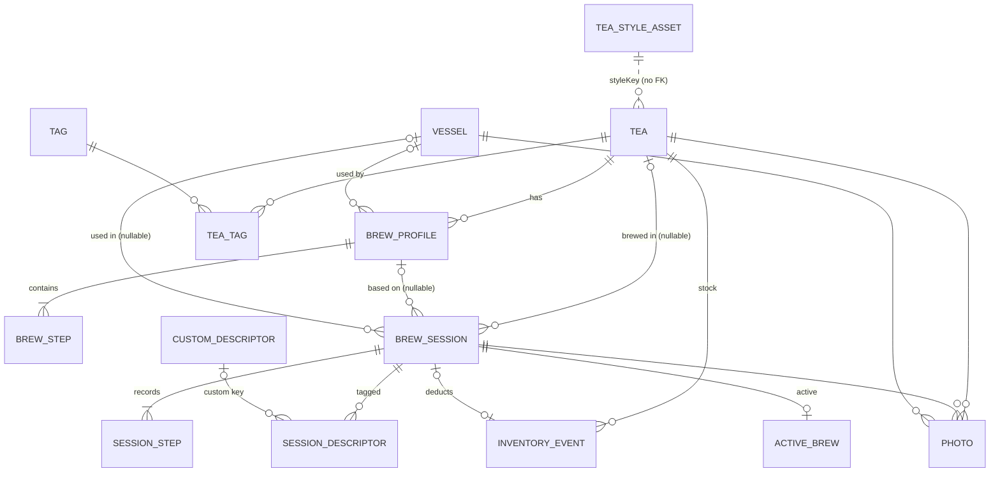

# 05 · Data Model & Backup Format

> Status: **Draft v0.1** · Last updated: 2026-10-21

## 1. Principles

1. **Local only.** All user data lives in a Room (SQLite) database, a typed
   DataStore for settings, and photo files in app-private storage.
2. **Metric storage.** Temperatures in °C, weights in grams, volumes in ml,
   durations in seconds. Unit conversion happens only at the UI boundary.
3. **Stable IDs.** User-created rows use UUID v4 strings, so backups can later be
   merged (BAK-03) and IDs never collide across devices.
4. **Timestamps** are epoch milliseconds UTC (`Long`). Sessions also store the
   IANA zone ID in effect when they started, for correct local-day grouping.
5. **Snapshots for history.** Journal sessions copy the tea name, style, vessel
   name and parameters they were brewed with, so history stays correct when the
   tea, profile or vessel changes or is deleted.
6. **Bundled content is not in the database.** Tea styles, built-in descriptors
   and guides are versioned app assets, referenced by stable string keys.
7. **Referential integrity** via foreign keys with explicit `ON DELETE` rules.

## 2. Entity-relationship diagram



## 3. Entities (Room tables)

Column types: `TEXT`, `INTEGER`, `REAL`. "Req." = NOT NULL.
Booleans are `INTEGER` 0/1. All tables except cross-refs have `created_at`
and `updated_at` (Req., epoch ms), omitted below for brevity.

### 3.1 Tea

Table `tea`

| Column | Type | Req. | Constraints / notes |
|---|---|---|---|
| `id` | TEXT | ✓ | PK, UUID |
| `name` | TEXT | ✓ | 1–80 chars, trimmed |
| `secondary_name` | TEXT | | ≤ 80, e.g. 「玉露」 |
| `style_key` | TEXT | | Key from bundled catalog, e.g. `gyokuro`; null = Other |
| `category` | TEXT | ✓ | `TeaCategory` |
| `form` | TEXT | ✓ | `TeaForm`, default `LOOSE_LEAF` |
| `umami_level` | TEXT | | `UmamiLevel`; null = use style's |
| `origin_country` | TEXT | | ISO 3166-1 alpha-2 |
| `origin_region` | TEXT | | ≤ 80, e.g. "Yame, Fukuoka" |
| `cultivar` | TEXT | | ≤ 80, e.g. "Saemidori" |
| `harvest_year` | INTEGER | | 1900 … current year + 1 |
| `harvest_season` | TEXT | | `HarvestSeason` |
| `shading_days` | INTEGER | | 0–60 |
| `processing_notes` | TEXT | | ≤ 300, e.g. "fukamushi, Tokoname-roasted" |
| `vendor` | TEXT | | ≤ 80 |
| `purchase_date` | TEXT | | ISO-8601 date `YYYY-MM-DD` |
| `price_minor` | INTEGER | | Price in minor units (cents), ≥ 0 |
| `currency` | TEXT | | ISO 4217; required if `price_minor` set |
| `package_grams` | REAL | | 0.1–10000 |
| `opened_date` | TEXT | | ISO date |
| `best_before` | TEXT | | ISO date |
| `freshness_days` | INTEGER | | Override of style window, 1–3650 |
| `grams_per_tsp` | REAL | | Override, 0.3–10 |
| `low_stock_grams` | REAL | | Override of SET-16 |
| `storage_note` | TEXT | | ≤ 120 |
| `notes` | TEXT | | ≤ 5000 |
| `is_favorite` | INTEGER | ✓ | default 0 |
| `is_archived` | INTEGER | ✓ | default 0 |
| `is_sample` | INTEGER | ✓ | default 0 (ONB-04) |
| `cover_photo_id` | TEXT | | FK → `photo.id` ON DELETE SET NULL (deferred) |

Indices: `name COLLATE NOCASE`, `category`, `is_archived`, `style_key`.
FTS: `tea_fts` (FTS4, external content = `tea`) over `name`, `secondary_name`,
`vendor`, `origin_region`, `cultivar`, `notes`; tag names are matched via a
join on `tag`.

### 3.2 BrewProfile

Table `brew_profile`

| Column | Type | Req. | Constraints / notes |
|---|---|---|---|
| `id` | TEXT | ✓ | PK |
| `tea_id` | TEXT | ✓ | FK → `tea` ON DELETE CASCADE |
| `name` | TEXT | ✓ | 1–40 |
| `method` | TEXT | ✓ | `BrewMethod` |
| `leaf_grams` | REAL | ✓ | 0.1–100 |
| `water_ml` | INTEGER | ✓ | 10–3000 |
| `base_temp_c` | REAL | ✓ | 0–100 |
| `vessel_id` | TEXT | | FK → `vessel` ON DELETE SET NULL |
| `is_default` | INTEGER | ✓ | Exactly one per tea (enforced in repository + partial unique index `WHERE is_default = 1`) |
| `position` | INTEGER | ✓ | Display order |
| `source_style_key` | TEXT | | Style the profile was copied from (for "reset to defaults") |
| `notes` | TEXT | | ≤ 500 |

### 3.3 BrewStep

Table `brew_step`

| Column | Type | Req. | Constraints / notes |
|---|---|---|---|
| `id` | TEXT | ✓ | PK |
| `profile_id` | TEXT | ✓ | FK → `brew_profile` ON DELETE CASCADE |
| `position` | INTEGER | ✓ | 0-based; UNIQUE(`profile_id`, `position`) |
| `kind` | TEXT | ✓ | `StepKind` |
| `duration_seconds` | INTEGER | ✓ | 1–86400 |
| `temp_c` | REAL | | 0–100; null = profile base temperature |
| `note` | TEXT | | ≤ 120 |

Profile rule: ≥ 1 and ≤ 30 steps, at least one non-RINSE step.

### 3.4 Vessel

Table `vessel`

| Column | Type | Req. | Constraints / notes |
|---|---|---|---|
| `id` | TEXT | ✓ | PK |
| `name` | TEXT | ✓ | 1–40 |
| `type` | TEXT | ✓ | `VesselType` |
| `capacity_ml` | INTEGER | ✓ | 10–3000 |
| `usable_ml` | INTEGER | | ≤ capacity (WARE-04, Could) |
| `material` | TEXT | | `VesselMaterial` |
| `notes` | TEXT | | ≤ 500 |
| `is_favorite` | INTEGER | ✓ | |
| `is_archived` | INTEGER | ✓ | |
| `cover_photo_id` | TEXT | | FK → `photo` SET NULL |

### 3.5 Tag & TeaTag

`tag`: `id` TEXT PK, `name` TEXT Req. 1–30, UNIQUE `COLLATE NOCASE`.
`tea_tag`: (`tea_id` FK CASCADE, `tag_id` FK CASCADE), PK both; index on `tag_id`.
Orphan tags (no teas) are kept until deleted in *Manage tags*.

### 3.6 BrewSession

Table `brew_session`

| Column | Type | Req. | Constraints / notes |
|---|---|---|---|
| `id` | TEXT | ✓ | PK |
| `status` | TEXT | ✓ | `SessionStatus` |
| `tea_id` | TEXT | | FK → `tea` ON DELETE SET NULL |
| `tea_name` | TEXT | ✓ | Snapshot (or free text for manual entries without a tea) |
| `tea_secondary_name` | TEXT | | Snapshot |
| `style_key` | TEXT | | Snapshot |
| `category` | TEXT | | Snapshot `TeaCategory` |
| `profile_id` | TEXT | | FK → `brew_profile` ON DELETE SET NULL |
| `profile_name` | TEXT | | Snapshot |
| `method` | TEXT | ✓ | `BrewMethod` |
| `vessel_id` | TEXT | | FK → `vessel` ON DELETE SET NULL |
| `vessel_name` | TEXT | | Snapshot |
| `leaf_grams` | REAL | | 0.1–100 |
| `water_ml` | INTEGER | | 10–3000 |
| `base_temp_c` | REAL | | 0–100 |
| `started_at` | INTEGER | ✓ | epoch ms |
| `ended_at` | INTEGER | | null while IN_PROGRESS |
| `zone_id` | TEXT | ✓ | e.g. `Europe/Berlin` |
| `rating` | REAL | | 0.5–5.0, multiple of 0.5 |
| `taste_umami` … `taste_aroma` | INTEGER | | 6 columns: `taste_umami`, `taste_sweetness`, `taste_bitterness`, `taste_astringency`, `taste_body`, `taste_aroma`; each 0–5 |
| `water_note` | TEXT | | ≤ 80 |
| `notes` | TEXT | | ≤ 5000 |
| `auto_finished` | INTEGER | ✓ | 1 if finished by idle timeout |

Indices: `started_at DESC`, `tea_id`, `status`.
FTS: `session_fts` over `tea_name`, `notes`, `water_note`; descriptor matches
(JRN-09) via a join on `session_descriptor` — built-in labels resolved in the
current locale, custom labels from `custom_descriptor`.
Rule: at most one row with `status = IN_PROGRESS` in 1.0 (GEN-03).

### 3.7 SessionStep

Table `session_step`

| Column | Type | Req. | Constraints / notes |
|---|---|---|---|
| `id` | TEXT | ✓ | PK |
| `session_id` | TEXT | ✓ | FK → `brew_session` CASCADE |
| `position` | INTEGER | ✓ | UNIQUE(`session_id`, `position`) |
| `kind` | TEXT | ✓ | `StepKind` |
| `planned_seconds` | INTEGER | | null for manual entries without plan |
| `adjusted_seconds` | INTEGER | ✓ | default 0 |
| `actual_seconds` | INTEGER | | null if not yet brewed or skipped |
| `paused_seconds` | INTEGER | ✓ | default 0 |
| `overtime_seconds` | INTEGER | ✓ | default 0 |
| `temp_c` | REAL | | effective temperature |
| `started_at` | INTEGER | | |
| `ended_at` | INTEGER | | |
| `skipped` | INTEGER | ✓ | |
| `overtime_auto_ack` | INTEGER | ✓ | Set by `overtimeTimeout`, see [04 §3.2](04-brew-timer.md#32-events-and-transitions) |
| `note` | TEXT | | ≤ 300 |

### 3.8 Descriptors

- Built-in descriptors are a bundled list ([08 §3](08-content.md#3-tasting-descriptor-vocabulary)),
  identified by keys such as `seaweed`, labels from string resources.
- `custom_descriptor`: `id` TEXT PK, `label` TEXT Req. 1–30 UNIQUE NOCASE,
  `group` TEXT (`DescriptorGroup`, default `OTHER`).
- `session_descriptor`: (`session_id` FK CASCADE, `descriptor_key` TEXT) PK both.
  `descriptor_key` is a built-in key or `custom:<custom_descriptor.id>`.
  Deleting a custom descriptor deletes its `session_descriptor` rows in the same
  transaction (application-level cascade).

### 3.9 Photo

Table `photo`

| Column | Type | Req. | Constraints / notes |
|---|---|---|---|
| `id` | TEXT | ✓ | PK; file name is `<id>.jpg` |
| `tea_id` | TEXT | | FK CASCADE |
| `session_id` | TEXT | | FK CASCADE |
| `vessel_id` | TEXT | | FK CASCADE |
| `position` | INTEGER | ✓ | order within owner |
| `width_px`, `height_px` | INTEGER | ✓ | after processing |
| `byte_size` | INTEGER | ✓ | |
| `caption` | TEXT | | ≤ 200 |

CHECK: exactly one of `tea_id`, `session_id`, `vessel_id` is non-null.
Files live in `filesDir/photos/`. An orphan sweeper (WorkManager, daily while
idle, and after restore) deletes files without rows and rows without files.

### 3.10 InventoryEvent

Table `inventory_event`

| Column | Type | Req. | Constraints / notes |
|---|---|---|---|
| `id` | TEXT | ✓ | PK |
| `tea_id` | TEXT | ✓ | FK → `tea` CASCADE |
| `session_id` | TEXT | | FK → `brew_session` CASCADE; UNIQUE (one deduction per session) |
| `type` | TEXT | ✓ | `InventoryEventType` |
| `delta_grams` | REAL | ✓ | positive = added, negative = used |
| `occurred_at` | INTEGER | ✓ | |
| `price_minor` | INTEGER | | for PURCHASE |
| `currency` | TEXT | | ISO 4217; required if `price_minor` set (defaults to the tea's currency) |
| `note` | TEXT | | ≤ 200 |

Remaining stock = `SUM(delta_grams)` per tea. A tea "tracks stock" iff it has ≥ 1
event. *Set remaining* inserts an ADJUSTMENT with `delta = target − current`.

### 3.11 TeaStyle (bundled asset, not a table)

Loaded from `assets/content/styles.json` (schema in [08 §2.1](08-content.md#21-style-record-schema)),
parsed once into memory (25 records in catalog v1), exposed via `TeaStyleRepository`.

### 3.12 ActiveBrew

Table `active_brew` — at most one row (`id` = 1 in 1.0; `id` INTEGER PK to allow
TMR-40 later).

| Column | Type | Req. | Notes |
|---|---|---|---|
| `id` | INTEGER | ✓ | PK |
| `session_id` | TEXT | | FK → `brew_session` CASCADE; null for quick timer |
| `is_quick_timer` | INTEGER | ✓ | |
| `quick_duration_seconds` | INTEGER | | quick timer only |
| `step_index` | INTEGER | ✓ | |
| `phase` | TEXT | ✓ | `TimerPhase` |
| `deadline_elapsed_ms` | INTEGER | | monotonic, RUNNING/ALERTING |
| `deadline_wall_ms` | INTEGER | | wall clock equivalent |
| `remaining_ms` | INTEGER | | PAUSED |
| `active_elapsed_ms` | INTEGER | ✓ | current step |
| `ready_since_wall_ms` | INTEGER | | READY/FINISHED: when the phase began |
| `paused_since_elapsed_ms` | INTEGER | | |
| `paused_since_wall_ms` | INTEGER | | for pause duration after reboot |
| `paused_total_ms` | INTEGER | ✓ | current step |
| `adjusted_seconds` | INTEGER | ✓ | current step |
| `step_started_wall_ms` | INTEGER | | |
| `boot_count` | INTEGER | ✓ | `Settings.Global.BOOT_COUNT` at persist time |
| `last_interaction_wall_ms` | INTEGER | ✓ | for idle timeout |

## 4. Enumerations

Stored as their `name` strings (never ordinals). New values may be added;
existing names are never renamed.

| Enum | Values |
|---|---|
| `TeaCategory` | `GREEN`, `WHITE`, `YELLOW`, `OOLONG`, `BLACK`, `DARK`, `HERBAL`, `OTHER` |
| `TeaForm` | `LOOSE_LEAF`, `POWDER`, `TEA_BAG`, `COMPRESSED` |
| `UmamiLevel` | `NONE`, `LOW`, `MEDIUM`, `HIGH`, `VERY_HIGH` |
| `HarvestSeason` | `FIRST_FLUSH` (spring / ichibancha), `SECOND_FLUSH` (early summer / nibancha), `SUMMER`, `AUTUMN`, `WINTER`, `UNKNOWN` |
| `BrewMethod` | `KYUSU` (Japanese small pot: kyusu, houhin, shiboridashi), `GONGFU`, `WESTERN`, `MATCHA_USUCHA`, `MATCHA_KOICHA`, `COLD_BREW` (mizudashi), `ICE_BREW` (kōridashi), `CUSTOM` |
| `StepKind` | `RINSE`, `INFUSION`, `WHISK` |
| `VesselType` | `KYUSU`, `HOUHIN`, `SHIBORIDASHI`, `GAIWAN`, `CLAY_TEAPOT`, `WESTERN_TEAPOT`, `MUG_INFUSER`, `GLASS`, `CHAWAN`, `COLD_BREW_BOTTLE`, `OTHER` |
| `VesselMaterial` | `UNGLAZED_CLAY`, `GLAZED_CERAMIC`, `PORCELAIN`, `GLASS`, `CAST_IRON`, `STAINLESS_STEEL`, `OTHER` |
| `SessionStatus` | `IN_PROGRESS`, `COMPLETED`, `MANUAL` |
| `TimerPhase` | `READY`, `RUNNING`, `PAUSED`, `ALERTING`, `FINISHED` |
| `InventoryEventType` | `INITIAL`, `PURCHASE`, `BREW`, `ADJUSTMENT` |
| `DescriptorGroup` | `MARINE`, `VEGETAL`, `SWEET`, `ROASTED_NUTTY`, `FLORAL`, `FRUITY`, `EARTHY_WOODY`, `SPICE_HERB`, `MOUTHFEEL`, `OFF_NOTE`, `OTHER` |

## 5. Settings (DataStore)

Typed DataStore (`UserSettings` data class serialized with kotlinx.serialization
JSON). Unknown fields are ignored on read; missing fields take defaults.

| Field | Type | Default | Req. |
|---|---|---|---|
| `schemaVersion` | Int | 1 | — |
| `onboardingCompleted` | Boolean | false | ONB-06 |
| `temperatureUnit` | `CELSIUS`/`FAHRENHEIT` | from locale | SET-01 |
| `weightUnit` | `GRAM`/`OUNCE` | from locale | SET-02 |
| `volumeUnit` | `MILLILITER`/`US_FLUID_OUNCE` | from locale | SET-03 |
| `showTeaspoons` | Boolean | false | SET-04 |
| `theme` | `SYSTEM`/`LIGHT`/`DARK` | SYSTEM | SET-05 |
| `dynamicColor` | Boolean | false | SET-06 |
| `leafPrecision` | `TENTH`/`HALF` | TENTH | SET-08 |
| `alertSound` | String key / `SILENT` | `singing_bowl` | SET-09 |
| `preAlert` | Boolean | false | SET-10 |
| `vibration` | Boolean | true | SET-11 |
| `startFirstStepImmediately` | Boolean | false | SET-12 |
| `alertStream` | `ALARM`/`NOTIFICATION` | ALARM | SET-13 |
| `alertLength` | `SHORT`/`NORMAL`/`LONG` | NORMAL | SET-14 |
| `deductStock` | Boolean | true | SET-15 |
| `defaultLowStockGrams` | Double | 10.0 | SET-16 |
| `keepScreenOn` | Boolean | true | SET-17 |
| `offerProfileUpdate` | Boolean | true | SET-18 |
| `weeklyDigest` | Boolean | false | SET-19 |
| `backupReminder` | `OFF`/`MONTHLY`/`WEEKLY` | MONTHLY | SET-20 |
| `lastBackupAt` | Long? | null | BAK-01 |
| `collectionSort` | enum | NAME_ASC | TEA-11 |
| `collectionViewMode` | `LIST`/`GRID` | LIST | TEA-12 |
| `insightsRange` | enum | DAYS_90 | INS-07 |
| `dismissedHints` | Set<String> | ∅ | nudges, tips |

## 6. Units, precision and rounding

| Quantity | Stored | Display | Conversion |
|---|---|---|---|
| Temperature | °C, `REAL`, 0.1 precision | Whole °C or °F | °F = °C × 9/5 + 32. Input in °F is converted to °C and stored with 1 decimal, so round-trips are stable (175 °F → 79.4 °C → 175 °F). |
| Leaf weight | g, `REAL`, 0.1 g | g with 1 decimal (trailing ".0" hidden for ≥ 10 g), or oz with 2 decimals | 1 oz = 28.349523125 g |
| Teaspoons | derived | "≈ 2 ¼ tsp" (¼ steps) | g / grams-per-tsp (tea override → style → 2.5) |
| Water volume | ml, `INTEGER` | ml, or US fl oz with 1 decimal | 1 US fl oz = 29.5735295625 ml; input in fl oz rounded to nearest ml |
| Duration | seconds, `INTEGER` | m:ss, h:mm:ss; "3 min" in compact lists | — |
| Ratio | derived | "x.x g / 100 ml" and "1 : n" (n rounded to integer) | ratio = leaf / water × 100 |
| Price | minor units + ISO currency | Locale currency format | — |

Rounding mode for all display values: half-up. Calculations use `Double`;
persisted values are rounded once at save time.

## 7. Derived values

| Value | Definition |
|---|---|
| Tea average rating | AVG(`rating`) over the tea's sessions with a rating; with count |
| Tea average taste | AVG per taste column over sessions where the column is non-null |
| Last brewed | MAX(`started_at`) of COMPLETED/MANUAL sessions |
| Remaining stock | SUM(`inventory_event.delta_grams`) |
| Stock status | INV-05 |
| Freshness status | INV-06; window = `tea.freshness_days` ?: style `freshnessDays` ?: none |
| Local session date | `started_at` converted with the session's `zone_id` |
| Streak | Consecutive local dates (each session's own zone) ending today or yesterday with ≥ 1 COMPLETED/MANUAL session |
| Total steep time | SUM(`actual_seconds`) of non-rinse, non-skipped steps |

## 8. Backup file format

### 8.1 Container

- Extension `.umamitea`, MIME type `application/zip` (SAF create document with
  suggested name `UmamiTea-backup-2026-10-21-0930.umamitea`).
- ZIP (DEFLATE) with entries:

```
manifest.json
data.json
settings.json
photos/<photoId>.jpg   (0..n)
```

### 8.2 manifest.json

```json
{
  "format": "umamitea-backup",
  "formatVersion": 1,
  "createdAt": "2026-10-21T07:30:00Z",
  "app": { "versionName": "1.0.0", "versionCode": 10000 },
  "databaseSchemaVersion": 1,
  "contentCatalogVersion": 1,
  "counts": { "teas": 24, "profiles": 31, "vessels": 3, "sessions": 412, "photos": 57 },
  "includesPhotos": true,
  "sha256": { "data.json": "…", "settings.json": "…" }
}
```

### 8.3 data.json

One top-level object with an array per table, using camelCase field names that
mirror the columns in §3 (e.g. `leafGrams`, `startedAt`):

```json
{
  "teas": [ { "id": "…", "name": "Gyokuro Yame Premium", "styleKey": "gyokuro", "category": "GREEN", "...": "..." } ],
  "brewProfiles": [], "brewSteps": [], "vessels": [], "tags": [], "teaTags": [],
  "sessions": [], "sessionSteps": [], "customDescriptors": [], "sessionDescriptors": [],
  "inventoryEvents": [], "photos": []
}
```

`active_brew` is **not** backed up. Restore is blocked while a session is active
(E13).

### 8.4 Validation on restore

1. File is a ZIP; total uncompressed size ≤ 2 GB; entry count ≤ 20,000;
   no entry name containing `..`, absolute paths or backslashes (zip-slip
   protection); only the entries listed in §8.1 are read.
2. `manifest.format == "umamitea-backup"`, `formatVersion ≤ supported`; checksums
   match.
3. JSON parses into the expected types; enums known (unknown enum values →
   mapped to `OTHER`/`CUSTOM` where defined, else reject).
4. Field constraints from §3 hold; referential integrity holds (every FK target
   exists in the file).
5. Every `photos[]` row has a matching image file, ≤ 15 MB, decodable.

Then: write a safety backup of current data; extract photos to a staging
directory; in one Room transaction delete all user tables and insert imported
rows; replace settings; swap the photo directory; delete staging. Any failure
rolls back the transaction and deletes staging.

### 8.5 Forward compatibility

- Newer app versions must read all older `formatVersion`s (migration functions
  per version, unit-tested with fixture files committed to the repo).
- Older app versions reject newer formats with "This backup was made with a
  newer version of UmamiTea. Please update the app."

## 9. CSV export format

UTF-8 with BOM, comma separator, RFC 4180 quoting, header row, ISO-8601 dates
in local time with offset, metric units with unit in the header.

- `teas.csv`: id, name, secondary_name, style, category, form, umami_level,
  origin_country, origin_region, cultivar, harvest_year, harvest_season,
  shading_days, vendor, purchase_date, price, currency, package_g,
  remaining_g, opened_date, best_before, favorite, archived, tags (`;`
  separated), avg_rating, sessions_count, notes.
- `sessions.csv`: id, tea_id, tea_name, started_at, ended_at, status, method,
  vessel, leaf_g, water_ml, base_temp_c, rating, umami, sweetness, bitterness,
  astringency, body, aroma, descriptors (`;`), water, notes.
- `steps.csv`: session_id, position, kind, planned_s, actual_s, overtime_s,
  temp_c, skipped, note.

## 10. Versioning & migrations

- Room `exportSchema = true`; schema JSON files committed under
  `core/database/schemas/` and reviewed in PRs.
- Every schema change bumps the version and ships a migration (AutoMigration
  where possible, manual otherwise) **plus** a `MigrationTestHelper` test from
  every released version.
- `fallbackToDestructiveMigration` is never enabled in release builds.
- DataStore settings carry `schemaVersion` with migration functions.
- Bundled content (`styles.json`, descriptors, guides) carries
  `contentCatalogVersion`; changing a style key requires an alias mapping.

## 11. Volume assumptions (for performance testing)

| Entity | Typical | Stress test |
|---|---|---|
| Teas | 10–60 | 1,000 |
| Profiles | 1–3 per tea | 3,000 |
| Sessions | 1–4 per day → ~1,000/year | 20,000 |
| Session steps | 3–8 per session | 150,000 |
| Photos | 0–200 | 2,000 (≈ 1 GB) |
