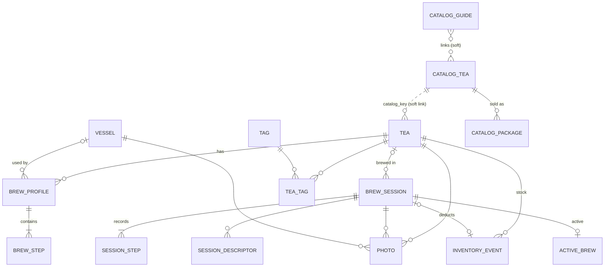

# 05 · Data Model & Backup Format

> Status: **Draft v0.2** · Last updated: 2026-10-22 (session lifecycle, `active_brew` columns, device backup and restore detection, D-052; schema freeze from rc.1, restore photo sweep, `auto_finished`, D-054; `auto_finished` after a device restore, D-063)
> v0.2: Tee-Kontor catalog tables, pre-alert per recipe, 5 °C temperature
> steps, metric only, costs, no sample data.

## 1. Principles

1. **Local only.** Room (SQLite) database, typed DataStore for settings, files
   in app-private storage.
2. **Metric storage:** °C, g, ml, seconds. Temperatures are stored as
   integers that are **multiples of 5** (GEN-12).
3. **Stable IDs:** UUID v4 strings for user data; the catalog uses the shop's
   base article number as its key (e.g. `TG0557`).
4. **Timestamps** epoch ms UTC; sessions also store the IANA zone ID.
5. **Snapshots for history:** sessions copy tea name, type, recipe and vessel
   values.
6. **Catalog is separate and replaceable.** Catalog tables live in a
   **separate Room database `catalog.db`** (excluded from device backup) and
   are rebuilt by each refresh; collection teas are independent copies with a *soft* link
   (`catalog_key`) — no foreign key — so catalog refreshes and device
   restores never cascade into personal data (CAT-13).
7. **Built-in styles** are a bundled asset referenced by key.

## 2. Entity-relationship diagram

## 3. Personal data tables

Booleans are `INTEGER` 0/1; all non-cross-ref tables have `created_at` and
`updated_at` (omitted below). Writes insert or update rows (`@Upsert`), never
`REPLACE`, which would delete the row first and cascade into its children.

### 3.1 Tea

Table `tea`

| Column | Type | Req. | Notes |
|---|---|---|---|
| `id` | TEXT | ✓ | PK, UUID |
| `name` | TEXT | ✓ | 1–80 |
| `secondary_name` | TEXT | | ≤ 80 |
| `catalog_key` | TEXT | | Tee-Kontor base article number; soft link |
| `style_key` | TEXT | | Built-in style; null = other |
| `tea_type` | TEXT | | Display type, e.g. „Gyokuro" (from catalog *Sorte* or style) |
| `category` | TEXT | ✓ | `TeaCategory` |
| `form` | TEXT | ✓ | `TeaForm` |
| `umami_level` | TEXT | | `UmamiLevel`; null = style's |
| `is_flavored` | INTEGER | ✓ | aromatisiert |
| `is_organic` | INTEGER | ✓ | Bio |
| `ingredients` | TEXT | | ≤ 1000, flavoured teas (from catalog) |
| `origin_country` | TEXT | | ISO 3166-1 alpha-2 |
| `origin_region` | TEXT | | ≤ 80 |
| `cultivar` | TEXT | | ≤ 80 |
| `harvest_year` | INTEGER | | |
| `harvest_season` | TEXT | | `HarvestSeason` |
| `shading_days` | INTEGER | | 0–60 |
| `processing_notes` | TEXT | | ≤ 300 (e.g. „Chumushi") |
| `description` | TEXT | | ≤ 10000 (copied from catalog) |
| `vendor` | TEXT | | default „Tee-Kontor Kiel" for catalog teas |
| `product_url` | TEXT | | shop link |
| `opened_date` | TEXT | | ISO date |
| `best_before` | TEXT | | ISO date |
| `freshness_days` | INTEGER | | override |
| `low_stock_grams` | REAL | | override |
| `storage_note` | TEXT | | ≤ 120 |
| `notes` | TEXT | | ≤ 5000 |
| `recipe_check_reason` | TEXT | | `RecipeCheckReason`; null = no flag (CAT-05, TEA-17) |
| `is_favorite` | INTEGER | ✓ | |
| `is_archived` | INTEGER | ✓ | |
| `cover_photo_id` | TEXT | | FK → `photo` SET NULL |

Indices: `name NOCASE`, `catalog_key`, `style_key`, `is_archived`.
FTS4 `tea_fts`: name, secondary_name, vendor, origin_region, cultivar, notes.

### 3.2 BrewProfile (recipe)

Table `brew_profile`

| Column | Type | Req. | Notes |
|---|---|---|---|
| `id` | TEXT | ✓ | PK |
| `tea_id` | TEXT | ✓ | FK → `tea` CASCADE |
| `name` | TEXT | ✓ | 1–40 |
| `method` | TEXT | ✓ | `BrewMethod` |
| `leaf_grams` | REAL | ✓ | 0.1–100 |
| `water_ml` | INTEGER | ✓ | 10–3000 |
| `base_temp_c` | INTEGER | ✓ | 5–100, multiple of 5 |
| `vessel_id` | TEXT | | FK → `vessel` SET NULL |
| `pre_alert_seconds` | INTEGER | | null = global; 0 = off; 5–30 step 5 |
| `is_default` | INTEGER | ✓ | one per tea |
| `position` | INTEGER | ✓ | |
| `source` | TEXT | ✓ | `RecipeSource` |
| `notes` | TEXT | | ≤ 500 |

### 3.3 BrewStep

Table `brew_step`: `id` PK; `profile_id` FK CASCADE; `position` (unique per
profile); `kind` `StepKind`; `duration_seconds` 5–86400; `temp_c` INTEGER
nullable, multiple of 5; `note` ≤ 120.

### 3.4 Vessel

Table `vessel`: `id`, `name` 1–40, `type` `VesselType`, `capacity_ml`
10–3000, `usable_ml` (≤ capacity), `material` `VesselMaterial`, `notes`,
`is_favorite`, `is_archived`, `cover_photo_id`.

### 3.5 Tag & TeaTag (Could)

`tag` (`id`, `name` UNIQUE NOCASE 1–30); `tea_tag` (`tea_id`, `tag_id`) PK both.

### 3.6 BrewSession

Table `brew_session`

| Column | Type | Req. | Notes |
|---|---|---|---|
| `id` | TEXT | ✓ | PK |
| `status` | TEXT | ✓ | `SessionStatus` |
| `tea_id` | TEXT | | FK → `tea` SET NULL |
| `tea_name` | TEXT | ✓ | snapshot |
| `tea_secondary_name`, `tea_type`, `style_key`, `category` | TEXT | | snapshots |
| `profile_id` | TEXT | | FK → `brew_profile` SET NULL |
| `profile_name` | TEXT | | snapshot |
| `method` | TEXT | ✓ | |
| `vessel_id` | TEXT | | FK SET NULL |
| `vessel_name` | TEXT | | snapshot |
| `leaf_grams` | REAL | | |
| `water_ml` | INTEGER | | |
| `base_temp_c` | INTEGER | | |
| `pre_alert_seconds` | INTEGER | | effective value used (04 §5); set at the start and by `editSteps` |
| `planned_step_count` | INTEGER | ✓ | number of steps planned at finish (incl. never-started ones), for „2 von 3 Aufgüssen" (TMR-12) |
| `cost_cents` | INTEGER | | leaf × cost per gram at finish (INV-08), rounded half up; null without a tea, leaf amount or priced stock |
| `started_at` | INTEGER | ✓ | |
| `ended_at` | INTEGER | | at completion: the end of the last ended step (the time of the completion if none has one) |
| `zone_id` | TEXT | ✓ | |
| `rating` | REAL | | 0.5–5.0 step 0.5 |
| `taste_umami`, `taste_sweetness`, `taste_bitterness`, `taste_astringency`, `taste_body`, `taste_aroma` | INTEGER | | 0–5 each |
| `notes` | TEXT | | ≤ 5000 |
| `auto_finished` | INTEGER | ✓ | 1 when the app completed the session on its own: the midnight timeout (TMR-14; `CompleteSession.autoFinished`, D-054), or recovery after a device restore that found it in progress without its `active_brew` row (E11, D-063); 0 when the user finished it, also by *Beenden & neu starten* (TMR-21). |
| `times_offered` | INTEGER | ✓ | boolean: PRF-07 prompt was applicable |
| `times_applied` | INTEGER | ✓ | boolean: user accepted *Zeiten ins Rezept übernehmen*; the offer is not shown again |

FTS4 `session_fts` (tea_name, notes); descriptor search via join.

### 3.7 SessionStep

Table `session_step`: `id`; `session_id` FK CASCADE; `position`; `kind`;
`planned_seconds`; `actual_seconds`; `paused_seconds`; `overtime_seconds`;
`temp_c`; `started_at`; `ended_at`; `skipped`; `overtime_auto_ack`
(see [04 §3.2](04-brew-timer.md#32-events-and-transitions)); `note` ≤ 300.

`(session_id, position)` is unique; positions run 0…n−1.

**Lifecycle** (`SessionRepository` in `core:data`, one operation per data
effect of the timer engine, 04 §4; D-052):

- **Start** (`CreateSession`): the `brew_session` row with its snapshots
  (05 §1.5), the effective pre-alert, `started_at` and `zone_id`, status
  `IN_PROGRESS`, and all planned rows.
- **Edit/add** (`ReplacePendingSteps`): the rows from the first unstarted
  position on are deleted and the new pending steps inserted; the session's
  `pre_alert_seconds` becomes the effective value after the edit. Started and
  ended rows are never touched.
- **Record** (`RecordStep`): the step's row gets the recorded values of
  [04 §5.1](04-brew-timer.md#51-recorded-step-data). A row is ended exactly
  when `actual_seconds` is set.
- **Complete** (`CompleteSession`, TMR-12): rows that were never started are
  **deleted**; `brew_session.planned_step_count` keeps the planned total so
  the journal can show „2 von 3 Aufgüssen". Skipped steps (TMR-09) stay with
  `skipped = 1`. It also sets `cost_cents` and `ended_at`, adds the BREW stock
  event (−leaf, at `ended_at`, linked by `session_id`) when *Bestand
  abziehen* is on (SET-15), and sets the tea's `opened_date` to the session's
  local date when it has none, or when the latest INITIAL/PURCHASE event is
  on a later day than `opened_date` and the stock had run out before it
  (INV-06). Completing a session that is no longer `IN_PROGRESS` changes
  nothing.
- **Discard** (`DiscardSession`, TMR-13): the session row is deleted; its
  steps, its stock event and the `active_brew` row go with it (FK CASCADE).

Each operation is one transaction; the controller runs a transition's data
effects and its `Persist` in one more (`DatabaseTransactions`, 04 §7.1).
Temperatures are snapped to 5 °C on the way in (GEN-12).

### 3.8 Descriptors

Built-in German vocabulary is bundled ([08 §4](08-content.md#4-tasting-descriptor-vocabulary)).
`custom_descriptor` (`id`, `label` UNIQUE NOCASE 1–30, `group`);
`session_descriptor` (`session_id` FK CASCADE, `descriptor_key`) — key is a
built-in key or `custom:<id>`.

### 3.9 Photo

Table `photo`: `id` (file `<id>.jpg` in `filesDir/photos/`; catalog copies are
re-encoded from WebP to JPEG when copied), exactly one of
`tea_id` / `session_id` / `vessel_id` (FK CASCADE), `position`, `width_px`,
`height_px`, `byte_size`, `origin` (`PhotoOrigin`).
When a tea is added from the catalog, the catalog photo is **copied** into
`photo` (origin `CATALOG_COPY`) so the tea stays independent. The single
owner is enforced by the model type (`PhotoOwner`), so no row can name two.
Replacing a recipe's steps (*Im Rezept speichern*) writes new `brew_step` rows
with new ids.

### 3.10 InventoryEvent

Table `inventory_event`

| Column | Type | Req. | Notes |
|---|---|---|---|
| `id` | TEXT | ✓ | PK |
| `tea_id` | TEXT | ✓ | FK CASCADE |
| `session_id` | TEXT | | FK CASCADE, unique |
| `type` | TEXT | ✓ | `InventoryEventType` |
| `delta_grams` | REAL | ✓ | + added / − used |
| `price_cents` | INTEGER | | for INITIAL/PURCHASE |
| `currency` | TEXT | | default `EUR` |
| `package_label` | TEXT | | e.g. „100 g" |
| `occurred_at` | INTEGER | ✓ | |
| `note` | TEXT | | ≤ 200 |

Remaining stock = SUM(`delta_grams`). Cost per gram = Σ price / Σ grams of
the INITIAL and PURCHASE events **that carry a price**; with no such event,
the cost per gram (and so the session cost) is null (#30).

### 3.12 ActiveBrew

Single-row table `active_brew` (`id` = 1). Together with the session's
`session_step` rows it holds the timer engine's state without loss; the
plain model type is `ActiveBrewSnapshot` in `core:model`, and the engine maps
it with `snapshot(state)` / `restore(snapshot)`
([04 §7.1](04-brew-timer.md#71-persisted-on-every-transition), D-048). A
step's status is not stored: rows with recorded values are ended, the
current step of RUNNING/PAUSED/ALERTING is started, all others are pending.

The `ActiveBrewStore` in `core:data` reads and writes the engine's
`TimerSnapshot` (this row plus the step rows) in one transaction each. A
write also brings the session's step rows to the snapshot's plan (rows keep
their id, note and `created_at`), so a persisted state always restores
equal, for every engine state whose temperatures are multiples of 5 °C
(D-052). Counters and flags are `NOT NULL`; values that only some phases set
are nullable (#30). A device restore clears the row (§8).

| Column | Type | Notes |
|---|---|---|
| `session_id` | TEXT | FK CASCADE; null for quick timer |
| `is_quick_timer`, `quick_duration_seconds` | | the quick timer's one INFUSION step; it has no `session_step` rows |
| `step_index` | INTEGER | current step; the number of steps in FINISHED |
| `phase` | TEXT | `TimerPhase` |
| `deadline_elapsed_ms`, `deadline_wall_ms` | INTEGER | RUNNING/ALERTING |
| `pre_alert_elapsed_ms`, `pre_alert_played` | | RUNNING; `pre_alert_played` also PAUSED |
| `remaining_ms` | INTEGER | PAUSED |
| `paused_total_ms` | INTEGER | current step, before the current phase |
| `paused_since_elapsed_ms`, `paused_since_wall_ms` | INTEGER | PAUSED |
| `ready_since_wall_ms` | INTEGER | READY/FINISHED |
| `step_started_wall_ms` | INTEGER | RUNNING/PAUSED/ALERTING |
| `alert_played` | INTEGER | ALERTING; recovery replays the alert while 0 |
| `boot_count` | INTEGER | boot of the `…_elapsed_ms` values |
| `last_interaction_wall_ms` | INTEGER | last user event. `idleDemote` 30 min and `midnightTimeout` at the first local midnight ≥ 6 h after the later of it and `ready_since_wall_ms` / `paused_since_wall_ms` (D-053); quick-timer cancel 30 min after it |
| `demoted` | INTEGER | FGS stopped, regular notification shown |
| `pre_alert_override_seconds` | INTEGER | the session's own pre-alert (Schritte-Sheet); null = *Wie Einstellung*, 0 = *Aus* |
| `pre_alert_inherited_seconds` | INTEGER | recipe ?: global pre-alert, frozen at the start (0 = off) |
| `zone_id` | TEXT | the session's time zone (IANA id); needed for the quick timer, which has no `brew_session` row |

The earlier `active_elapsed_ms` is dropped: it is derived (RUNNING:
planned − (deadline − now); PAUSED: planned − remaining) and is not part of
the state (D-048). Whether every step is a long step (cold or ice brew) is not
a column either: the active brew store reads it from
`brew_session.method` into `TimerSnapshot.longStepsOnly` (D-053).

## 4. Catalog tables (rebuilt by each refresh)

### 4.1 CatalogTea

Table `catalog_tea`

| Column | Type | Notes |
|---|---|---|
| `key` | TEXT PK | Base article number (variant suffixes like `-50`, `M` stripped) |
| `name`, `secondary_name` | TEXT | |
| `product_url` | TEXT | canonical product page |
| `shop_category` | TEXT | e.g. „Grüner Tee › Japan › Gyokuro" |
| `tea_type` | TEXT | *Sorte* as named by the shop |
| `style_key` | TEXT | mapped built-in style (CAT-06) |
| `origin_country`, `origin_region`, `cultivar`, `harvest`, `shading`, `steaming` | TEXT | as found |
| `is_organic`, `is_flavored`, `cold_brew_suitable` | INTEGER | badges / aroma / ingredients |
| `aroma`, `taste_notes`, `manufacturer`, `season`, `matcha_grade` | TEXT | properties table |
| `taste_scales_json` | TEXT | shop scales, e.g. `{"Umami":4,"Bitterstoffe":1}` |
| `breadcrumb` | TEXT | category path of the product page |
| `ingredients` | TEXT | flavoured teas |
| `description_html` | TEXT | sanitised HTML/Markdown of the description |
| `brew_table_raw` | TEXT | brewing grid as found (JSON: one object per row with `kind` = japan/westlich and the cell texts) |
| `brew_text_raw` | TEXT | brewing prose as found |
| `derived_recipes_json` | TEXT | list of recipes (same shape as `brew_profile` + steps) |
| `recipe_check_reason` | TEXT | `RecipeCheckReason` or null |
| `base_price_cents_per_100g` | INTEGER | |
| `available` | INTEGER | in stock at refresh |
| `discontinued` | INTEGER | not found in the latest refresh; only kept if a collection tea links to it (CAT-07 AC4) |
| `photo_file` | TEXT | `filesDir/catalog/<key>.webp` |
| `photo_url`, `photo_etag` | TEXT | change detection |
| `content_hash` | TEXT | to report „geändert" |
| `first_seen_at`, `last_seen_at` | INTEGER | |

FTS4 `catalog_fts` over name, secondary_name, description text, cultivar,
origin_region.

### 4.2 CatalogPackage

Table `catalog_package`: `catalog_key` FK CASCADE, `article_number`
(e.g. `TG0557-50`), `label` („50 g", „250 g · 3 % gespart"), `grams` REAL,
`price_cents`, `price_is_estimate` INTEGER, `savings_percent` INTEGER,
`variant_url`, `available`.

### 4.2a CatalogSkip

Table `catalog_skip`: `base_key` PK, `reason` (`NOT_GREEN`, `SET`,
`NO_TEA`), `checked_at` — base numbers from the sitemap that were classified
as out of scope, so later refreshes don't fetch them again (re-checked after
90 days).

### 4.3 CatalogGuide

Table `catalog_guide`: `slug` PK, `title`, `url`, `body_markdown`,
`hero_file`, `linked_catalog_keys` (JSON), `fetched_at`.

### 4.4 CatalogRefreshLog

Table `catalog_refresh_log`: `id`, `started_at`, `finished_at`, `status`
(`SUCCESS` / `FAILED` / `CANCELLED`), counts (new, changed, discontinued,
flagged, photos), `parser_version`, `error_summary`.

### 4.5 Refresh transaction

Parsing writes into staging tables; on success, one transaction replaces
`catalog_tea`, `catalog_package`, `catalog_guide` and marks discontinued keys
(kept from the previous catalog with `discontinued = 1`). On failure the
staging tables are dropped and the old catalog stays untouched (CAT-07 AC5).

## 5. Enumerations

| Enum | Values |
|---|---|
| `TeaCategory` | `GREEN`, `WHITE`, `YELLOW`, `OOLONG`, `BLACK`, `DARK`, `HERBAL`, `OTHER` |
| `TeaForm` | `LOOSE_LEAF`, `POWDER`, `TEA_BAG`, `COMPRESSED` |
| `UmamiLevel` | `NONE`, `LOW`, `MEDIUM`, `HIGH`, `VERY_HIGH` |
| `HarvestSeason` | `FIRST_FLUSH`, `SECOND_FLUSH`, `SUMMER`, `AUTUMN`, `WINTER`, `UNKNOWN` |
| `BrewMethod` | `KYUSU`, `GONGFU`, `WESTERN`, `MATCHA_USUCHA`, `MATCHA_KOICHA`, `COLD_BREW`, `ICE_BREW`, `CUSTOM` |
| `StepKind` | `RINSE`, `INFUSION`, `WHISK` |
| `VesselType` | `KYUSU`, `HOUHIN`, `SHIBORIDASHI`, `GAIWAN`, `CLAY_TEAPOT`, `WESTERN_TEAPOT`, `MUG_INFUSER`, `GLASS`, `CHAWAN`, `COLD_BREW_BOTTLE`, `OTHER` |
| `VesselMaterial` | `UNGLAZED_CLAY`, `GLAZED_CERAMIC`, `PORCELAIN`, `GLASS`, `CAST_IRON`, `STAINLESS_STEEL`, `OTHER` |
| `SessionStatus` | `IN_PROGRESS`, `COMPLETED`, `MANUAL` |
| `TimerPhase` | `READY`, `RUNNING`, `PAUSED`, `ALERTING`, `FINISHED` |
| `InventoryEventType` | `INITIAL`, `PURCHASE`, `BREW`, `ADJUSTMENT` |
| `PhotoOrigin` | `OWN`, `CATALOG_COPY` |
| `RecipeSource` | `CATALOG_TABLE`, `CATALOG_TEXT`, `STYLE_DEFAULT`, `USER` |
| `RecipeCheckReason` | `FROM_TEXT`, `FROM_STYLE_DEFAULT`, `TABLE_TEXT_CONFLICT`, `IMPLAUSIBLE_VALUE`, `UNMAPPED_STYLE` |
| `DescriptorGroup` | `MARINE`, `VEGETAL`, `SWEET`, `ROASTED_NUTTY`, `FLORAL`, `FRUITY`, `EARTHY_WOODY`, `SPICE_HERB`, `MOUTHFEEL`, `OFF_NOTE`, `OTHER` |

## 6. Settings (DataStore)

| Field | Type | Default | Req. |
|---|---|---|---|
| `schemaVersion` | Int | 1 | |
| `onboardingCompleted` | Boolean | false | ONB-04 |
| `theme` | SYSTEM/LIGHT/DARK | SYSTEM | SET-05 |
| `dynamicColor` | Boolean | false | SET-06 |
| `alertSound` | key | `klangschale` | SET-09 |
| `preAlertSeconds` | Int (0, 5…30) | 10 | SET-10; a written value is snapped to 5 s and clamped to 0 or 5…30 |
| `vibration` | Boolean | true | SET-11 |
| `alertLength` | SHORT/NORMAL/LONG | NORMAL | SET-14 |
| `deductStock` | Boolean | true | SET-15 |
| `lowStockGrams` | Double | 10.0 | SET-16 |
| `keepScreenOn` | Boolean | true | SET-17 |
| `offerRecipeUpdate` | Boolean | true | SET-18 |
| `weeklyDigest` | Boolean | false | SET-19 |
| `backupReminder` | OFF/MONTHLY | MONTHLY | SET-20 |
| `lastManualBackupAt` | Long? | null | BAK-01 |
| `catalogDownloadPhotos` | Boolean | true | SET-22 |
| `collectionSegment` | MY_TEAS/CATALOG | MY_TEAS | SCR-08 |
| `collectionSort`, `catalogSort` | enums | name | |
| `statsRange` | enum | DAYS_90 | INS-07 |
| `dimWhileSteeping` | Boolean | true | SET-25 |
| `dismissedHints` | Set<String> | ∅ | |
| `seedDataCreated` | Boolean | false | WARE-06 (seed data created once, M1-07). In DataStore, so a device restore brings it back and nothing is seeded again |
| `seedPhotosAttempted` | Boolean | false | ONB-06 (set before the first request of the one-time seed photo download, D-050) |

The settings are one JSON file, `files/datastore/settings.json`. A missing
key reads as its default, an unknown enum name falls back to the default,
and an unreadable file reads as all defaults (#30).

## 7. Units & rounding

| Quantity | Stored | Display |
|---|---|---|
| Temperature | °C, integer, multiple of 5 | „55 °C" |
| Leaf | g, REAL (0.1) | „4,0 g" (German decimal comma) |
| Water | ml, INTEGER | „100 ml" |
| Duration | s | „1:30", „1 Min 30 s" in prose, „3 Min" in lists |
| Ratio | derived | „4,0 g / 100 ml" |
| Money | cents + currency (EUR) | „15,90 €" |

Snap rule: `snap5(x) = 5 × floor(x / 5 + 0.5)` (half up: 52,5 → 55).
Time rounding for derived recipes: nearest 5 s (half up).

## 8. Backup file format

- Manual export `.umamit` (ZIP): `manifest.json`, `data.json`,
  `settings.json`, `photos/<id>.jpg`. The **catalog is not included** (it is
  re-downloadable); collection teas keep their `catalog_key`.
- `manifest.json`: format id `umamit-backup`, `formatVersion` 1,
  `createdAt`, app version, database schema version, counts, SHA-256 of JSON
  entries.
- `data.json`: arrays for teas, brewProfiles, brewSteps, vessels, tags,
  teaTags, sessions, sessionSteps, customDescriptors, sessionDescriptors,
  inventoryEvents, photos (camelCase fields mirroring §3).
- **Restore (post-1.0, BAK-02 `Won't` for 1.x, D-036):** if built later,
  restore validation covers ZIP limits and zip-slip protection,
  manifest/version check, checksums, types/enums, constraints, referential
  integrity, photo files decodable; safety backup of current data; staging;
  single transaction; rollback on failure. The 1.x export already writes
  `manifest.json` with checksums so such a restore can read it.
- **Android device backup** (`res/xml/data_extraction_rules.xml` for cloud
  backup and device transfer, the same set in `res/xml/backup_rules.xml` as
  `fullBackupContent`; both referenced from the manifest): **only included
  files** are backed up, and the rules include exactly `umamit.db`,
  `umamit.db-wal`, `umamit.db-shm` (domain `database`) and `datastore/`
  (domain `file`, the settings). Everything else stays out because nothing
  includes it: `catalog.db*`, `photos/`, `catalog/`, caches, other libraries'
  databases and the no-backup storage (D-052). `BackupRulesTest` checks the
  sets.
- **Restore detection** (D-052): an empty install marker file
  `umamit-install-marker` in `Context.noBackupFilesDir`, which no backup
  carries. When Room creates `umamit.db` (a fresh install, or cleared app
  data), the marker is written. When Room opens a database and the marker is
  missing, the database came from a backup: in one transaction
  `active_brew` is cleared and every `photo` row whose `photos/<id>.jpg` is
  missing is deleted, with its `cover_photo_id`s cleared (`photos/` is never
  backed up); then the marker is written, so this happens exactly once
  (D-054). It runs in Room's open callback, before any query is served, so
  nothing reads the restored row or a dangling cover. A row whose file exists
  stays, so a false positive (a marker that could not be written) loses no
  photo.
- **After a device restore:** `active_brew` is cleared as above (no session
  is resumed, 04 §11 E11). A session that was in progress keeps its
  `brew_session` row with status `IN_PROGRESS`; it is not in the journal
  (M1-09 decides how such rows are finished). The photo rows without a file
  and their covers are gone (restore detection above), so after the next
  catalog refresh (CAT-15) catalog teas without a cover, the seed teas
  included, get the catalog photo copied again (via `catalog_key`). The M5
  orphan sweeper (06 §5.4) removes leftover files and `*.tmp` files.

## 9. Migrations

Room `exportSchema = true` with schemas committed; every version change ships
a migration and a `MigrationTestHelper` test; no destructive fallback. The
build rewrites the schema JSON, so CI fails when the committed copy differs
from it after the build (`git diff --exit-code core/database/schemas`) or a
schema file is not committed.

**Schema freeze (D-054).** Version 1 was changed in place while no APK had
used it (D-052). From the first APK that can reach the PO's phone,
`v0.1.0-rc.1`, on, every schema change bumps the version and ships a tested
migration; a release candidate counts like a release, because Room refuses to
open a database whose schema changed under the same version and the app would
not start until its data is cleared. CI and the release workflow enforce
it (`scripts/check-frozen-schemas.sh`, D-070): every schema JSON that a `v*`
tag contains must keep its `version` and `identityHash`, which is what Room
compares when it opens the database; a formatting-only difference (e.g. after
a Room upgrade) passes with a warning. `SchemaVersionsTest` opens a database
of every committed schema version with the production `umamiDatabaseBuilder`,
whose migrations are the list `UMAMI_MIGRATIONS`, so a version bump without
its migration in that list fails the unit tests. The tags, tea descriptors
and FTS tables of §3 (`tag`, `tea_tag`, `custom_descriptor`, `session_descriptor`, `tea_fts`,
`session_fts`) arrive with M3 and M4 through such migrations. The
catalog tables may be dropped and recreated in a migration (followed by a
prompt to refresh), since they are re-downloadable.

## 10. Volume assumptions

| Entity | Expected | Test |
|---|---|---|
| Catalog teas | 260–280 | 500 |
| Own teas | 10–40 | 300 |
| Sessions | ~1,000 / year | 10,000 |
| Photos | catalog ~280 (~30 MB), own < 200 | 1,000 |
