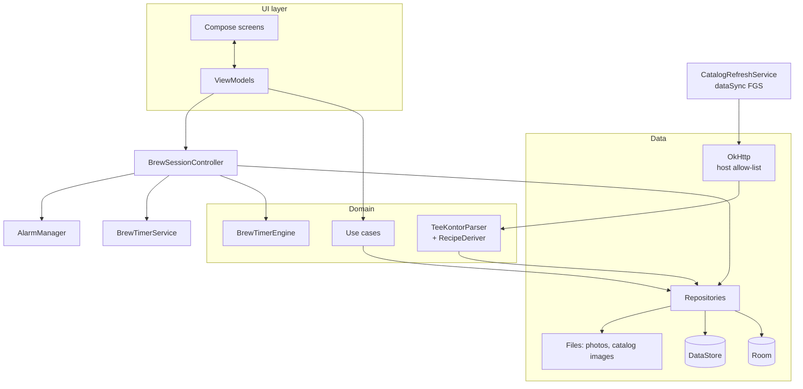

# 06 · Technical Architecture

> Status: **Draft v0.2** · Last updated: 2026-10-25 (shop session and catalog image targets, D-074)
> v0.2: personal sideloaded app, min SDK 35, catalog scraping (OkHttp +
> Jsoup), GitHub Releases distribution, Claude as developer.

## 1. Platform & tooling

| Item | Decision |
|---|---|
| Language | Kotlin 2.x, 100 % Kotlin |
| UI | Jetpack Compose + Material 3 (+ Adaptive) |
| Min SDK | **35** (Android 15) — PO's phone runs Android 16 |
| Target / compile SDK | **36** (Android 16), pinned; raised only by a deliberate decision |
| Build | Gradle Kotlin DSL, version catalog, convention plugins in `build-logic/` |
| Distribution | **Signed APK on GitHub Releases** (no Play Store, no AAB needed) |
| Application ID | `com.umamit.app` (D-027); must stay constant so updates install over the previous version |
| Repository | `katznmeik/UmamiT` (renamed from `UmamiTea`, old URLs redirect); one PR per milestone into `main` |
| Developer | Claude (cloud sessions), delegating to subagents per [12 · Subagent Distribution Plan](12-agent-plan.md); PO reviews PRs and tests APKs on the phone |

Library versions are pinned in `gradle/libs.versions.toml` (latest stable at
project start).

## 2. Architecture overview

Official Android architecture: UDF, Compose UI + ViewModels, domain layer for
shared logic, repositories over Room / DataStore / network / files.



### 2.1 UI layer

- One ViewModel per destination exposing `StateFlow<UiState>`; stateless
  `XxxScreen(state, onAction)` + stateful `XxxRoute`.
- Navigation Compose with type-safe routes (D-007).
- All strings in `res/values/strings.xml` (German); no English resource set
  is needed, but strings are never hard-coded.

### 2.2 Domain layer (pure Kotlin)

Use cases: `ScaleRecipe`, `Snap5`, `StartSession`, `FinishSession`
(status, stock deduction, cost, opened date, recipe-update applicability),
`DiscardSession`, `ComputePreAlert`, `ComputeFreshness`, `ComputeStock`,
`ComputeCostPerGram`, `ComputeStreak`, `BuildStatistics`,
`AddFromCatalog`, `ResetFromCatalog`, `CreateBackup` (`RestoreBackup` is
post-1.0, BAK-02).

Catalog: `TeeKontorParser` (HTML → `ProductPage`), `CatalogEntries` (variant merge),
`StyleMapper`, `RecipeDeriver` (rules in [08 §2.5](08-content.md#25-recipe-derivation)),
`CatalogDiff`. All pure and unit-testable with HTML fixtures.

### 2.3 Concurrency

Coroutines/Flow; injected dispatchers; app-scoped scope for the timer
controller; no main-thread database access.

## 3. Modules

```
UmamiT/
├── app/                       Application, MainActivity, NavHost, DI root, manifest
├── build-logic/convention/
├── core/
│   ├── model/                 Pure Kotlin models & enums
│   ├── common/                Clocks, dispatchers, result types, Snap5
│   ├── domain/                Use cases
│   ├── timer-engine/          BrewTimerEngine (pure)
│   ├── timer/                 Controller, service, AlertPlayer, alarms, receivers, Live Update
│   ├── catalog-parser/        TeeKontorParser, CatalogEntries, StyleMapper, RecipeDeriver (pure JVM)
│   ├── network/               OkHttp client with host allow-list (M1: seed photos), rate limiter, robots.txt (M1, D-050); the only HTTP client (D-054)
│   ├── database/              Room, DAOs, migrations, schemas/
│   ├── datastore/             Settings
│   ├── content/               Bundled styles, descriptors, sounds, illustrations
│   ├── data/                  Repositories, photo storage, CatalogRefreshService
│   ├── backup/                Export (restore post-1.0)
│   ├── designsystem/          Theme, fonts, components, icons
│   ├── ui/                    Shared composables
│   └── testing/               Fakes, fixtures, builders
├── feature/
│   ├── onboarding/            Einrichtung
│   ├── home/
│   ├── brew/                  Tea picker, setup, timer, saved sheet, quick timer
│   ├── collection/            Meine Tees, tea detail/editor, recipes, stock
│   ├── catalog/               Katalog list/detail, add sheet, refresh sheet, guides
│   ├── journal/
│   ├── stats/
│   ├── teaware/
│   └── settings/              Settings, reliability, backup, about
└── docs/
```

Rules: features depend only on `core:*`; pure modules (`model`, `common`,
`domain`, `timer-engine`, `catalog-parser`) have no Android dependency.
M1-01 creates **all** module stubs above (and their version-catalog entries)
before parallel work starts, so later milestones never edit the module graph
concurrently.

## 4. Key libraries

| Purpose | Library |
|---|---|
| UI | Compose BOM, Material 3, Material 3 Adaptive, Activity/Lifecycle Compose |
| Navigation | Navigation Compose (type-safe) |
| DI | Hilt (KSP) |
| Database | Room (KSP) |
| Settings | DataStore (kotlinx-serialization) |
| Serialization | kotlinx-serialization-json |
| HTTP | OkHttp (no Retrofit needed) |
| HTML parsing | Jsoup |
| Background work | WorkManager for the daily orphan sweep and reminders only; the catalog refresh runs in the app's own `dataSync` foreground service (§5.3) |
| Images | Coil 3 (local files only) |
| Charts | Vico for bar charts; custom Canvas for radar and donut |
| Markdown (guides) | Compose Markdown renderer or minimal in-house renderer (D-008) |
| Licences | AboutLibraries |
| Testing | JUnit4, Turbine, Truth, coroutines-test, Robolectric, Compose UI test, Roborazzi, MockWebServer |
| Debug | LeakCanary, StrictMode |

No analytics, ads or crash-reporting SDKs. The network is used for exactly
three things (GEN-01, D-036): the catalog refresh, the one-time seed photo
download at first start, and the on-demand exact price fetch when adding a
package. An OkHttp interceptor rejects any host other than
`www.tee-kontor-kiel.de` (images are served from the same host, 08 §2.2).
The client uses a **single connection** (`maxRequestsPerHost = 1`, one
dispatcher thread for the shop). Each job (the seed photos, one refresh, one
exact price fetch) runs as one **shop session** (`ShopSession`, D-074): it
reads robots.txt once with RFC 9309's status rules, never fetches a
disallowed URL, retries connection errors only for the refresh (D-076), and
after the first stop signal sends nothing more. An answer over 5 MB leaves
only its URL out (D-090). An idle connection is kept for 30 s only, since
connection retries are off (D-090). The seed photo download ends before a
refresh started from the setup (D-090); a new refresh starts only once a
cancelled one has cleaned up.

## 5. Key technical designs

### 5.1 Brew timer — see [04](04-brew-timer.md).

### 5.2 Photos

Photo picker (`PickVisualMedia`) and camera (`TakePicture` into a
`FileProvider` URI; no `CAMERA` permission); decode with sampling, rotate per
EXIF, resize to 2048 px, JPEG 85, strip EXIF; store in `filesDir/photos/`.
Catalog photos: downloaded to `filesDir/catalog/`, resized to 1200 px WebP
(quality 80) plus a WebP list thumbnail with a 256 px short side (never
larger than the photo), both from one decode; downloaded again only when the
page's photo URL is not the one the stored photo came from (CAT-08, D-073,
D-074, D-086).

### 5.3 Catalog refresh

1. `CatalogRefreshService`: the app's **own foreground service** of type
   `dataSync` (permission `FOREGROUND_SERVICE_DATA_SYNC`), started with
   `startForegroundService` directly from the user's tap while the app is in
   the foreground. Not WorkManager: on Android 16 jobs are subject to
   runtime quotas that could stop a 10-minute refresh. Progress notification
   on the `catalog` channel; cancellable from the sheet and the
   notification; the service stops itself when done. The refresh job itself
   runs in the app's scope (`AppCatalogRefreshRunner`); the service keeps
   the process running, follows its state (progress at most every 2 s) and
   holds a partial wake lock of its own while it makes progress, so the
   phone may be locked. Separate from the timer's service, channels, IDs and
   alarms (rule 8; [D-079](10-open-questions-and-decisions.md#d-079)).
2. Fetch `robots.txt` and the sitemap; derive base article numbers from
   product URLs, skip known out-of-scope numbers (`catalog_skip`) per
   [08 §2.4](08-content.md#24-discovery-variants-and-request-budget): a
   later refresh fetches the known green teas (with the numbers merged into
   them), the new base numbers and the skip entries due again (D-086).
   `robots.txt` rules use longest-match precedence with `*` and `$`
   wildcards (RFC 9309).
3. Fetch each candidate parent page (≤ 2 req/s, one connection, 20 s
   timeout; a timeout or connection error is retried ≤ 3 times with 2/4/8 s
   backoff, each retry a new call through `ShopClient`; stop signals and
   HTTP errors are never retried, D-076); classify by breadcrumb; parse with
   `TeeKontorParser` (selectors versioned as `parserVersion`). Stop the
   refresh (old catalog kept) on a Cloudflare challenge, on HTTP 429 or on
   any `Retry-After` header ([08 §2.8](08-content.md#28-sanitising-and-robustness)).
4. Merge variants, map styles, derive recipes, compute content hashes.
5. Sanity check of the parsed pages (CAT-07 AC5), before any photo or guide
   request; then download new and changed photos (if SET-22; an unchanged
   photo is never fetched again, D-086).
6. Fetch and convert *Tee-Info* guides (CAT-09) into staging, with their
   images unless SET-22 is off (stored ones not fetched again, D-087).
7. Atomic swap of the staging tables, guides included
   ([05 §4.5](05-data-model.md#45-refresh-transaction)) with the summary
   counts (CAT-07 AC3), keeping unread known teas and owned discontinued ones
   (CAT-07 AC4); delete the photos of teas and the images of guides no
   longer in the catalog (also after a failed run); log; link the seed teas
   once (CAT-15, D-086).

All requests (pages and images) share the 2 req/s limit. Expected
duration: first refresh (~1,560 classification pages + ~280 photos + guides)
≈ 15–18 min (D-076); later refreshes (~280 pages, changed photos only) ≈ 3–4 min.
Exact variant prices are fetched on demand when adding a package (CAT-12).

### 5.4 Background work

| Work | Trigger |
|---|---|
| `CatalogRefreshService` (own `dataSync` FGS, not WorkManager) | User action only |
| `OrphanFileSweepWorker` | Daily, idle; also once after a device restore |
| `ReminderWorker` | Daily check (backup, stock digest) |

### 5.5 Edge-to-edge, predictive back, insets — required (target SDK 36).

### 5.7 Manifest permissions (complete list)

| Permission | Purpose |
|---|---|
| `INTERNET` | The three uses of GEN-01: catalog refresh, one-time seed photo download, exact price fetch (all to `www.tee-kontor-kiel.de`) |
| `POST_NOTIFICATIONS`, `POST_PROMOTED_NOTIFICATIONS` | Timer, Live Update, catalog progress (`POST_PROMOTED_NOTIFICATIONS` is not in the SDK 36 stubs but from Android 16 QPR1 a normal|appop permission that promotion requires; must stay declared; the user controls it, checked via `canPostPromotedNotifications()`, D-043/D-044) |
| `USE_FULL_SCREEN_INTENT` | Full-screen step alert over the lock screen (TMR-06) |
| `FOREGROUND_SERVICE`, `FOREGROUND_SERVICE_SPECIAL_USE` | Timer service |
| `FOREGROUND_SERVICE_DATA_SYNC` | Catalog refresh service |
| `WAKE_LOCK` | Timer; catalog refresh (CPU kept running while it makes progress with the phone locked, D-079) |
| `VIBRATE` | Timer |
| `USE_EXACT_ALARM`, `RECEIVE_BOOT_COMPLETED` | Timer alarms and reboot recovery |
| `REQUEST_IGNORE_BATTERY_OPTIMIZATIONS` | Reliability setup |

No storage, camera, location or contacts permissions.

The build enforces this list (`./gradlew checkManifestPermissions`, in CI,
M1-02): the merged **release** manifest may request only the permissions
above. Two deliberate exceptions, both in `ManifestPermissions.kt` in
build-logic:

- the app's own `<applicationId>.DYNAMIC_RECEIVER_NOT_EXPORTED_PERMISSION`,
  which `androidx.core` declares at signature level to protect non-exported
  runtime receivers; it is accepted only when declared that way and grants
  nothing outside the app;
- **debug builds only:** `READ_EXTERNAL_STORAGE` and `WRITE_EXTERNAL_STORAGE`,
  added by LeakCanary for its heap dumps. The release check proves they never
  reach a release build.

### 5.6 Error handling & logging

Typed errors for validation, I/O, network and parsing; release builds keep a
small local rolling log (≤ 200 KB) viewable and copyable in Einstellungen ›
Über › *Diagnose* (*Kopieren*), so the PO can paste it into an issue when
something goes wrong. It exists **from M1** (D-036) and records:

- timer events and state transitions, each pre-alert and deadline with its
  **scheduled and actual fire time** (wall and monotonic, difference in ms);
- FGS start/stop, refused background starts;
- the ringer mode at each alert, and for a step's tick or alert the
  scheduled time and the moment the sound started (delta in ms; D-068);
- `BOOT_COMPLETED`, `MY_PACKAGE_REPLACED` and recovery decisions;
- permission states at app start (notifications, promoted notifications,
  full-screen intent, exact alarms, battery optimisation);
- from M2: catalog refresh steps and errors.

No personal content (tea names are allowed, notes are not).

Since M1-20 (D-060): `DiagnosticsLog` in `core:data` keeps two files of
100 KB in `noBackupFilesDir/diagnostics/`, written in order on the IO
dispatcher; writing never blocks or throws into the timer (rule 8). Entries
are technical English, one line each, with the local time to the
millisecond; time-based events show the scheduled and actual time on both
clocks and the delta in ms. Since #46 (D-063) the controller also logs each
recovery request (app start, `BOOT_COMPLETED`, `MY_PACKAGE_REPLACED`), the
row of the 04 §7.2 table that recovery applied, sessions ended after a device
restore, recovery retries that stopped, and a refused service start that was refused
again.

## 6. Build & distribution

| Variant | Details |
|---|---|
| `debug` | `.debug` suffix, StrictMode, LeakCanary; for Claude and CI only (never installed on the PO's phone) |
| `release` | R8 + resource shrinking, signed with the release key (CI builds it with a throwaway CI signing config) |

- **Signing:** see §6.1. Losing the key means updates can no longer be
  installed over the existing app.
- **Versioning:** the single source is `gradle.properties`
  (`umamit.version=0.1.0-rc.1`). `versionName` = that string;
  `versionCode = MAJOR*1_000_000 + MINOR*10_000 + PATCH*100 + N`, where N is
  the release-candidate number (1–98) and **99 for the final release**.
  Examples: `0.1.0-rc.1` → 10001, `0.1.0-rc.2` → 10002, `0.1.0` → 10099,
  `1.0.0` → 1000099. Every later build therefore has a higher versionCode.
  The probe release `0.0.1-probe` uses 101; further probes (D-040) are
  `0.0.2-probe` → 201, `0.0.3-probe` → 301, and so on.
- **Release workflow** (`release.yml`): triggered by `workflow_dispatch`
  with inputs `ref` (branch or commit) and `version`. It checks that
  `version` matches `gradle.properties` and that CI passed on the exact
  commit, runs the unit tests and the schema checks (05 §9), builds, signs
  the APK and verifies the certificate fingerprint (§6.1); then it **creates
  the tag** `v<version>` and the **GitHub Release** with the APK and release
  notes. Signing and publishing are separate jobs (D-070): the job that holds
  the keystore has a read-only token and runs only GitHub's own actions,
  pinned to commit SHAs; the publish job has `contents: write`, runs no
  action, and verifies the APK again before it publishes. Claude triggers it
  through the GitHub Actions API / tool (no local tag push needed). GitHub
  only dispatches workflows whose file exists on the default branch, so
  `release.yml`, `accuracy.yml` and `timer-stress.yml` (D-084) reach `main`
  through small housekeeping PRs before their first dispatch; the version at
  the dispatch's workflow ref runs (D-039, D-070). How to dispatch:
  `docs/release.md`.
- **Release candidates:** `vX.Y.Z-rc.N` are built from the milestone's PR
  branch and published as **pre-releases** for the PO's on-device testing.
  After the PR is merged, the final `vX.Y.Z` is built from `main`.
- **Installing:** the PO downloads the APK from the release page on the
  phone and allows *Unbekannte Apps installieren* for the browser once.
  Updates install over the existing app (same key, higher versionCode).

### 6.1 Signing process (D-035)

Claude does everything except the two steps only the PO can do: storing the
backup and pasting the secrets into GitHub. Claude has no access to
repository secrets.

| # | Step | Who |
|---|---|---|
| 1 | Generate the release keystore with `keytool`: PKCS12, RSA 4096, alias `umamit`, validity 10 000 days (~27 years), DN `CN=UmamiT, O=Personal, C=DE`. Use one random 32-character password (PKCS12 uses the same password for store and key). The keystore is created in the session scratchpad and **never committed**. | Claude |
| 2 | Write a backup file `umamit-signing.txt` with the password, the alias, the SHA-256 certificate fingerprint and the base64-encoded keystore. Deliver it together with `umamit-release.p12` to the PO **directly in the Claude session as file attachments**. Never committed, never uploaded as a workflow artifact, and the password is never printed in chat. | Claude |
| 3 | Save both files in a safe place (password manager or private cloud folder). | **PO** |
| 4 | Add **two** repository secrets (GitHub › Settings › Secrets and variables › Actions › *New repository secret*): `UMAMIT_KEYSTORE_B64` and `UMAMIT_KEYSTORE_PASSWORD`, copying the values from `umamit-signing.txt`. Takes about 2 minutes. | **PO** |
| 5 | Delete the scratchpad copies once the PO confirms the backup. | Claude |
| 6 | `release.yml` decodes the keystore into the runner's temp directory and signs with alias `umamit`. It then **checks the APK's certificate fingerprint** against the expected SHA-256 stored in the repository (`signing/release-cert-sha256.txt`, a public value) and fails the release if they differ. | Claude |
| 7 | The probe release `v0.0.1-probe` (M1 plan) is the first signed build and tests the setup. | Claude |

**Fallback** if session file attachments are not available: the PO creates
the keystore on a PC or in Termux with two commands and keeps the outputs
(Claude then only needs the fingerprint, which is public):

```bash
keytool -genkeypair -keystore umamit-release.p12 -storetype PKCS12 -alias umamit -keyalg RSA -keysize 4096 -validity 10000 -dname "CN=UmamiT, O=Personal, C=DE"
base64 -w0 umamit-release.p12 > umamit-release.p12.b64   # value for UMAMIT_KEYSTORE_B64
```

The public certificate fingerprint is also listed in the README. If ever in
doubt, the PO can compare it with *Einstellungen › Apps › UmamiT*. Debug
builds use the per-machine debug key and are never installed on the PO's
phone.

## 7. Quality gates

- Spotless/ktlint, Detekt, Android Lint (no baseline), Compose rules.
- Tests:
  - **Pure unit:** timer engine, recipe derivation, variant merge, style
    mapping, stock/cost, streaks, backup validation (≥ 90 % line coverage in
    these modules).
  - **Parser:** tests on synthetic HTML fixtures that mirror the shop's page
    structure without its content (D-016), plus an on-demand live check
    against the real site from a cloud session.
  - **Robolectric:** DAOs, migrations, notifications, alarms.
  - **Compose UI and Roborazzi** screenshot tests for key screens (light/dark,
    200 % font).
  - **Instrumented:** E2E tests in the **CI emulator job** (GitHub Actions,
    `reactivecircus/android-emulator-runner`, API 35 and 36, KVM-enabled
    runner). The cloud container has no KVM, so emulator tests never run
    there. Includes process death, alarms, full-screen intent and
    Live Update promotion (asserted via `dumpsys notification`,
    `FLAG_PROMOTED_ONGOING`).
- CI (`ci.yml`) on every PR: format (Spotless), Detekt, Android Lint, unit
  tests, screenshot verification, `assembleDebug` and `assembleRelease`
  (R8, signed with a throwaway CI signing config so shrinking problems show
  up early), the emulator job, and the merged-manifest permission check. The
  debug APK artifact is for Claude/CI only.
- **Acceptance on the PO's Galaxy** per milestone (checklists in [09](09-release-plan.md)).

## 8. Repository conventions

- One PR per milestone into `main`, CI green, PO approves, **Claude merges** (D-037).
- Conventional Commits; `CHANGELOG.md`; tags `vX.Y.Z` / `vX.Y.Z-rc.N` are
  created by `release.yml` (§6).
- PR description lists the requirement IDs implemented and an on-device test
  checklist.
