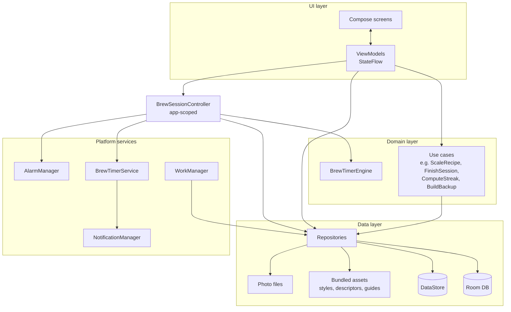

# 06 · Technical Architecture

> Status: **Draft v0.1** · Last updated: 2026-10-21

## 1. Platform & tooling

| Item | Decision |
|---|---|
| Language | Kotlin 2.x (K2 compiler), 100 % Kotlin, no Java sources |
| UI | Jetpack Compose + Material 3 (+ Material 3 Adaptive) — no XML layouts except manifest/resources |
| Min SDK | **26** (Android 8.0) — notification channels, adaptive icons, `java.time` without desugaring |
| Target / compile SDK | Latest stable API level that Google Play requires at release time (≥ 36) |
| Build | Gradle (Kotlin DSL), Android Gradle Plugin (latest stable), version catalog `gradle/libs.versions.toml`, convention plugins in `build-logic/` |
| JDK | 17 (or the version required by AGP) |
| Distribution | Android App Bundle (AAB) via Google Play; Play App Signing |
| Application ID | **TBD** (open question Q-01) — placeholder `com.umamitea.app`; must be final before the first Play upload |
| Source control | GitHub `katznmeik/UmamiTea`, trunk-based with short-lived feature branches |

All library versions are pinned in the version catalog at project start
(latest stable) and updated deliberately (Renovate/Dependabot PRs, CI must be
green).

## 2. Architecture overview

UmamiTea follows the **official Android app architecture** guidance:
unidirectional data flow (UDF), a UI layer of Compose screens + ViewModels, an
optional domain layer for reusable business logic, and a data layer of
repositories over Room/DataStore/assets/files.



### 2.1 UI layer rules

- One ViewModel per screen (or per navigation destination), Hilt-injected.
- ViewModels expose a single `StateFlow<XxxUiState>` (immutable data class,
  annotated `@Immutable` where needed) and accept user intents via functions
  (`onAction(XxxAction)` or named functions). One-off events (snackbars,
  navigation) are modelled as state, consumed and cleared.
- Screens are split into a stateful `XxxRoute` (collects state with
  `collectAsStateWithLifecycle`) and a stateless `XxxScreen(state, onAction)` used
  in previews and tests.
- No ViewModel or repository is passed down the composable tree.
- Navigation: **Navigation Compose with type-safe routes**
  (`@Serializable` route objects). Each feature module exposes a
  `NavGraphBuilder.xxxGraph()` extension and route types. (Navigation 3 may be
  adopted if stable and adopted widely at project start; decision D-007.)
- Strings, plurals and content descriptions only from resources.

### 2.2 Domain layer

- Pure Kotlin (no Android dependencies), in `:core:domain` and
  `:core:timer-engine`.
- Use cases exist only where logic is shared or non-trivial:
  `ScaleRecipeUseCase`, `ConvertUnitsUseCase`, `CoolingTransfersUseCase`,
  `StartSessionUseCase`, `FinishSessionUseCase` (status, inventory deduction,
  opened date), `DiscardSessionUseCase`, `ComputeFreshnessUseCase`,
  `ComputeStockStatusUseCase`, `ComputeStreakUseCase`,
  `BuildInsightsUseCase`, `BrewCoachUseCase`, `CreateBackupUseCase`,
  `RestoreBackupUseCase`, `ExportCsvUseCase`.

### 2.3 Data layer

- Repositories are interfaces in `:core:data` with Room/DataStore
  implementations; they expose `Flow` for observation and `suspend` functions
  for one-shot writes.
- Repositories own transactions spanning multiple tables (e.g. delete tea +
  photos files scheduling; finish session + inventory event).
- Bundled content repositories parse JSON assets once (lazy, on IO dispatcher)
  and cache in memory.

### 2.4 Concurrency

- Kotlin coroutines & Flow everywhere; dispatchers injected
  (`@IoDispatcher`, `@DefaultDispatcher`) for testability.
- App-scoped `CoroutineScope` (SupervisorJob) provided by Hilt for the
  `BrewSessionController` and long-lived work; no `GlobalScope`.
- Room queries: `suspend`/`Flow`; never on the main thread
  (`allowMainThreadQueries` forbidden).

## 3. Module structure

```
UmamiTea/
├── app/                         Application, MainActivity, NavHost, DI graph root, manifest
├── build-logic/convention/      Gradle convention plugins (android-app, android-library, compose, feature, hilt, room, jvm-library)
├── core/
│   ├── model/                   Pure Kotlin models & enums (Tea, BrewProfile, …)
│   ├── common/                  Result types, dispatchers, clocks (MonotonicClock, WallClock), utils
│   ├── domain/                  Use cases, unit conversion, brewing math (pure Kotlin)
│   ├── timer-engine/            BrewTimerEngine state machine (pure Kotlin)
│   ├── timer/                   BrewSessionController, BrewTimerService, AlertPlayer, receivers, notifications
│   ├── database/                Room DB, entities, DAOs, migrations, schemas/
│   ├── datastore/               UserSettings DataStore & serializer
│   ├── content/                 Bundled assets (styles.json, descriptors, guides) + loaders
│   ├── data/                    Repository interfaces & implementations, photo storage
│   ├── backup/                  Backup/restore/CSV (zip, JSON, validation)
│   ├── designsystem/            Theme (colors, type, shapes), fonts, core components, icons
│   ├── ui/                      Shared composables bound to models (TeaListItem, TasteRadar, …)
│   └── testing/                 Fakes, test rules, fixtures, test data builders
├── feature/
│   ├── onboarding/
│   ├── home/
│   ├── brew/                    Tea picker, brew setup, timer screen, session summary, quick timer
│   ├── collection/              Tea list/detail/editor, style picker, profile editor, stock history
│   ├── teaware/
│   ├── journal/                 Journal list, session detail/editor, descriptor picker
│   ├── insights/
│   ├── learn/                   Guides, style reference, tools
│   └── settings/                Settings, backup & restore screens, about
├── benchmark/                   Macrobenchmarks & Baseline Profile generator
└── docs/
```

Dependency rules (enforced by convention plugins and a Gradle module-graph
check in CI):
- `feature:*` → `core:*` only; features never depend on each other.
  Cross-feature navigation goes through route types declared in the feature's
  `api` package and wired in `:app`.
- `core:model`, `core:common`, `core:domain`, `core:timer-engine` are pure
  JVM/Kotlin modules (fast unit tests, no Robolectric).
- `core:designsystem` does not depend on `core:model`.

## 4. Key libraries

| Purpose | Library |
|---|---|
| UI | Compose BOM, `material3`, `material3-adaptive`, `material3-adaptive-navigation-suite`, `activity-compose`, `lifecycle-runtime-compose`, `lifecycle-viewmodel-compose` |
| Navigation | `navigation-compose` (type-safe), `hilt-navigation-compose` |
| DI | Hilt (KSP) |
| Database | Room (`room-runtime`, `room-ktx`, KSP compiler, `room-testing`) |
| Settings | DataStore (typed, kotlinx-serialization serializer) |
| Serialization | `kotlinx-serialization-json` |
| Background work | WorkManager (`work-runtime-ktx`, `hilt-work`) — reminders, orphan photo sweep |
| Images | Coil 3 (`coil-compose`) — local files only, no network fetcher module |
| Charts | Vico (Compose) for bar charts; custom Compose `Canvas` for radar and donut |
| Rich text guides | Markdown rendering via a Compose Markdown renderer (e.g. `multiplatform-markdown-renderer-m3`) or a small in-house renderer for the subset used (decision D-008) |
| Splash | `core-splashscreen` |
| Licences | AboutLibraries (Gradle plugin + Compose UI) |
| Startup | `profileinstaller` + Baseline Profiles |
| Debug only | LeakCanary, StrictMode |
| Testing | JUnit4, `kotlinx-coroutines-test`, Turbine, Truth (or kotlin.test), Robolectric, Compose UI test, Roborazzi (screenshot tests), Hilt testing, `work-testing`, Macrobenchmark, UI Automator |

**Dependency policy:** no library that adds the `INTERNET` permission, analytics,
crash reporting SDKs, or ads. Every new dependency needs a one-line
justification in its PR. A CI task fails if the merged manifest contains
`INTERNET` (GEN-01).

## 5. Key technical designs

### 5.1 Brew timer

See [04 · Brew Timer](04-brew-timer.md). Components live in `:core:timer-engine`
(pure state machine) and `:core:timer` (Android integration).

### 5.2 Photos

- Pick via `ActivityResultContracts.PickVisualMedia` (system photo picker,
  backported through Google Play services on older versions) — no storage
  permission.
- Capture via `ActivityResultContracts.TakePicture` into a `FileProvider` URI in
  `cacheDir/capture/` — the app does **not** declare `CAMERA`.
- Processing on `Dispatchers.Default`: decode with sampling, apply EXIF
  orientation, resize to max 2048 px on the long edge, re-encode JPEG quality 85,
  **drop all EXIF metadata** (incl. GPS), write to `filesDir/photos/<uuid>.jpg`,
  create the `photo` row; delete the temporary file.
- Thumbnails are produced on the fly by Coil with memory + disk cache
  (`cacheDir/coil`).

### 5.3 Search

- FTS4 tables (`tea_fts`, `session_fts`) maintained by Room
  (`@Fts4(contentEntity = …)`). Query string sanitised and turned into prefix
  tokens (`word*`).

### 5.4 Background work (WorkManager)

| Worker | Schedule | Constraints |
|---|---|---|
| `OrphanPhotoSweepWorker` | Daily; also one-off after restore | Device idle not required; battery not low |
| `ReminderDigestWorker` | Weekly if INV-07 on | Battery not low |
| `BackupReminderWorker` | Daily check if SET-20 ≠ OFF | — |

The timer does **not** use WorkManager (insufficient precision).

### 5.5 Edge-to-edge, insets, predictive back

- `enableEdgeToEdge()` in `MainActivity`; all screens handle system bar and
  display cutout insets via Material 3 scaffolds and `WindowInsets` APIs
  (mandatory when targeting Android 15+).
- Predictive back supported (`android:enableOnBackInvokedCallback="true"`), using
  Compose `PredictiveBackHandler`/`BackHandler` for editors' discard dialogs.

### 5.6 Localisation

- All strings in `strings.xml` with translator comments; plurals via
  `pluralStringResource`; numbers, dates and currency via `java.time` /
  `NumberFormat` with the current locale.
- `res/xml/locales_config.xml` for per-app language (Android 13+).
- RTL support: `start`/`end` everywhere; mirrored icons where directional.

### 5.7 Error handling & logging

- Expected failures (validation, I/O, corrupt backup) are returned as typed
  results (`sealed interface XxxError`) and shown as inline errors/snackbars.
- Unexpected exceptions crash (no swallowing); Play Console vitals collects
  crashes and ANRs without an SDK.
- Logging via a thin `Logger` wrapper over `android.util.Log`; debug builds log
  verbosely, release builds log warnings and errors only, never user content.

### 5.8 App startup

- No content providers from libraries running work at startup except
  `androidx.startup` initializers required by WorkManager/profileinstaller
  (WorkManager uses on-demand initialization via `Configuration.Provider`).
- `Application.onCreate`: Hilt, notification channels, timer recovery (§7 of
  [04](04-brew-timer.md)) on a background dispatcher.
- Baseline Profile covers: cold start → Home, Home → Brew setup → Timer,
  Collection scroll, Journal scroll.

## 6. Build configuration

| Variant | Details |
|---|---|
| `debug` | `applicationIdSuffix ".debug"`, app name "UmamiTea Debug", debuggable, StrictMode (penalty log), LeakCanary |
| `release` | R8 full mode, `isMinifyEnabled = true`, `isShrinkResources = true`, signed with upload key (CI secrets), crunch PNGs |
| `benchmark` | Release-like, debuggable false, signed with debug key, used by `:benchmark` |

- Versioning: `versionName` = SemVer `MAJOR.MINOR.PATCH`;
  `versionCode = MAJOR*10000 + MINOR*100 + PATCH` (e.g. 1.0.0 → 10000).
- Native libraries (if any via dependencies) must support 16 KB page sizes.
- Resource configuration limited to shipped languages (`androidResources.localeFilters`).
- Reproducible builds: no timestamps in BuildConfig.

## 7. Quality gates

### 7.1 Static analysis

- **Spotless + ktlint** (official Kotlin style) — formatting.
- **Detekt** with a project config; no baseline at project start (zero issues).
- **Android Lint** — `warningsAsErrors` for: `HardcodedText`, `MissingTranslation`
  (for shipped locales), `UnusedResources`, `ContentDescription`,
  `ObsoleteSdkInt`, accessibility checks; lint baseline forbidden.
- **Compose rules** (ktlint/detekt Compose ruleset).
- **Dependency analysis** plugin to catch unused/misdeclared dependencies.

### 7.2 Testing strategy

| Layer | What | Tooling | Target |
|---|---|---|---|
| Unit (pure JVM) | Engine, use cases, unit conversion, scaling, streaks, freshness, backup validation, CSV | JUnit, Truth, Turbine, coroutines-test | ≥ 90 % line coverage for `core:domain`, `core:timer-engine`, `core:backup` |
| Unit (Robolectric) | DAOs, repositories, migrations, DataStore, notifications | Robolectric, room-testing | All DAO queries; every migration |
| ViewModel | UiState for each action, error handling | Fakes from `core:testing` | Every ViewModel |
| UI (Compose) | Screen behaviour with fake state, semantics, a11y | Compose UI test (Robolectric where possible) | All screens' main flows |
| Screenshot | Each screen state in light/dark, font scale 1.0 & 2.0, compact & expanded | Roborazzi | All screens; diffs reviewed in PR |
| Instrumented E2E | Critical journeys on emulator: onboarding → add tea → brew → finish → journal; backup → restore | UI Automator / Compose test on device | Run nightly + before release |
| Performance | Startup, scroll jank, timer accuracy | Macrobenchmark | Budgets in [07](07-non-functional.md) |
| Manual | Device matrix, OEM battery behaviour, TalkBack, Doze | Checklist | Every release candidate |

Fakes over mocks: `core:testing` provides in-memory repositories, fake clocks
(`TestMonotonicClock`), and data builders (`aTea { name = "…" }`).

### 7.3 Continuous integration (GitHub Actions)

| Workflow | Trigger | Jobs |
|---|---|---|
| `ci.yml` | PR, push to `main` | `spotlessCheck`, `detekt`, `lint`, unit tests (`testDebugUnitTest`), `verifyRoborazziDebug`, `assembleDebug`, manifest permission check, module-graph check; cache Gradle |
| `instrumented.yml` | Nightly, manual | Emulator (API 26, 30, latest) E2E tests via Gradle Managed Devices |
| `release.yml` | Tag `v*` | Build signed AAB + R8 mapping, upload as artifact; optionally upload to Play internal track (Gradle Play Publisher) |

Branch protection on `main`: CI green + 1 review (or self-review checklist for
solo development).

### 7.4 Definition of Done (per feature)

- Requirements' acceptance criteria met and covered by tests.
- Light/dark, compact/expanded, 200 % font, TalkBack checked; screenshot tests
  added.
- No new lint/detekt warnings; strings externalised.
- Room schema exported and migration added if schema changed.
- Docs updated if behaviour diverges from these specs (specs are living
  documents).

## 8. Repository conventions

- Conventional Commits (`feat:`, `fix:`, `docs:`, `refactor:`, `test:`, `build:`).
- Branch naming: `feature/<short-name>`, `fix/<short-name>`.
- PR template: summary, linked requirement IDs (e.g. `TMR-06`), screenshots,
  test notes.
- `CHANGELOG.md` maintained per release (Keep a Changelog format).
- Licence of the repository: TBD (Q-11).
