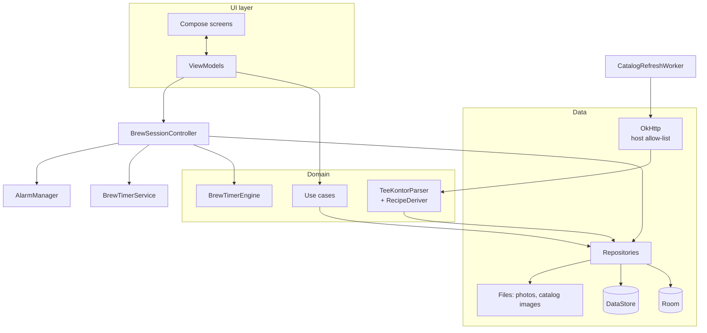

# 06 · Technical Architecture

> Status: **Draft v0.2** · Last updated: 2026-10-21
> v0.2: personal sideloaded app, min SDK 35, catalog scraping (OkHttp +
> Jsoup), GitHub Releases distribution, Claude as developer.

## 1. Platform & tooling

| Item | Decision |
|---|---|
| Language | Kotlin 2.x, 100 % Kotlin |
| UI | Jetpack Compose + Material 3 (+ Adaptive) |
| Min SDK | **35** (Android 15) — PO's phone runs Android 16 |
| Target / compile SDK | **36** (Android 16) or newer stable |
| Build | Gradle Kotlin DSL, version catalog, convention plugins in `build-logic/` |
| Distribution | **Signed APK on GitHub Releases** (no Play Store, no AAB needed) |
| Application ID | `com.umamit.app` (D-027); must stay constant so updates install over the previous version |
| Repository | `katznmeik/UmamiTea`; one PR per milestone into `main` |
| Developer | Claude (cloud sessions), delegating to subagents per [12 · Subagent Distribution Plan](12-agent-plan.md); PO reviews PRs and tests APKs on the phone |

Library versions are pinned in `gradle/libs.versions.toml` (latest stable at
project start).

## 2. Architecture overview

Official Android architecture: UDF, Compose UI + ViewModels, domain layer for
shared logic, repositories over Room / DataStore / network / files.



### 2.1 UI layer

- One ViewModel per destination exposing `StateFlow<UiState>`; stateless
  `XxxScreen(state, onAction)` + stateful `XxxRoute`.
- Navigation Compose with type-safe routes (D-007).
- All strings in `res/values/strings.xml` (German); no English resource set
  is needed, but strings are never hard-coded.

### 2.2 Domain layer (pure Kotlin)

Use cases: `ScaleRecipe`, `Snap5`, `StartSession`, `FinishSession`
(status, stock deduction, cost, opened date, recipe-update applicability),
`DiscardSession`, `ComputePreAlert`, `ComputeFreshness`, `ComputeStock`,
`ComputeCostPerGram`, `ComputeStreak`, `BuildStatistics`,
`AddFromCatalog`, `ResetFromCatalog`, `CreateBackup`, `RestoreBackup`.

Catalog: `TeeKontorParser` (HTML → `ParsedProduct`), `VariantMerger`,
`StyleMapper`, `RecipeDeriver` (rules in [08 §2.5](08-content.md#25-recipe-derivation)),
`CatalogDiff`. All pure and unit-testable with HTML fixtures.

### 2.3 Concurrency

Coroutines/Flow; injected dispatchers; app-scoped scope for the timer
controller; no main-thread database access.

## 3. Modules

```
UmamiT/
├── app/                       Application, MainActivity, NavHost, DI root, manifest
├── build-logic/convention/
├── core/
│   ├── model/                 Pure Kotlin models & enums
│   ├── common/                Clocks, dispatchers, result types, Snap5
│   ├── domain/                Use cases
│   ├── timer-engine/          BrewTimerEngine (pure)
│   ├── timer/                 Controller, service, AlertPlayer, alarms, receivers, Live Update
│   ├── catalog-parser/        TeeKontorParser, VariantMerger, StyleMapper, RecipeDeriver (pure JVM)
│   ├── network/               OkHttp client with host allow-list, rate limiter, robots.txt
│   ├── database/              Room, DAOs, migrations, schemas/
│   ├── datastore/             Settings
│   ├── content/               Bundled styles, descriptors, sounds, illustrations
│   ├── data/                  Repositories, photo storage, CatalogRefreshWorker
│   ├── backup/                Export/restore
│   ├── designsystem/          Theme, fonts, components, icons
│   ├── ui/                    Shared composables
│   └── testing/               Fakes, fixtures, builders
├── feature/
│   ├── onboarding/            Einrichtung
│   ├── home/
│   ├── brew/                  Tea picker, setup, timer, saved sheet, quick timer
│   ├── collection/            Meine Tees, tea detail/editor, recipes, stock
│   ├── catalog/               Katalog list/detail, add sheet, refresh sheet, guides
│   ├── journal/
│   ├── stats/
│   ├── teaware/
│   └── settings/              Settings, reliability, backup, about
└── docs/
```

Rules: features depend only on `core:*`; pure modules (`model`, `common`,
`domain`, `timer-engine`, `catalog-parser`) have no Android dependency.

## 4. Key libraries

| Purpose | Library |
|---|---|
| UI | Compose BOM, Material 3, Material 3 Adaptive, Activity/Lifecycle Compose |
| Navigation | Navigation Compose (type-safe) |
| DI | Hilt (KSP) |
| Database | Room (KSP) |
| Settings | DataStore (kotlinx-serialization) |
| Serialization | kotlinx-serialization-json |
| HTTP | OkHttp (no Retrofit needed) |
| HTML parsing | Jsoup |
| Background work | WorkManager (catalog refresh as long-running worker in a `dataSync` foreground service; reminders) |
| Images | Coil 3 (local files only) |
| Charts | Vico for bar charts; custom Canvas for radar and donut |
| Markdown (guides) | Compose Markdown renderer or minimal in-house renderer (D-008) |
| Licences | AboutLibraries |
| Testing | JUnit4, Turbine, Truth, coroutines-test, Robolectric, Compose UI test, Roborazzi, MockWebServer |
| Debug | LeakCanary, StrictMode |

No analytics, ads or crash-reporting SDKs. Only the catalog refresh uses the
network (GEN-01); an OkHttp interceptor rejects any host other than
`www.tee-kontor-kiel.de` (and its image CDN host if it differs, configured
after inspection).

## 5. Key technical designs

### 5.1 Brew timer — see [04](04-brew-timer.md).

### 5.2 Photos

Photo picker (`PickVisualMedia`) and camera (`TakePicture` into a
`FileProvider` URI; no `CAMERA` permission); decode with sampling, rotate per
EXIF, resize to 2048 px, JPEG 85, strip EXIF; store in `filesDir/photos/`.
Catalog photos: downloaded to `filesDir/catalog/`, resized to 1600 px WebP,
re-downloaded only if URL/ETag changed.

### 5.3 Catalog refresh

1. `CatalogRefreshWorker`: user-initiated long-running WorkManager worker
   using `setForeground()` with foreground service type `dataSync`
   (permission `FOREGROUND_SERVICE_DATA_SYNC`; WorkManager's
   `SystemForegroundService` declared with `foregroundServiceType="dataSync"`
   via manifest merge); progress notification on the `catalog` channel;
   cancellable.
2. Fetch `robots.txt` and the sitemap; derive base article numbers from
   product URLs, skip known out-of-scope numbers (`catalog_skip`) per
   [08 §2.4](08-content.md#24-discovery-variants-and-request-budget).
3. Fetch each candidate parent page (≤ 2 req/s, retry ≤ 3 with backoff,
   20 s timeout); classify by breadcrumb; parse with `TeeKontorParser`
   (selectors versioned as `parserVersion`); stop on Cloudflare challenge.
4. Merge variants, map styles, derive recipes, compute content hashes.
5. Download changed photos (if SET-22).
6. Fetch and convert *Tee-Info* guides (CAT-09) into staging.
7. Sanity check (CAT-07 AC5); atomic swap of the staging tables
   ([05 §4.5](05-data-model.md#45-refresh-transaction)); log.

All requests (pages and images) share the 2 req/s limit. Expected
duration: first refresh (~700 classification pages + ~280 photos + guides)
≈ 9–10 min; later refreshes (~280 pages, changed photos only) ≈ 3–4 min.
Exact variant prices are fetched on demand when adding a package (CAT-12).

### 5.4 Background work

| Work | Trigger |
|---|---|
| `CatalogRefreshWorker` | User action only |
| `OrphanFileSweepWorker` | Daily, idle |
| `ReminderWorker` | Daily check (backup, stock digest) |

### 5.5 Edge-to-edge, predictive back, insets — required (target SDK 36).

### 5.7 Manifest permissions (complete list)

| Permission | Purpose |
|---|---|
| `INTERNET` | Catalog refresh only (GEN-01) |
| `POST_NOTIFICATIONS`, `POST_PROMOTED_NOTIFICATIONS` | Timer, Live Update, catalog progress |
| `FOREGROUND_SERVICE`, `FOREGROUND_SERVICE_SPECIAL_USE` | Timer service |
| `FOREGROUND_SERVICE_DATA_SYNC` | Catalog refresh worker |
| `WAKE_LOCK`, `VIBRATE` | Timer |
| `USE_EXACT_ALARM`, `RECEIVE_BOOT_COMPLETED` | Timer alarms and reboot recovery |
| `REQUEST_IGNORE_BATTERY_OPTIMIZATIONS` | Reliability setup |

No storage, camera, location or contacts permissions.

### 5.6 Error handling & logging

Typed errors for validation, I/O, network and parsing; release builds keep a
small local rolling log (≤ 200 KB) of timer and catalog events, viewable and
copyable in Einstellungen › Über › *Diagnose*, so the PO can paste it into an
issue when something goes wrong.

## 6. Build & distribution

| Variant | Details |
|---|---|
| `debug` | `.debug` suffix, installable side-by-side, StrictMode, LeakCanary |
| `release` | R8 + resource shrinking, signed with the release key |

- **Signing:** see §6.1. Losing the key means updates can no longer be
  installed over the existing app.
- **Versioning:** SemVer `versionName`; `versionCode = MAJOR*10000 +
  MINOR*100 + PATCH`.
- **Release workflow** (`release.yml`, on tag `v*`): build, test, sign APK,
  create a GitHub Release with the APK and release notes.
- **Installing:** the PO downloads the APK from the release page on the
  phone and allows *Unbekannte Apps installieren* for the browser once.
  Updates install over the existing app (same key, higher versionCode).

### 6.1 Signing process (D-035)

Claude does everything except the two steps only the PO can do: storing the
backup and pasting the secrets into GitHub. Claude has no access to
repository secrets.

| # | Step | Who |
|---|---|---|
| 1 | Generate the release keystore with `keytool`: PKCS12, RSA 4096, alias `umamit`, validity 10 000 days (~27 years), DN `CN=UmamiT, O=Personal, C=DE`. Use one random 32-character password (PKCS12 uses the same password for store and key). The keystore is created in the session scratchpad and **never committed**. | Claude |
| 2 | Write a backup file `umamit-signing.txt` with the password, the alias, the SHA-256 certificate fingerprint and the base64-encoded keystore. Send it together with `umamit-release.p12` to the PO as session files. The password is never printed in chat or committed. | Claude |
| 3 | Save both files in a safe place (password manager or private cloud folder). | **PO** |
| 4 | Add **two** repository secrets (GitHub › Settings › Secrets and variables › Actions › *New repository secret*): `UMAMIT_KEYSTORE_B64` and `UMAMIT_KEYSTORE_PASSWORD`, copying the values from `umamit-signing.txt`. Takes about 2 minutes. | **PO** |
| 5 | Delete the scratchpad copies once the PO confirms the backup. | Claude |
| 6 | `release.yml` decodes the keystore into the runner's temp directory and signs with alias `umamit`. It then **checks the APK's certificate fingerprint** against the expected SHA-256 stored in the repository (`signing/release-cert-sha256.txt`, a public value) and fails the release if they differ. | Claude |
| 7 | Test the setup with a test tag (`v0.0.1-test`), then delete that release. | Claude |

The public certificate fingerprint is also listed in the README. If ever in
doubt, the PO can compare it with *Einstellungen › Apps › UmamiT*. Debug
builds use the per-machine debug key and are never installed on the PO's
phone.

## 7. Quality gates

- Spotless/ktlint, Detekt, Android Lint (no baseline), Compose rules.
- Tests:
  - **Pure unit:** timer engine, recipe derivation, variant merge, style
    mapping, stock/cost, streaks, backup validation (≥ 90 % line coverage in
    these modules).
  - **Parser:** tests on synthetic HTML fixtures that mirror the shop's page
    structure without its content (D-016), plus an on-demand live check
    against the real site from a cloud session.
  - **Robolectric:** DAOs, migrations, notifications, alarms.
  - **Compose UI and Roborazzi** screenshot tests for key screens (light/dark,
    200 % font).
  - **Instrumented:** E2E on an emulator (API 35/36).
- CI (`ci.yml`) on every PR: format (Spotless), Detekt, Android Lint, unit tests, screenshot
  verification, assemble debug APK (artifact attached for quick testing).
- **Acceptance on the PO's Galaxy** per milestone (checklists in [09](09-release-plan.md)).

## 8. Repository conventions

- One PR per milestone into `main`, CI green, PO merges.
- Conventional Commits; `CHANGELOG.md`; tags `vX.Y.Z` produce releases.
- PR description lists the requirement IDs implemented and an on-device test
  checklist.
